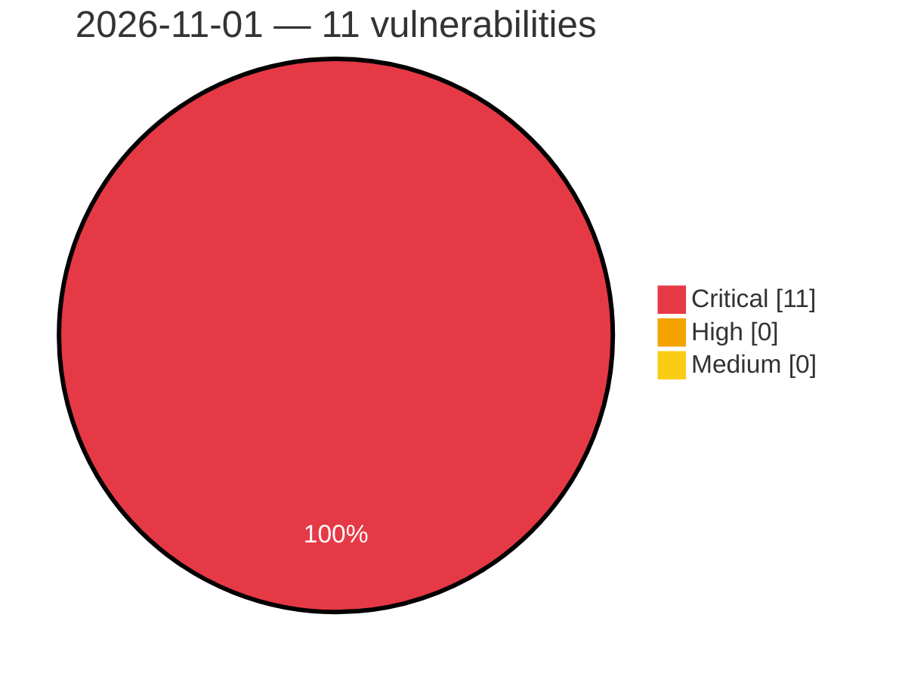

# Critical, High & Medium Severity Vulnerabilities — 2026-11-01

**Source status for this day:**

| Source | Critical | High | Medium | Total |
|--------|---------:|-----:|-------:|------:|
| cvefeed.io (High/Critical) | 11 | 0 | 0 | 11 |

**KEV (actively exploited):** 0  **Watchlist matches:** 10

## Critical (11)

| CVSS | Flags | Source | CVE / Title | Reported |
|------|-------|--------|-------------|----------|
| 10.0 | ⭐ | cvefeed.io (High/Critical) | [CVE-2026-120198 - WAVLINK WL-WN530BE1-A protocol.csp con_check_read_finish command injection](https://cvefeed.io/vuln/detail/CVE-2026-120198) | 1 hour, 51 minutes ago |
| 10.0 | ⭐ | cvefeed.io (High/Critical) | [CVE-2026-120195 - WAVLINK WL-WN579A3-A Initial Setup Wizard adm.cgi set_wzdgwMesh os command injection](https://cvefeed.io/vuln/detail/CVE-2026-120195) | 2 hours, 51 minutes ago |
| 10.0 | — | cvefeed.io (High/Critical) | [CVE-2026-120189 - D-Link DIR-505 TFTP Upload Filename tftpd mp_upload_file stack-based overflow](https://cvefeed.io/vuln/detail/CVE-2026-120189) | 5 hours, 53 minutes ago |
| 9.9 | ⭐ | cvefeed.io (High/Critical) | [CVE-2026-120197 - WAVLINK WL-WN530HG4B wapi.cgi port_forward os command injection](https://cvefeed.io/vuln/detail/CVE-2026-120197) | 2 hours, 51 minutes ago |
| 9.9 | ⭐ | cvefeed.io (High/Critical) | [CVE-2026-120196 - WAVLINK WN579X3-D wapi.cgi port_forward os command injection](https://cvefeed.io/vuln/detail/CVE-2026-120196) | 2 hours, 51 minutes ago |
| 9.9 | ⭐ | cvefeed.io (High/Critical) | [CVE-2026-120308 - Beta9 host filesystem exposure via volume path traversal](https://cvefeed.io/vuln/detail/CVE-2026-120308) | 1 hour, 2 minutes ago |
| 9.9 | ⭐ | cvefeed.io (High/Critical) | [CVE-2026-120307 - Beta9 container escape via unvalidated sandbox file paths](https://cvefeed.io/vuln/detail/CVE-2026-120307) | 1 hour, 2 minutes ago |
| 9.9 | ⭐ | cvefeed.io (High/Critical) | [CVE-2026-120306 - Beta9 build sandbox escape via chroot-only isolation](https://cvefeed.io/vuln/detail/CVE-2026-120306) | 1 hour, 2 minutes ago |
| 9.9 | ⭐ | cvefeed.io (High/Critical) | [CVE-2026-120227 - WAVLINK WN701AE ioos Web Backend static_route_setting.sh del_staticrule os command injection](https://cvefeed.io/vuln/detail/CVE-2026-120227) | 1 hour, 2 minutes ago |
| 9.9 | ⭐ | cvefeed.io (High/Critical) | [CVE-2026-120224 - Oray Pugongying X5 Pro API Authorization run_async_task improper authorization](https://cvefeed.io/vuln/detail/CVE-2026-120224) | 3 hours, 1 minute ago |
| 9.1 | ⭐ | cvefeed.io (High/Critical) | [CVE-2026-120225 - Oray Pugongying X5 Pro openwrt_release config_restore_ex path traversal](https://cvefeed.io/vuln/detail/CVE-2026-120225) | 3 hours, 1 minute ago |
