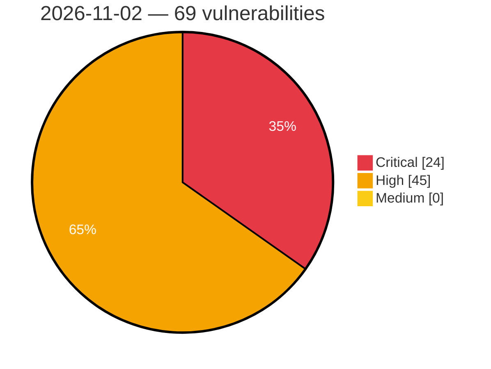

# Critical, High & Medium Severity Vulnerabilities — 2026-11-02

**Source status for this day:**

| Source | Critical | High | Medium | Total |
|--------|---------:|-----:|-------:|------:|
| cvefeed.io (High/Critical) | 24 | 45 | 0 | 69 |

**KEV (actively exploited):** 0  **Watchlist matches:** 51

## Critical (24)

| CVSS | Flags | Source | CVE / Title | Reported |
|------|-------|--------|-------------|----------|
| 10.0 | ⭐ | cvefeed.io (High/Critical) | [CVE-2026-120277 - WAVLINK WN536AX6-A WireGuard CLI Group ioos sub_41a1d8 os command injection](https://cvefeed.io/vuln/detail/CVE-2026-120277) | 48 minutes ago |
| 10.0 | ⭐ | cvefeed.io (High/Critical) | [CVE-2026-120276 - WAVLINK WN536AX6-A Web Management ioos sub_416760 os command injection](https://cvefeed.io/vuln/detail/CVE-2026-120276) | 48 minutes ago |
| 10.0 | ⭐ | cvefeed.io (High/Critical) | [CVE-2026-120345 - WAVLINK WN551X3-A DNS Resolution ioos sub_41a430 os command injection](https://cvefeed.io/vuln/detail/CVE-2026-120345) | 2 hours, 43 minutes ago |
| 10.0 | ⭐ | cvefeed.io (High/Critical) | [CVE-2026-120344 - WAVLINK WN551X3-A WireGuard CLI Group ioos system os command injection](https://cvefeed.io/vuln/detail/CVE-2026-120344) | 3 hours, 43 minutes ago |
| 10.0 | — | cvefeed.io (High/Critical) | [CVE-2026-120283 - Linksys E8450 portal.cgi strcpy stack-based overflow](https://cvefeed.io/vuln/detail/CVE-2026-120283) | 7 hours, 44 minutes ago |
| 10.0 | — | cvefeed.io (High/Critical) | [CVE-2026-120281 - WAVLINK WN536AX6-A OpenVPN protocol.csp strcpy stack-based overflow](https://cvefeed.io/vuln/detail/CVE-2026-120281) | 7 hours, 44 minutes ago |
| 10.0 | ⭐ | cvefeed.io (High/Critical) | [CVE-2026-120280 - WAVLINK WN536AX6-A WireGuard protocol.csp wireguard_cli_group handler os command injection](https://cvefeed.io/vuln/detail/CVE-2026-120280) | 7 hours, 44 minutes ago |
| 10.0 | ⭐ | cvefeed.io (High/Critical) | [CVE-2026-120279 - WAVLINK WN536AX6-A openvpn_cli protocol.csp os command injection](https://cvefeed.io/vuln/detail/CVE-2026-120279) | 7 hours, 44 minutes ago |
| 9.9 | ⭐ | cvefeed.io (High/Critical) | [CVE-2026-120322 - Termix-SSH Termix transferToHost path traversal](https://cvefeed.io/vuln/detail/CVE-2026-120322) | 6 hours, 42 minutes ago |
| 9.9 | ⭐ | cvefeed.io (High/Critical) | [CVE-2026-120282 - WAVLINK WN536AX6-A protocol.csp host_black os command injection](https://cvefeed.io/vuln/detail/CVE-2026-120282) | 7 hours, 44 minutes ago |
| 9.8 | ⭐ | cvefeed.io (High/Critical) | [CVE-2026-77876 - Control Web Panel (CWP) < 1.16 OS Command Injection via protected_directory](https://cvefeed.io/vuln/detail/CVE-2026-77876) | 2 hours, 53 minutes ago |
| 9.8 | ⭐ | cvefeed.io (High/Critical) | [CVE-2026-73697 - Control Web Panel (CWP) < 1.16 File Write and Command Injection via phpini_editor](https://cvefeed.io/vuln/detail/CVE-2026-73697) | 3 hours, 53 minutes ago |
| 9.8 | — | cvefeed.io (High/Critical) | [CVE-2026-73696 - Control Web Panel (CWP) < 1.12 Execution After Redirect in CWPUserIndex](https://cvefeed.io/vuln/detail/CVE-2026-73696) | 3 hours, 53 minutes ago |
| 9.8 | ⭐ | cvefeed.io (High/Critical) | [CVE-2026-73695 - Control Web Panel (CWP) < 1.16 Path Traversal via services/users/index.php](https://cvefeed.io/vuln/detail/CVE-2026-73695) | 3 hours, 53 minutes ago |
| 9.8 | ⭐ | cvefeed.io (High/Critical) | [CVE-2026-86596 - s2Member <= 260927 - Unauthenticated Remote Code Execution via 'item_name' IPN Parameter](https://cvefeed.io/vuln/detail/CVE-2026-86596) | 2 hours, 47 minutes ago |
| 9.4 | ⭐ | cvefeed.io (High/Critical) | [CVE-2025-11969 - Broken Access Control via System REST APIs in Multiple WSO2 Products Allows Unauthorized Administrative Actions](https://cvefeed.io/vuln/detail/CVE-2025-11969) | 2 hours, 43 minutes ago |
| 9.4 | ⭐ | cvefeed.io (High/Critical) | [CVE-2026-105603 - Joomla Extension - dj-extensions.com - Authenticated arbitrary file upload in DJ-Classifieds < 3.11.3](https://cvefeed.io/vuln/detail/CVE-2026-105603) | 45 minutes ago |
| 9.4 | ⭐ | cvefeed.io (High/Critical) | [CVE-2026-119085 - Template injection in the publishing component of awslabs Virtual Engineering Workbench](https://cvefeed.io/vuln/detail/CVE-2026-119085) | 52 minutes ago |
| 9.4 | ⭐ | cvefeed.io (High/Critical) | [CVE-2026-97718 - CSRF in Secure Access Server v14.60](https://cvefeed.io/vuln/detail/CVE-2026-97718) | 4 hours, 46 minutes ago |
| 9.3 | ⭐ | cvefeed.io (High/Critical) | [CVE-2026-105604 - Joomla Extension - dj-extensions.com - Unauthenticated SQL injection in DJ-Classifieds < 3.11.3](https://cvefeed.io/vuln/detail/CVE-2026-105604) | 43 minutes ago |
| 9.3 | ⭐ | cvefeed.io (High/Critical) | [CVE-2026-105769 - kaniko can send the build's Azure (Entra ID) access token to lookalike ACR registry hosts](https://cvefeed.io/vuln/detail/CVE-2026-105769) | 1 hour, 53 minutes ago |
| 9.1 | ⭐ | cvefeed.io (High/Critical) | [CVE-2026-88811 - Rancher credentials disclosed to third-party hosts by the Rancher Manager meta proxy](https://cvefeed.io/vuln/detail/CVE-2026-88811) | 1 hour, 53 minutes ago |
| 9.1 | ⭐ | cvefeed.io (High/Critical) | [CVE-2026-94290 - Privilege escalation to cluster-admin on the Rancher local cluster through Fleet's agent management controller](https://cvefeed.io/vuln/detail/CVE-2026-94290) | 2 hours, 53 minutes ago |
| 9.1 | ⭐ | cvefeed.io (High/Critical) | [CVE-2026-120459 - python-jose through 3.5.0 Authentication Bypass via Empty HMAC Key](https://cvefeed.io/vuln/detail/CVE-2026-120459) | 3 hours, 53 minutes ago |

## High (45)

| CVSS | Flags | Source | CVE / Title | Reported |
|------|-------|--------|-------------|----------|
| 8.8 | ⭐ | cvefeed.io (High/Critical) | [CVE-2026-18199 - Remote Code Execution Vulnerability](https://cvefeed.io/vuln/detail/CVE-2026-18199) | 43 minutes ago |
| 8.8 | ⭐ | cvefeed.io (High/Critical) | [CVE-2026-120315 - LobeHub Chat 1.84.26 before 2.1.49 Path Traversal RCE via writeTempFile](https://cvefeed.io/vuln/detail/CVE-2026-120315) | 5 hours, 44 minutes ago |
| 8.8 | ⭐ | cvefeed.io (High/Critical) | [CVE-2026-120312 - Network-AI 5.13.4 before 5.15.5 Path Traversal via AgentVCR Cassette Name](https://cvefeed.io/vuln/detail/CVE-2026-120312) | 5 hours, 44 minutes ago |
| 8.8 | ⭐ | cvefeed.io (High/Critical) | [CVE-2026-120311 - Network-AI 5.13.4 before 5.15.5 Path Traversal via FileJobStore Job ID](https://cvefeed.io/vuln/detail/CVE-2026-120311) | 5 hours, 44 minutes ago |
| 8.8 | — | cvefeed.io (High/Critical) | [CVE-2026-120461 - Jpom through 2.11.12 Cross-Workspace Authorization Bypass via /node/ssh_command/batch](https://cvefeed.io/vuln/detail/CVE-2026-120461) | 3 hours, 53 minutes ago |
| 8.8 | ⭐ | cvefeed.io (High/Critical) | [CVE-2026-120460 - Jpom through 2.11.12 Cross-Workspace Authorization Bypass via Docker Controllers](https://cvefeed.io/vuln/detail/CVE-2026-120460) | 3 hours, 53 minutes ago |
| 8.8 | ⭐ | cvefeed.io (High/Critical) | [CVE-2026-29508 - ReadyMedia 1.3.0 - 1.3.3 Stack Buffer Overflow via DFF Parser](https://cvefeed.io/vuln/detail/CVE-2026-29508) | 3 hours, 47 minutes ago |
| 8.8 | ⭐ | cvefeed.io (High/Critical) | [CVE-2026-105476 - cPanel Arbitrary File Write Privilege Escalation](https://cvefeed.io/vuln/detail/CVE-2026-105476) | 3 hours, 47 minutes ago |
| 8.7 | ⭐ | cvefeed.io (High/Critical) | [CVE-2026-120313 - Network-AI before 5.15.5 Path Traversal via InputSanitizer.sanitizePath](https://cvefeed.io/vuln/detail/CVE-2026-120313) | 5 hours, 44 minutes ago |
| 8.7 | ⭐ | cvefeed.io (High/Critical) | [CVE-2026-119731 - Munshi Payment Bypass via Unauthenticated Webhook Endpoint](https://cvefeed.io/vuln/detail/CVE-2026-119731) | 16 minutes ago |
| 8.7 | — | cvefeed.io (High/Critical) | [CVE-2026-114408 - NULL pointer dereference in ICMPv6 Packet Too Big processing when the destination table is full](https://cvefeed.io/vuln/detail/CVE-2026-114408) | 2 hours, 53 minutes ago |
| 8.7 | ⭐ | cvefeed.io (High/Critical) | [CVE-2026-71450 - Johnson Controls EasyIO Neo EC and CW Edge Controller Authentication Bypass](https://cvefeed.io/vuln/detail/CVE-2026-71450) | 1 hour, 47 minutes ago |
| 8.7 | ⭐ | cvefeed.io (High/Critical) | [CVE-2026-120091 - Temporal Server Kubernetes compute provider builds a client from caller-supplied configuration and runs a caller-chosen command on the Worker Service host](https://cvefeed.io/vuln/detail/CVE-2026-120091) | 2 hours, 47 minutes ago |
| 8.7 | ⭐ | cvefeed.io (High/Critical) | [CVE-2026-115215 - NetX Secure DTLS server allocates a session for each new source before the cookie exchange and never reclaims it, so spoofed datagrams exhaust the session pool](https://cvefeed.io/vuln/detail/CVE-2026-115215) | 2 hours, 47 minutes ago |
| 8.7 | — | cvefeed.io (High/Critical) | [CVE-2026-105475 - cPanel NUL Byte Injection Information Disclosure](https://cvefeed.io/vuln/detail/CVE-2026-105475) | 3 hours, 47 minutes ago |
| 8.6 | ⭐ | cvefeed.io (High/Critical) | [CVE-2026-77880 - Control Web Panel (CWP) < 1.16 OS Command Injection via /newpass/](https://cvefeed.io/vuln/detail/CVE-2026-77880) | 2 hours, 53 minutes ago |
| 8.6 | ⭐ | cvefeed.io (High/Critical) | [CVE-2026-77878 - Control Web Panel (CWP) < 1.30 OS Command Injection via restoredatabase API](https://cvefeed.io/vuln/detail/CVE-2026-77878) | 2 hours, 53 minutes ago |
| 8.6 | ⭐ | cvefeed.io (High/Critical) | [CVE-2026-77877 - Control Web Panel (CWP) < 1.30 Unauthenticated Loopback API Root Access](https://cvefeed.io/vuln/detail/CVE-2026-77877) | 2 hours, 53 minutes ago |
| 8.6 | ⭐ | cvefeed.io (High/Critical) | [CVE-2026-104080 - Control Web Panel (CWP) < 1.30 OS Command Injection via valid_token](https://cvefeed.io/vuln/detail/CVE-2026-104080) | 2 hours, 53 minutes ago |
| 8.6 | — | cvefeed.io (High/Critical) | [CVE-2026-120487 - LaraDashboard before 1.4.5 Incorrect Authorization via SettingPolicy Core Upgrades](https://cvefeed.io/vuln/detail/CVE-2026-120487) | 3 hours, 53 minutes ago |
| 8.5 | ⭐ | cvefeed.io (High/Critical) | [CVE-2026-77879 - Control Web Panel (CWP) < 1.16 SQL Injection via access_token() API](https://cvefeed.io/vuln/detail/CVE-2026-77879) | 2 hours, 53 minutes ago |
| 8.4 | ⭐ | cvefeed.io (High/Critical) | [CVE-2026-111048 - FOSSBilling: Low-privileged staff can run JavaScript in administrators' browsers via stored XSS in support ticket notes](https://cvefeed.io/vuln/detail/CVE-2026-111048) | 52 minutes ago |
| 8.4 | — | cvefeed.io (High/Critical) | [CVE-2026-109142 - Krill treats a "local parent" as already-authenticated, letting a CA operator act as any child of any CA on the same server](https://cvefeed.io/vuln/detail/CVE-2026-109142) | 2 hours, 53 minutes ago |
| 8.4 | ⭐ | cvefeed.io (High/Critical) | [CVE-2026-109141 - Krill users restricted to one CA can make any other CA delegate its prefixes and publish ROAs for them via bulk import](https://cvefeed.io/vuln/detail/CVE-2026-109141) | 2 hours, 53 minutes ago |
| 8.4 | — | cvefeed.io (High/Critical) | [CVE-2026-109140 - Krill login-session tokens reuse their encryption nonce across restarts, so any user who can log in can forge an "admin" token](https://cvefeed.io/vuln/detail/CVE-2026-109140) | 2 hours, 53 minutes ago |
| 8.4 | — | cvefeed.io (High/Critical) | [CVE-2026-58873 - WindowManagerService Permission Bypass and Local Escalation of Privilege](https://cvefeed.io/vuln/detail/CVE-2026-58873) | 3 hours, 47 minutes ago |
| 8.4 | ⭐ | cvefeed.io (High/Critical) | [CVE-2026-59044 - Linux Kernel Use-After-Free Local Privilege Escalation](https://cvefeed.io/vuln/detail/CVE-2026-59044) | 4 hours, 47 minutes ago |
| 8.4 | ⭐ | cvefeed.io (High/Critical) | [CVE-2026-59028 - Android RegisteredAidCache Permission Bypass](https://cvefeed.io/vuln/detail/CVE-2026-59028) | 4 hours, 47 minutes ago |
| 8.4 | — | cvefeed.io (High/Critical) | [CVE-2026-59000 - [Product/Vendor Name] Permission Bypass via Confused Deputy Vulnerability](https://cvefeed.io/vuln/detail/CVE-2026-59000) | 4 hours, 47 minutes ago |
| 8.4 | — | cvefeed.io (High/Critical) | [CVE-2026-58984 - Linux Kernel Use-After-Free Memory Corruption](https://cvefeed.io/vuln/detail/CVE-2026-58984) | 4 hours, 47 minutes ago |
| 8.4 | ⭐ | cvefeed.io (High/Critical) | [CVE-2026-58970 - AppTimeTracker Background Activity Launch Privilege Escalation](https://cvefeed.io/vuln/detail/CVE-2026-58970) | 4 hours, 47 minutes ago |
| 8.4 | — | cvefeed.io (High/Critical) | [CVE-2026-58965 - MusicFxHelper Permission Bypass Vulnerability](https://cvefeed.io/vuln/detail/CVE-2026-58965) | 4 hours, 47 minutes ago |
| 8.4 | ⭐ | cvefeed.io (High/Critical) | [CVE-2026-58957 - Android ActivityStarter Background Activity Launch Privilege Escalation](https://cvefeed.io/vuln/detail/CVE-2026-58957) | 4 hours, 47 minutes ago |
| 8.4 | ⭐ | cvefeed.io (High/Critical) | [CVE-2026-58946 - Android ActivityClientController Permission Bypass](https://cvefeed.io/vuln/detail/CVE-2026-58946) | 4 hours, 47 minutes ago |
| 8.4 | ⭐ | cvefeed.io (High/Critical) | [CVE-2026-58944 - Android ActivityTaskManagerService Background Activity Launch Privilege Escalation](https://cvefeed.io/vuln/detail/CVE-2026-58944) | 4 hours, 47 minutes ago |
| 8.4 | ⭐ | cvefeed.io (High/Critical) | [CVE-2026-58943 - Android AddAccountSettings Background Activity Launch Privilege Escalation](https://cvefeed.io/vuln/detail/CVE-2026-58943) | 4 hours, 47 minutes ago |
| 8.4 | — | cvefeed.io (High/Critical) | [CVE-2026-58942 - Linux Kernel Use-After-Free Vulnerability](https://cvefeed.io/vuln/detail/CVE-2026-58942) | 4 hours, 47 minutes ago |
| 8.4 | ⭐ | cvefeed.io (High/Critical) | [CVE-2026-58934 - Android WindowState Permission Bypass](https://cvefeed.io/vuln/detail/CVE-2026-58934) | 4 hours, 47 minutes ago |
| 8.4 | ⭐ | cvefeed.io (High/Critical) | [CVE-2026-58885 - Linux Kernel Confused Deputy Privilege Escalation](https://cvefeed.io/vuln/detail/CVE-2026-58885) | 4 hours, 47 minutes ago |
| 8.3 | ⭐ | cvefeed.io (High/Critical) | [CVE-2026-120324 - Aklivity Zilla http-filesystem Binding FileSystemServerFactory Path.resolve path traversal](https://cvefeed.io/vuln/detail/CVE-2026-120324) | 5 hours, 43 minutes ago |
| 8.3 | — | cvefeed.io (High/Critical) | [CVE-2026-116766 - Improper input handling in Secure Access server](https://cvefeed.io/vuln/detail/CVE-2026-116766) | 3 hours, 47 minutes ago |
| 8.2 | — | cvefeed.io (High/Critical) | [CVE-2026-120317 - http4k 4.9.10.0 before 6.60.0.0 Digest auth-int Missing Body Integrity](https://cvefeed.io/vuln/detail/CVE-2026-120317) | 5 hours, 43 minutes ago |
| 8.2 | ⭐ | cvefeed.io (High/Critical) | [CVE-2026-120316 - http4k before 6.62.0.0-ee Path Traversal via ThymeleafTemplates Template Resolution](https://cvefeed.io/vuln/detail/CVE-2026-120316) | 5 hours, 43 minutes ago |
| 8.2 | — | cvefeed.io (High/Critical) | [CVE-2026-115403 - NULL pointer dereference in the BSD raw IPv6 send path when the destination table is full](https://cvefeed.io/vuln/detail/CVE-2026-115403) | 2 hours, 47 minutes ago |
| 8.1 | — | cvefeed.io (High/Critical) | [CVE-2026-91898 - Dell Alienware Command Center Improper Verification of Cryptographic Signature Vulnerability](https://cvefeed.io/vuln/detail/CVE-2026-91898) | 4 hours, 46 minutes ago |
