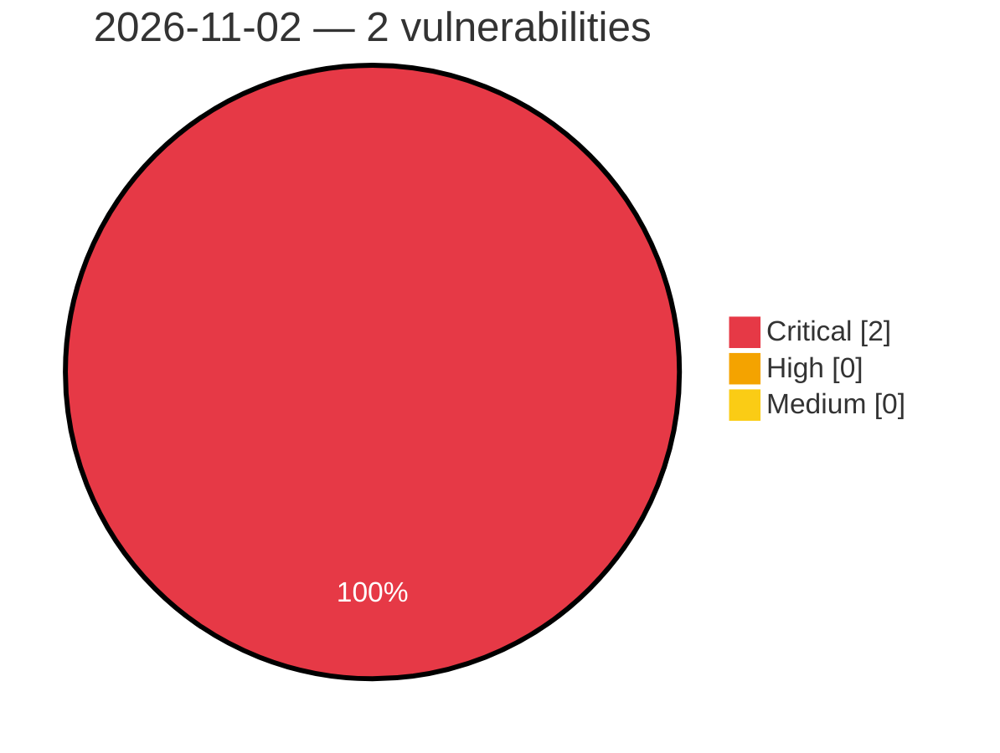

# Critical, High & Medium Severity Vulnerabilities — 2026-11-02

**Source status for this day:**

| Source | Critical | High | Medium | Total |
|--------|---------:|-----:|-------:|------:|
| cvefeed.io (High/Critical) | 2 | 0 | 0 | 2 |

**KEV (actively exploited):** 0  **Watchlist matches:** 2

## Critical (2)

| CVSS | Flags | Source | CVE / Title | Reported |
|------|-------|--------|-------------|----------|
| 10.0 | ⭐ | cvefeed.io (High/Critical) | [CVE-2026-120277 - WAVLINK WN536AX6-A WireGuard CLI Group ioos sub_41a1d8 os command injection](https://cvefeed.io/vuln/detail/CVE-2026-120277) | 48 minutes ago |
| 10.0 | ⭐ | cvefeed.io (High/Critical) | [CVE-2026-120276 - WAVLINK WN536AX6-A Web Management ioos sub_416760 os command injection](https://cvefeed.io/vuln/detail/CVE-2026-120276) | 48 minutes ago |
