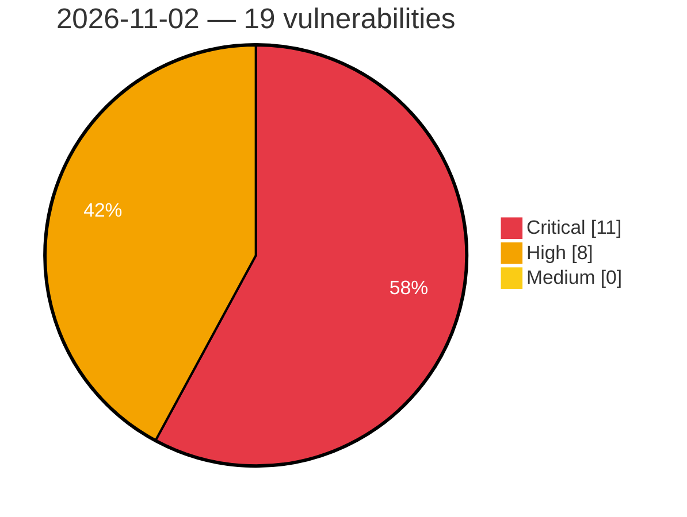

# Critical, High & Medium Severity Vulnerabilities — 2026-11-02

**Source status for this day:**

| Source | Critical | High | Medium | Total |
|--------|---------:|-----:|-------:|------:|
| cvefeed.io (High/Critical) | 11 | 8 | 0 | 19 |

**KEV (actively exploited):** 0  **Watchlist matches:** 16

## Critical (11)

| CVSS | Flags | Source | CVE / Title | Reported |
|------|-------|--------|-------------|----------|
| 10.0 | ⭐ | cvefeed.io (High/Critical) | [CVE-2026-120277 - WAVLINK WN536AX6-A WireGuard CLI Group ioos sub_41a1d8 os command injection](https://cvefeed.io/vuln/detail/CVE-2026-120277) | 48 minutes ago |
| 10.0 | ⭐ | cvefeed.io (High/Critical) | [CVE-2026-120276 - WAVLINK WN536AX6-A Web Management ioos sub_416760 os command injection](https://cvefeed.io/vuln/detail/CVE-2026-120276) | 48 minutes ago |
| 10.0 | ⭐ | cvefeed.io (High/Critical) | [CVE-2026-120345 - WAVLINK WN551X3-A DNS Resolution ioos sub_41a430 os command injection](https://cvefeed.io/vuln/detail/CVE-2026-120345) | 2 hours, 43 minutes ago |
| 10.0 | ⭐ | cvefeed.io (High/Critical) | [CVE-2026-120344 - WAVLINK WN551X3-A WireGuard CLI Group ioos system os command injection](https://cvefeed.io/vuln/detail/CVE-2026-120344) | 3 hours, 43 minutes ago |
| 10.0 | — | cvefeed.io (High/Critical) | [CVE-2026-120283 - Linksys E8450 portal.cgi strcpy stack-based overflow](https://cvefeed.io/vuln/detail/CVE-2026-120283) | 7 hours, 44 minutes ago |
| 10.0 | — | cvefeed.io (High/Critical) | [CVE-2026-120281 - WAVLINK WN536AX6-A OpenVPN protocol.csp strcpy stack-based overflow](https://cvefeed.io/vuln/detail/CVE-2026-120281) | 7 hours, 44 minutes ago |
| 10.0 | ⭐ | cvefeed.io (High/Critical) | [CVE-2026-120280 - WAVLINK WN536AX6-A WireGuard protocol.csp wireguard_cli_group handler os command injection](https://cvefeed.io/vuln/detail/CVE-2026-120280) | 7 hours, 44 minutes ago |
| 10.0 | ⭐ | cvefeed.io (High/Critical) | [CVE-2026-120279 - WAVLINK WN536AX6-A openvpn_cli protocol.csp os command injection](https://cvefeed.io/vuln/detail/CVE-2026-120279) | 7 hours, 44 minutes ago |
| 9.9 | ⭐ | cvefeed.io (High/Critical) | [CVE-2026-120322 - Termix-SSH Termix transferToHost path traversal](https://cvefeed.io/vuln/detail/CVE-2026-120322) | 6 hours, 42 minutes ago |
| 9.9 | ⭐ | cvefeed.io (High/Critical) | [CVE-2026-120282 - WAVLINK WN536AX6-A protocol.csp host_black os command injection](https://cvefeed.io/vuln/detail/CVE-2026-120282) | 7 hours, 44 minutes ago |
| 9.4 | ⭐ | cvefeed.io (High/Critical) | [CVE-2025-11969 - Broken Access Control via System REST APIs in Multiple WSO2 Products Allows Unauthorized Administrative Actions](https://cvefeed.io/vuln/detail/CVE-2025-11969) | 2 hours, 43 minutes ago |

## High (8)

| CVSS | Flags | Source | CVE / Title | Reported |
|------|-------|--------|-------------|----------|
| 8.8 | ⭐ | cvefeed.io (High/Critical) | [CVE-2026-18199 - Remote Code Execution Vulnerability](https://cvefeed.io/vuln/detail/CVE-2026-18199) | 43 minutes ago |
| 8.8 | ⭐ | cvefeed.io (High/Critical) | [CVE-2026-120315 - LobeHub Chat 1.84.26 before 2.1.49 Path Traversal RCE via writeTempFile](https://cvefeed.io/vuln/detail/CVE-2026-120315) | 5 hours, 44 minutes ago |
| 8.8 | ⭐ | cvefeed.io (High/Critical) | [CVE-2026-120312 - Network-AI 5.13.4 before 5.15.5 Path Traversal via AgentVCR Cassette Name](https://cvefeed.io/vuln/detail/CVE-2026-120312) | 5 hours, 44 minutes ago |
| 8.8 | ⭐ | cvefeed.io (High/Critical) | [CVE-2026-120311 - Network-AI 5.13.4 before 5.15.5 Path Traversal via FileJobStore Job ID](https://cvefeed.io/vuln/detail/CVE-2026-120311) | 5 hours, 44 minutes ago |
| 8.7 | ⭐ | cvefeed.io (High/Critical) | [CVE-2026-120313 - Network-AI before 5.15.5 Path Traversal via InputSanitizer.sanitizePath](https://cvefeed.io/vuln/detail/CVE-2026-120313) | 5 hours, 44 minutes ago |
| 8.3 | ⭐ | cvefeed.io (High/Critical) | [CVE-2026-120324 - Aklivity Zilla http-filesystem Binding FileSystemServerFactory Path.resolve path traversal](https://cvefeed.io/vuln/detail/CVE-2026-120324) | 5 hours, 43 minutes ago |
| 8.2 | — | cvefeed.io (High/Critical) | [CVE-2026-120317 - http4k 4.9.10.0 before 6.60.0.0 Digest auth-int Missing Body Integrity](https://cvefeed.io/vuln/detail/CVE-2026-120317) | 5 hours, 43 minutes ago |
| 8.2 | ⭐ | cvefeed.io (High/Critical) | [CVE-2026-120316 - http4k before 6.62.0.0-ee Path Traversal via ThymeleafTemplates Template Resolution](https://cvefeed.io/vuln/detail/CVE-2026-120316) | 5 hours, 43 minutes ago |
