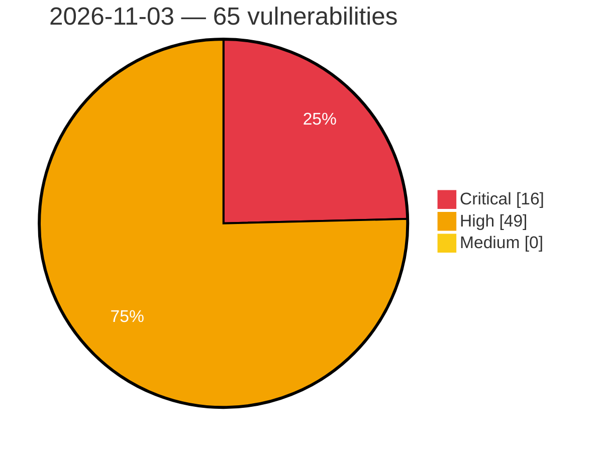

# Critical, High & Medium Severity Vulnerabilities — 2026-11-03

**Source status for this day:**

| Source | Critical | High | Medium | Total |
|--------|---------:|-----:|-------:|------:|
| cvefeed.io (High/Critical) | 16 | 49 | 0 | 65 |

**KEV (actively exploited):** 0  **Watchlist matches:** 40

## Critical (16)

| CVSS | Flags | Source | CVE / Title | Reported |
|------|-------|--------|-------------|----------|
| 9.8 | ⭐ | cvefeed.io (High/Critical) | [CVE-2026-120534 - Advanced Custom Fields: Extended PRO <= 0.9.2.6 - Unauthenticated Remote Code Execution via Dynamic Render Field Type](https://cvefeed.io/vuln/detail/CVE-2026-120534) | 1 hour, 48 minutes ago |
| 9.8 | — | cvefeed.io (High/Critical) | [CVE-2026-112354 - Etrel INCH AC Charging Station Hard-coded Default Credentials](https://cvefeed.io/vuln/detail/CVE-2026-112354) | 46 minutes ago |
| 9.8 | — | cvefeed.io (High/Critical) | [CVE-2026-95731 - Unauthenticated Hardcoded Password Vulnerabilities in HPE Networking Fabric Composer Command-Line Interface allow Unauthorized Administrative Access](https://cvefeed.io/vuln/detail/CVE-2026-95731) | 1 hour, 34 minutes ago |
| 9.8 | — | cvefeed.io (High/Critical) | [CVE-2022-29966 - Emerson Ovation Missing Authentication for Critical Functionality](https://cvefeed.io/vuln/detail/CVE-2022-29966) | 1 hour, 55 minutes ago |
| 9.6 | — | cvefeed.io (High/Critical) | [CVE-2026-95733 - Use of Hardcoded Credentials in HPE Networking Fabric Composer Could Allow Adjacent Arbitrary Code Execution](https://cvefeed.io/vuln/detail/CVE-2026-95733) | 1 hour, 34 minutes ago |
| 9.6 | ⭐ | cvefeed.io (High/Critical) | [CVE-2026-95732 - Authentication Bypass in HPE Networking Fabric Composer allows Arbitrary Code Execution](https://cvefeed.io/vuln/detail/CVE-2026-95732) | 1 hour, 34 minutes ago |
| 9.6 | ⭐ | cvefeed.io (High/Critical) | [CVE-2026-120931 - Google Chrome WebGL Out-of-Bounds Write Vulnerability](https://cvefeed.io/vuln/detail/CVE-2026-120931) | 2 hours, 53 minutes ago |
| 9.4 | ⭐ | cvefeed.io (High/Critical) | [CVE-2026-115731 - Report Deserialization Code Execution](https://cvefeed.io/vuln/detail/CVE-2026-115731) | 35 minutes ago |
| 9.2 | ⭐ | cvefeed.io (High/Critical) | [CVE-2026-89292 - Unauthenticated SSRF with MNESTIX_BACKEND_API_KEY disclosure in Eclipse Mnestix Browser server actions for configured Infrastructures](https://cvefeed.io/vuln/detail/CVE-2026-89292) | 5 hours, 5 minutes ago |
| 9.2 | ⭐ | cvefeed.io (High/Critical) | [CVE-2026-119084 - Remote Code Execution via Unsafe Class Loading in Amazon Redshift JDBC Driver Connection Parameters](https://cvefeed.io/vuln/detail/CVE-2026-119084) | 46 minutes ago |
| 9.1 | ⭐ | cvefeed.io (High/Critical) | [CVE-2026-120518 - BuddyPress XProfile Image Field <= 3.1.0 - Unauthenticated Arbitrary File Deletion via Signup Image Field Activation Handler](https://cvefeed.io/vuln/detail/CVE-2026-120518) | 1 hour, 48 minutes ago |
| 9.1 | ⭐ | cvefeed.io (High/Critical) | [CVE-2026-121392 - FreeRDP before 3.32.2 Certificate Identity Validation Bypass via tls_verify_certificate](https://cvefeed.io/vuln/detail/CVE-2026-121392) | 54 minutes ago |
| 9.1 | ⭐ | cvefeed.io (High/Critical) | [CVE-2026-22058 - CVE-2026-22058 Authentication Bypass Vulnerability in StorageGRID (formerly StorageGRID Webscale)](https://cvefeed.io/vuln/detail/CVE-2026-22058) | 10 minutes ago |
| 9.1 | ⭐ | cvefeed.io (High/Critical) | [CVE-2026-95860 - node-opcua: Namespace-Level RBAC Fail-Open - Anonymous Write/Call Bypass via Unbound `DefaultRolePermissions](https://cvefeed.io/vuln/detail/CVE-2026-95860) | 34 minutes ago |
| 9.0 | ⭐ | cvefeed.io (High/Critical) | [CVE-2026-82158 - Dell Wyse Management Suite Cross-Site Scripting Vulnerability](https://cvefeed.io/vuln/detail/CVE-2026-82158) | 34 minutes ago |
| 9.0 | — | cvefeed.io (High/Critical) | [CVE-2026-115732 - Certificate Name Authorization Bypass](https://cvefeed.io/vuln/detail/CVE-2026-115732) | 35 minutes ago |

## High (49)

| CVSS | Flags | Source | CVE / Title | Reported |
|------|-------|--------|-------------|----------|
| 8.8 | ⭐ | cvefeed.io (High/Critical) | [CVE-2026-76955 - Zyxel NWA110AX Buffer Overflow Privilege Escalation](https://cvefeed.io/vuln/detail/CVE-2026-76955) | 4 hours, 50 minutes ago |
| 8.8 | — | cvefeed.io (High/Critical) | [CVE-2026-107441 - Zyxel GS1900-24E CGI Program Out-of-Bounds Write Vulnerability](https://cvefeed.io/vuln/detail/CVE-2026-107441) | 4 hours, 50 minutes ago |
| 8.8 | ⭐ | cvefeed.io (High/Critical) | [CVE-2026-121429 - AzuraCast through 0.23.8 Command Injection via StereoTool Liquidsoap pipe()](https://cvefeed.io/vuln/detail/CVE-2026-121429) | 53 minutes ago |
| 8.8 | ⭐ | cvefeed.io (High/Critical) | [CVE-2026-121428 - AzuraCast through 0.23.8 RCE via Supervisor Configuration Injection in Timezone](https://cvefeed.io/vuln/detail/CVE-2026-121428) | 53 minutes ago |
| 8.8 | — | cvefeed.io (High/Critical) | [CVE-2026-121417 - SurrealDB before 3.3.0 Use-After-Free via affinitypool spawn_local in KV Backends](https://cvefeed.io/vuln/detail/CVE-2026-121417) | 54 minutes ago |
| 8.8 | — | cvefeed.io (High/Critical) | [CVE-2026-85035 - Use-after-free via dynamically allocated message queue retained by the CAN RX filter](https://cvefeed.io/vuln/detail/CVE-2026-85035) | 1 hour, 4 minutes ago |
| 8.8 | ⭐ | cvefeed.io (High/Critical) | [CVE-2026-76124 - BuddyBoss App <= 3.2.1 - Authenticated (Subscriber+) Arbitrary File Upload via Feedback Endpoint](https://cvefeed.io/vuln/detail/CVE-2026-76124) | 2 hours, 4 minutes ago |
| 8.8 | — | cvefeed.io (High/Critical) | [CVE-2026-89293 - Missing server-side authorization in Eclipse Mnestix Browser admin server actions allows unauthenticated configuration tampering](https://cvefeed.io/vuln/detail/CVE-2026-89293) | 5 hours, 5 minutes ago |
| 8.8 | ⭐ | cvefeed.io (High/Critical) | [CVE-2026-82159 - Dell Wyse Management Suite Cross-Site Scripting Vulnerability](https://cvefeed.io/vuln/detail/CVE-2026-82159) | 34 minutes ago |
| 8.8 | ⭐ | cvefeed.io (High/Critical) | [CVE-2026-121621 - Github.com/argoproj-labs/argocd-image-updater: argocd-image-updater: arbitrary command execution via crafted ssh repository proxy configuration](https://cvefeed.io/vuln/detail/CVE-2026-121621) | 34 minutes ago |
| 8.8 | ⭐ | cvefeed.io (High/Critical) | [CVE-2026-95734 - Authenticated Sensitive Information Disclosure in HPE Networking Fabric Composer API](https://cvefeed.io/vuln/detail/CVE-2026-95734) | 1 hour, 34 minutes ago |
| 8.8 | ⭐ | cvefeed.io (High/Critical) | [CVE-2026-95722 - Local Privilege Escalation Vulnerability in the Virtual Intranet Access (VIA) Client](https://cvefeed.io/vuln/detail/CVE-2026-95722) | 1 hour, 34 minutes ago |
| 8.8 | ⭐ | cvefeed.io (High/Critical) | [CVE-2026-121731 - RosarioSIS before 12.9 SQL Injection via period_id in Attendance Absence Report](https://cvefeed.io/vuln/detail/CVE-2026-121731) | 1 hour, 55 minutes ago |
| 8.7 | ⭐ | cvefeed.io (High/Critical) | [CVE-2026-121448 - Dockhand before 1.0.54 Path Traversal via Stack Environment Routes](https://cvefeed.io/vuln/detail/CVE-2026-121448) | 53 minutes ago |
| 8.7 | — | cvefeed.io (High/Critical) | [CVE-2026-121444 - svg-sanitizer 0.11.0 before 1.1.0 Algorithmic Complexity DoS via use Reference Graph](https://cvefeed.io/vuln/detail/CVE-2026-121444) | 53 minutes ago |
| 8.7 | — | cvefeed.io (High/Critical) | [CVE-2026-121437 - Mistune 3.3.0 before 3.3.4 Quadratic-Time DoS via _process_emphasis_delimiters](https://cvefeed.io/vuln/detail/CVE-2026-121437) | 53 minutes ago |
| 8.7 | — | cvefeed.io (High/Critical) | [CVE-2026-121427 - AzuraCast through 0.23.8 Config Injection via frontend_config.custom_config](https://cvefeed.io/vuln/detail/CVE-2026-121427) | 53 minutes ago |
| 8.7 | — | cvefeed.io (High/Critical) | [CVE-2026-121386 - FreeRDP before 3.32.2 Denial of Service via WinPR PNG/JPEG Image Readers](https://cvefeed.io/vuln/detail/CVE-2026-121386) | 54 minutes ago |
| 8.7 | — | cvefeed.io (High/Critical) | [CVE-2026-95735 - Improper Certificate Validation in HPE Networking Fabric Composer](https://cvefeed.io/vuln/detail/CVE-2026-95735) | 1 hour, 34 minutes ago |
| 8.7 | — | cvefeed.io (High/Critical) | [CVE-2026-121727 - Kore before 4.3.0 Integer Underflow Memory Exhaustion via http_header_recv()](https://cvefeed.io/vuln/detail/CVE-2026-121727) | 1 hour, 55 minutes ago |
| 8.7 | ⭐ | cvefeed.io (High/Critical) | [CVE-2022-30267 - Emerson Ovation Insufficient Verification of Data Authenticity](https://cvefeed.io/vuln/detail/CVE-2022-30267) | 1 hour, 55 minutes ago |
| 8.6 | ⭐ | cvefeed.io (High/Critical) | [CVE-2026-121436 - Froxlor 2.3.8 before 2.3.15 API Key Disclosure via api_keys.php](https://cvefeed.io/vuln/detail/CVE-2026-121436) | 53 minutes ago |
| 8.6 | ⭐ | cvefeed.io (High/Critical) | [CVE-2026-121419 - SurrealDB 3.1.0 before 3.3.0 MCP Session Hijack via BoundSubject Collision](https://cvefeed.io/vuln/detail/CVE-2026-121419) | 54 minutes ago |
| 8.6 | ⭐ | cvefeed.io (High/Critical) | [CVE-2026-119742 - Nagios XI < 2026R2 OS Command Injection via mibs.php](https://cvefeed.io/vuln/detail/CVE-2026-119742) | 1 hour, 4 minutes ago |
| 8.6 | ⭐ | cvefeed.io (High/Critical) | [CVE-2026-108047 - Inadequate authorization vulnerability in Alosuite’s user invitation functionality](https://cvefeed.io/vuln/detail/CVE-2026-108047) | 2 hours, 5 minutes ago |
| 8.5 | ⭐ | cvefeed.io (High/Critical) | [CVE-2026-120833 - labbench before 0.46.1 Deserialization of Untrusted Data via read() Pickle Auto-Dispatch](https://cvefeed.io/vuln/detail/CVE-2026-120833) | 5 hours, 50 minutes ago |
| 8.4 | ⭐ | cvefeed.io (High/Critical) | [CVE-2026-95723 - Authenticated Local Missing Integrity Verification Vulnerability leads to Local Privilege Escalation in Virtual Intranet Access (VIA) Client](https://cvefeed.io/vuln/detail/CVE-2026-95723) | 1 hour, 34 minutes ago |
| 8.4 | ⭐ | cvefeed.io (High/Critical) | [CVE-2026-109836 - ALCPU Core Temp Kernel Driver Arbitrary Memory Access Vulnerability](https://cvefeed.io/vuln/detail/CVE-2026-109836) | 1 hour, 55 minutes ago |
| 8.3 | — | cvefeed.io (High/Critical) | [CVE-2026-121426 - Nodemailer 3.0.0 before 10.1.4 Recipient Domain Confusion via addressparser](https://cvefeed.io/vuln/detail/CVE-2026-121426) | 53 minutes ago |
| 8.3 | — | cvefeed.io (High/Critical) | [CVE-2026-121425 - Nodemailer 3.0.0 before 10.1.4 Recipient Injection via addressparser Group Parsing](https://cvefeed.io/vuln/detail/CVE-2026-121425) | 54 minutes ago |
| 8.3 | — | cvefeed.io (High/Critical) | [CVE-2026-121424 - Nodemailer 3.0.0 before 10.1.4 Address Parsing Bypass via Nested Comments](https://cvefeed.io/vuln/detail/CVE-2026-121424) | 54 minutes ago |
| 8.3 | — | cvefeed.io (High/Critical) | [CVE-2026-119179 - MongoDB Node.js driver: Connection pool desynchronization after operation timeout can expose other user's data](https://cvefeed.io/vuln/detail/CVE-2026-119179) | 1 hour, 4 minutes ago |
| 8.3 | ⭐ | cvefeed.io (High/Critical) | [CVE-2026-95736 - Unauthenticated Adjacent Improper Certificate Validation Vulnerabilities in HPE Networking Fabric Composer](https://cvefeed.io/vuln/detail/CVE-2026-95736) | 1 hour, 34 minutes ago |
| 8.3 | ⭐ | cvefeed.io (High/Critical) | [CVE-2026-121729 - emailflare before commit cf31f33 Missing Authorization via /api/keys Routes](https://cvefeed.io/vuln/detail/CVE-2026-121729) | 1 hour, 55 minutes ago |
| 8.2 | — | cvefeed.io (High/Critical) | [CVE-2026-121445 - svg-sanitizer 1.0.0 before 1.1.0 ReDoS and Fail-Open via image-set CSS Stripping](https://cvefeed.io/vuln/detail/CVE-2026-121445) | 53 minutes ago |
| 8.2 | — | cvefeed.io (High/Critical) | [CVE-2026-121414 - Parse Server before 8.6.110 and 9.0.0 before 9.10.6-alpha.2 Denial of Service via afterSave Pointer Update](https://cvefeed.io/vuln/detail/CVE-2026-121414) | 54 minutes ago |
| 8.2 | — | cvefeed.io (High/Critical) | [CVE-2026-121409 - FreeRDP before 3.32.2 Denial of Service via Oversized X.224 Routing Token](https://cvefeed.io/vuln/detail/CVE-2026-121409) | 54 minutes ago |
| 8.2 | — | cvefeed.io (High/Critical) | [CVE-2026-121398 - FreeRDP before 3.32.2 Use-After-Free via dyn-channel-dump Module](https://cvefeed.io/vuln/detail/CVE-2026-121398) | 54 minutes ago |
| 8.2 | — | cvefeed.io (High/Critical) | [CVE-2026-111752 - Angular: Denial of Service via Unmatched Empty-Path Outlet Route Matching in Server-Side Rendering (SSR)](https://cvefeed.io/vuln/detail/CVE-2026-111752) | 35 minutes ago |
| 8.2 | — | cvefeed.io (High/Critical) | [CVE-2026-111751 - Angular: Denial of Service via RouterLink Query Parameter Retention in Server-Side Rendering (SSR)](https://cvefeed.io/vuln/detail/CVE-2026-111751) | 35 minutes ago |
| 8.2 | ⭐ | cvefeed.io (High/Critical) | [CVE-2026-95737 - Local Privilege Escalation in HPE Networking Fabric Composer](https://cvefeed.io/vuln/detail/CVE-2026-95737) | 1 hour, 34 minutes ago |
| 8.1 | ⭐ | cvefeed.io (High/Critical) | [CVE-2026-120577 - FluentCart A New Era of eCommerce <= 1.6.2 - Authenticated (Custom+) Arbitrary File Deletion via 'file_path' Parameter](https://cvefeed.io/vuln/detail/CVE-2026-120577) | 1 hour, 48 minutes ago |
| 8.1 | ⭐ | cvefeed.io (High/Critical) | [CVE-2026-120574 - SureCart – Ecommerce Made Easy For Selling Physical Products, Digital Downloads, Subscriptions, Donations, & Payments <= 4.9.5 - Unauthenticated Account Takeover](https://cvefeed.io/vuln/detail/CVE-2026-120574) | 1 hour, 48 minutes ago |
| 8.1 | ⭐ | cvefeed.io (High/Critical) | [CVE-2026-120538 - Easy Digital Downloads <= 3.7.2 - Unauthenticated Authentication Bypass to Administrator Account Takeover via Guest Checkout Email Binding at PayPal Capture](https://cvefeed.io/vuln/detail/CVE-2026-120538) | 1 hour, 48 minutes ago |
| 8.1 | ⭐ | cvefeed.io (High/Critical) | [CVE-2026-95739 - Unauthenticated Improper Restriction of Excessive Authentication Attempts in the API of HPE Networking Fabric Composer](https://cvefeed.io/vuln/detail/CVE-2026-95739) | 1 hour, 34 minutes ago |
| 8.1 | ⭐ | cvefeed.io (High/Critical) | [CVE-2026-95738 - Authentication Bypass in the Affected Interface of HPE Networking Fabric Composer](https://cvefeed.io/vuln/detail/CVE-2026-95738) | 1 hour, 34 minutes ago |
| 8.1 | ⭐ | cvefeed.io (High/Critical) | [CVE-2026-95724 - Unauthenticated Improper Certificate Validation leads to Authentication Bypass in HPE Networking Virtual Intranet Access (VIA)](https://cvefeed.io/vuln/detail/CVE-2026-95724) | 1 hour, 34 minutes ago |
| 8.0 | ⭐ | cvefeed.io (High/Critical) | [CVE-2026-95741 - Authenticated Missing Integrity Verification in API of HPE Networking Fabric Composer](https://cvefeed.io/vuln/detail/CVE-2026-95741) | 1 hour, 34 minutes ago |
| 8.0 | ⭐ | cvefeed.io (High/Critical) | [CVE-2026-95740 - Unauthenticated Adjacent Improper Certificate Validation Vulnerability leads to Information Disclosure in HPE Networking Fabric Composer](https://cvefeed.io/vuln/detail/CVE-2026-95740) | 1 hour, 34 minutes ago |
