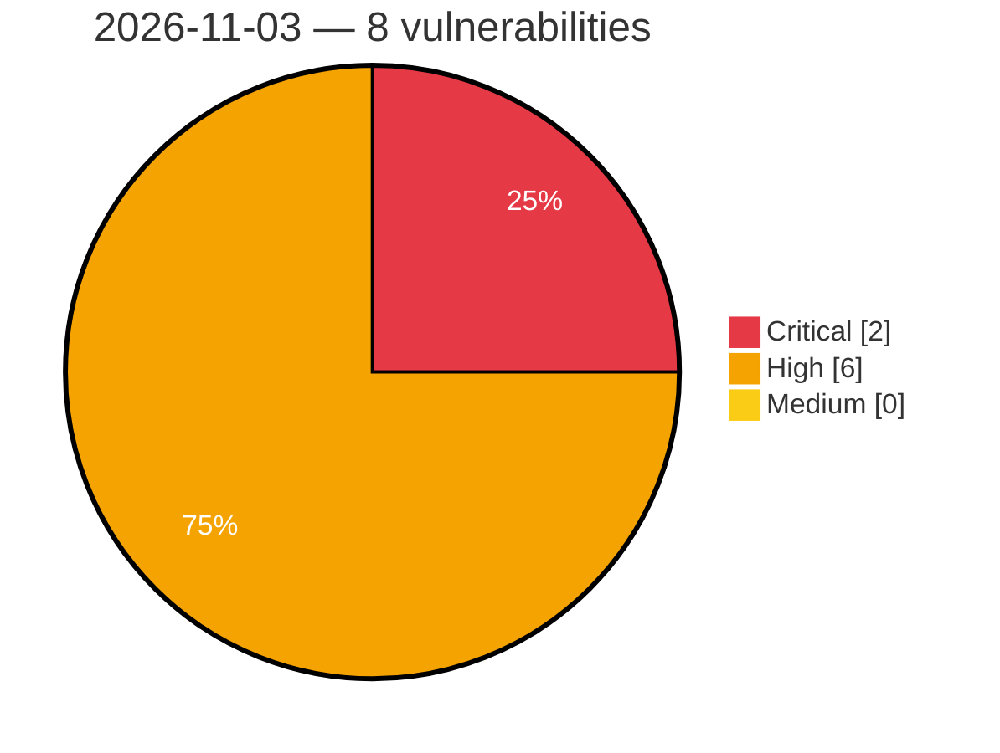

# Critical, High & Medium Severity Vulnerabilities — 2026-11-03

**Source status for this day:**

| Source | Critical | High | Medium | Total |
|--------|---------:|-----:|-------:|------:|
| cvefeed.io (High/Critical) | 2 | 6 | 0 | 8 |

**KEV (actively exploited):** 0  **Watchlist matches:** 7

## Critical (2)

| CVSS | Flags | Source | CVE / Title | Reported |
|------|-------|--------|-------------|----------|
| 9.8 | ⭐ | cvefeed.io (High/Critical) | [CVE-2026-120534 - Advanced Custom Fields: Extended PRO <= 0.9.2.6 - Unauthenticated Remote Code Execution via Dynamic Render Field Type](https://cvefeed.io/vuln/detail/CVE-2026-120534) | 1 hour, 48 minutes ago |
| 9.1 | ⭐ | cvefeed.io (High/Critical) | [CVE-2026-120518 - BuddyPress XProfile Image Field <= 3.1.0 - Unauthenticated Arbitrary File Deletion via Signup Image Field Activation Handler](https://cvefeed.io/vuln/detail/CVE-2026-120518) | 1 hour, 48 minutes ago |

## High (6)

| CVSS | Flags | Source | CVE / Title | Reported |
|------|-------|--------|-------------|----------|
| 8.8 | ⭐ | cvefeed.io (High/Critical) | [CVE-2026-76955 - Zyxel NWA110AX Buffer Overflow Privilege Escalation](https://cvefeed.io/vuln/detail/CVE-2026-76955) | 4 hours, 50 minutes ago |
| 8.8 | — | cvefeed.io (High/Critical) | [CVE-2026-107441 - Zyxel GS1900-24E CGI Program Out-of-Bounds Write Vulnerability](https://cvefeed.io/vuln/detail/CVE-2026-107441) | 4 hours, 50 minutes ago |
| 8.5 | ⭐ | cvefeed.io (High/Critical) | [CVE-2026-120833 - labbench before 0.46.1 Deserialization of Untrusted Data via read() Pickle Auto-Dispatch](https://cvefeed.io/vuln/detail/CVE-2026-120833) | 5 hours, 50 minutes ago |
| 8.1 | ⭐ | cvefeed.io (High/Critical) | [CVE-2026-120577 - FluentCart A New Era of eCommerce <= 1.6.2 - Authenticated (Custom+) Arbitrary File Deletion via 'file_path' Parameter](https://cvefeed.io/vuln/detail/CVE-2026-120577) | 1 hour, 48 minutes ago |
| 8.1 | ⭐ | cvefeed.io (High/Critical) | [CVE-2026-120574 - SureCart – Ecommerce Made Easy For Selling Physical Products, Digital Downloads, Subscriptions, Donations, & Payments <= 4.9.5 - Unauthenticated Account Takeover](https://cvefeed.io/vuln/detail/CVE-2026-120574) | 1 hour, 48 minutes ago |
| 8.1 | ⭐ | cvefeed.io (High/Critical) | [CVE-2026-120538 - Easy Digital Downloads <= 3.7.2 - Unauthenticated Authentication Bypass to Administrator Account Takeover via Guest Checkout Email Binding at PayPal Capture](https://cvefeed.io/vuln/detail/CVE-2026-120538) | 1 hour, 48 minutes ago |
