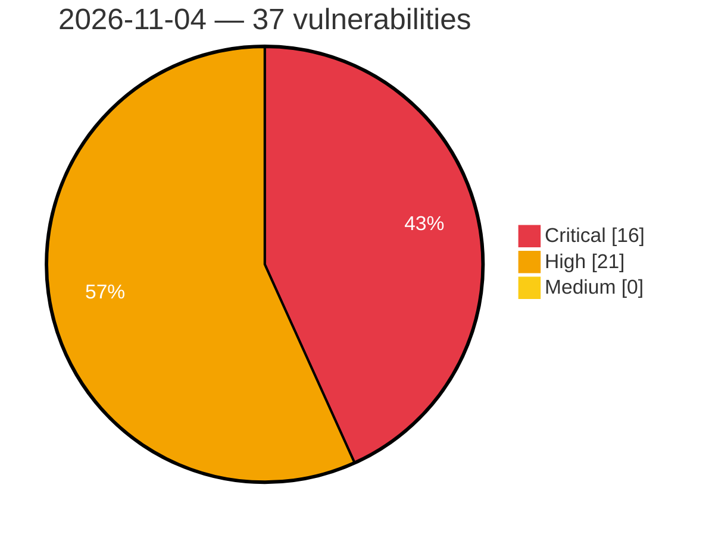

# Critical, High & Medium Severity Vulnerabilities — 2026-11-04

**Source status for this day:**

| Source | Critical | High | Medium | Total |
|--------|---------:|-----:|-------:|------:|
| cvefeed.io (High/Critical) | 16 | 21 | 0 | 37 |

**KEV (actively exploited):** 0  **Watchlist matches:** 21

## Critical (16)

| CVSS | Flags | Source | CVE / Title | Reported |
|------|-------|--------|-------------|----------|
| 10.0 | — | cvefeed.io (High/Critical) | [CVE-2026-121615 - Linksys E5600 Login mesh_login.cgi improper authentication](https://cvefeed.io/vuln/detail/CVE-2026-121615) | 5 hours, 50 minutes ago |
| 10.0 | — | cvefeed.io (High/Critical) | [CVE-2026-121609 - Qihoo 360 Whole Home Router M5 Boot Script mpt start hard-coded credentials](https://cvefeed.io/vuln/detail/CVE-2026-121609) | 6 hours, 50 minutes ago |
| 10.0 | ⭐ | cvefeed.io (High/Critical) | [CVE-2026-121607 - Qihoo 360 D603-2/D600-2/D606-6/D706 iscm testspeed_command os command injection](https://cvefeed.io/vuln/detail/CVE-2026-121607) | 6 hours, 50 minutes ago |
| 10.0 | — | cvefeed.io (High/Critical) | [CVE-2026-121606 - Qihoo 360 D621-2/D603-2/D600-2/D619/D606-6/D706 Firmware Signature Verification iscm verify_sign signature verification](https://cvefeed.io/vuln/detail/CVE-2026-121606) | 7 hours, 50 minutes ago |
| 9.9 | — | cvefeed.io (High/Critical) | [CVE-2026-121597 - TOTOLINK A950RG Easy Setup Wizard cstecgi.cgi setAppEasyWizardConfig stack-based overflow](https://cvefeed.io/vuln/detail/CVE-2026-121597) | 55 minutes ago |
| 9.9 | — | cvefeed.io (High/Critical) | [CVE-2026-121600 - TOTOLINK A950RG MAC Filter cstecgi.cgi setMacFilterRules stack-based overflow](https://cvefeed.io/vuln/detail/CVE-2026-121600) | 7 hours, 50 minutes ago |
| 9.9 | — | cvefeed.io (High/Critical) | [CVE-2026-121599 - TOTOLINK A950RG Multi-SSID Configuration cstecgi.cgi delWiFiMultipleConfig stack-based overflow](https://cvefeed.io/vuln/detail/CVE-2026-121599) | 7 hours, 50 minutes ago |
| 9.9 | — | cvefeed.io (High/Critical) | [CVE-2026-121598 - TOTOLINK A950RG Basic Wireless Configuration cstecgi.cgi strcpy stack-based overflow](https://cvefeed.io/vuln/detail/CVE-2026-121598) | 7 hours, 50 minutes ago |
| 9.8 | ⭐ | cvefeed.io (High/Critical) | [CVE-2026-92190 - Quest Foglight for Databases baseRmiServiceExporter Deserialization of Untrusted Data Remote Code Execution Vulnerability](https://cvefeed.io/vuln/detail/CVE-2026-92190) | 55 minutes ago |
| 9.8 | ⭐ | cvefeed.io (High/Critical) | [CVE-2026-92189 - Quest Foglight for Databases writeTopologySectionToFile External Control of File Path Remote Code Execution Vulnerability](https://cvefeed.io/vuln/detail/CVE-2026-92189) | 55 minutes ago |
| 9.8 | ⭐ | cvefeed.io (High/Critical) | [CVE-2026-92188 - Quest Foglight for Databases ForgeMBeanServerSupport Missing Authentication Remote Code Execution Vulnerability](https://cvefeed.io/vuln/detail/CVE-2026-92188) | 55 minutes ago |
| 9.8 | ⭐ | cvefeed.io (High/Critical) | [CVE-2026-114549 - NoMachine nxwebrunner Heap-based Buffer Overflow Remote Code Execution Vulnerability](https://cvefeed.io/vuln/detail/CVE-2026-114549) | 55 minutes ago |
| 9.3 | — | cvefeed.io (High/Critical) | [CVE-2026-121803 - Out-of-bounds Write in UFS Firmware](https://cvefeed.io/vuln/detail/CVE-2026-121803) | 4 hours, 50 minutes ago |
| 9.2 | — | cvefeed.io (High/Critical) | [CVE-2026-114425 - Forged LFT metadata permits arbitrary file read and deletion](https://cvefeed.io/vuln/detail/CVE-2026-114425) | 38 minutes ago |
| 9.2 | — | cvefeed.io (High/Critical) | [CVE-2026-114424 - Code execution through double evaluation in address replacement rules](https://cvefeed.io/vuln/detail/CVE-2026-114424) | 39 minutes ago |
| 9.1 | — | cvefeed.io (High/Critical) | [CVE-2026-121802 - Better-Auth Expo Improper Authentication Verification Vulnerability](https://cvefeed.io/vuln/detail/CVE-2026-121802) | 5 hours, 50 minutes ago |

## High (21)

| CVSS | Flags | Source | CVE / Title | Reported |
|------|-------|--------|-------------|----------|
| 8.8 | ⭐ | cvefeed.io (High/Critical) | [CVE-2026-92197 - Quest Foglight for Databases unzipFile Directory Traversal Remote Code Execution Vulnerability](https://cvefeed.io/vuln/detail/CVE-2026-92197) | 55 minutes ago |
| 8.8 | ⭐ | cvefeed.io (High/Critical) | [CVE-2026-92195 - Quest Foglight for Databases loadEvolveLicense Directory Traversal Remote Code Execution Vulnerability](https://cvefeed.io/vuln/detail/CVE-2026-92195) | 55 minutes ago |
| 8.8 | ⭐ | cvefeed.io (High/Critical) | [CVE-2026-92194 - Quest Foglight for Databases loadManageServerLicense Directory Traversal Remote Code Execution Vulnerability](https://cvefeed.io/vuln/detail/CVE-2026-92194) | 55 minutes ago |
| 8.8 | ⭐ | cvefeed.io (High/Critical) | [CVE-2026-92192 - Quest Foglight for Databases installLicense Directory Traversal Remote Code Execution Vulnerability](https://cvefeed.io/vuln/detail/CVE-2026-92192) | 55 minutes ago |
| 8.8 | ⭐ | cvefeed.io (High/Critical) | [CVE-2026-92191 - Quest Foglight for Databases runScript Incorrect Authorization Remote Code Execution Vulnerability](https://cvefeed.io/vuln/detail/CVE-2026-92191) | 55 minutes ago |
| 8.8 | ⭐ | cvefeed.io (High/Critical) | [CVE-2026-92187 - Quest Foglight for Databases extractAndCreateUploadInfoList Directory Traversal Remote Code Execution Vulnerability](https://cvefeed.io/vuln/detail/CVE-2026-92187) | 55 minutes ago |
| 8.8 | ⭐ | cvefeed.io (High/Critical) | [CVE-2026-92186 - Quest Foglight for Databases paFnUploadFileAndCreateInfo Directory Traversal Remote Code Execution Vulnerability](https://cvefeed.io/vuln/detail/CVE-2026-92186) | 55 minutes ago |
| 8.8 | ⭐ | cvefeed.io (High/Critical) | [CVE-2026-121816 - About Time Technologies｜Herowatch Mini - Missing Authentication](https://cvefeed.io/vuln/detail/CVE-2026-121816) | 1 hour, 50 minutes ago |
| 8.8 | ⭐ | cvefeed.io (High/Critical) | [CVE-2026-77690 - Command injection vulnerability](https://cvefeed.io/vuln/detail/CVE-2026-77690) | 2 hours, 50 minutes ago |
| 8.8 | — | cvefeed.io (High/Critical) | [CVE-2026-16511 - Unvalidated user pointers in RTIO syscall verifiers allow a user-mode thread to write kernel memory](https://cvefeed.io/vuln/detail/CVE-2026-16511) | 2 hours, 50 minutes ago |
| 8.7 | ⭐ | cvefeed.io (High/Critical) | [CVE-2026-114426 - Pre-authentication upload parsing permits resource exhaustion](https://cvefeed.io/vuln/detail/CVE-2026-114426) | 34 minutes ago |
| 8.7 | — | cvefeed.io (High/Critical) | [CVE-2026-121817 - About Time Technologies｜Herowatch Go Server - Insecure Direct Object Reference](https://cvefeed.io/vuln/detail/CVE-2026-121817) | 1 hour, 50 minutes ago |
| 8.7 | ⭐ | cvefeed.io (High/Critical) | [CVE-2026-84730 - ASUS Router AiCloud Stack-Based Buffer Overflow](https://cvefeed.io/vuln/detail/CVE-2026-84730) | 6 hours, 50 minutes ago |
| 8.5 | — | cvefeed.io (High/Critical) | [CVE-2026-121818 - About Time Technologies｜Herowatch Go - Security Misconfiguration](https://cvefeed.io/vuln/detail/CVE-2026-121818) | 1 hour, 50 minutes ago |
| 8.5 | ⭐ | cvefeed.io (High/Critical) | [CVE-2026-112116 - ASUS System Control Interface Arbitrary Memory Access Vulnerability](https://cvefeed.io/vuln/detail/CVE-2026-112116) | 6 hours, 50 minutes ago |
| 8.4 | — | cvefeed.io (High/Critical) | [CVE-2026-80335 - Out-of-bounds Write in Bootloader](https://cvefeed.io/vuln/detail/CVE-2026-80335) | 4 hours, 50 minutes ago |
| 8.3 | — | cvefeed.io (High/Critical) | [CVE-2026-114421 - Empty initial password permits GINA account takeover](https://cvefeed.io/vuln/detail/CVE-2026-114421) | 25 minutes ago |
| 8.3 | ⭐ | cvefeed.io (High/Critical) | [CVE-2026-87040 - Bluetooth LE Controller accepts received PDUs whose length field exceeds the configured maximum receive length, causing out-of-bounds read and write](https://cvefeed.io/vuln/detail/CVE-2026-87040) | 2 hours, 50 minutes ago |
| 8.2 | ⭐ | cvefeed.io (High/Critical) | [CVE-2026-92198 - Quest Foglight for Databases getSource XML External Entity Processing Information Disclosure Vulnerability](https://cvefeed.io/vuln/detail/CVE-2026-92198) | 55 minutes ago |
| 8.2 | ⭐ | cvefeed.io (High/Critical) | [CVE-2026-118628 - MLflow get-artifacts Server-Side Request Forgery Information Disclosure Vulnerability](https://cvefeed.io/vuln/detail/CVE-2026-118628) | 55 minutes ago |
| 8.1 | ⭐ | cvefeed.io (High/Critical) | [CVE-2026-114550 - libwebsockets MQTT Protocol PUBACK Packet Handling Out-Of-Bounds Write Remote Code Execution Vulnerability](https://cvefeed.io/vuln/detail/CVE-2026-114550) | 55 minutes ago |
