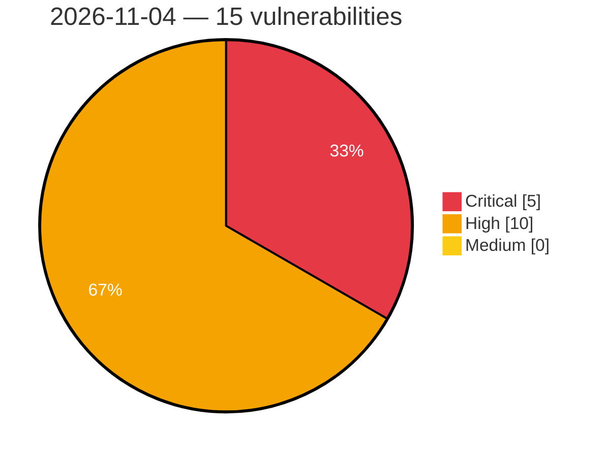

# Critical, High & Medium Severity Vulnerabilities — 2026-11-04

**Source status for this day:**

| Source | Critical | High | Medium | Total |
|--------|---------:|-----:|-------:|------:|
| cvefeed.io (High/Critical) | 5 | 10 | 0 | 15 |

**KEV (actively exploited):** 0  **Watchlist matches:** 14

## Critical (5)

| CVSS | Flags | Source | CVE / Title | Reported |
|------|-------|--------|-------------|----------|
| 9.9 | — | cvefeed.io (High/Critical) | [CVE-2026-121597 - TOTOLINK A950RG Easy Setup Wizard cstecgi.cgi setAppEasyWizardConfig stack-based overflow](https://cvefeed.io/vuln/detail/CVE-2026-121597) | 55 minutes ago |
| 9.8 | ⭐ | cvefeed.io (High/Critical) | [CVE-2026-92190 - Quest Foglight for Databases baseRmiServiceExporter Deserialization of Untrusted Data Remote Code Execution Vulnerability](https://cvefeed.io/vuln/detail/CVE-2026-92190) | 55 minutes ago |
| 9.8 | ⭐ | cvefeed.io (High/Critical) | [CVE-2026-92189 - Quest Foglight for Databases writeTopologySectionToFile External Control of File Path Remote Code Execution Vulnerability](https://cvefeed.io/vuln/detail/CVE-2026-92189) | 55 minutes ago |
| 9.8 | ⭐ | cvefeed.io (High/Critical) | [CVE-2026-92188 - Quest Foglight for Databases ForgeMBeanServerSupport Missing Authentication Remote Code Execution Vulnerability](https://cvefeed.io/vuln/detail/CVE-2026-92188) | 55 minutes ago |
| 9.8 | ⭐ | cvefeed.io (High/Critical) | [CVE-2026-114549 - NoMachine nxwebrunner Heap-based Buffer Overflow Remote Code Execution Vulnerability](https://cvefeed.io/vuln/detail/CVE-2026-114549) | 55 minutes ago |

## High (10)

| CVSS | Flags | Source | CVE / Title | Reported |
|------|-------|--------|-------------|----------|
| 8.8 | ⭐ | cvefeed.io (High/Critical) | [CVE-2026-92197 - Quest Foglight for Databases unzipFile Directory Traversal Remote Code Execution Vulnerability](https://cvefeed.io/vuln/detail/CVE-2026-92197) | 55 minutes ago |
| 8.8 | ⭐ | cvefeed.io (High/Critical) | [CVE-2026-92195 - Quest Foglight for Databases loadEvolveLicense Directory Traversal Remote Code Execution Vulnerability](https://cvefeed.io/vuln/detail/CVE-2026-92195) | 55 minutes ago |
| 8.8 | ⭐ | cvefeed.io (High/Critical) | [CVE-2026-92194 - Quest Foglight for Databases loadManageServerLicense Directory Traversal Remote Code Execution Vulnerability](https://cvefeed.io/vuln/detail/CVE-2026-92194) | 55 minutes ago |
| 8.8 | ⭐ | cvefeed.io (High/Critical) | [CVE-2026-92192 - Quest Foglight for Databases installLicense Directory Traversal Remote Code Execution Vulnerability](https://cvefeed.io/vuln/detail/CVE-2026-92192) | 55 minutes ago |
| 8.8 | ⭐ | cvefeed.io (High/Critical) | [CVE-2026-92191 - Quest Foglight for Databases runScript Incorrect Authorization Remote Code Execution Vulnerability](https://cvefeed.io/vuln/detail/CVE-2026-92191) | 55 minutes ago |
| 8.8 | ⭐ | cvefeed.io (High/Critical) | [CVE-2026-92187 - Quest Foglight for Databases extractAndCreateUploadInfoList Directory Traversal Remote Code Execution Vulnerability](https://cvefeed.io/vuln/detail/CVE-2026-92187) | 55 minutes ago |
| 8.8 | ⭐ | cvefeed.io (High/Critical) | [CVE-2026-92186 - Quest Foglight for Databases paFnUploadFileAndCreateInfo Directory Traversal Remote Code Execution Vulnerability](https://cvefeed.io/vuln/detail/CVE-2026-92186) | 55 minutes ago |
| 8.2 | ⭐ | cvefeed.io (High/Critical) | [CVE-2026-92198 - Quest Foglight for Databases getSource XML External Entity Processing Information Disclosure Vulnerability](https://cvefeed.io/vuln/detail/CVE-2026-92198) | 55 minutes ago |
| 8.2 | ⭐ | cvefeed.io (High/Critical) | [CVE-2026-118628 - MLflow get-artifacts Server-Side Request Forgery Information Disclosure Vulnerability](https://cvefeed.io/vuln/detail/CVE-2026-118628) | 55 minutes ago |
| 8.1 | ⭐ | cvefeed.io (High/Critical) | [CVE-2026-114550 - libwebsockets MQTT Protocol PUBACK Packet Handling Out-Of-Bounds Write Remote Code Execution Vulnerability](https://cvefeed.io/vuln/detail/CVE-2026-114550) | 55 minutes ago |
