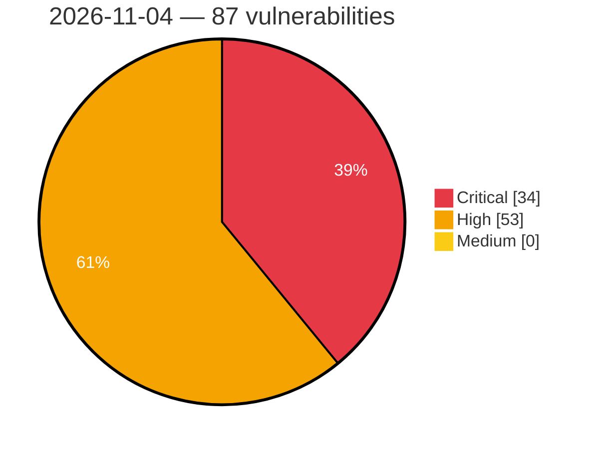

# Critical, High & Medium Severity Vulnerabilities — 2026-11-04

**Source status for this day:**

| Source | Critical | High | Medium | Total |
|--------|---------:|-----:|-------:|------:|
| cvefeed.io (High/Critical) | 34 | 53 | 0 | 87 |

**KEV (actively exploited):** 0  **Watchlist matches:** 45

## Critical (34)

| CVSS | Flags | Source | CVE / Title | Reported |
|------|-------|--------|-------------|----------|
| 10.0 | — | cvefeed.io (High/Critical) | [CVE-2026-121615 - Linksys E5600 Login mesh_login.cgi improper authentication](https://cvefeed.io/vuln/detail/CVE-2026-121615) | 5 hours, 50 minutes ago |
| 10.0 | — | cvefeed.io (High/Critical) | [CVE-2026-121609 - Qihoo 360 Whole Home Router M5 Boot Script mpt start hard-coded credentials](https://cvefeed.io/vuln/detail/CVE-2026-121609) | 6 hours, 50 minutes ago |
| 10.0 | ⭐ | cvefeed.io (High/Critical) | [CVE-2026-121607 - Qihoo 360 D603-2/D600-2/D606-6/D706 iscm testspeed_command os command injection](https://cvefeed.io/vuln/detail/CVE-2026-121607) | 6 hours, 50 minutes ago |
| 10.0 | — | cvefeed.io (High/Critical) | [CVE-2026-121606 - Qihoo 360 D621-2/D603-2/D600-2/D619/D606-6/D706 Firmware Signature Verification iscm verify_sign signature verification](https://cvefeed.io/vuln/detail/CVE-2026-121606) | 7 hours, 50 minutes ago |
| 10.0 | — | cvefeed.io (High/Critical) | [CVE-2026-121933 - Linksys E5350 Setup Wizard apply.cgi save_settings missing authentication](https://cvefeed.io/vuln/detail/CVE-2026-121933) | 1 hour, 2 minutes ago |
| 10.0 | ⭐ | cvefeed.io (High/Critical) | [CVE-2026-121932 - Linksys E5350 apply.cgi system os command injection](https://cvefeed.io/vuln/detail/CVE-2026-121932) | 2 hours, 4 minutes ago |
| 9.9 | — | cvefeed.io (High/Critical) | [CVE-2026-121597 - TOTOLINK A950RG Easy Setup Wizard cstecgi.cgi setAppEasyWizardConfig stack-based overflow](https://cvefeed.io/vuln/detail/CVE-2026-121597) | 55 minutes ago |
| 9.9 | — | cvefeed.io (High/Critical) | [CVE-2026-121600 - TOTOLINK A950RG MAC Filter cstecgi.cgi setMacFilterRules stack-based overflow](https://cvefeed.io/vuln/detail/CVE-2026-121600) | 7 hours, 50 minutes ago |
| 9.9 | — | cvefeed.io (High/Critical) | [CVE-2026-121599 - TOTOLINK A950RG Multi-SSID Configuration cstecgi.cgi delWiFiMultipleConfig stack-based overflow](https://cvefeed.io/vuln/detail/CVE-2026-121599) | 7 hours, 50 minutes ago |
| 9.9 | — | cvefeed.io (High/Critical) | [CVE-2026-121598 - TOTOLINK A950RG Basic Wireless Configuration cstecgi.cgi strcpy stack-based overflow](https://cvefeed.io/vuln/detail/CVE-2026-121598) | 7 hours, 50 minutes ago |
| 9.8 | ⭐ | cvefeed.io (High/Critical) | [CVE-2026-92190 - Quest Foglight for Databases baseRmiServiceExporter Deserialization of Untrusted Data Remote Code Execution Vulnerability](https://cvefeed.io/vuln/detail/CVE-2026-92190) | 55 minutes ago |
| 9.8 | ⭐ | cvefeed.io (High/Critical) | [CVE-2026-92189 - Quest Foglight for Databases writeTopologySectionToFile External Control of File Path Remote Code Execution Vulnerability](https://cvefeed.io/vuln/detail/CVE-2026-92189) | 55 minutes ago |
| 9.8 | ⭐ | cvefeed.io (High/Critical) | [CVE-2026-92188 - Quest Foglight for Databases ForgeMBeanServerSupport Missing Authentication Remote Code Execution Vulnerability](https://cvefeed.io/vuln/detail/CVE-2026-92188) | 55 minutes ago |
| 9.8 | ⭐ | cvefeed.io (High/Critical) | [CVE-2026-114549 - NoMachine nxwebrunner Heap-based Buffer Overflow Remote Code Execution Vulnerability](https://cvefeed.io/vuln/detail/CVE-2026-114549) | 55 minutes ago |
| 9.8 | — | cvefeed.io (High/Critical) | [CVE-2026-121953 - FreeRDP before 3.32.2 Use-After-Free via rdpgfx Dynamic Virtual Channel Close](https://cvefeed.io/vuln/detail/CVE-2026-121953) | 27 minutes ago |
| 9.8 | — | cvefeed.io (High/Critical) | [CVE-2026-121952 - FreeRDP before 3.32.2 Proxy Out-of-Bounds Write via Bitmap Cache v2 Capability](https://cvefeed.io/vuln/detail/CVE-2026-121952) | 27 minutes ago |
| 9.8 | — | cvefeed.io (High/Critical) | [CVE-2026-122006 - ActiveStorage ImageMagick Arbitrary File Access Vulnerability](https://cvefeed.io/vuln/detail/CVE-2026-122006) | 1 hour, 27 minutes ago |
| 9.8 | ⭐ | cvefeed.io (High/Critical) | [CVE-2026-65555 - WordPress Uncanny Toolkit for LearnDash plugin <= 3.8.2 - Privilege Escalation vulnerability](https://cvefeed.io/vuln/detail/CVE-2026-65555) | 3 hours, 27 minutes ago |
| 9.8 | — | cvefeed.io (High/Critical) | [CVE-2026-82418 - IBM Watson Speech Services Cartridge is vulnerable to a Use After Free condition in cryptography wheels OpenSSL](https://cvefeed.io/vuln/detail/CVE-2026-82418) | 17 minutes ago |
| 9.8 | ⭐ | cvefeed.io (High/Critical) | [CVE-2025-71457 - vtenext 25.02 before 25.02.1 Unverified Password Change via hub/rpwd.php](https://cvefeed.io/vuln/detail/CVE-2025-71457) | 44 minutes ago |
| 9.3 | — | cvefeed.io (High/Critical) | [CVE-2026-121803 - Out-of-bounds Write in UFS Firmware](https://cvefeed.io/vuln/detail/CVE-2026-121803) | 4 hours, 50 minutes ago |
| 9.3 | — | cvefeed.io (High/Critical) | [CVE-2026-113780 - ESF-IDF: Unvalidated Stack Pointer at the ESP-TEE Privilege-Switch Boundary](https://cvefeed.io/vuln/detail/CVE-2026-113780) | 2 hours, 4 minutes ago |
| 9.2 | — | cvefeed.io (High/Critical) | [CVE-2026-114425 - Forged LFT metadata permits arbitrary file read and deletion](https://cvefeed.io/vuln/detail/CVE-2026-114425) | 38 minutes ago |
| 9.2 | — | cvefeed.io (High/Critical) | [CVE-2026-114424 - Code execution through double evaluation in address replacement rules](https://cvefeed.io/vuln/detail/CVE-2026-114424) | 39 minutes ago |
| 9.2 | — | cvefeed.io (High/Critical) | [CVE-2026-121639 - WatchGuard AuthPoint Gateway Improper Authentication Allows Unauthenticated Denial of Service](https://cvefeed.io/vuln/detail/CVE-2026-121639) | 1 hour, 27 minutes ago |
| 9.2 | ⭐ | cvefeed.io (High/Critical) | [CVE-2026-121939 - Databasement before 1.10.9 Account Takeover via OIDC Email Auto-Linking](https://cvefeed.io/vuln/detail/CVE-2026-121939) | 3 hours, 27 minutes ago |
| 9.1 | — | cvefeed.io (High/Critical) | [CVE-2026-121802 - Better-Auth Expo Improper Authentication Verification Vulnerability](https://cvefeed.io/vuln/detail/CVE-2026-121802) | 5 hours, 50 minutes ago |
| 9.1 | ⭐ | cvefeed.io (High/Critical) | [CVE-2026-121640 - WatchGuard AuthPoint Gateway Capture-replay Allows Unauthorized Administrative Actions](https://cvefeed.io/vuln/detail/CVE-2026-121640) | 1 hour, 27 minutes ago |
| 9.1 | ⭐ | cvefeed.io (High/Critical) | [CVE-2026-121638 - WatchGuard AuthPoint Gateway Improper Certificate Validation Allows Man-in-the-Middle Attacks](https://cvefeed.io/vuln/detail/CVE-2026-121638) | 1 hour, 27 minutes ago |
| 9.1 | ⭐ | cvefeed.io (High/Critical) | [CVE-2026-122220 - WPO365 LOGIN before 45.2 SAML Replay Protection Bypass](https://cvefeed.io/vuln/detail/CVE-2026-122220) | 1 hour, 2 minutes ago |
| 9.1 | ⭐ | cvefeed.io (High/Critical) | [CVE-2026-113373 - Nexus Repository 3 - Disabled or Locked Single Sign-On Users Can Sign In Again](https://cvefeed.io/vuln/detail/CVE-2026-113373) | 1 hour, 2 minutes ago |
| 9.1 | ⭐ | cvefeed.io (High/Critical) | [CVE-2026-121931 - Linksys WRT54GL Traceroute Diagnostic Function apply.cgi system os command injection](https://cvefeed.io/vuln/detail/CVE-2026-121931) | 2 hours, 4 minutes ago |
| 9.1 | ⭐ | cvefeed.io (High/Critical) | [CVE-2026-121930 - Linksys WRT54GL Ping Diagnostic apply.cgi system os command injection](https://cvefeed.io/vuln/detail/CVE-2026-121930) | 2 hours, 4 minutes ago |
| 9.0 | ⭐ | cvefeed.io (High/Critical) | [CVE-2026-122120 - Yealink Plug-in Software Unauthorized File Write Vulnerability](https://cvefeed.io/vuln/detail/CVE-2026-122120) | 2 hours, 4 minutes ago |

## High (53)

| CVSS | Flags | Source | CVE / Title | Reported |
|------|-------|--------|-------------|----------|
| 8.9 | — | cvefeed.io (High/Critical) | [CVE-2026-121637 - WatchGuard AuthPoint Gateway Improper HMAC Validation in LDAP Authentication Callback Allows Forged Authentication Results](https://cvefeed.io/vuln/detail/CVE-2026-121637) | 1 hour, 27 minutes ago |
| 8.9 | ⭐ | cvefeed.io (High/Critical) | [CVE-2026-118391 - Unbounded query cache growth from interpolated JSON paths and splice lists in Ecto](https://cvefeed.io/vuln/detail/CVE-2026-118391) | 2 hours, 27 minutes ago |
| 8.8 | ⭐ | cvefeed.io (High/Critical) | [CVE-2026-92197 - Quest Foglight for Databases unzipFile Directory Traversal Remote Code Execution Vulnerability](https://cvefeed.io/vuln/detail/CVE-2026-92197) | 55 minutes ago |
| 8.8 | ⭐ | cvefeed.io (High/Critical) | [CVE-2026-92195 - Quest Foglight for Databases loadEvolveLicense Directory Traversal Remote Code Execution Vulnerability](https://cvefeed.io/vuln/detail/CVE-2026-92195) | 55 minutes ago |
| 8.8 | ⭐ | cvefeed.io (High/Critical) | [CVE-2026-92194 - Quest Foglight for Databases loadManageServerLicense Directory Traversal Remote Code Execution Vulnerability](https://cvefeed.io/vuln/detail/CVE-2026-92194) | 55 minutes ago |
| 8.8 | ⭐ | cvefeed.io (High/Critical) | [CVE-2026-92192 - Quest Foglight for Databases installLicense Directory Traversal Remote Code Execution Vulnerability](https://cvefeed.io/vuln/detail/CVE-2026-92192) | 55 minutes ago |
| 8.8 | ⭐ | cvefeed.io (High/Critical) | [CVE-2026-92191 - Quest Foglight for Databases runScript Incorrect Authorization Remote Code Execution Vulnerability](https://cvefeed.io/vuln/detail/CVE-2026-92191) | 55 minutes ago |
| 8.8 | ⭐ | cvefeed.io (High/Critical) | [CVE-2026-92187 - Quest Foglight for Databases extractAndCreateUploadInfoList Directory Traversal Remote Code Execution Vulnerability](https://cvefeed.io/vuln/detail/CVE-2026-92187) | 55 minutes ago |
| 8.8 | ⭐ | cvefeed.io (High/Critical) | [CVE-2026-92186 - Quest Foglight for Databases paFnUploadFileAndCreateInfo Directory Traversal Remote Code Execution Vulnerability](https://cvefeed.io/vuln/detail/CVE-2026-92186) | 55 minutes ago |
| 8.8 | ⭐ | cvefeed.io (High/Critical) | [CVE-2026-121816 - About Time Technologies｜Herowatch Mini - Missing Authentication](https://cvefeed.io/vuln/detail/CVE-2026-121816) | 1 hour, 50 minutes ago |
| 8.8 | ⭐ | cvefeed.io (High/Critical) | [CVE-2026-77690 - Command injection vulnerability](https://cvefeed.io/vuln/detail/CVE-2026-77690) | 2 hours, 50 minutes ago |
| 8.8 | — | cvefeed.io (High/Critical) | [CVE-2026-16511 - Unvalidated user pointers in RTIO syscall verifiers allow a user-mode thread to write kernel memory](https://cvefeed.io/vuln/detail/CVE-2026-16511) | 2 hours, 50 minutes ago |
| 8.8 | — | cvefeed.io (High/Critical) | [CVE-2026-121958 - FreeRDP through 3.32.1 Heap Out-of-Bounds Write via RDPGFX HashTable_GetKeys](https://cvefeed.io/vuln/detail/CVE-2026-121958) | 27 minutes ago |
| 8.8 | ⭐ | cvefeed.io (High/Critical) | [CVE-2026-121940 - Stonewuu ai-fusion-video before 1.3.0 IDOR via Project, Asset and Script Controllers](https://cvefeed.io/vuln/detail/CVE-2026-121940) | 3 hours, 27 minutes ago |
| 8.8 | ⭐ | cvefeed.io (High/Critical) | [CVE-2026-122135 - Mistral Vibe before 3.0.3 RCE via Repository-Configured gpg.program](https://cvefeed.io/vuln/detail/CVE-2026-122135) | 44 minutes ago |
| 8.8 | ⭐ | cvefeed.io (High/Critical) | [CVE-2026-122134 - Mistral Vibe before 2.25.7 Code Execution via Git Filter Drivers](https://cvefeed.io/vuln/detail/CVE-2026-122134) | 44 minutes ago |
| 8.8 | ⭐ | cvefeed.io (High/Critical) | [CVE-2026-122133 - Mistral Vibe before 2.25.5 on Windows Untrusted Search Path RCE via git.exe](https://cvefeed.io/vuln/detail/CVE-2026-122133) | 44 minutes ago |
| 8.8 | — | cvefeed.io (High/Critical) | [CVE-2026-11376 - IBM MQ is affected by a denial of service vulnerability](https://cvefeed.io/vuln/detail/CVE-2026-11376) | 55 minutes ago |
| 8.8 | — | cvefeed.io (High/Critical) | [CVE-2026-13292 - IBM MQ Managed File Transfer is affected by an arbitrary code execution vulnerability](https://cvefeed.io/vuln/detail/CVE-2026-13292) | 56 minutes ago |
| 8.7 | ⭐ | cvefeed.io (High/Critical) | [CVE-2026-114426 - Pre-authentication upload parsing permits resource exhaustion](https://cvefeed.io/vuln/detail/CVE-2026-114426) | 34 minutes ago |
| 8.7 | — | cvefeed.io (High/Critical) | [CVE-2026-121817 - About Time Technologies｜Herowatch Go Server - Insecure Direct Object Reference](https://cvefeed.io/vuln/detail/CVE-2026-121817) | 1 hour, 50 minutes ago |
| 8.7 | ⭐ | cvefeed.io (High/Critical) | [CVE-2026-84730 - ASUS Router AiCloud Stack-Based Buffer Overflow](https://cvefeed.io/vuln/detail/CVE-2026-84730) | 6 hours, 50 minutes ago |
| 8.7 | — | cvefeed.io (High/Critical) | [CVE-2026-121966 - Traefik before 2.11.60 and 3.7.16 ForwardAuth NTLM/Negotiate Identity Leak](https://cvefeed.io/vuln/detail/CVE-2026-121966) | 27 minutes ago |
| 8.7 | — | cvefeed.io (High/Critical) | [CVE-2026-121964 - FreeRDP before 3.32.2 Heap Buffer Overflow via rpc_client_recv_fragment](https://cvefeed.io/vuln/detail/CVE-2026-121964) | 27 minutes ago |
| 8.7 | — | cvefeed.io (High/Critical) | [CVE-2026-121960 - FreeRDP before 3.32.2 Unauthenticated Denial of Service via CredSSP TSRequest](https://cvefeed.io/vuln/detail/CVE-2026-121960) | 27 minutes ago |
| 8.7 | — | cvefeed.io (High/Critical) | [CVE-2026-121957 - FreeRDP before 3.32.2 Use-After-Free via RDPGFX ResetGraphics Race](https://cvefeed.io/vuln/detail/CVE-2026-121957) | 27 minutes ago |
| 8.7 | — | cvefeed.io (High/Critical) | [CVE-2026-121956 - FreeRDP before 3.32.2 Double Free in WinPR Kerberos retrieveSomeTgt](https://cvefeed.io/vuln/detail/CVE-2026-121956) | 27 minutes ago |
| 8.7 | — | cvefeed.io (High/Critical) | [CVE-2026-121955 - FreeRDP before 3.32.2 Use-After-Free in Smartcard Emulation ReleaseContext](https://cvefeed.io/vuln/detail/CVE-2026-121955) | 27 minutes ago |
| 8.7 | — | cvefeed.io (High/Critical) | [CVE-2026-121951 - FreeRDP 3.0.0 before 3.32.2 Denial of Service via Slow-Path Input Event](https://cvefeed.io/vuln/detail/CVE-2026-121951) | 27 minutes ago |
| 8.7 | — | cvefeed.io (High/Critical) | [CVE-2026-122127 - CESNET ipfixcol2 2.7.1 before 2.9.0 Heap Buffer Overflow via TCP LZ4 Decoder](https://cvefeed.io/vuln/detail/CVE-2026-122127) | 44 minutes ago |
| 8.6 | ⭐ | cvefeed.io (High/Critical) | [CVE-2025-71456 - vtenext before 25.02.2 SQL Injection via fieldname in Fax EditView](https://cvefeed.io/vuln/detail/CVE-2025-71456) | 44 minutes ago |
| 8.6 | ⭐ | cvefeed.io (High/Critical) | [CVE-2026-113374 - Nexus Repository 3 - Privilege Escalation via Rut Auth Capability Creation](https://cvefeed.io/vuln/detail/CVE-2026-113374) | 1 hour, 2 minutes ago |
| 8.6 | ⭐ | cvefeed.io (High/Critical) | [CVE-2026-82033 - DeepSeek Harness Unauthenticated RPC Command Execution](https://cvefeed.io/vuln/detail/CVE-2026-82033) | 2 hours, 4 minutes ago |
| 8.5 | — | cvefeed.io (High/Critical) | [CVE-2026-121818 - About Time Technologies｜Herowatch Go - Security Misconfiguration](https://cvefeed.io/vuln/detail/CVE-2026-121818) | 1 hour, 50 minutes ago |
| 8.5 | ⭐ | cvefeed.io (High/Critical) | [CVE-2026-112116 - ASUS System Control Interface Arbitrary Memory Access Vulnerability](https://cvefeed.io/vuln/detail/CVE-2026-112116) | 6 hours, 50 minutes ago |
| 8.5 | ⭐ | cvefeed.io (High/Critical) | [CVE-2026-121941 - libmt32emu before 2.8.4 Heap Buffer Overflow via MidiStreamParserImpl::parseSysex](https://cvefeed.io/vuln/detail/CVE-2026-121941) | 3 hours, 27 minutes ago |
| 8.5 | — | cvefeed.io (High/Critical) | [CVE-2026-11724 - IBM MQ Managed File Transfer is affected by an arbitrary code execution vulnerability](https://cvefeed.io/vuln/detail/CVE-2026-11724) | 55 minutes ago |
| 8.4 | — | cvefeed.io (High/Critical) | [CVE-2026-80335 - Out-of-bounds Write in Bootloader](https://cvefeed.io/vuln/detail/CVE-2026-80335) | 4 hours, 50 minutes ago |
| 8.3 | — | cvefeed.io (High/Critical) | [CVE-2026-114421 - Empty initial password permits GINA account takeover](https://cvefeed.io/vuln/detail/CVE-2026-114421) | 25 minutes ago |
| 8.3 | ⭐ | cvefeed.io (High/Critical) | [CVE-2026-87040 - Bluetooth LE Controller accepts received PDUs whose length field exceeds the configured maximum receive length, causing out-of-bounds read and write](https://cvefeed.io/vuln/detail/CVE-2026-87040) | 2 hours, 50 minutes ago |
| 8.3 | ⭐ | cvefeed.io (High/Critical) | [CVE-2026-92704 - SharpEmu: Cross-site request forgery in the debugger frontend leads to arbitrary process execution](https://cvefeed.io/vuln/detail/CVE-2026-92704) | 27 minutes ago |
| 8.3 | — | cvefeed.io (High/Critical) | [CVE-2026-122130 - CESNET ipfixcol2 2.3.0 before 2.9.0 Buffer Overflow via Forwarder Output Plugin](https://cvefeed.io/vuln/detail/CVE-2026-122130) | 44 minutes ago |
| 8.2 | ⭐ | cvefeed.io (High/Critical) | [CVE-2026-92198 - Quest Foglight for Databases getSource XML External Entity Processing Information Disclosure Vulnerability](https://cvefeed.io/vuln/detail/CVE-2026-92198) | 55 minutes ago |
| 8.2 | ⭐ | cvefeed.io (High/Critical) | [CVE-2026-118628 - MLflow get-artifacts Server-Side Request Forgery Information Disclosure Vulnerability](https://cvefeed.io/vuln/detail/CVE-2026-118628) | 55 minutes ago |
| 8.2 | — | cvefeed.io (High/Critical) | [CVE-2026-121963 - FreeRDP before 3.32.2 Use-After-Free via Dynamic rdpsnd Channel Close](https://cvefeed.io/vuln/detail/CVE-2026-121963) | 27 minutes ago |
| 8.2 | ⭐ | cvefeed.io (High/Critical) | [CVE-2026-121961 - FreeRDP before 3.32.2 Use-After-Free via DRDYNVC Tracker Race](https://cvefeed.io/vuln/detail/CVE-2026-121961) | 27 minutes ago |
| 8.2 | ⭐ | cvefeed.io (High/Critical) | [CVE-2026-119746 - ProSoft ICX35 Login Lockout Bypass via Client-Side Cookies](https://cvefeed.io/vuln/detail/CVE-2026-119746) | 27 minutes ago |
| 8.2 | — | cvefeed.io (High/Critical) | [CVE-2026-122126 - reSIProcate reTurn client through 1.14.0 Heap Buffer Overflow via TurnTcpSocket](https://cvefeed.io/vuln/detail/CVE-2026-122126) | 44 minutes ago |
| 8.2 | — | cvefeed.io (High/Critical) | [CVE-2026-122148 - Yealink MeetingBoard Pro Front-End Validation Bypass Vulnerability](https://cvefeed.io/vuln/detail/CVE-2026-122148) | 2 hours, 4 minutes ago |
| 8.1 | ⭐ | cvefeed.io (High/Critical) | [CVE-2026-114550 - libwebsockets MQTT Protocol PUBACK Packet Handling Out-Of-Bounds Write Remote Code Execution Vulnerability](https://cvefeed.io/vuln/detail/CVE-2026-114550) | 55 minutes ago |
| 8.1 | — | cvefeed.io (High/Critical) | [CVE-2026-121962 - FreeRDP before 3.32.2 Heap Buffer Overflow via Early User Authorization Read](https://cvefeed.io/vuln/detail/CVE-2026-121962) | 27 minutes ago |
| 8.1 | ⭐ | cvefeed.io (High/Critical) | [CVE-2026-122224 - WebVirtCloud through commit bb920b0 Missing Authorization in REST API Migrate and Create Endpoints](https://cvefeed.io/vuln/detail/CVE-2026-122224) | 44 minutes ago |
| 8.1 | — | cvefeed.io (High/Critical) | [CVE-2026-13271 - IBM MQ Managed File Transfer is affected by a denial of service vulnerability](https://cvefeed.io/vuln/detail/CVE-2026-13271) | 56 minutes ago |
