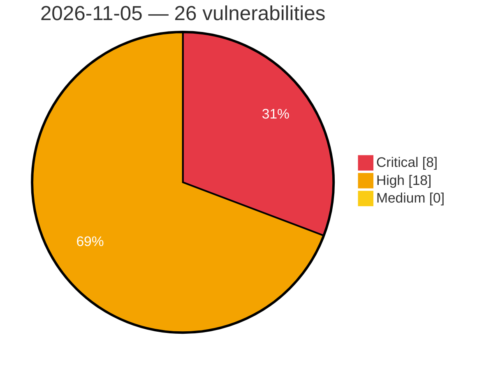

# Critical, High & Medium Severity Vulnerabilities — 2026-11-05

**Source status for this day:**

| Source | Critical | High | Medium | Total |
|--------|---------:|-----:|-------:|------:|
| cvefeed.io (High/Critical) | 8 | 18 | 0 | 26 |

**KEV (actively exploited):** 0  **Watchlist matches:** 18

## Critical (8)

| CVSS | Flags | Source | CVE / Title | Reported |
|------|-------|--------|-------------|----------|
| 10.0 | ⭐ | cvefeed.io (High/Critical) | [CVE-2026-122051 - Edimax BR-6208AC mp command injection](https://cvefeed.io/vuln/detail/CVE-2026-122051) | 1 hour, 40 minutes ago |
| 9.9 | ⭐ | cvefeed.io (High/Critical) | [CVE-2026-122313 - Kyverno 1.17.0 before 1.19.2 Cross-Namespace Privilege Escalation via NamespacedMutatingPolicy](https://cvefeed.io/vuln/detail/CVE-2026-122313) | 6 hours, 42 minutes ago |
| 9.9 | ⭐ | cvefeed.io (High/Critical) | [CVE-2026-122311 - Kyverno 1.16.0 before 1.19.2 Path Traversal in Namespaced CEL Policies via resource argument](https://cvefeed.io/vuln/detail/CVE-2026-122311) | 6 hours, 42 minutes ago |
| 9.9 | ⭐ | cvefeed.io (High/Critical) | [CVE-2026-122310 - Kyverno 1.19.1 before 1.19.2 Privilege Escalation via Policy apiCall urlPath](https://cvefeed.io/vuln/detail/CVE-2026-122310) | 6 hours, 42 minutes ago |
| 9.8 | ⭐ | cvefeed.io (High/Critical) | [CVE-2026-100109 - Security For WooCommerce 1.0.10 - 1.0.16 - Unauthenticated Privilege Escalation via usfw_create_temporary_user](https://cvefeed.io/vuln/detail/CVE-2026-100109) | 1 hour, 43 minutes ago |
| 9.4 | ⭐ | cvefeed.io (High/Critical) | [CVE-2026-123025 - OPNsense os-acme-client Google Cloud DNS OS Command Injection](https://cvefeed.io/vuln/detail/CVE-2026-123025) | 2 hours, 42 minutes ago |
| 9.2 | — | cvefeed.io (High/Critical) | [CVE-2026-122992 - DStarGateway Integer Underflow](https://cvefeed.io/vuln/detail/CVE-2026-122992) | 6 hours, 42 minutes ago |
| 9.1 | — | cvefeed.io (High/Critical) | [CVE-2026-122321 - Kyverno 1.18.0 before 1.19.2 verifyImages Cache Signature Verification Bypass](https://cvefeed.io/vuln/detail/CVE-2026-122321) | 6 hours, 42 minutes ago |

## High (18)

| CVSS | Flags | Source | CVE / Title | Reported |
|------|-------|--------|-------------|----------|
| 8.8 | ⭐ | cvefeed.io (High/Critical) | [CVE-2026-118869 - SHIRASAGI OS Command Injection Vulnerability](https://cvefeed.io/vuln/detail/CVE-2026-118869) | 43 minutes ago |
| 8.8 | ⭐ | cvefeed.io (High/Critical) | [CVE-2026-118193 - GiveWP <= 4.19.1 - Authenticated (Custom+) Privilege Escalation to 'donor_default_user_role' Parameter](https://cvefeed.io/vuln/detail/CVE-2026-118193) | 4 hours, 41 minutes ago |
| 8.7 | ⭐ | cvefeed.io (High/Critical) | [CVE-2026-123014 - iTerm2 Argument Injection Vulnerability](https://cvefeed.io/vuln/detail/CVE-2026-123014) | 3 hours, 43 minutes ago |
| 8.7 | — | cvefeed.io (High/Critical) | [CVE-2026-122323 - Kyverno 1.11.0 before 1.19.2 Memory Exhaustion via Notary Signature Decompression](https://cvefeed.io/vuln/detail/CVE-2026-122323) | 6 hours, 42 minutes ago |
| 8.7 | — | cvefeed.io (High/Critical) | [CVE-2026-122322 - Kyverno from 1.11.0 before 1.19.2 Memory Exhaustion via Notary Attestation Decompression](https://cvefeed.io/vuln/detail/CVE-2026-122322) | 6 hours, 42 minutes ago |
| 8.7 | ⭐ | cvefeed.io (High/Critical) | [CVE-2026-122319 - Kyverno before 1.19.2 Denial of Service via In/NotIn Operator Panic](https://cvefeed.io/vuln/detail/CVE-2026-122319) | 6 hours, 42 minutes ago |
| 8.7 | — | cvefeed.io (High/Critical) | [CVE-2026-122315 - Kyverno before 1.19.2 Image Verification Bypass via Attestation Type Panic](https://cvefeed.io/vuln/detail/CVE-2026-122315) | 6 hours, 42 minutes ago |
| 8.7 | ⭐ | cvefeed.io (High/Critical) | [CVE-2026-122314 - Kyverno before 1.19.2 Denial of Service via Shallow Variable Substitution Panic](https://cvefeed.io/vuln/detail/CVE-2026-122314) | 6 hours, 42 minutes ago |
| 8.5 | ⭐ | cvefeed.io (High/Critical) | [CVE-2026-122316 - Kyverno 1.17.0 before 1.19.2 Cross-Namespace Write via NamespacedMutatingPolicy mutateExisting](https://cvefeed.io/vuln/detail/CVE-2026-122316) | 6 hours, 42 minutes ago |
| 8.5 | — | cvefeed.io (High/Critical) | [CVE-2026-122308 - Kyverno before 1.19.2 Label Spoofing via Generation Handler processRequest](https://cvefeed.io/vuln/detail/CVE-2026-122308) | 6 hours, 42 minutes ago |
| 8.3 | ⭐ | cvefeed.io (High/Critical) | [CVE-2026-123033 - TrueNAS SCALE middlewared Authentication Bypass](https://cvefeed.io/vuln/detail/CVE-2026-123033) | 2 hours, 42 minutes ago |
| 8.3 | ⭐ | cvefeed.io (High/Critical) | [CVE-2026-122320 - Kyverno before 1.19.2 Cross-Namespace Resource Read via generate.clone](https://cvefeed.io/vuln/detail/CVE-2026-122320) | 6 hours, 42 minutes ago |
| 8.3 | ⭐ | cvefeed.io (High/Critical) | [CVE-2026-122312 - Kyverno 1.19.1 before 1.19.2 Namespace Isolation Bypass via APICall URLPath Query String](https://cvefeed.io/vuln/detail/CVE-2026-122312) | 6 hours, 42 minutes ago |
| 8.3 | ⭐ | cvefeed.io (High/Critical) | [CVE-2026-122307 - Kyverno before 1.19.2 Policy Bypass via admissionpolicygenerator PolicyException Handling](https://cvefeed.io/vuln/detail/CVE-2026-122307) | 6 hours, 42 minutes ago |
| 8.3 | ⭐ | cvefeed.io (High/Critical) | [CVE-2026-122306 - Kyverno before 1.19.2 Denial of Service via Exponential-Time Wildcard Matching](https://cvefeed.io/vuln/detail/CVE-2026-122306) | 6 hours, 42 minutes ago |
| 8.2 | ⭐ | cvefeed.io (High/Critical) | [CVE-2026-93389 - LiteSpeed Cache <= 7.9.1 - Unauthenticated Sensitive Information Disclosure (WooCommerce Store API Cart/Checkout PII + Cart-Token) via Public REST Caching](https://cvefeed.io/vuln/detail/CVE-2026-93389) | 4 hours, 41 minutes ago |
| 8.2 | — | cvefeed.io (High/Critical) | [CVE-2026-122309 - Kyverno before 1.19.2 Denial of Service via Unbounded CEL Policy Evaluation Cost](https://cvefeed.io/vuln/detail/CVE-2026-122309) | 6 hours, 42 minutes ago |
| 8.1 | — | cvefeed.io (High/Critical) | [CVE-2026-116617 - Motors <= 1.4.128 - Authenticated (Subscriber+) File Deletion via 'stm_dealer_logo_path' Parameter](https://cvefeed.io/vuln/detail/CVE-2026-116617) | 4 hours, 41 minutes ago |
