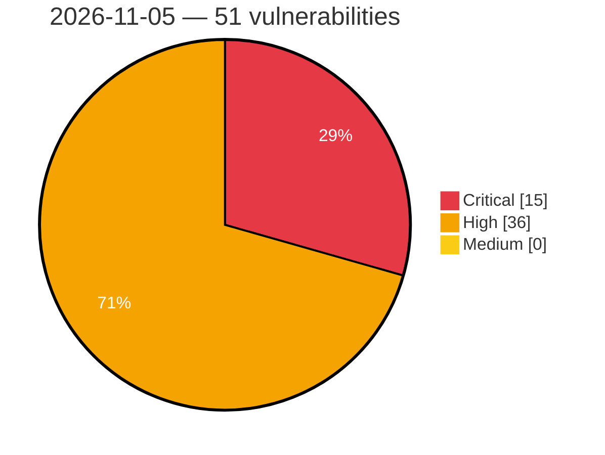

# Critical, High & Medium Severity Vulnerabilities — 2026-11-05

**Source status for this day:**

| Source | Critical | High | Medium | Total |
|--------|---------:|-----:|-------:|------:|
| cvefeed.io (High/Critical) | 15 | 36 | 0 | 51 |

**KEV (actively exploited):** 0  **Watchlist matches:** 34

## Critical (15)

| CVSS | Flags | Source | CVE / Title | Reported |
|------|-------|--------|-------------|----------|
| 10.0 | ⭐ | cvefeed.io (High/Critical) | [CVE-2026-122051 - Edimax BR-6208AC mp command injection](https://cvefeed.io/vuln/detail/CVE-2026-122051) | 1 hour, 40 minutes ago |
| 10.0 | ⭐ | cvefeed.io (High/Critical) | [CVE-2026-96677 - Apache Juneau: Cross-site scripting via unescaped request variables in HTML-doc chrome](https://cvefeed.io/vuln/detail/CVE-2026-96677) | 4 hours, 54 minutes ago |
| 10.0 | — | cvefeed.io (High/Critical) | [CVE-2026-73117 - Apache Juneau: Response header CRLF injection and open redirect when applications set headers or redirect targets from request data](https://cvefeed.io/vuln/detail/CVE-2026-73117) | 4 hours, 54 minutes ago |
| 10.0 | ⭐ | cvefeed.io (High/Critical) | [CVE-2026-73116 - Apache Juneau: REST client forwards credentials to a different origin when following HTTP redirects](https://cvefeed.io/vuln/detail/CVE-2026-73116) | 4 hours, 54 minutes ago |
| 10.0 | — | cvefeed.io (High/Critical) | [CVE-2026-73101 - Apache Juneau: Internal exception class and message disclosed via error response header and body regardless of secure defaults](https://cvefeed.io/vuln/detail/CVE-2026-73101) | 4 hours, 54 minutes ago |
| 9.9 | ⭐ | cvefeed.io (High/Critical) | [CVE-2026-122313 - Kyverno 1.17.0 before 1.19.2 Cross-Namespace Privilege Escalation via NamespacedMutatingPolicy](https://cvefeed.io/vuln/detail/CVE-2026-122313) | 6 hours, 42 minutes ago |
| 9.9 | ⭐ | cvefeed.io (High/Critical) | [CVE-2026-122311 - Kyverno 1.16.0 before 1.19.2 Path Traversal in Namespaced CEL Policies via resource argument](https://cvefeed.io/vuln/detail/CVE-2026-122311) | 6 hours, 42 minutes ago |
| 9.9 | ⭐ | cvefeed.io (High/Critical) | [CVE-2026-122310 - Kyverno 1.19.1 before 1.19.2 Privilege Escalation via Policy apiCall urlPath](https://cvefeed.io/vuln/detail/CVE-2026-122310) | 6 hours, 42 minutes ago |
| 9.8 | ⭐ | cvefeed.io (High/Critical) | [CVE-2026-100109 - Security For WooCommerce 1.0.10 - 1.0.16 - Unauthenticated Privilege Escalation via usfw_create_temporary_user](https://cvefeed.io/vuln/detail/CVE-2026-100109) | 1 hour, 43 minutes ago |
| 9.8 | ⭐ | cvefeed.io (High/Critical) | [CVE-2026-83542 - Apache OFBiz: Unauthenticated RCE via login-page widget injection](https://cvefeed.io/vuln/detail/CVE-2026-83542) | 2 hours, 55 minutes ago |
| 9.4 | ⭐ | cvefeed.io (High/Critical) | [CVE-2026-123025 - OPNsense os-acme-client Google Cloud DNS OS Command Injection](https://cvefeed.io/vuln/detail/CVE-2026-123025) | 2 hours, 42 minutes ago |
| 9.2 | — | cvefeed.io (High/Critical) | [CVE-2026-122992 - DStarGateway Integer Underflow](https://cvefeed.io/vuln/detail/CVE-2026-122992) | 6 hours, 42 minutes ago |
| 9.1 | — | cvefeed.io (High/Critical) | [CVE-2026-122321 - Kyverno 1.18.0 before 1.19.2 verifyImages Cache Signature Verification Bypass](https://cvefeed.io/vuln/detail/CVE-2026-122321) | 6 hours, 42 minutes ago |
| 9.1 | ⭐ | cvefeed.io (High/Critical) | [CVE-2026-119344 - Cocos Intra-handshake attested TLS implementation is vulnerable to Diversion Attacks](https://cvefeed.io/vuln/detail/CVE-2026-119344) | 54 minutes ago |
| 9.1 | ⭐ | cvefeed.io (High/Critical) | [CVE-2026-117691 - Keycloak-services: keycloak-services: saml redirect binding signature bypass via percent-encoded parameter names](https://cvefeed.io/vuln/detail/CVE-2026-117691) | 2 hours, 55 minutes ago |

## High (36)

| CVSS | Flags | Source | CVE / Title | Reported |
|------|-------|--------|-------------|----------|
| 8.8 | ⭐ | cvefeed.io (High/Critical) | [CVE-2026-118869 - SHIRASAGI OS Command Injection Vulnerability](https://cvefeed.io/vuln/detail/CVE-2026-118869) | 43 minutes ago |
| 8.8 | ⭐ | cvefeed.io (High/Critical) | [CVE-2026-118193 - GiveWP <= 4.19.1 - Authenticated (Custom+) Privilege Escalation to 'donor_default_user_role' Parameter](https://cvefeed.io/vuln/detail/CVE-2026-118193) | 4 hours, 41 minutes ago |
| 8.8 | — | cvefeed.io (High/Critical) | [CVE-2026-121994 - Gdb: gdb: stack buffer overflow in fetch_register_using_p via unchecked p-reply length](https://cvefeed.io/vuln/detail/CVE-2026-121994) | 1 hour, 3 minutes ago |
| 8.8 | ⭐ | cvefeed.io (High/Critical) | [CVE-2026-119744 - Cendio ThinLinc Improper Authentication via Web Access](https://cvefeed.io/vuln/detail/CVE-2026-119744) | 1 hour, 55 minutes ago |
| 8.8 | ⭐ | cvefeed.io (High/Critical) | [CVE-2026-84183 - Apache OFBiz: Content Manager VIEW-only RCE in updateLayout](https://cvefeed.io/vuln/detail/CVE-2026-84183) | 2 hours, 55 minutes ago |
| 8.8 | ⭐ | cvefeed.io (High/Critical) | [CVE-2026-82960 - Apache OFBiz: Widget use-when Expression Injection Bypasses Groovy Sandbox for authenticated RCE](https://cvefeed.io/vuln/detail/CVE-2026-82960) | 2 hours, 55 minutes ago |
| 8.8 | — | cvefeed.io (High/Critical) | [CVE-2026-82912 - Apache OFBiz: Unsandboxed Groovy compiled from a service parameter](https://cvefeed.io/vuln/detail/CVE-2026-82912) | 2 hours, 55 minutes ago |
| 8.7 | ⭐ | cvefeed.io (High/Critical) | [CVE-2026-123014 - iTerm2 Argument Injection Vulnerability](https://cvefeed.io/vuln/detail/CVE-2026-123014) | 3 hours, 43 minutes ago |
| 8.7 | — | cvefeed.io (High/Critical) | [CVE-2026-122323 - Kyverno 1.11.0 before 1.19.2 Memory Exhaustion via Notary Signature Decompression](https://cvefeed.io/vuln/detail/CVE-2026-122323) | 6 hours, 42 minutes ago |
| 8.7 | — | cvefeed.io (High/Critical) | [CVE-2026-122322 - Kyverno from 1.11.0 before 1.19.2 Memory Exhaustion via Notary Attestation Decompression](https://cvefeed.io/vuln/detail/CVE-2026-122322) | 6 hours, 42 minutes ago |
| 8.7 | ⭐ | cvefeed.io (High/Critical) | [CVE-2026-122319 - Kyverno before 1.19.2 Denial of Service via In/NotIn Operator Panic](https://cvefeed.io/vuln/detail/CVE-2026-122319) | 6 hours, 42 minutes ago |
| 8.7 | — | cvefeed.io (High/Critical) | [CVE-2026-122315 - Kyverno before 1.19.2 Image Verification Bypass via Attestation Type Panic](https://cvefeed.io/vuln/detail/CVE-2026-122315) | 6 hours, 42 minutes ago |
| 8.7 | ⭐ | cvefeed.io (High/Critical) | [CVE-2026-122314 - Kyverno before 1.19.2 Denial of Service via Shallow Variable Substitution Panic](https://cvefeed.io/vuln/detail/CVE-2026-122314) | 6 hours, 42 minutes ago |
| 8.6 | ⭐ | cvefeed.io (High/Critical) | [CVE-2026-73856 - ModSecurity: Response Body Inspection Bypass](https://cvefeed.io/vuln/detail/CVE-2026-73856) | 54 minutes ago |
| 8.6 | ⭐ | cvefeed.io (High/Critical) | [CVE-2026-104269 - ModSecurity: RFC 2231 `filename*` Parameter Bypasses Multipart Filename Rules on RFC-Compliant Backends (Go, Python, Node, Java)](https://cvefeed.io/vuln/detail/CVE-2026-104269) | 55 minutes ago |
| 8.5 | ⭐ | cvefeed.io (High/Critical) | [CVE-2026-122316 - Kyverno 1.17.0 before 1.19.2 Cross-Namespace Write via NamespacedMutatingPolicy mutateExisting](https://cvefeed.io/vuln/detail/CVE-2026-122316) | 6 hours, 42 minutes ago |
| 8.5 | — | cvefeed.io (High/Critical) | [CVE-2026-122308 - Kyverno before 1.19.2 Label Spoofing via Generation Handler processRequest](https://cvefeed.io/vuln/detail/CVE-2026-122308) | 6 hours, 42 minutes ago |
| 8.5 | — | cvefeed.io (High/Critical) | [CVE-2026-120499 - h5io before 0.2.6 Arbitrary Code Execution via read_hdf5](https://cvefeed.io/vuln/detail/CVE-2026-120499) | 17 minutes ago |
| 8.5 | — | cvefeed.io (High/Critical) | [CVE-2026-122329 - SDL_mixer 3.1.2 through 3.2.4 Stack-based Buffer Overflow via FetchXLaw() in AIFF Decoder](https://cvefeed.io/vuln/detail/CVE-2026-122329) | 54 minutes ago |
| 8.5 | — | cvefeed.io (High/Critical) | [CVE-2026-122328 - SDL_mixer 3.1.2 through 3.2.4 Stack-based Buffer Overflow via FetchXLaw() in WAV Decoder](https://cvefeed.io/vuln/detail/CVE-2026-122328) | 54 minutes ago |
| 8.4 | ⭐ | cvefeed.io (High/Critical) | [CVE-2026-119083 - GluonTS arbitrary file write during archive extraction](https://cvefeed.io/vuln/detail/CVE-2026-119083) | 37 minutes ago |
| 8.3 | ⭐ | cvefeed.io (High/Critical) | [CVE-2026-123033 - TrueNAS SCALE middlewared Authentication Bypass](https://cvefeed.io/vuln/detail/CVE-2026-123033) | 2 hours, 42 minutes ago |
| 8.3 | ⭐ | cvefeed.io (High/Critical) | [CVE-2026-122320 - Kyverno before 1.19.2 Cross-Namespace Resource Read via generate.clone](https://cvefeed.io/vuln/detail/CVE-2026-122320) | 6 hours, 42 minutes ago |
| 8.3 | ⭐ | cvefeed.io (High/Critical) | [CVE-2026-122312 - Kyverno 1.19.1 before 1.19.2 Namespace Isolation Bypass via APICall URLPath Query String](https://cvefeed.io/vuln/detail/CVE-2026-122312) | 6 hours, 42 minutes ago |
| 8.3 | ⭐ | cvefeed.io (High/Critical) | [CVE-2026-122307 - Kyverno before 1.19.2 Policy Bypass via admissionpolicygenerator PolicyException Handling](https://cvefeed.io/vuln/detail/CVE-2026-122307) | 6 hours, 42 minutes ago |
| 8.3 | ⭐ | cvefeed.io (High/Critical) | [CVE-2026-122306 - Kyverno before 1.19.2 Denial of Service via Exponential-Time Wildcard Matching](https://cvefeed.io/vuln/detail/CVE-2026-122306) | 6 hours, 42 minutes ago |
| 8.2 | ⭐ | cvefeed.io (High/Critical) | [CVE-2026-93389 - LiteSpeed Cache <= 7.9.1 - Unauthenticated Sensitive Information Disclosure (WooCommerce Store API Cart/Checkout PII + Cart-Token) via Public REST Caching](https://cvefeed.io/vuln/detail/CVE-2026-93389) | 4 hours, 41 minutes ago |
| 8.2 | — | cvefeed.io (High/Critical) | [CVE-2026-122309 - Kyverno before 1.19.2 Denial of Service via Unbounded CEL Policy Evaluation Cost](https://cvefeed.io/vuln/detail/CVE-2026-122309) | 6 hours, 42 minutes ago |
| 8.2 | — | cvefeed.io (High/Critical) | [CVE-2026-121996 - Gdb: gdbserver: heap disclosure and wild pointer in gdb_parse_agent_expr via untrusted agent-expression length](https://cvefeed.io/vuln/detail/CVE-2026-121996) | 1 hour, 3 minutes ago |
| 8.1 | — | cvefeed.io (High/Critical) | [CVE-2026-116617 - Motors <= 1.4.128 - Authenticated (Subscriber+) File Deletion via 'stm_dealer_logo_path' Parameter](https://cvefeed.io/vuln/detail/CVE-2026-116617) | 4 hours, 41 minutes ago |
| 8.1 | ⭐ | cvefeed.io (High/Critical) | [CVE-2026-123158 - OpenSSH Authentication Bypass Vulnerability](https://cvefeed.io/vuln/detail/CVE-2026-123158) | 54 minutes ago |
| 8.1 | — | cvefeed.io (High/Critical) | [CVE-2026-107891 - musl libc Integer Overflow in Regular Expression Compilation](https://cvefeed.io/vuln/detail/CVE-2026-107891) | 55 minutes ago |
| 8.1 | ⭐ | cvefeed.io (High/Critical) | [CVE-2026-121997 - Gdb: gdbserver: heap buffer overflow in cmd_qtdpsrc via qtdpsrc declared/actual length mismatch](https://cvefeed.io/vuln/detail/CVE-2026-121997) | 1 hour, 3 minutes ago |
| 8.1 | ⭐ | cvefeed.io (High/Critical) | [CVE-2026-114232 - Keycloak-services: keycloak-services: uma protection api resourcetype field not validated — cross-owner resource access](https://cvefeed.io/vuln/detail/CVE-2026-114232) | 1 hour, 6 minutes ago |
| 8.1 | ⭐ | cvefeed.io (High/Critical) | [CVE-2026-112208 - Keycloak-services: keycloak-services: account takeover via stale sso_auth note in organization identity-first login](https://cvefeed.io/vuln/detail/CVE-2026-112208) | 1 hour, 7 minutes ago |
| 8.0 | ⭐ | cvefeed.io (High/Critical) | [CVE-2026-102523 - MariaDB server: Authorization bypass via ALTER TABLE ... CONVERT ... PARTITION](https://cvefeed.io/vuln/detail/CVE-2026-102523) | 55 minutes ago |
