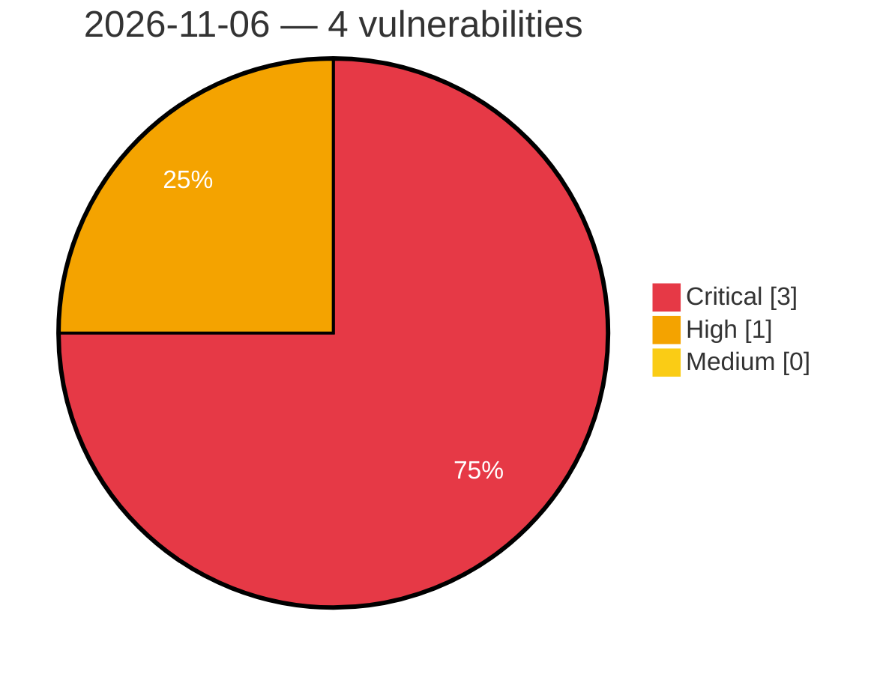

# Critical, High & Medium Severity Vulnerabilities — 2026-11-06

**Source status for this day:**

| Source | Critical | High | Medium | Total |
|--------|---------:|-----:|-------:|------:|
| cvefeed.io (High/Critical) | 3 | 1 | 0 | 4 |

**KEV (actively exploited):** 0  **Watchlist matches:** 3

## Critical (3)

| CVSS | Flags | Source | CVE / Title | Reported |
|------|-------|--------|-------------|----------|
| 10.0 | — | cvefeed.io (High/Critical) | [CVE-2026-107492 - Envoy Proxy Improper Authentication Vulnerability](https://cvefeed.io/vuln/detail/CVE-2026-107492) | 2 hours, 49 minutes ago |
| 9.4 | ⭐ | cvefeed.io (High/Critical) | [CVE-2026-63774 - Subnet Solutions PowerSYSTEM Center SQL Injection](https://cvefeed.io/vuln/detail/CVE-2026-63774) | 2 hours, 49 minutes ago |
| 9.4 | ⭐ | cvefeed.io (High/Critical) | [CVE-2026-63017 - Subnet Solutions PowerSYSTEM Center Incorrect Authorization](https://cvefeed.io/vuln/detail/CVE-2026-63017) | 2 hours, 49 minutes ago |

## High (1)

| CVSS | Flags | Source | CVE / Title | Reported |
|------|-------|--------|-------------|----------|
| 8.7 | ⭐ | cvefeed.io (High/Critical) | [CVE-2025-71458 - FTS3 Web Monitoring 3.12.0 through 3.13.2 and 3.14.0 SQL Injection via /linkinfo](https://cvefeed.io/vuln/detail/CVE-2025-71458) | 2 hours, 49 minutes ago |
