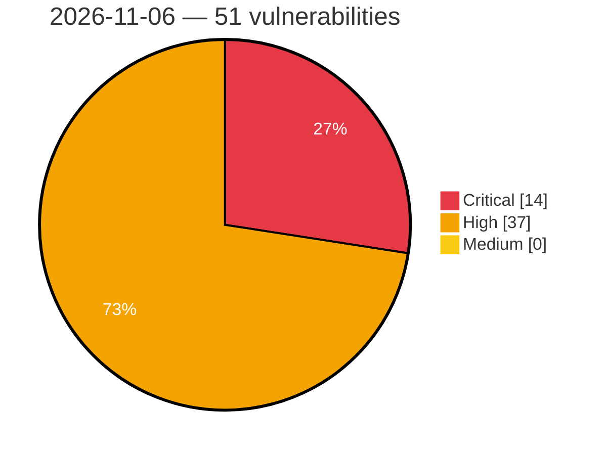

# Critical, High & Medium Severity Vulnerabilities — 2026-11-06

**Source status for this day:**

| Source | Critical | High | Medium | Total |
|--------|---------:|-----:|-------:|------:|
| cvefeed.io (High/Critical) | 14 | 37 | 0 | 51 |

**KEV (actively exploited):** 0  **Watchlist matches:** 36

## Critical (14)

| CVSS | Flags | Source | CVE / Title | Reported |
|------|-------|--------|-------------|----------|
| 10.0 | — | cvefeed.io (High/Critical) | [CVE-2026-107492 - Envoy Proxy Improper Authentication Vulnerability](https://cvefeed.io/vuln/detail/CVE-2026-107492) | 2 hours, 49 minutes ago |
| 10.0 | ⭐ | cvefeed.io (High/Critical) | [CVE-2026-118423 - WP Libre Form 1.5.0.1 - Unauthenticated RCE via Arbitrary File Upload](https://cvefeed.io/vuln/detail/CVE-2026-118423) | 3 hours, 52 minutes ago |
| 9.9 | ⭐ | cvefeed.io (High/Critical) | [CVE-2026-122193 - OS command injection in the example SSM documents in Trusted Remote Execution (REX)](https://cvefeed.io/vuln/detail/CVE-2026-122193) | 57 minutes ago |
| 9.8 | ⭐ | cvefeed.io (High/Critical) | [CVE-2026-120844 - WordPress OAuth Single Sign On – SSO (OAuth Client) plugin <= 7.1.3 - Privilege Escalation vulnerability](https://cvefeed.io/vuln/detail/CVE-2026-120844) | 3 hours, 52 minutes ago |
| 9.8 | ⭐ | cvefeed.io (High/Critical) | [CVE-2026-119516 - WordPress Radius Booking — Booking Calendar for Appointments & Services plugin <= 1.0.20 - PHP Object Injection vulnerability](https://cvefeed.io/vuln/detail/CVE-2026-119516) | 3 hours, 52 minutes ago |
| 9.8 | — | cvefeed.io (High/Critical) | [CVE-2026-59105 - Universal sysadmin credential vulnerability in Jumis](https://cvefeed.io/vuln/detail/CVE-2026-59105) | 2 hours, 57 minutes ago |
| 9.8 | ⭐ | cvefeed.io (High/Critical) | [CVE-2026-123488 - Craft CMS 4.0.0 before 4.18.9 SQL Injection via Element Search Endpoint](https://cvefeed.io/vuln/detail/CVE-2026-123488) | 2 hours, 57 minutes ago |
| 9.6 | ⭐ | cvefeed.io (High/Critical) | [CVE-2026-123294 - JetBrains Hub Privilege Escalation Vulnerability](https://cvefeed.io/vuln/detail/CVE-2026-123294) | 52 minutes ago |
| 9.6 | ⭐ | cvefeed.io (High/Critical) | [CVE-2026-123832 - JetBrains CLion Safe Mode Remote Code Execution](https://cvefeed.io/vuln/detail/CVE-2026-123832) | 57 minutes ago |
| 9.6 | ⭐ | cvefeed.io (High/Critical) | [CVE-2026-123831 - JetBrains CLion Safe Mode Remote Code Execution](https://cvefeed.io/vuln/detail/CVE-2026-123831) | 57 minutes ago |
| 9.4 | ⭐ | cvefeed.io (High/Critical) | [CVE-2026-63774 - Subnet Solutions PowerSYSTEM Center SQL Injection](https://cvefeed.io/vuln/detail/CVE-2026-63774) | 2 hours, 49 minutes ago |
| 9.4 | ⭐ | cvefeed.io (High/Critical) | [CVE-2026-63017 - Subnet Solutions PowerSYSTEM Center Incorrect Authorization](https://cvefeed.io/vuln/detail/CVE-2026-63017) | 2 hours, 49 minutes ago |
| 9.1 | — | cvefeed.io (High/Critical) | [CVE-2026-88800 - MDJM Event Management and Mobile Events Manager <= 1.7.8.7 - Unauthenticated Arbitrary Role Deletion](https://cvefeed.io/vuln/detail/CVE-2026-88800) | 3 hours, 52 minutes ago |
| 9.0 | — | cvefeed.io (High/Critical) | [CVE-2026-123279 - JetBrains Datalore Arbitrary Code Execution](https://cvefeed.io/vuln/detail/CVE-2026-123279) | 52 minutes ago |

## High (37)

| CVSS | Flags | Source | CVE / Title | Reported |
|------|-------|--------|-------------|----------|
| 8.8 | ⭐ | cvefeed.io (High/Critical) | [CVE-2026-88799 - MDJM Event Management and Mobile Events Manager <= 1.7.8.7 - Subscriber+ Account Takeover via IDOR](https://cvefeed.io/vuln/detail/CVE-2026-88799) | 3 hours, 52 minutes ago |
| 8.8 | ⭐ | cvefeed.io (High/Critical) | [CVE-2026-118670 - OHIF Viewers: DOM-Based Cross Site Scripting (XSS) through MIME type of document](https://cvefeed.io/vuln/detail/CVE-2026-118670) | 45 minutes ago |
| 8.8 | — | cvefeed.io (High/Critical) | [CVE-2026-123836 - JetBrains Datalore SSH Private Key Exposure](https://cvefeed.io/vuln/detail/CVE-2026-123836) | 57 minutes ago |
| 8.8 | — | cvefeed.io (High/Critical) | [CVE-2026-123783 - Skyvern through 1.0.56 Script Sandbox Bypass via types.CodeType Bytecode](https://cvefeed.io/vuln/detail/CVE-2026-123783) | 2 hours, 57 minutes ago |
| 8.8 | ⭐ | cvefeed.io (High/Critical) | [CVE-2026-123621 - Usermin through 2.570 Path Traversal File Write via detachall.cgi](https://cvefeed.io/vuln/detail/CVE-2026-123621) | 2 hours, 57 minutes ago |
| 8.8 | ⭐ | cvefeed.io (High/Critical) | [CVE-2026-123491 - Craft CMS 4.0.0 before 4.18.9 Unauthenticated SQL Injection via GraphQL Eager-Load Select](https://cvefeed.io/vuln/detail/CVE-2026-123491) | 2 hours, 57 minutes ago |
| 8.8 | ⭐ | cvefeed.io (High/Critical) | [CVE-2026-123490 - Craft CMS before 5.11.2 Privilege Escalation via getOwners() Sandbox Bypass](https://cvefeed.io/vuln/detail/CVE-2026-123490) | 2 hours, 57 minutes ago |
| 8.7 | ⭐ | cvefeed.io (High/Critical) | [CVE-2025-71458 - FTS3 Web Monitoring 3.12.0 through 3.13.2 and 3.14.0 SQL Injection via /linkinfo](https://cvefeed.io/vuln/detail/CVE-2025-71458) | 2 hours, 49 minutes ago |
| 8.7 | ⭐ | cvefeed.io (High/Critical) | [CVE-2026-85111 - Apache James: Denial of service upon MIME parsing](https://cvefeed.io/vuln/detail/CVE-2026-85111) | 19 minutes ago |
| 8.7 | ⭐ | cvefeed.io (High/Critical) | [CVE-2026-113431 - Unbounded decoded HTTP/2 header-list size in cowlib cow_http2_machine enables HPACK amplification memory exhaustion](https://cvefeed.io/vuln/detail/CVE-2026-113431) | 52 minutes ago |
| 8.7 | ⭐ | cvefeed.io (High/Critical) | [CVE-2026-123087 - SQL injection in Atmira’s SIREC](https://cvefeed.io/vuln/detail/CVE-2026-123087) | 1 hour, 53 minutes ago |
| 8.7 | — | cvefeed.io (High/Critical) | [CVE-2026-121824 - Armeria Thrift Malformed Message Denial of Service Vulnerability](https://cvefeed.io/vuln/detail/CVE-2026-121824) | 3 hours, 52 minutes ago |
| 8.7 | ⭐ | cvefeed.io (High/Critical) | [CVE-2026-121823 - Armeria Path Traversal Vulnerability](https://cvefeed.io/vuln/detail/CVE-2026-121823) | 3 hours, 52 minutes ago |
| 8.7 | ⭐ | cvefeed.io (High/Critical) | [CVE-2026-121820 - Armeria SAML HTTP-Redirect Binding Memory Exhaustion Denial of Service](https://cvefeed.io/vuln/detail/CVE-2026-121820) | 3 hours, 52 minutes ago |
| 8.7 | ⭐ | cvefeed.io (High/Critical) | [CVE-2026-119432 - Foxit Workspace Stored XSS in shared artifacts](https://cvefeed.io/vuln/detail/CVE-2026-119432) | 6 hours, 51 minutes ago |
| 8.7 | ⭐ | cvefeed.io (High/Critical) | [CVE-2026-89017 - Skyline DataMiner BrokerGateway Embedded API Key Authentication Bypass](https://cvefeed.io/vuln/detail/CVE-2026-89017) | 24 minutes ago |
| 8.7 | — | cvefeed.io (High/Critical) | [CVE-2026-123792 - Symfony: Exponential and Quadratic Parse Times in the YAML Parser Let a Single Document Hold a Process](https://cvefeed.io/vuln/detail/CVE-2026-123792) | 1 hour, 56 minutes ago |
| 8.7 | — | cvefeed.io (High/Critical) | [CVE-2026-123487 - Parse Server 9.0.0 before 9.10.7-alpha.1 ReDoS via Email Validation Regex](https://cvefeed.io/vuln/detail/CVE-2026-123487) | 2 hours, 57 minutes ago |
| 8.6 | ⭐ | cvefeed.io (High/Critical) | [CVE-2026-53980 - Charmbracelet Wish 2.0.5 Path Traversal via git Middleware](https://cvefeed.io/vuln/detail/CVE-2026-53980) | 2 hours, 57 minutes ago |
| 8.5 | — | cvefeed.io (High/Critical) | [CVE-2026-33379 - Dashboard snapshot permission bypass](https://cvefeed.io/vuln/detail/CVE-2026-33379) | 1 hour, 53 minutes ago |
| 8.5 | ⭐ | cvefeed.io (High/Critical) | [CVE-2026-123786 - Agenta before 0.122.5 SSRF via Workflow Revision URL Leaks Secret Token](https://cvefeed.io/vuln/detail/CVE-2026-123786) | 2 hours, 57 minutes ago |
| 8.5 | ⭐ | cvefeed.io (High/Critical) | [CVE-2026-123784 - Fluxbox through 1.3.7 OS Command Injection via Style Background Values](https://cvefeed.io/vuln/detail/CVE-2026-123784) | 2 hours, 57 minutes ago |
| 8.4 | — | cvefeed.io (High/Critical) | [CVE-2026-123323 - JetBrains YouTrack Improper URL Validation Vulnerability](https://cvefeed.io/vuln/detail/CVE-2026-123323) | 52 minutes ago |
| 8.4 | — | cvefeed.io (High/Critical) | [CVE-2026-123962 - FreedomBox Arbitrary File Read and Write Vulnerability](https://cvefeed.io/vuln/detail/CVE-2026-123962) | 57 minutes ago |
| 8.4 | — | cvefeed.io (High/Critical) | [CVE-2026-118515 - Symfony: The Serializer Builds UploadedFile Objects From Request Data, Letting a Client Point an Upload at Any Server File](https://cvefeed.io/vuln/detail/CVE-2026-118515) | 57 minutes ago |
| 8.3 | — | cvefeed.io (High/Critical) | [CVE-2026-123675 - OpenBMB Internet of Agents Code Executor Tool code_executor.py execute_code code injection](https://cvefeed.io/vuln/detail/CVE-2026-123675) | 1 hour, 57 minutes ago |
| 8.2 | ⭐ | cvefeed.io (High/Critical) | [CVE-2026-123301 - JetBrains IntelliJ IDEA DOM-based Cross-Site Scripting Vulnerability](https://cvefeed.io/vuln/detail/CVE-2026-123301) | 52 minutes ago |
| 8.2 | ⭐ | cvefeed.io (High/Critical) | [CVE-2026-115701 - Cowboy HTTP/1.1 Unbounded Buffering of Pipelined Data During Request Handling Enables Memory Exhaustion](https://cvefeed.io/vuln/detail/CVE-2026-115701) | 52 minutes ago |
| 8.2 | ⭐ | cvefeed.io (High/Critical) | [CVE-2026-85743 - FreeScout: Server-side request forgery via incomplete outbound host validation and unguarded download sinks](https://cvefeed.io/vuln/detail/CVE-2026-85743) | 54 minutes ago |
| 8.2 | ⭐ | cvefeed.io (High/Critical) | [CVE-2026-123623 - Grida through 0.0.24 Missing Authorization in Forms File-Preview API](https://cvefeed.io/vuln/detail/CVE-2026-123623) | 1 hour, 57 minutes ago |
| 8.2 | ⭐ | cvefeed.io (High/Critical) | [CVE-2026-121623 - Symfony: DataUriNormalizer Opens Data URIs With a Non-Lowercase Scheme as Local Files, Letting a Client Read Any Server File](https://cvefeed.io/vuln/detail/CVE-2026-121623) | 1 hour, 57 minutes ago |
| 8.2 | ⭐ | cvefeed.io (High/Critical) | [CVE-2026-119170 - Regression in FIPS enforcement of hash algorithms affecting only Python 3.14.10](https://cvefeed.io/vuln/detail/CVE-2026-119170) | 2 hours, 57 minutes ago |
| 8.1 | — | cvefeed.io (High/Critical) | [CVE-2026-123317 - JetBrains Ktor Session Forgery Vulnerability](https://cvefeed.io/vuln/detail/CVE-2026-123317) | 52 minutes ago |
| 8.1 | ⭐ | cvefeed.io (High/Critical) | [CVE-2026-123295 - JetBrains Hub Two-Factor Authentication Bypass](https://cvefeed.io/vuln/detail/CVE-2026-123295) | 52 minutes ago |
| 8.1 | ⭐ | cvefeed.io (High/Critical) | [CVE-2026-123280 - JetBrains Datalore Remote Code Execution](https://cvefeed.io/vuln/detail/CVE-2026-123280) | 52 minutes ago |
| 8.1 | ⭐ | cvefeed.io (High/Critical) | [CVE-2026-123859 - SQL Injection via unescaped DataFrame column names in Snowflake Connector for Python and Snowflake Connector for Python (Universal Core)](https://cvefeed.io/vuln/detail/CVE-2026-123859) | 57 minutes ago |
| 8.0 | ⭐ | cvefeed.io (High/Critical) | [CVE-2026-88801 - MDJM Event Management and Mobile Events Manager <= 1.7.8.7 - Subscriber+ Stored XSS via Role Creation](https://cvefeed.io/vuln/detail/CVE-2026-88801) | 3 hours, 52 minutes ago |
