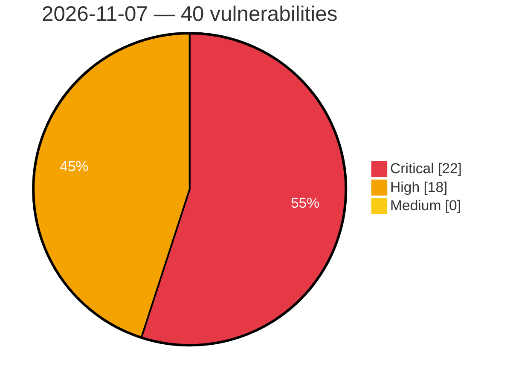

# Critical, High & Medium Severity Vulnerabilities — 2026-11-07

**Source status for this day:**

| Source | Critical | High | Medium | Total |
|--------|---------:|-----:|-------:|------:|
| cvefeed.io (High/Critical) | 22 | 18 | 0 | 40 |

**KEV (actively exploited):** 0  **Watchlist matches:** 30

## Critical (22)

| CVSS | Flags | Source | CVE / Title | Reported |
|------|-------|--------|-------------|----------|
| 10.0 | — | cvefeed.io (High/Critical) | [CVE-2026-123966 - Tenda AC19 saveParentControlInfo heap-based overflow](https://cvefeed.io/vuln/detail/CVE-2026-123966) | 1 hour, 22 minutes ago |
| 9.9 | — | cvefeed.io (High/Critical) | [CVE-2026-123960 - TOTOLINK CA300-PoE cstecgi.cgi setWanConfig buffer overflow](https://cvefeed.io/vuln/detail/CVE-2026-123960) | 1 hour, 3 minutes ago |
| 9.9 | — | cvefeed.io (High/Critical) | [CVE-2026-123958 - TOTOLINK CA300-PoE cstecgi.cgi setLanConfig buffer overflow](https://cvefeed.io/vuln/detail/CVE-2026-123958) | 2 hours, 3 minutes ago |
| 9.9 | — | cvefeed.io (High/Critical) | [CVE-2026-123957 - TOTOLINK CA300-PoE cstecgi.cgi setIpQosRules buffer overflow](https://cvefeed.io/vuln/detail/CVE-2026-123957) | 2 hours, 3 minutes ago |
| 9.9 | ⭐ | cvefeed.io (High/Critical) | [CVE-2026-17410 - Multiple Vulnerabilities in IBM API Connect](https://cvefeed.io/vuln/detail/CVE-2026-17410) | 6 hours, 2 minutes ago |
| 9.9 | ⭐ | cvefeed.io (High/Critical) | [CVE-2026-17402 - Multiple Vulnerabilities in IBM API Connect](https://cvefeed.io/vuln/detail/CVE-2026-17402) | 6 hours, 2 minutes ago |
| 9.9 | ⭐ | cvefeed.io (High/Critical) | [CVE-2026-17399 - Multiple Vulnerabilities in IBM API Connect](https://cvefeed.io/vuln/detail/CVE-2026-17399) | 6 hours, 2 minutes ago |
| 9.9 | — | cvefeed.io (High/Critical) | [CVE-2026-123961 - TOTOLINK CA300-PoE cstecgi.cgi setWiFiBasicConfig buffer overflow](https://cvefeed.io/vuln/detail/CVE-2026-123961) | 4 hours, 22 minutes ago |
| 9.8 | ⭐ | cvefeed.io (High/Critical) | [CVE-2026-93754 - payever – WooCommerce Gateway <= 4.8.0 - Unauthenticated Arbitrary File Upload Leading to Remote Code Execution](https://cvefeed.io/vuln/detail/CVE-2026-93754) | 44 minutes ago |
| 9.8 | ⭐ | cvefeed.io (High/Critical) | [CVE-2026-17408 - Multiple Vulnerabilities in IBM API Connect](https://cvefeed.io/vuln/detail/CVE-2026-17408) | 6 hours, 2 minutes ago |
| 9.8 | ⭐ | cvefeed.io (High/Critical) | [CVE-2026-119075 - Registration Form for WooCommerce <= 1.1.4 - Unauthenticated Privilege Escalation to 'user_roles' Parameter at Checkout](https://cvefeed.io/vuln/detail/CVE-2026-119075) | 3 hours, 21 minutes ago |
| 9.8 | ⭐ | cvefeed.io (High/Critical) | [CVE-2026-104014 - Naimur Email OTP Verification for WooCommerce <= 2.1.0 - Unauthenticated Authentication Bypass to Account Takeover via Abandoned Password Reset Finalization](https://cvefeed.io/vuln/detail/CVE-2026-104014) | 3 hours, 21 minutes ago |
| 9.6 | ⭐ | cvefeed.io (High/Critical) | [CVE-2026-18535 - IBM API Connect Denial of Service](https://cvefeed.io/vuln/detail/CVE-2026-18535) | 6 hours, 2 minutes ago |
| 9.4 | ⭐ | cvefeed.io (High/Critical) | [CVE-2026-18838 - Multiple Vulnerabilities in IBM API Connect](https://cvefeed.io/vuln/detail/CVE-2026-18838) | 6 hours, 2 minutes ago |
| 9.4 | ⭐ | cvefeed.io (High/Critical) | [CVE-2026-17409 - Multiple Vulnerabilities in IBM API Connect](https://cvefeed.io/vuln/detail/CVE-2026-17409) | 6 hours, 2 minutes ago |
| 9.3 | ⭐ | cvefeed.io (High/Critical) | [CVE-2026-18836 - Multiple Vulnerabilities in IBM API Connect](https://cvefeed.io/vuln/detail/CVE-2026-18836) | 6 hours, 2 minutes ago |
| 9.1 | — | cvefeed.io (High/Critical) | [CVE-2026-123959 - TOTOLINK CA300-PoE cstecgi.cgi setLanguageCfg buffer overflow](https://cvefeed.io/vuln/detail/CVE-2026-123959) | 1 hour, 3 minutes ago |
| 9.1 | — | cvefeed.io (High/Critical) | [CVE-2026-120984 - Keycloak-services: keycloak-services: manage-clients to arbitrary code execution through inline javascript policy import](https://cvefeed.io/vuln/detail/CVE-2026-120984) | 1 hour, 22 minutes ago |
| 9.1 | ⭐ | cvefeed.io (High/Critical) | [CVE-2026-122041 - Checkout Field Editor for WooCommerce (Pro) <= 3.8.0 - Missing Authorization to Unauthenticated Arbitrary Attachment Deletion via 'attachment_id' Parameter via thwcfe_remove_uploaded AJAX Action](https://cvefeed.io/vuln/detail/CVE-2026-122041) | 2 hours, 23 minutes ago |
| 9.1 | ⭐ | cvefeed.io (High/Critical) | [CVE-2026-118066 - Appointment Booking Plugin <= 5.7.6 - Unauthenticated Authentication Bypass via Account Takeover via 'IS NOT NULL' Sentinel in 'password_reset_token' Parameter](https://cvefeed.io/vuln/detail/CVE-2026-118066) | 3 hours, 21 minutes ago |
| 9.1 | — | cvefeed.io (High/Critical) | [CVE-2026-124057 - TOTOLINK CA300-PoE cstecgi.cgi setWiFiMultipleConfig buffer overflow](https://cvefeed.io/vuln/detail/CVE-2026-124057) | 1 hour, 9 minutes ago |
| 9.0 | ⭐ | cvefeed.io (High/Critical) | [CVE-2026-17403 - Multiple Vulnerabilities in IBM API Connect](https://cvefeed.io/vuln/detail/CVE-2026-17403) | 6 hours, 2 minutes ago |

## High (18)

| CVSS | Flags | Source | CVE / Title | Reported |
|------|-------|--------|-------------|----------|
| 8.8 | ⭐ | cvefeed.io (High/Critical) | [CVE-2026-104913 - Interactive Real Estate <= 2.6.0- Authenticated (Subscriber+) Arbitrary File Upload via Project Import ZIP with Crafted image_map.json](https://cvefeed.io/vuln/detail/CVE-2026-104913) | 43 minutes ago |
| 8.8 | ⭐ | cvefeed.io (High/Critical) | [CVE-2026-121762 - WordPress PowerPress Podcasting plugin <= 11.18.0 - Cross Site Request Forgery (CSRF) vulnerability](https://cvefeed.io/vuln/detail/CVE-2026-121762) | 1 hour, 4 minutes ago |
| 8.8 | ⭐ | cvefeed.io (High/Critical) | [CVE-2026-66669 - WordPress Superb Addons: Blocks, Patterns &amp; theme Designer plugin <= 4.2.4 - Cross Site Request Forgery (CSRF) vulnerability](https://cvefeed.io/vuln/detail/CVE-2026-66669) | 2 hours, 3 minutes ago |
| 8.8 | ⭐ | cvefeed.io (High/Critical) | [CVE-2026-87112 - QA Assistants <= 5.3.0 - Unauthenticated PHP Object Injection to Remote Code Execution via 'raw_name' and 'dlevent_ver' Parameters](https://cvefeed.io/vuln/detail/CVE-2026-87112) | 4 hours, 4 minutes ago |
| 8.8 | ⭐ | cvefeed.io (High/Critical) | [CVE-2026-17405 - Multiple Vulnerabilities in IBM API Connect](https://cvefeed.io/vuln/detail/CVE-2026-17405) | 6 hours, 2 minutes ago |
| 8.8 | — | cvefeed.io (High/Critical) | [CVE-2026-120841 - WordPress WpTravelly plugin <= 2.3.8 - Local File Inclusion vulnerability](https://cvefeed.io/vuln/detail/CVE-2026-120841) | 2 hours, 23 minutes ago |
| 8.8 | — | cvefeed.io (High/Critical) | [CVE-2026-120839 - WordPress WpTravelly plugin <= 2.3.8 - Local File Inclusion vulnerability](https://cvefeed.io/vuln/detail/CVE-2026-120839) | 2 hours, 23 minutes ago |
| 8.6 | ⭐ | cvefeed.io (High/Critical) | [CVE-2026-124318 - Treeio through 2.0 Insecure Deserialization RCE via Admin-Editable Pickle Fields](https://cvefeed.io/vuln/detail/CVE-2026-124318) | 22 minutes ago |
| 8.5 | ⭐ | cvefeed.io (High/Critical) | [CVE-2026-17407 - Multiple Vulnerabilities in IBM API Connect](https://cvefeed.io/vuln/detail/CVE-2026-17407) | 6 hours, 2 minutes ago |
| 8.5 | ⭐ | cvefeed.io (High/Critical) | [CVE-2026-17406 - Multiple Vulnerabilities in IBM API Connect](https://cvefeed.io/vuln/detail/CVE-2026-17406) | 6 hours, 2 minutes ago |
| 8.5 | ⭐ | cvefeed.io (High/Critical) | [CVE-2026-17404 - Multiple Vulnerabilities in IBM API Connect](https://cvefeed.io/vuln/detail/CVE-2026-17404) | 6 hours, 2 minutes ago |
| 8.5 | ⭐ | cvefeed.io (High/Critical) | [CVE-2026-17398 - Multiple Vulnerabilities in IBM API Connect](https://cvefeed.io/vuln/detail/CVE-2026-17398) | 6 hours, 2 minutes ago |
| 8.5 | ⭐ | cvefeed.io (High/Critical) | [CVE-2026-17397 - Multiple Vulnerabilities in IBM API Connect](https://cvefeed.io/vuln/detail/CVE-2026-17397) | 6 hours, 2 minutes ago |
| 8.3 | ⭐ | cvefeed.io (High/Critical) | [CVE-2026-19121 - Multiple Vulnerabilities in IBM API Connect](https://cvefeed.io/vuln/detail/CVE-2026-19121) | 6 hours, 2 minutes ago |
| 8.1 | ⭐ | cvefeed.io (High/Critical) | [CVE-2026-103900 - WPJAM Basic <= 7.1 - Unauthenticated Privilege Escalation to 'data[args][role]' Parameter](https://cvefeed.io/vuln/detail/CVE-2026-103900) | 1 hour, 4 minutes ago |
| 8.1 | ⭐ | cvefeed.io (High/Critical) | [CVE-2026-104738 - Advanced Form Integration <= 2.10.2 - Unauthenticated PHP Object Injection via $_POST Parameters](https://cvefeed.io/vuln/detail/CVE-2026-104738) | 2 hours, 4 minutes ago |
| 8.1 | ⭐ | cvefeed.io (High/Critical) | [CVE-2026-118267 - WP Data Access <= 5.5.89 - Incorrect Authorization to Unauthenticated Privilege Escalation via 'key' and 'val' Parameters on app/update, app/delete, app/insert](https://cvefeed.io/vuln/detail/CVE-2026-118267) | 3 hours, 21 minutes ago |
| 8.1 | ⭐ | cvefeed.io (High/Critical) | [CVE-2026-104746 - Motors <= 1.4.125 - Authenticated (Subscriber+) Arbitrary File Deletion via 'stm_user_avatar_path' User Meta](https://cvefeed.io/vuln/detail/CVE-2026-104746) | 3 hours, 21 minutes ago |
