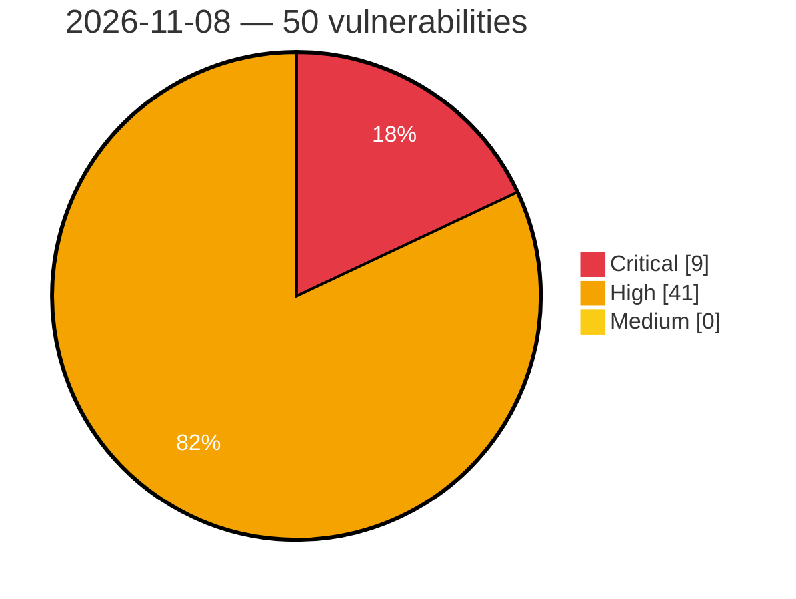

# Critical, High & Medium Severity Vulnerabilities — 2026-11-08

**Source status for this day:**

| Source | Critical | High | Medium | Total |
|--------|---------:|-----:|-------:|------:|
| cvefeed.io (High/Critical) | 9 | 41 | 0 | 50 |

**KEV (actively exploited):** 0  **Watchlist matches:** 30

## Critical (9)

| CVSS | Flags | Source | CVE / Title | Reported |
|------|-------|--------|-------------|----------|
| 9.9 | ⭐ | cvefeed.io (High/Critical) | [CVE-2026-124469 - OpenEMR before 8.3.0 SQL Injection via Fee Sheet warehouse parameter](https://cvefeed.io/vuln/detail/CVE-2026-124469) | 2 hours, 12 minutes ago |
| 9.9 | ⭐ | cvefeed.io (High/Critical) | [CVE-2026-124450 - OpenEMR before 8.3.0 Arbitrary File Read/Write via disposeDocument](https://cvefeed.io/vuln/detail/CVE-2026-124450) | 2 hours, 12 minutes ago |
| 9.8 | — | cvefeed.io (High/Critical) | [CVE-2026-123614 - imgproxy 4.0.0 before 4.0.16 Heap Buffer Overflow via ICO Loader Integer Overflow](https://cvefeed.io/vuln/detail/CVE-2026-123614) | 2 hours, 29 minutes ago |
| 9.6 | ⭐ | cvefeed.io (High/Critical) | [CVE-2026-109900 - WordPress Melapress Role Editor plugin <= 1.3.0 - Privilege Escalation vulnerability](https://cvefeed.io/vuln/detail/CVE-2026-109900) | 14 minutes ago |
| 9.4 | ⭐ | cvefeed.io (High/Critical) | [CVE-2026-124490 - OpenEMR before 8.3.0 Arbitrary File Read/Write via oe-module-faxsms disposeDocument](https://cvefeed.io/vuln/detail/CVE-2026-124490) | 2 hours, 12 minutes ago |
| 9.3 | ⭐ | cvefeed.io (High/Critical) | [CVE-2026-124494 - SunEditor before 3.4.0 Stored XSS via &colon; Entity Sanitizer Bypass](https://cvefeed.io/vuln/detail/CVE-2026-124494) | 2 hours, 12 minutes ago |
| 9.3 | ⭐ | cvefeed.io (High/Critical) | [CVE-2026-124493 - SunEditor before 3.4.0 Stored XSS via DocumentType Header textContent](https://cvefeed.io/vuln/detail/CVE-2026-124493) | 2 hours, 12 minutes ago |
| 9.3 | ⭐ | cvefeed.io (High/Critical) | [CVE-2026-124463 - OpenEMR before 8.3.0 Stored XSS via CAMOS Rx Print View](https://cvefeed.io/vuln/detail/CVE-2026-124463) | 2 hours, 12 minutes ago |
| 9.1 | ⭐ | cvefeed.io (High/Critical) | [CVE-2026-101117 - IBM WebSphere eXtremes Scale Liberty deployment is affected by Cross Site Scripting(XSS) attacks.](https://cvefeed.io/vuln/detail/CVE-2026-101117) | 14 minutes ago |

## High (41)

| CVSS | Flags | Source | CVE / Title | Reported |
|------|-------|--------|-------------|----------|
| 8.9 | — | cvefeed.io (High/Critical) | [CVE-2026-123587 - Hickory-DNS 0.26.0 before 0.26.2 DNSSEC Nonexistence Forgery via Wraparound NSEC](https://cvefeed.io/vuln/detail/CVE-2026-123587) | 2 hours, 29 minutes ago |
| 8.8 | — | cvefeed.io (High/Critical) | [CVE-2026-123605 - Hickory DNS through 0.25.0-alpha.3 DNSSEC Validation Bypass via RRSIG Signer's Name](https://cvefeed.io/vuln/detail/CVE-2026-123605) | 2 hours, 29 minutes ago |
| 8.8 | — | cvefeed.io (High/Critical) | [CVE-2026-123596 - Hickory DNS through 0.26.0-alpha.1 DNSSEC Validation Bypass via Ancestor-Delegation NSEC](https://cvefeed.io/vuln/detail/CVE-2026-123596) | 2 hours, 29 minutes ago |
| 8.8 | — | cvefeed.io (High/Critical) | [CVE-2026-123595 - Hickory DNS through 0.26.0-alpha.1 DNSSEC Validation Bypass via Ancestor-Delegation NSEC3](https://cvefeed.io/vuln/detail/CVE-2026-123595) | 2 hours, 29 minutes ago |
| 8.8 | — | cvefeed.io (High/Critical) | [CVE-2026-124486 - OpenEMR before 8.3.0 Missing Authorization in Classic Document Controller](https://cvefeed.io/vuln/detail/CVE-2026-124486) | 2 hours, 12 minutes ago |
| 8.8 | ⭐ | cvefeed.io (High/Critical) | [CVE-2026-124484 - OpenEMR before 8.4.0 Missing Authorization in Portal Onsite-Document APIs](https://cvefeed.io/vuln/detail/CVE-2026-124484) | 2 hours, 12 minutes ago |
| 8.8 | ⭐ | cvefeed.io (High/Critical) | [CVE-2026-124480 - OpenEMR before 8.4.0 Authorization Bypass via FHIR QuestionnaireResponse APICSRFTOKEN](https://cvefeed.io/vuln/detail/CVE-2026-124480) | 2 hours, 12 minutes ago |
| 8.8 | — | cvefeed.io (High/Critical) | [CVE-2026-124477 - OpenEMR before 8.3.0 Missing Authorization via delete_Recall in save.php](https://cvefeed.io/vuln/detail/CVE-2026-124477) | 2 hours, 12 minutes ago |
| 8.8 | ⭐ | cvefeed.io (High/Critical) | [CVE-2026-124467 - OpenEMR before 8.4.0 Remote Code Execution via ESign LFI and fax upload](https://cvefeed.io/vuln/detail/CVE-2026-124467) | 2 hours, 12 minutes ago |
| 8.8 | ⭐ | cvefeed.io (High/Critical) | [CVE-2026-124446 - OpenEMR before 8.3.0 Arbitrary File Read and Write via FaxSMS disposeDocument](https://cvefeed.io/vuln/detail/CVE-2026-124446) | 2 hours, 12 minutes ago |
| 8.7 | — | cvefeed.io (High/Critical) | [CVE-2026-123616 - imgproxy 3.3.0 before 4.0.16 Memory Exhaustion DoS via ICO Loader](https://cvefeed.io/vuln/detail/CVE-2026-123616) | 2 hours, 29 minutes ago |
| 8.7 | — | cvefeed.io (High/Critical) | [CVE-2026-123615 - imgproxy before 4.0.17 Out-of-Bounds Write in ICO Loader](https://cvefeed.io/vuln/detail/CVE-2026-123615) | 2 hours, 29 minutes ago |
| 8.7 | — | cvefeed.io (High/Critical) | [CVE-2026-123608 - Hickory DNS hickory-proto 0.3.1 before 0.26.1 CPU Exhaustion via BinEncoder Name Compression](https://cvefeed.io/vuln/detail/CVE-2026-123608) | 2 hours, 29 minutes ago |
| 8.7 | — | cvefeed.io (High/Critical) | [CVE-2026-123607 - Hickory DNS NSEC3 Closest-Encloser Proof Unbounded Loop Denial of Service](https://cvefeed.io/vuln/detail/CVE-2026-123607) | 2 hours, 29 minutes ago |
| 8.7 | ⭐ | cvefeed.io (High/Critical) | [CVE-2026-123606 - Hickory-DNS Recursor 0.25.0-alpha.3 through 0.25.2 Glueless-NS Referral Amplification](https://cvefeed.io/vuln/detail/CVE-2026-123606) | 2 hours, 29 minutes ago |
| 8.7 | ⭐ | cvefeed.io (High/Critical) | [CVE-2026-123604 - Hickory DNS 0.26.0-beta.1 before 0.26.2 Resource Exhaustion DoS via NameServerPool::try_send TC-Retry Loop](https://cvefeed.io/vuln/detail/CVE-2026-123604) | 2 hours, 29 minutes ago |
| 8.7 | — | cvefeed.io (High/Critical) | [CVE-2026-123588 - Hickory DNS Recursive Resolver Denial of Service via Cached Empty Connection Pool](https://cvefeed.io/vuln/detail/CVE-2026-123588) | 2 hours, 29 minutes ago |
| 8.7 | — | cvefeed.io (High/Critical) | [CVE-2026-123586 - Hickory DNS 0.25.0-alpha.3 through 0.25.2 Query Amplification via Cyclic Referrals](https://cvefeed.io/vuln/detail/CVE-2026-123586) | 2 hours, 29 minutes ago |
| 8.7 | — | cvefeed.io (High/Critical) | [CVE-2026-123580 - Hickory-DNS 0.26.0-beta.1 before 0.26.2 DNSSEC Nonexistence Proof Forgery via NSEC3](https://cvefeed.io/vuln/detail/CVE-2026-123580) | 2 hours, 29 minutes ago |
| 8.7 | ⭐ | cvefeed.io (High/Critical) | [CVE-2026-123577 - Hickory DNS 0.24.0 before 0.26.2 DoH Unbounded Request Body Denial of Service](https://cvefeed.io/vuln/detail/CVE-2026-123577) | 2 hours, 29 minutes ago |
| 8.7 | ⭐ | cvefeed.io (High/Critical) | [CVE-2026-123576 - Hickory DNS 0.24.0 through 0.26.1 Memory Exhaustion via DNS-over-QUIC Requests](https://cvefeed.io/vuln/detail/CVE-2026-123576) | 2 hours, 29 minutes ago |
| 8.7 | ⭐ | cvefeed.io (High/Critical) | [CVE-2026-123575 - Hickory DNS before 0.26.2 DoH Memory Exhaustion via Incomplete Request Bodies](https://cvefeed.io/vuln/detail/CVE-2026-123575) | 2 hours, 29 minutes ago |
| 8.7 | — | cvefeed.io (High/Critical) | [CVE-2026-123574 - Hickory DNS 0.24.0 before 0.26.2 Denial of Service via Zone File Parser](https://cvefeed.io/vuln/detail/CVE-2026-123574) | 2 hours, 29 minutes ago |
| 8.7 | — | cvefeed.io (High/Critical) | [CVE-2026-123573 - hickory-dns from 0.20.1 before 0.26.2 Panic in SVCB/HTTPS Zone File Parser](https://cvefeed.io/vuln/detail/CVE-2026-123573) | 2 hours, 29 minutes ago |
| 8.7 | ⭐ | cvefeed.io (High/Critical) | [CVE-2026-124553 - BabelDOC from 0.3.61 before 0.7.0 Denial of Service via ToUnicode CMap Parsing](https://cvefeed.io/vuln/detail/CVE-2026-124553) | 1 hour, 14 minutes ago |
| 8.7 | ⭐ | cvefeed.io (High/Critical) | [CVE-2026-124483 - OpenEMR before 8.4.0 Improper Authorization via Prescription REST API](https://cvefeed.io/vuln/detail/CVE-2026-124483) | 2 hours, 12 minutes ago |
| 8.6 | ⭐ | cvefeed.io (High/Critical) | [CVE-2026-114713 - UnrealIRCd IRCv3 Label Message Tag Command Injection](https://cvefeed.io/vuln/detail/CVE-2026-114713) | 1 hour, 30 minutes ago |
| 8.6 | ⭐ | cvefeed.io (High/Critical) | [CVE-2026-124488 - OpenEMR before 8.3.0 Authorization Bypass via load_form.php High-Sensitivity Encounters](https://cvefeed.io/vuln/detail/CVE-2026-124488) | 2 hours, 12 minutes ago |
| 8.6 | ⭐ | cvefeed.io (High/Critical) | [CVE-2026-124472 - OpenEMR before 8.3.0 Missing Authorization via sl_eob_patient_note.php](https://cvefeed.io/vuln/detail/CVE-2026-124472) | 2 hours, 12 minutes ago |
| 8.6 | ⭐ | cvefeed.io (High/Critical) | [CVE-2026-124471 - OpenEMR before 8.3.0 Missing Authorization and IDOR via sl_eob_invoice.php](https://cvefeed.io/vuln/detail/CVE-2026-124471) | 2 hours, 12 minutes ago |
| 8.6 | ⭐ | cvefeed.io (High/Critical) | [CVE-2026-124461 - OpenEMR before 8.3.0 IDOR via DICOM library/ajax/upload.php Endpoint](https://cvefeed.io/vuln/detail/CVE-2026-124461) | 2 hours, 12 minutes ago |
| 8.6 | ⭐ | cvefeed.io (High/Critical) | [CVE-2026-124459 - OpenEMR before 8.3.0 Cross-Patient IDOR via Encounter Form Viewers and Save Handlers](https://cvefeed.io/vuln/detail/CVE-2026-124459) | 2 hours, 12 minutes ago |
| 8.6 | ⭐ | cvefeed.io (High/Critical) | [CVE-2026-124448 - OpenEMR before 8.3.0 Stored XSS via CCDA/CCD Preview XSLT Attributes](https://cvefeed.io/vuln/detail/CVE-2026-124448) | 2 hours, 12 minutes ago |
| 8.6 | ⭐ | cvefeed.io (High/Critical) | [CVE-2026-124447 - OpenEMR before 8.3.0 IDOR via OnsitePortalActivityController Update Endpoint](https://cvefeed.io/vuln/detail/CVE-2026-124447) | 2 hours, 12 minutes ago |
| 8.5 | ⭐ | cvefeed.io (High/Critical) | [CVE-2026-114189 - WordPress AnyWhere Elementor plugin <= 1.3.0 - SQL Injection vulnerability](https://cvefeed.io/vuln/detail/CVE-2026-114189) | 14 minutes ago |
| 8.3 | — | cvefeed.io (High/Critical) | [CVE-2026-123601 - Hickory DNS 0.26.0-beta.1 before 0.26.2 NSEC3 Proof of Nonexistence Forgery](https://cvefeed.io/vuln/detail/CVE-2026-123601) | 2 hours, 29 minutes ago |
| 8.3 | ⭐ | cvefeed.io (High/Critical) | [CVE-2026-124492 - SunEditor before 3.4.0 Stored XSS via Link Modal Bookmark List](https://cvefeed.io/vuln/detail/CVE-2026-124492) | 2 hours, 12 minutes ago |
| 8.2 | — | cvefeed.io (High/Critical) | [CVE-2026-123602 - Hickory DNS Recursor Ghost Domain Attack via Child-Side NS RRset Caching](https://cvefeed.io/vuln/detail/CVE-2026-123602) | 2 hours, 29 minutes ago |
| 8.2 | — | cvefeed.io (High/Critical) | [CVE-2026-123592 - Hickory DNS 0.26.0-beta.1 before 0.26.2 DNSSEC Validation Bypass via Name Hash Collision](https://cvefeed.io/vuln/detail/CVE-2026-123592) | 2 hours, 29 minutes ago |
| 8.2 | — | cvefeed.io (High/Critical) | [CVE-2026-123591 - Hickory DNS 0.26.0-beta.1 before 0.26.2 DNSSEC Validation Bypass via Missing RFC 6840 Checks](https://cvefeed.io/vuln/detail/CVE-2026-123591) | 2 hours, 29 minutes ago |
| 8.2 | ⭐ | cvefeed.io (High/Critical) | [CVE-2026-123584 - Hickory-DNS 0.26.0 before 0.26.2 UDP Client Denial of Service via Spoofed Responses](https://cvefeed.io/vuln/detail/CVE-2026-123584) | 2 hours, 29 minutes ago |
