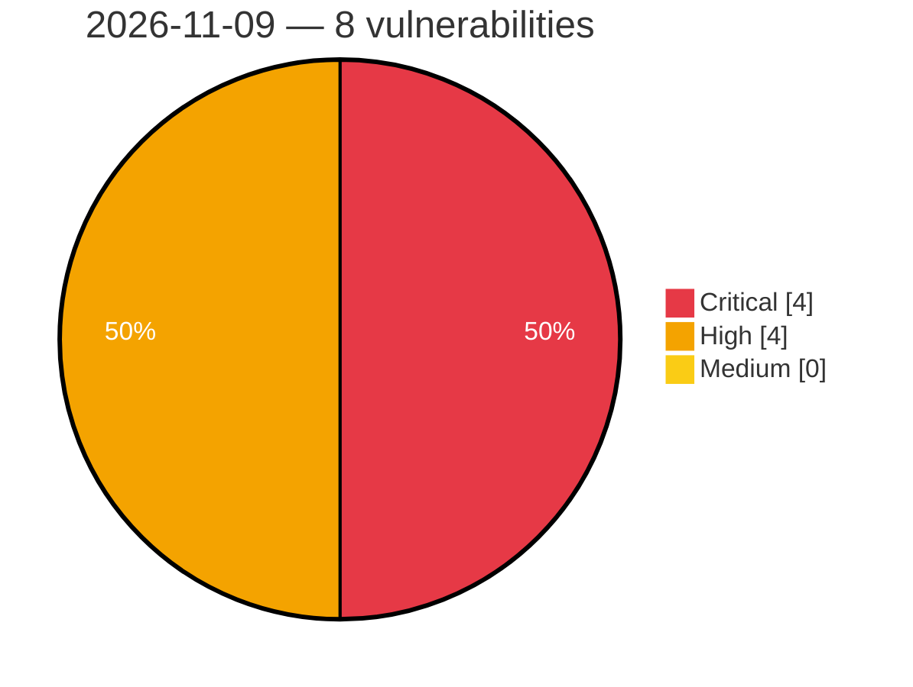

# Critical, High & Medium Severity Vulnerabilities — 2026-11-09

**Source status for this day:**

| Source | Critical | High | Medium | Total |
|--------|---------:|-----:|-------:|------:|
| cvefeed.io (High/Critical) | 4 | 4 | 0 | 8 |

**KEV (actively exploited):** 0  **Watchlist matches:** 4

## Critical (4)

| CVSS | Flags | Source | CVE / Title | Reported |
|------|-------|--------|-------------|----------|
| 10.0 | ⭐ | cvefeed.io (High/Critical) | [CVE-2026-124580 - Chengdu Feiyuxing Technology VW2100/VEC10GP Weixin Auth Endpoint webserver handle_wechat_cn_wifi os command injection](https://cvefeed.io/vuln/detail/CVE-2026-124580) | 31 minutes ago |
| 9.3 | — | cvefeed.io (High/Critical) | [CVE-2026-113364 - NEC WebSAM WinShare Buffer Overflow](https://cvefeed.io/vuln/detail/CVE-2026-113364) | 3 hours, 29 minutes ago |
| 9.3 | ⭐ | cvefeed.io (High/Critical) | [CVE-2026-113363 - NEC WebSAM WinShare Remote Code Execution Vulnerability](https://cvefeed.io/vuln/detail/CVE-2026-113363) | 3 hours, 30 minutes ago |
| 9.1 | ⭐ | cvefeed.io (High/Critical) | [CVE-2026-119506 - WordPress Frontend Admin by DynamiApps plugin <= 3.30.1 - Privilege Escalation vulnerability](https://cvefeed.io/vuln/detail/CVE-2026-119506) | 35 minutes ago |

## High (4)

| CVSS | Flags | Source | CVE / Title | Reported |
|------|-------|--------|-------------|----------|
| 10.0 | — | cvefeed.io (High/Critical) | [CVE-2026-124577 - Intelbras SG 2404 PoE L2+ Web Management EXCU_SHELL improper authentication](https://cvefeed.io/vuln/detail/CVE-2026-124577) | 31 minutes ago |
| 10.0 | — | cvefeed.io (High/Critical) | [CVE-2026-124560 - D-Link DIR-878 HNAP prog.cgi GetCAPTCHAsetting heap-based overflow](https://cvefeed.io/vuln/detail/CVE-2026-124560) | 5 hours, 31 minutes ago |
| 8.5 | ⭐ | cvefeed.io (High/Critical) | [CVE-2026-113362 - NEC WebSAM Winshare Improper Access Control Vulnerability](https://cvefeed.io/vuln/detail/CVE-2026-113362) | 4 hours, 31 minutes ago |
| 8.1 | — | cvefeed.io (High/Critical) | [CVE-2026-94249 - Missing Authorization in TÜBİTAK BİLGEM's Liderahenk](https://cvefeed.io/vuln/detail/CVE-2026-94249) | 27 minutes ago |
