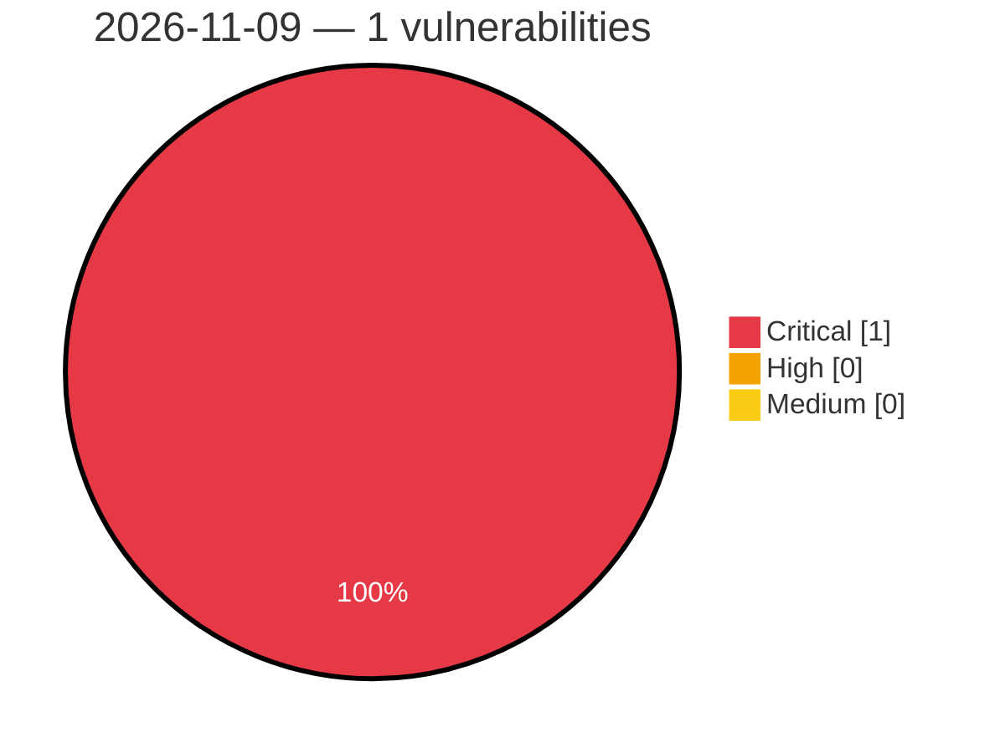

# Critical, High & Medium Severity Vulnerabilities — 2026-11-09

**Source status for this day:**

| Source | Critical | High | Medium | Total |
|--------|---------:|-----:|-------:|------:|
| cvefeed.io (High/Critical) | 1 | 0 | 0 | 1 |

**KEV (actively exploited):** 0  **Watchlist matches:** 1

## Critical (1)

| CVSS | Flags | Source | CVE / Title | Reported |
|------|-------|--------|-------------|----------|
| 9.1 | ⭐ | cvefeed.io (High/Critical) | [CVE-2026-119506 - WordPress Frontend Admin by DynamiApps plugin <= 3.30.1 - Privilege Escalation vulnerability](https://cvefeed.io/vuln/detail/CVE-2026-119506) | 35 minutes ago |
