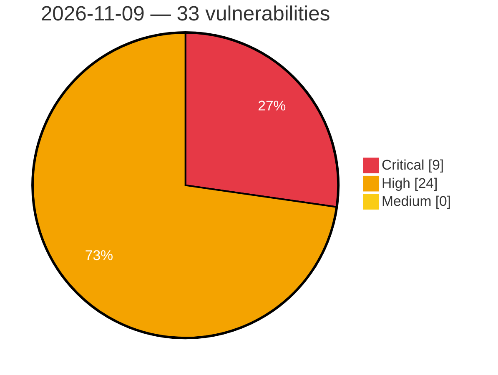

# Critical, High & Medium Severity Vulnerabilities — 2026-11-09

**Source status for this day:**

| Source | Critical | High | Medium | Total |
|--------|---------:|-----:|-------:|------:|
| cvefeed.io (High/Critical) | 9 | 24 | 0 | 33 |

**KEV (actively exploited):** 0  **Watchlist matches:** 16

## Critical (9)

| CVSS | Flags | Source | CVE / Title | Reported |
|------|-------|--------|-------------|----------|
| 10.0 | ⭐ | cvefeed.io (High/Critical) | [CVE-2026-124580 - Chengdu Feiyuxing Technology VW2100/VEC10GP Weixin Auth Endpoint webserver handle_wechat_cn_wifi os command injection](https://cvefeed.io/vuln/detail/CVE-2026-124580) | 31 minutes ago |
| 9.9 | ⭐ | cvefeed.io (High/Critical) | [CVE-2026-123800 - SuperTokens Core: App-scoped API key can overwrite the parent connection URI domain's credentials and take over sibling applications](https://cvefeed.io/vuln/detail/CVE-2026-123800) | 24 minutes ago |
| 9.8 | ⭐ | cvefeed.io (High/Critical) | [CVE-2026-123270 - CVE-2026-123270](https://cvefeed.io/vuln/detail/CVE-2026-123270) | 1 hour, 24 minutes ago |
| 9.8 | — | cvefeed.io (High/Critical) | [CVE-2026-119756 - Tasmota 16.0.0 Heap Out-of-Bounds Write via Device Groups UDP](https://cvefeed.io/vuln/detail/CVE-2026-119756) | 1 hour, 24 minutes ago |
| 9.3 | — | cvefeed.io (High/Critical) | [CVE-2026-113364 - NEC WebSAM WinShare Buffer Overflow](https://cvefeed.io/vuln/detail/CVE-2026-113364) | 3 hours, 29 minutes ago |
| 9.3 | ⭐ | cvefeed.io (High/Critical) | [CVE-2026-113363 - NEC WebSAM WinShare Remote Code Execution Vulnerability](https://cvefeed.io/vuln/detail/CVE-2026-113363) | 3 hours, 30 minutes ago |
| 9.3 | ⭐ | cvefeed.io (High/Critical) | [CVE-2026-104989 - Pre-authentication remote code execution in Chaos V-Ray Swarm](https://cvefeed.io/vuln/detail/CVE-2026-104989) | 2 hours, 24 minutes ago |
| 9.2 | ⭐ | cvefeed.io (High/Critical) | [CVE-2026-124001 - ION-DTN 2.2.1b-4.2.0 Integer Overflow Heap Corruption via DGR](https://cvefeed.io/vuln/detail/CVE-2026-124001) | 24 minutes ago |
| 9.1 | ⭐ | cvefeed.io (High/Critical) | [CVE-2026-119506 - WordPress Frontend Admin by DynamiApps plugin <= 3.30.1 - Privilege Escalation vulnerability](https://cvefeed.io/vuln/detail/CVE-2026-119506) | 35 minutes ago |

## High (24)

| CVSS | Flags | Source | CVE / Title | Reported |
|------|-------|--------|-------------|----------|
| 10.0 | — | cvefeed.io (High/Critical) | [CVE-2026-124577 - Intelbras SG 2404 PoE L2+ Web Management EXCU_SHELL improper authentication](https://cvefeed.io/vuln/detail/CVE-2026-124577) | 31 minutes ago |
| 10.0 | — | cvefeed.io (High/Critical) | [CVE-2026-124560 - D-Link DIR-878 HNAP prog.cgi GetCAPTCHAsetting heap-based overflow](https://cvefeed.io/vuln/detail/CVE-2026-124560) | 5 hours, 31 minutes ago |
| 8.8 | ⭐ | cvefeed.io (High/Critical) | [CVE-2026-12977 - Org.wildfly.core/wildfly-server: wildfly: rbac bypass in wildfly deployment-operation handlers leads to privilege escalation](https://cvefeed.io/vuln/detail/CVE-2026-12977) | 24 minutes ago |
| 8.8 | ⭐ | cvefeed.io (High/Critical) | [CVE-2026-121576 - WordPress MCP Server for WordPress plugin <= 2.0.1 - Privilege Escalation vulnerability](https://cvefeed.io/vuln/detail/CVE-2026-121576) | 2 hours, 24 minutes ago |
| 8.7 | — | cvefeed.io (High/Critical) | [CVE-2026-123999 - ION-DTN 3.6.2-4.2.0 Heap Buffer Overflow via nm_mgr AMP Rendering](https://cvefeed.io/vuln/detail/CVE-2026-123999) | 24 minutes ago |
| 8.7 | — | cvefeed.io (High/Critical) | [CVE-2026-124683 - Eclipse Langium Algorithmic Complexity Denial of Service](https://cvefeed.io/vuln/detail/CVE-2026-124683) | 2 hours, 24 minutes ago |
| 8.5 | ⭐ | cvefeed.io (High/Critical) | [CVE-2026-113362 - NEC WebSAM Winshare Improper Access Control Vulnerability](https://cvefeed.io/vuln/detail/CVE-2026-113362) | 4 hours, 31 minutes ago |
| 8.5 | — | cvefeed.io (High/Critical) | [CVE-2026-125250 - FFmpeg through 9.0.2 GIF Encoder Heap Buffer Overflow via shrunk_buf Remap](https://cvefeed.io/vuln/detail/CVE-2026-125250) | 24 minutes ago |
| 8.5 | — | cvefeed.io (High/Critical) | [CVE-2026-125244 - FFmpeg before 8.1.3 and 9.x before 9.0.2 VVC Decoder Out-of-Bounds Write via sh_entry_points](https://cvefeed.io/vuln/detail/CVE-2026-125244) | 24 minutes ago |
| 8.5 | — | cvefeed.io (High/Critical) | [CVE-2026-125233 - FFmpeg through 9.0.2 Heap Buffer Overflow via DVB Subtitle Encoder](https://cvefeed.io/vuln/detail/CVE-2026-125233) | 24 minutes ago |
| 8.5 | — | cvefeed.io (High/Critical) | [CVE-2026-125229 - FFmpeg through 9.0.2 Out-of-Bounds Memory Access in Huffyuv/FFVHUFF Median Predictor](https://cvefeed.io/vuln/detail/CVE-2026-125229) | 24 minutes ago |
| 8.5 | — | cvefeed.io (High/Critical) | [CVE-2026-125209 - FFmpeg before 8.1.3 and 9.x before 9.0.2 Heap Buffer Overflow via dvdsubenc.c](https://cvefeed.io/vuln/detail/CVE-2026-125209) | 24 minutes ago |
| 8.5 | — | cvefeed.io (High/Critical) | [CVE-2026-125203 - FFmpeg before 8.1.3 and 9.x before 9.0.2 Heap Buffer Overflow in Cook Multichannel Decoder](https://cvefeed.io/vuln/detail/CVE-2026-125203) | 24 minutes ago |
| 8.5 | ⭐ | cvefeed.io (High/Critical) | [CVE-2026-121769 - WordPress WP w3all phpBB plugin <= 3.1.9 - SQL Injection vulnerability](https://cvefeed.io/vuln/detail/CVE-2026-121769) | 24 minutes ago |
| 8.5 | — | cvefeed.io (High/Critical) | [CVE-2026-125267 - FFmpeg before 8.1.3 and 9.x before 9.0.2 Heap Out-of-Bounds Write via APAC Decoder](https://cvefeed.io/vuln/detail/CVE-2026-125267) | 29 minutes ago |
| 8.5 | — | cvefeed.io (High/Critical) | [CVE-2026-125262 - FFmpeg through 9.0.2 Heap Buffer Overflow via LCEVC Enhancement Decoding](https://cvefeed.io/vuln/detail/CVE-2026-125262) | 29 minutes ago |
| 8.5 | — | cvefeed.io (High/Critical) | [CVE-2026-125259 - FFmpeg through 9.0.2 Heap Buffer Overflow via ProRes prores_ks Encoder](https://cvefeed.io/vuln/detail/CVE-2026-125259) | 29 minutes ago |
| 8.5 | ⭐ | cvefeed.io (High/Critical) | [CVE-2026-104620 - PackageKit/ZYpp local privilege escalation using InstallFiles(SIMULATE)](https://cvefeed.io/vuln/detail/CVE-2026-104620) | 4 hours, 24 minutes ago |
| 8.3 | — | cvefeed.io (High/Critical) | [CVE-2026-19706 - Openshift/installer: openshift installer: unconditional csr approval during agent-based installation (abi) bootstrap](https://cvefeed.io/vuln/detail/CVE-2026-19706) | 1 hour, 24 minutes ago |
| 8.1 | — | cvefeed.io (High/Critical) | [CVE-2026-94249 - Missing Authorization in TÜBİTAK BİLGEM's Liderahenk](https://cvefeed.io/vuln/detail/CVE-2026-94249) | 27 minutes ago |
| 8.1 | ⭐ | cvefeed.io (High/Critical) | [CVE-2026-123803 - SuperTokens Core: WebAuthn sign-in accepts a passkey across tenant boundaries](https://cvefeed.io/vuln/detail/CVE-2026-123803) | 24 minutes ago |
| 8.1 | ⭐ | cvefeed.io (High/Critical) | [CVE-2026-123802 - SuperTokens Core SAML: identity taken from an assertion that never passed the audience check, allowing sign-in as any IdP user](https://cvefeed.io/vuln/detail/CVE-2026-123802) | 24 minutes ago |
| 8.1 | ⭐ | cvefeed.io (High/Critical) | [CVE-2026-123798 - SuperTokens Core: SAML XML Signature Wrapping authentication bypass — any IdP user can authenticate as any other user](https://cvefeed.io/vuln/detail/CVE-2026-123798) | 24 minutes ago |
| 8.1 | ⭐ | cvefeed.io (High/Critical) | [CVE-2026-115338 - Insecure XFT Transport in Progress WS_FTP Server](https://cvefeed.io/vuln/detail/CVE-2026-115338) | 2 hours, 24 minutes ago |
