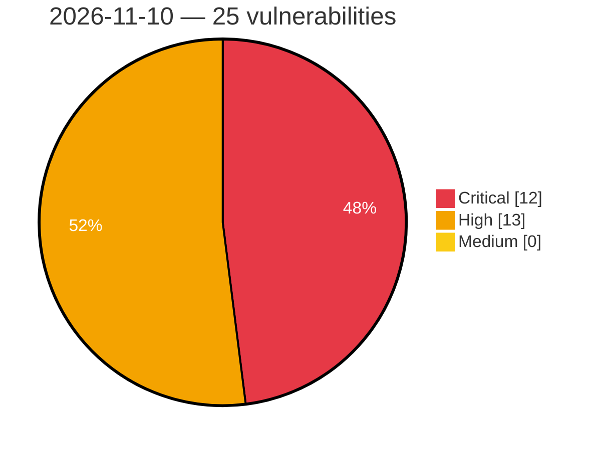

# Critical, High & Medium Severity Vulnerabilities — 2026-11-10

**Source status for this day:**

| Source | Critical | High | Medium | Total |
|--------|---------:|-----:|-------:|------:|
| cvefeed.io (High/Critical) | 12 | 13 | 0 | 25 |

**KEV (actively exploited):** 0  **Watchlist matches:** 16

## Critical (12)

| CVSS | Flags | Source | CVE / Title | Reported |
|------|-------|--------|-------------|----------|
| 10.0 | ⭐ | cvefeed.io (High/Critical) | [CVE-2026-120017 - Missing Authentication in SAP NetWeaver AS ABAP and ABAP Platform (SAML2 Service Provider)](https://cvefeed.io/vuln/detail/CVE-2026-120017) | 31 minutes ago |
| 10.0 | — | cvefeed.io (High/Critical) | [CVE-2026-89126 - Memory Corruption vulnerability in SAP Web Dispatcher](https://cvefeed.io/vuln/detail/CVE-2026-89126) | 39 minutes ago |
| 10.0 | ⭐ | cvefeed.io (High/Critical) | [CVE-2026-124600 - Unencrypted HTTP Traffic Exposing Sensitive User Credentials in GV-Face Android Application v2.2.1](https://cvefeed.io/vuln/detail/CVE-2026-124600) | 53 minutes ago |
| 10.0 | ⭐ | cvefeed.io (High/Critical) | [CVE-2026-89103 - Broken Access Control in SAP Gateway](https://cvefeed.io/vuln/detail/CVE-2026-89103) | 55 minutes ago |
| 9.9 | — | cvefeed.io (High/Critical) | [CVE-2026-109803 - Code Injection vulnerability in SAP NetWeaver Knowledge Management (XML Forms)](https://cvefeed.io/vuln/detail/CVE-2026-109803) | 35 minutes ago |
| 9.9 | — | cvefeed.io (High/Critical) | [CVE-2026-109795 - Missing authorization check in S4CRM](https://cvefeed.io/vuln/detail/CVE-2026-109795) | 37 minutes ago |
| 9.9 | ⭐ | cvefeed.io (High/Critical) | [CVE-2026-76965 - OS Command Injection vulnerability in ABAP Application Server for SAP NetWeaver and ABAP Platform](https://cvefeed.io/vuln/detail/CVE-2026-76965) | 57 minutes ago |
| 9.8 | ⭐ | cvefeed.io (High/Critical) | [CVE-2026-125384 - INDOTALENT WHMS before 10.20261109 Default Administrator Credentials via UserAdminSeeder](https://cvefeed.io/vuln/detail/CVE-2026-125384) | 57 minutes ago |
| 9.8 | ⭐ | cvefeed.io (High/Critical) | [CVE-2026-125383 - INDOTALENT WHMS before 10.20261109 Hard-Coded JWT Signing Key Authentication Bypass](https://cvefeed.io/vuln/detail/CVE-2026-125383) | 57 minutes ago |
| 9.8 | ⭐ | cvefeed.io (High/Critical) | [CVE-2026-125370 - Kubero 3.0.0 through 3.1.1 Authentication Bypass via Hardcoded JWT Secret](https://cvefeed.io/vuln/detail/CVE-2026-125370) | 57 minutes ago |
| 9.6 | ⭐ | cvefeed.io (High/Critical) | [CVE-2026-89119 - Cross-Site Request Forgery (CSRF) vulnerability in SAP Web Dispatcher and Internet Communication Manager](https://cvefeed.io/vuln/detail/CVE-2026-89119) | 54 minutes ago |
| 9.1 | ⭐ | cvefeed.io (High/Critical) | [CVE-2026-109798 - XML External Entity (XXE) Vulnerability in SAP BusinessObjects Business Intelligence Platform (Web Intelligence)](https://cvefeed.io/vuln/detail/CVE-2026-109798) | 36 minutes ago |

## High (13)

| CVSS | Flags | Source | CVE / Title | Reported |
|------|-------|--------|-------------|----------|
| 8.9 | — | cvefeed.io (High/Critical) | [CVE-2026-76966 - Multiple vulnerabilities in Application Server ABAP of SAP NetWeaver and ABAP Platform](https://cvefeed.io/vuln/detail/CVE-2026-76966) | 56 minutes ago |
| 8.8 | — | cvefeed.io (High/Critical) | [CVE-2026-125406 - Ettercap through 0.8.4.1 Stack Buffer Underwrite via Telnet Dissector Backspace Handling](https://cvefeed.io/vuln/detail/CVE-2026-125406) | 57 minutes ago |
| 8.8 | — | cvefeed.io (High/Critical) | [CVE-2026-125400 - Ettercap through 0.8.4.1 Use-After-Free via PCRE2 Filter Substitution](https://cvefeed.io/vuln/detail/CVE-2026-125400) | 57 minutes ago |
| 8.6 | ⭐ | cvefeed.io (High/Critical) | [CVE-2026-125399 - Fluxion before 6.39 OS Command Injection via Crafted SSID](https://cvefeed.io/vuln/detail/CVE-2026-125399) | 57 minutes ago |
| 8.6 | ⭐ | cvefeed.io (High/Critical) | [CVE-2026-125391 - Webmin through 2.670 OS Command Injection via Samba User Account Options](https://cvefeed.io/vuln/detail/CVE-2026-125391) | 57 minutes ago |
| 8.6 | ⭐ | cvefeed.io (High/Critical) | [CVE-2026-125382 - Map-OS 5.0.0 to before 5.2.2 Privilege Escalation via /api/v1/usuarios](https://cvefeed.io/vuln/detail/CVE-2026-125382) | 57 minutes ago |
| 8.6 | ⭐ | cvefeed.io (High/Critical) | [CVE-2026-125364 - frab through 0.9.1 Privilege Escalation via conference_users_attributes in UsersController](https://cvefeed.io/vuln/detail/CVE-2026-125364) | 57 minutes ago |
| 8.5 | ⭐ | cvefeed.io (High/Critical) | [CVE-2026-125396 - Ghostscript before 10.08.0 -dSAFER Bypass via .putgstringcopy .forceput Recovery](https://cvefeed.io/vuln/detail/CVE-2026-125396) | 57 minutes ago |
| 8.2 | — | cvefeed.io (High/Critical) | [CVE-2026-120008 - Memory Corruption Vulnerability in SAP NetWeaver (Internet Graphics Service)](https://cvefeed.io/vuln/detail/CVE-2026-120008) | 33 minutes ago |
| 8.1 | — | cvefeed.io (High/Critical) | [CVE-2026-125405 - Ettercap through 0.8.4.1 Out-of-Bounds Read via HTTP NTLM Authentication Parsing](https://cvefeed.io/vuln/detail/CVE-2026-125405) | 57 minutes ago |
| 8.1 | ⭐ | cvefeed.io (High/Critical) | [CVE-2026-125403 - Ettercap through 0.8.4.1 Out-of-Bounds Read via sslw_remove_sts](https://cvefeed.io/vuln/detail/CVE-2026-125403) | 57 minutes ago |
| 8.1 | ⭐ | cvefeed.io (High/Critical) | [CVE-2026-125402 - Ettercap through 0.8.4.1 Heap Out-of-Bounds Read via TLS SNI Parsing](https://cvefeed.io/vuln/detail/CVE-2026-125402) | 57 minutes ago |
| 8.1 | — | cvefeed.io (High/Critical) | [CVE-2026-125401 - Ettercap through 0.8.4.1 Heap Buffer Overflow via Gadu-Gadu Dissector](https://cvefeed.io/vuln/detail/CVE-2026-125401) | 57 minutes ago |
