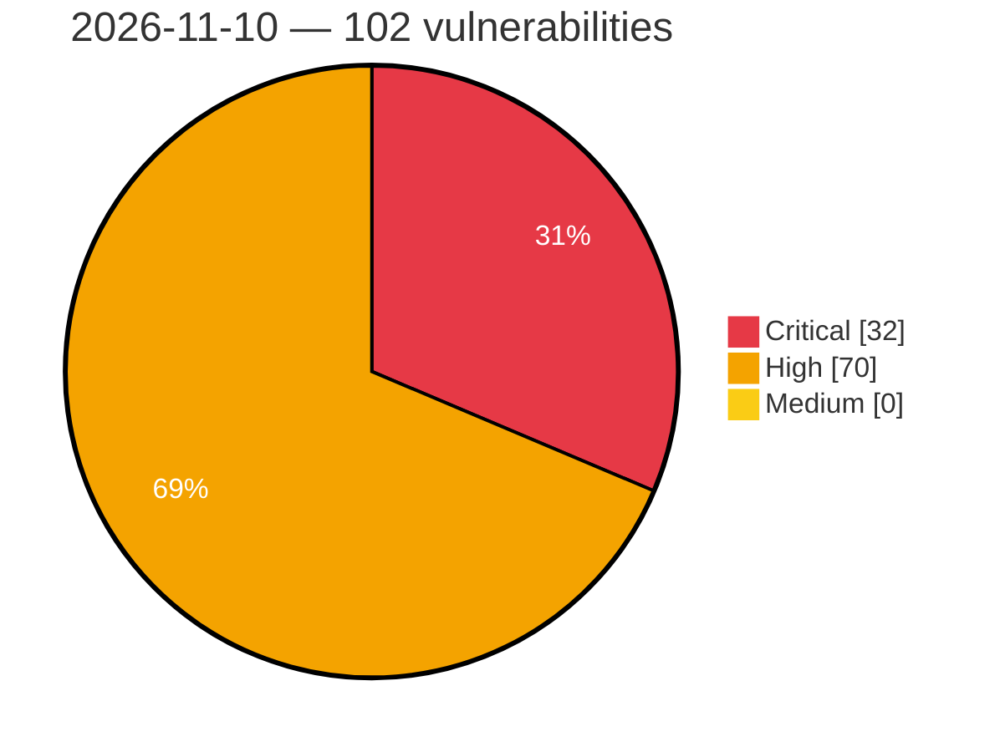

# Critical, High & Medium Severity Vulnerabilities — 2026-11-10

**Source status for this day:**

| Source | Critical | High | Medium | Total |
|--------|---------:|-----:|-------:|------:|
| cvefeed.io (High/Critical) | 32 | 70 | 0 | 102 |

**KEV (actively exploited):** 0  **Watchlist matches:** 71

## Critical (32)

| CVSS | Flags | Source | CVE / Title | Reported |
|------|-------|--------|-------------|----------|
| 10.0 | ⭐ | cvefeed.io (High/Critical) | [CVE-2026-120017 - Missing Authentication in SAP NetWeaver AS ABAP and ABAP Platform (SAML2 Service Provider)](https://cvefeed.io/vuln/detail/CVE-2026-120017) | 31 minutes ago |
| 10.0 | — | cvefeed.io (High/Critical) | [CVE-2026-89126 - Memory Corruption vulnerability in SAP Web Dispatcher](https://cvefeed.io/vuln/detail/CVE-2026-89126) | 39 minutes ago |
| 10.0 | ⭐ | cvefeed.io (High/Critical) | [CVE-2026-124600 - Unencrypted HTTP Traffic Exposing Sensitive User Credentials in GV-Face Android Application v2.2.1](https://cvefeed.io/vuln/detail/CVE-2026-124600) | 53 minutes ago |
| 10.0 | ⭐ | cvefeed.io (High/Critical) | [CVE-2026-89103 - Broken Access Control in SAP Gateway](https://cvefeed.io/vuln/detail/CVE-2026-89103) | 55 minutes ago |
| 9.9 | — | cvefeed.io (High/Critical) | [CVE-2026-109803 - Code Injection vulnerability in SAP NetWeaver Knowledge Management (XML Forms)](https://cvefeed.io/vuln/detail/CVE-2026-109803) | 35 minutes ago |
| 9.9 | — | cvefeed.io (High/Critical) | [CVE-2026-109795 - Missing authorization check in S4CRM](https://cvefeed.io/vuln/detail/CVE-2026-109795) | 37 minutes ago |
| 9.9 | ⭐ | cvefeed.io (High/Critical) | [CVE-2026-76965 - OS Command Injection vulnerability in ABAP Application Server for SAP NetWeaver and ABAP Platform](https://cvefeed.io/vuln/detail/CVE-2026-76965) | 57 minutes ago |
| 9.9 | — | cvefeed.io (High/Critical) | [CVE-2026-13312 - Arbitrary Code Execution in Product/Vendor](https://cvefeed.io/vuln/detail/CVE-2026-13312) | 3 hours, 15 minutes ago |
| 9.9 | ⭐ | cvefeed.io (High/Critical) | [CVE-2026-121908 - Adobe Connect \| Improper Neutralization of Special Elements used in an SQL Command ('SQL Injection') (CWE-89)](https://cvefeed.io/vuln/detail/CVE-2026-121908) | 50 minutes ago |
| 9.9 | ⭐ | cvefeed.io (High/Critical) | [CVE-2026-121906 - Adobe Connect \| Improper Limitation of a Pathname to a Restricted Directory ('Path Traversal') (CWE-22)](https://cvefeed.io/vuln/detail/CVE-2026-121906) | 50 minutes ago |
| 9.8 | ⭐ | cvefeed.io (High/Critical) | [CVE-2026-125384 - INDOTALENT WHMS before 10.20261109 Default Administrator Credentials via UserAdminSeeder](https://cvefeed.io/vuln/detail/CVE-2026-125384) | 57 minutes ago |
| 9.8 | ⭐ | cvefeed.io (High/Critical) | [CVE-2026-125383 - INDOTALENT WHMS before 10.20261109 Hard-Coded JWT Signing Key Authentication Bypass](https://cvefeed.io/vuln/detail/CVE-2026-125383) | 57 minutes ago |
| 9.8 | ⭐ | cvefeed.io (High/Critical) | [CVE-2026-125370 - Kubero 3.0.0 through 3.1.1 Authentication Bypass via Hardcoded JWT Secret](https://cvefeed.io/vuln/detail/CVE-2026-125370) | 57 minutes ago |
| 9.8 | ⭐ | cvefeed.io (High/Critical) | [CVE-2026-61547 - rabbitmq-c: Heap Buffer Overflow in amqp_send_frame() When Serializing Oversized AMQP_FRAME_BODY](https://cvefeed.io/vuln/detail/CVE-2026-61547) | 15 minutes ago |
| 9.8 | ⭐ | cvefeed.io (High/Critical) | [CVE-2026-121653 - Ivanti Endpoint Manager SQL Injection Remote Code Execution](https://cvefeed.io/vuln/detail/CVE-2026-121653) | 1 hour, 15 minutes ago |
| 9.8 | ⭐ | cvefeed.io (High/Critical) | [CVE-2026-89324 - Basel Post Types <= 1.18 - Unauthenticated Authentication Bypass via Forged Opauth Callback Signature with Hardcoded Fallback Salt](https://cvefeed.io/vuln/detail/CVE-2026-89324) | 47 minutes ago |
| 9.8 | ⭐ | cvefeed.io (High/Critical) | [CVE-2026-125298 - AsiaInfo Business Support System (BSS) Missing JWT Signature Verification](https://cvefeed.io/vuln/detail/CVE-2026-125298) | 50 minutes ago |
| 9.8 | ⭐ | cvefeed.io (High/Critical) | [CVE-2026-125297 - AsiaInfo Business Support System (BSS) Missing Authentication](https://cvefeed.io/vuln/detail/CVE-2026-125297) | 50 minutes ago |
| 9.6 | ⭐ | cvefeed.io (High/Critical) | [CVE-2026-89119 - Cross-Site Request Forgery (CSRF) vulnerability in SAP Web Dispatcher and Internet Communication Manager](https://cvefeed.io/vuln/detail/CVE-2026-89119) | 54 minutes ago |
| 9.6 | ⭐ | cvefeed.io (High/Critical) | [CVE-2026-121904 - Adobe Connect \| Cross-site Scripting (Stored XSS) (CWE-79)](https://cvefeed.io/vuln/detail/CVE-2026-121904) | 50 minutes ago |
| 9.5 | ⭐ | cvefeed.io (High/Critical) | [CVE-2026-126187 - React: Unauthenticated Remote Code Execution in React Server Components](https://cvefeed.io/vuln/detail/CVE-2026-126187) | 1 hour, 57 minutes ago |
| 9.4 | ⭐ | cvefeed.io (High/Critical) | [CVE-2026-63011 - GroupOffice Vulnerable to RCE in TemplateParser eval() via Contact/labels](https://cvefeed.io/vuln/detail/CVE-2026-63011) | 15 minutes ago |
| 9.4 | ⭐ | cvefeed.io (High/Critical) | [CVE-2026-125757 - mailcow: dockerized before 2026-11 Template Injection RCE via Domain-Wide Footer](https://cvefeed.io/vuln/detail/CVE-2026-125757) | 1 hour, 15 minutes ago |
| 9.4 | ⭐ | cvefeed.io (High/Critical) | [CVE-2026-121683 - Ivanti Cloud Services Application Authentication Bypass Vulnerability](https://cvefeed.io/vuln/detail/CVE-2026-121683) | 1 hour, 15 minutes ago |
| 9.4 | ⭐ | cvefeed.io (High/Critical) | [CVE-2026-121902 - Adobe Connect \| Improper Neutralization of Special Elements used in an SQL Command ('SQL Injection') (CWE-89)](https://cvefeed.io/vuln/detail/CVE-2026-121902) | 50 minutes ago |
| 9.3 | ⭐ | cvefeed.io (High/Critical) | [CVE-2026-60043 - XSS in backend](https://cvefeed.io/vuln/detail/CVE-2026-60043) | 15 minutes ago |
| 9.3 | ⭐ | cvefeed.io (High/Critical) | [CVE-2026-125883 - Multiple XXE Vulnerabilities](https://cvefeed.io/vuln/detail/CVE-2026-125883) | 50 minutes ago |
| 9.3 | ⭐ | cvefeed.io (High/Critical) | [CVE-2026-125881 - Schema-hint SSRF via service import schema validation](https://cvefeed.io/vuln/detail/CVE-2026-125881) | 50 minutes ago |
| 9.1 | ⭐ | cvefeed.io (High/Critical) | [CVE-2026-109798 - XML External Entity (XXE) Vulnerability in SAP BusinessObjects Business Intelligence Platform (Web Intelligence)](https://cvefeed.io/vuln/detail/CVE-2026-109798) | 36 minutes ago |
| 9.1 | ⭐ | cvefeed.io (High/Critical) | [CVE-2026-125758 - Aptabase before commit 61d4c01 Authentication Bypass via Known Example AUTH_SECRET](https://cvefeed.io/vuln/detail/CVE-2026-125758) | 1 hour, 15 minutes ago |
| 9.1 | ⭐ | cvefeed.io (High/Critical) | [CVE-2026-82391 - Out-of-bounds write in Zephyr HTTP/2 server static-filesystem handler via corrupted receive-buffer length](https://cvefeed.io/vuln/detail/CVE-2026-82391) | 47 minutes ago |
| 9.0 | — | cvefeed.io (High/Critical) | [CVE-2026-126261 - Fortinet FortiManager Improper Authorization Vulnerability](https://cvefeed.io/vuln/detail/CVE-2026-126261) | 44 minutes ago |

## High (70)

| CVSS | Flags | Source | CVE / Title | Reported |
|------|-------|--------|-------------|----------|
| 8.9 | — | cvefeed.io (High/Critical) | [CVE-2026-76966 - Multiple vulnerabilities in Application Server ABAP of SAP NetWeaver and ABAP Platform](https://cvefeed.io/vuln/detail/CVE-2026-76966) | 56 minutes ago |
| 8.8 | — | cvefeed.io (High/Critical) | [CVE-2026-125406 - Ettercap through 0.8.4.1 Stack Buffer Underwrite via Telnet Dissector Backspace Handling](https://cvefeed.io/vuln/detail/CVE-2026-125406) | 57 minutes ago |
| 8.8 | — | cvefeed.io (High/Critical) | [CVE-2026-125400 - Ettercap through 0.8.4.1 Use-After-Free via PCRE2 Filter Substitution](https://cvefeed.io/vuln/detail/CVE-2026-125400) | 57 minutes ago |
| 8.8 | — | cvefeed.io (High/Critical) | [CVE-2026-8372 - Unauthorized Access Vulnerability in [Product Name]](https://cvefeed.io/vuln/detail/CVE-2026-8372) | 3 hours, 15 minutes ago |
| 8.8 | ⭐ | cvefeed.io (High/Critical) | [CVE-2026-4762 - Server Privilege Escalation Vulnerability](https://cvefeed.io/vuln/detail/CVE-2026-4762) | 3 hours, 15 minutes ago |
| 8.8 | — | cvefeed.io (High/Critical) | [CVE-2026-97891 - Eclipse Kura Session Exhaustion Denial of Service](https://cvefeed.io/vuln/detail/CVE-2026-97891) | 15 minutes ago |
| 8.8 | ⭐ | cvefeed.io (High/Critical) | [CVE-2026-124251 - WordPress WPIDE – File Manager & Code Editor plugin <= 3.6.4 - Cross Site Request Forgery (CSRF) vulnerability](https://cvefeed.io/vuln/detail/CVE-2026-124251) | 15 minutes ago |
| 8.8 | — | cvefeed.io (High/Critical) | [CVE-2026-123180 - Missing Authentication Vulnerability in NETGEAR Nighthawk RAX30 models](https://cvefeed.io/vuln/detail/CVE-2026-123180) | 15 minutes ago |
| 8.8 | ⭐ | cvefeed.io (High/Critical) | [CVE-2026-126186 - Active Storage: Possible arbitrary file read and remote code execution in Active Storage video previews, analysis and image processing](https://cvefeed.io/vuln/detail/CVE-2026-126186) | 50 minutes ago |
| 8.8 | ⭐ | cvefeed.io (High/Critical) | [CVE-2026-121913 - Adobe Connect \| Incorrect Authorization (CWE-863)](https://cvefeed.io/vuln/detail/CVE-2026-121913) | 50 minutes ago |
| 8.7 | — | cvefeed.io (High/Critical) | [CVE-2026-60046 - DoS via password reset](https://cvefeed.io/vuln/detail/CVE-2026-60046) | 15 minutes ago |
| 8.7 | — | cvefeed.io (High/Critical) | [CVE-2026-60044 - Static backup password](https://cvefeed.io/vuln/detail/CVE-2026-60044) | 15 minutes ago |
| 8.7 | — | cvefeed.io (High/Critical) | [CVE-2026-60040 - DoS in backup creation](https://cvefeed.io/vuln/detail/CVE-2026-60040) | 15 minutes ago |
| 8.7 | ⭐ | cvefeed.io (High/Critical) | [CVE-2026-92684 - Aggregation queries can bypass authentication restrictions in @neo4j/graphql](https://cvefeed.io/vuln/detail/CVE-2026-92684) | 15 minutes ago |
| 8.7 | ⭐ | cvefeed.io (High/Critical) | [CVE-2026-63651 - LiveDocs: fetch_docs/introspect fetch client-supplied URLs with no host allowlist and follow redirects](https://cvefeed.io/vuln/detail/CVE-2026-63651) | 15 minutes ago |
| 8.7 | ⭐ | cvefeed.io (High/Critical) | [CVE-2026-63010 - Group-Office: Stored XSS via Manual Reminders](https://cvefeed.io/vuln/detail/CVE-2026-63010) | 15 minutes ago |
| 8.7 | ⭐ | cvefeed.io (High/Critical) | [CVE-2026-112186 - Eclipse Kura Service Listing API Denial of Service Vulnerability](https://cvefeed.io/vuln/detail/CVE-2026-112186) | 15 minutes ago |
| 8.7 | — | cvefeed.io (High/Critical) | [CVE-2026-92545 - Kong Gateway Cache Key Collision Vulnerability](https://cvefeed.io/vuln/detail/CVE-2026-92545) | 47 minutes ago |
| 8.7 | ⭐ | cvefeed.io (High/Critical) | [CVE-2026-125878 - Multiple OGNL Injection vulnerabilities](https://cvefeed.io/vuln/detail/CVE-2026-125878) | 50 minutes ago |
| 8.7 | ⭐ | cvefeed.io (High/Critical) | [CVE-2026-122102 - Adobe Connect \| Cross-site Scripting (Stored XSS) (CWE-79)](https://cvefeed.io/vuln/detail/CVE-2026-122102) | 50 minutes ago |
| 8.6 | ⭐ | cvefeed.io (High/Critical) | [CVE-2026-125399 - Fluxion before 6.39 OS Command Injection via Crafted SSID](https://cvefeed.io/vuln/detail/CVE-2026-125399) | 57 minutes ago |
| 8.6 | ⭐ | cvefeed.io (High/Critical) | [CVE-2026-125391 - Webmin through 2.670 OS Command Injection via Samba User Account Options](https://cvefeed.io/vuln/detail/CVE-2026-125391) | 57 minutes ago |
| 8.6 | ⭐ | cvefeed.io (High/Critical) | [CVE-2026-125382 - Map-OS 5.0.0 to before 5.2.2 Privilege Escalation via /api/v1/usuarios](https://cvefeed.io/vuln/detail/CVE-2026-125382) | 57 minutes ago |
| 8.6 | ⭐ | cvefeed.io (High/Critical) | [CVE-2026-125364 - frab through 0.9.1 Privilege Escalation via conference_users_attributes in UsersController](https://cvefeed.io/vuln/detail/CVE-2026-125364) | 57 minutes ago |
| 8.6 | ⭐ | cvefeed.io (High/Critical) | [CVE-2026-60039 - Command injection in backup restore](https://cvefeed.io/vuln/detail/CVE-2026-60039) | 15 minutes ago |
| 8.6 | ⭐ | cvefeed.io (High/Critical) | [CVE-2026-60038 - OpenSSL command injection in ImportPKCS12](https://cvefeed.io/vuln/detail/CVE-2026-60038) | 15 minutes ago |
| 8.6 | ⭐ | cvefeed.io (High/Critical) | [CVE-2026-60037 - OpenSSL command injection in device importer](https://cvefeed.io/vuln/detail/CVE-2026-60037) | 15 minutes ago |
| 8.6 | ⭐ | cvefeed.io (High/Critical) | [CVE-2026-60036 - Command injection in patch activate](https://cvefeed.io/vuln/detail/CVE-2026-60036) | 15 minutes ago |
| 8.6 | ⭐ | cvefeed.io (High/Critical) | [CVE-2026-60035 - Command injection in network auth](https://cvefeed.io/vuln/detail/CVE-2026-60035) | 15 minutes ago |
| 8.6 | ⭐ | cvefeed.io (High/Critical) | [CVE-2026-112185 - Eclipse Kura Configuration REST API Privilege Escalation](https://cvefeed.io/vuln/detail/CVE-2026-112185) | 15 minutes ago |
| 8.6 | ⭐ | cvefeed.io (High/Critical) | [CVE-2026-125882 - RCE via file repository upload path traversal](https://cvefeed.io/vuln/detail/CVE-2026-125882) | 50 minutes ago |
| 8.6 | ⭐ | cvefeed.io (High/Critical) | [CVE-2026-125879 - Local privilege escalation to root via nable-writable syslog-ng config](https://cvefeed.io/vuln/detail/CVE-2026-125879) | 50 minutes ago |
| 8.5 | ⭐ | cvefeed.io (High/Critical) | [CVE-2026-125396 - Ghostscript before 10.08.0 -dSAFER Bypass via .putgstringcopy .forceput Recovery](https://cvefeed.io/vuln/detail/CVE-2026-125396) | 57 minutes ago |
| 8.5 | ⭐ | cvefeed.io (High/Critical) | [CVE-2026-57907 - WatchGuard Endpoint Protection Local Privilege Escalation in Console-Service Communication Allows SYSTEM Code Execution](https://cvefeed.io/vuln/detail/CVE-2026-57907) | 15 minutes ago |
| 8.5 | ⭐ | cvefeed.io (High/Critical) | [CVE-2026-34016 - Intel VTune Profiler Time-of-Check Time-of-Use Privilege Escalation Vulnerability](https://cvefeed.io/vuln/detail/CVE-2026-34016) | 15 minutes ago |
| 8.5 | ⭐ | cvefeed.io (High/Critical) | [CVE-2026-32670 - Intel VTune Profiler Privilege Escalation via Time-of-Check Time-of-Use Race Condition](https://cvefeed.io/vuln/detail/CVE-2026-32670) | 15 minutes ago |
| 8.5 | ⭐ | cvefeed.io (High/Critical) | [CVE-2026-32667 - Intel VTune Profiler Device Driver Out-of-Bounds Write Privilege Escalation](https://cvefeed.io/vuln/detail/CVE-2026-32667) | 15 minutes ago |
| 8.5 | ⭐ | cvefeed.io (High/Critical) | [CVE-2026-126050 - apitrace 2.0 through 14.0 Heap Buffer Overflow via SnappyFile::flushReadCache()](https://cvefeed.io/vuln/detail/CVE-2026-126050) | 15 minutes ago |
| 8.5 | ⭐ | cvefeed.io (High/Critical) | [CVE-2026-125271 - AWS API MCP Server Security Policy Bypass via Incorrect Operation Name Normalization](https://cvefeed.io/vuln/detail/CVE-2026-125271) | 15 minutes ago |
| 8.4 | ⭐ | cvefeed.io (High/Critical) | [CVE-2026-12389 - Remote Code Execution via Authenticated Arbitrary File Upload](https://cvefeed.io/vuln/detail/CVE-2026-12389) | 3 hours, 15 minutes ago |
| 8.4 | ⭐ | cvefeed.io (High/Critical) | [CVE-2026-91000 - Insecure IPC Channels lead to local privilege escalation](https://cvefeed.io/vuln/detail/CVE-2026-91000) | 47 minutes ago |
| 8.4 | ⭐ | cvefeed.io (High/Critical) | [CVE-2025-0008 - Secure Debug Unlock Authentication Bypass](https://cvefeed.io/vuln/detail/CVE-2025-0008) | 1 hour, 57 minutes ago |
| 8.3 | ⭐ | cvefeed.io (High/Critical) | [CVE-2026-63288 - API Authentication Bypass via WebSocket Request](https://cvefeed.io/vuln/detail/CVE-2026-63288) | 3 hours, 15 minutes ago |
| 8.3 | — | cvefeed.io (High/Critical) | [CVE-2026-50109 - Intel Performance Counter Monitor Out-of-Bounds Write Denial of Service Vulnerability](https://cvefeed.io/vuln/detail/CVE-2026-50109) | 15 minutes ago |
| 8.3 | — | cvefeed.io (High/Critical) | [CVE-2026-125755 - Nodemailer 3.0.0 before 10.4.1 Recipient Allow-List Bypass via addressparser](https://cvefeed.io/vuln/detail/CVE-2026-125755) | 1 hour, 15 minutes ago |
| 8.3 | ⭐ | cvefeed.io (High/Critical) | [CVE-2026-92442 - Kong Gateway Enterprise GraphQL Proxy Cache Advanced Cache Poisoning Vulnerability](https://cvefeed.io/vuln/detail/CVE-2026-92442) | 47 minutes ago |
| 8.3 | ⭐ | cvefeed.io (High/Critical) | [CVE-2026-77685 - Bluetooth Classic RFCOMM: integer underflow in the MCC TEST command handler leads to out-of-bounds read disclosed to the peer and out-of-bounds write](https://cvefeed.io/vuln/detail/CVE-2026-77685) | 47 minutes ago |
| 8.3 | ⭐ | cvefeed.io (High/Critical) | [CVE-2026-125880 - Stored XSS via MMS3 patch metadata (admin context)](https://cvefeed.io/vuln/detail/CVE-2026-125880) | 50 minutes ago |
| 8.2 | — | cvefeed.io (High/Critical) | [CVE-2026-120008 - Memory Corruption Vulnerability in SAP NetWeaver (Internet Graphics Service)](https://cvefeed.io/vuln/detail/CVE-2026-120008) | 33 minutes ago |
| 8.2 | ⭐ | cvefeed.io (High/Critical) | [CVE-2026-120513 - Everest Forms <= 3.6.2 - Unauthenticated Arbitrary File Deletion via 'everest_forms_{form_id}_old_{field_id}' Parameter](https://cvefeed.io/vuln/detail/CVE-2026-120513) | 2 hours, 15 minutes ago |
| 8.2 | — | cvefeed.io (High/Critical) | [CVE-2026-91763 - Insecure Temporary File Vulnerability in Hitachi Dynamic Link Manager for Linux](https://cvefeed.io/vuln/detail/CVE-2026-91763) | 4 hours, 14 minutes ago |
| 8.2 | — | cvefeed.io (High/Critical) | [CVE-2026-91761 - Insecure Temporary File Vulnerability in Hitachi Dynamic Link Manager for Linux](https://cvefeed.io/vuln/detail/CVE-2026-91761) | 4 hours, 14 minutes ago |
| 8.2 | — | cvefeed.io (High/Critical) | [CVE-2026-86579 - Binary Planting Vulnerability in Hitachi Dynamic Link Manager for Windows](https://cvefeed.io/vuln/detail/CVE-2026-86579) | 4 hours, 14 minutes ago |
| 8.2 | — | cvefeed.io (High/Critical) | [CVE-2026-125756 - postal-mime before 4.2.1 Sender Spoofing via Address Parser Domain Truncation](https://cvefeed.io/vuln/detail/CVE-2026-125756) | 1 hour, 15 minutes ago |
| 8.2 | ⭐ | cvefeed.io (High/Critical) | [CVE-2026-125753 - ABP Framework before 10.6.2 and 10.7.0 Path Traversal via Blogging File Endpoints](https://cvefeed.io/vuln/detail/CVE-2026-125753) | 1 hour, 15 minutes ago |
| 8.2 | — | cvefeed.io (High/Critical) | [CVE-2026-124037 - Information exposure in Flock Safety Platform public access-list sign-up](https://cvefeed.io/vuln/detail/CVE-2026-124037) | 1 hour, 15 minutes ago |
| 8.2 | — | cvefeed.io (High/Critical) | [CVE-2026-96437 - Kong Gateway Enterprise ai-azure-content-safety Security Bypass Vulnerability](https://cvefeed.io/vuln/detail/CVE-2026-96437) | 47 minutes ago |
| 8.2 | — | cvefeed.io (High/Critical) | [CVE-2026-92443 - Kong Gateway Improper Authorization Caching Vulnerability](https://cvefeed.io/vuln/detail/CVE-2026-92443) | 47 minutes ago |
| 8.2 | — | cvefeed.io (High/Critical) | [CVE-2026-123041 - Kong Gateway Request-Callout Cache Poisoning Vulnerability](https://cvefeed.io/vuln/detail/CVE-2026-123041) | 50 minutes ago |
| 8.1 | — | cvefeed.io (High/Critical) | [CVE-2026-125405 - Ettercap through 0.8.4.1 Out-of-Bounds Read via HTTP NTLM Authentication Parsing](https://cvefeed.io/vuln/detail/CVE-2026-125405) | 57 minutes ago |
| 8.1 | ⭐ | cvefeed.io (High/Critical) | [CVE-2026-125403 - Ettercap through 0.8.4.1 Out-of-Bounds Read via sslw_remove_sts](https://cvefeed.io/vuln/detail/CVE-2026-125403) | 57 minutes ago |
| 8.1 | ⭐ | cvefeed.io (High/Critical) | [CVE-2026-125402 - Ettercap through 0.8.4.1 Heap Out-of-Bounds Read via TLS SNI Parsing](https://cvefeed.io/vuln/detail/CVE-2026-125402) | 57 minutes ago |
| 8.1 | — | cvefeed.io (High/Critical) | [CVE-2026-125401 - Ettercap through 0.8.4.1 Heap Buffer Overflow via Gadu-Gadu Dissector](https://cvefeed.io/vuln/detail/CVE-2026-125401) | 57 minutes ago |
| 8.1 | ⭐ | cvefeed.io (High/Critical) | [CVE-2026-60041 - CSRF in backend](https://cvefeed.io/vuln/detail/CVE-2026-60041) | 15 minutes ago |
| 8.1 | ⭐ | cvefeed.io (High/Critical) | [CVE-2026-76877 - WPML Multilingual CMS <= 4.9.7 - Unauthenticated Authentication Bypass in Language-per-Domain SSO via 'wpml_sso_token_domain' Parameter](https://cvefeed.io/vuln/detail/CVE-2026-76877) | 2 hours, 15 minutes ago |
| 8.1 | — | cvefeed.io (High/Critical) | [CVE-2026-91764 - Improper Link Resolution Before File Access Vulnerability in Hitachi Dynamic Link Manager for Linux](https://cvefeed.io/vuln/detail/CVE-2026-91764) | 4 hours, 14 minutes ago |
| 8.1 | ⭐ | cvefeed.io (High/Critical) | [CVE-2026-91756 - OS Command Injection Vulnerability in Hitachi Dynamic Link Manager for VMware](https://cvefeed.io/vuln/detail/CVE-2026-91756) | 4 hours, 14 minutes ago |
| 8.1 | — | cvefeed.io (High/Critical) | [CVE-2026-91755 - Integer Overflow Vulnerability in Hitachi Dynamic Link Manager for VMware](https://cvefeed.io/vuln/detail/CVE-2026-91755) | 4 hours, 14 minutes ago |
| 8.1 | — | cvefeed.io (High/Critical) | [CVE-2026-91754 - Stack-based Buffer Overflow Vulnerability in Hitachi Dynamic Link Manager for VMware](https://cvefeed.io/vuln/detail/CVE-2026-91754) | 4 hours, 14 minutes ago |
| 8.0 | ⭐ | cvefeed.io (High/Critical) | [CVE-2026-12964 - [Product/Vendor Name] Privilege Escalation Vulnerability](https://cvefeed.io/vuln/detail/CVE-2026-12964) | 3 hours, 15 minutes ago |
