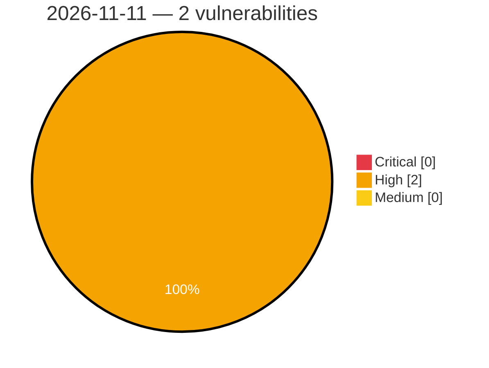

# Critical, High & Medium Severity Vulnerabilities — 2026-11-11

**Source status for this day:**

| Source | Critical | High | Medium | Total |
|--------|---------:|-----:|-------:|------:|
| cvefeed.io (High/Critical) | 0 | 2 | 0 | 2 |

**KEV (actively exploited):** 0  **Watchlist matches:** 1

## High (2)

| CVSS | Flags | Source | CVE / Title | Reported |
|------|-------|--------|-------------|----------|
| 8.5 | — | cvefeed.io (High/Critical) | [CVE-2026-126497 - LibreCAD through 2.2.1.6 Heap Out-of-Bounds Write via dwgReader18::parseDataPage](https://cvefeed.io/vuln/detail/CVE-2026-126497) | 16 minutes ago |
| 8.3 | ⭐ | cvefeed.io (High/Critical) | [CVE-2026-126499 - Jellyfin before 12.0 Path Traversal via Library VirtualFolders Endpoints](https://cvefeed.io/vuln/detail/CVE-2026-126499) | 16 minutes ago |
