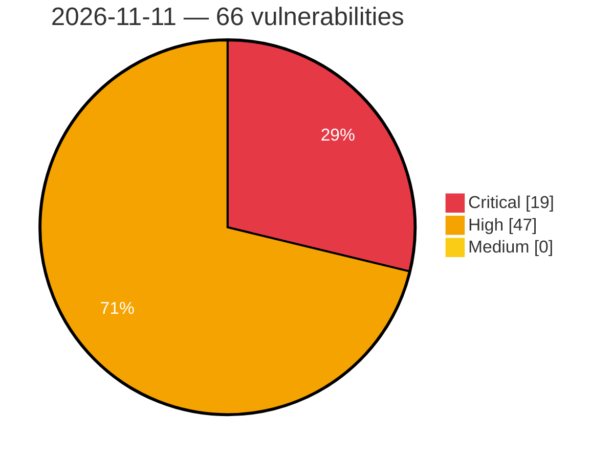

# Critical, High & Medium Severity Vulnerabilities — 2026-11-11

**Source status for this day:**

| Source | Critical | High | Medium | Total |
|--------|---------:|-----:|-------:|------:|
| cvefeed.io (High/Critical) | 19 | 47 | 0 | 66 |

**KEV (actively exploited):** 0  **Watchlist matches:** 52

## Critical (19)

| CVSS | Flags | Source | CVE / Title | Reported |
|------|-------|--------|-------------|----------|
| 9.9 | ⭐ | cvefeed.io (High/Critical) | [CVE-2026-110697 - Quay: quay: sql like wildcard injection in robot listing leaks cross-tenant robot tokens](https://cvefeed.io/vuln/detail/CVE-2026-110697) | 21 minutes ago |
| 9.8 | ⭐ | cvefeed.io (High/Critical) | [CVE-2026-64682 - AstroBlocks: Admin session tokens can be forged due to a hard-coded fallback JWT secret and a mismatched environment variable name](https://cvefeed.io/vuln/detail/CVE-2026-64682) | 3 hours, 55 minutes ago |
| 9.8 | ⭐ | cvefeed.io (High/Critical) | [CVE-2026-64678 - Nitrite: Unfiltered Java Deserialization in Legacy v1 Database Migration Path](https://cvefeed.io/vuln/detail/CVE-2026-64678) | 3 hours, 55 minutes ago |
| 9.8 | ⭐ | cvefeed.io (High/Critical) | [CVE-2026-126542 - WWBN AVideo 6.5 through 29.7.1 Authentication Bypass via Hybridauth Social Login](https://cvefeed.io/vuln/detail/CVE-2026-126542) | 7 hours, 57 minutes ago |
| 9.8 | — | cvefeed.io (High/Critical) | [CVE-2026-123710 - Quay: red hat quay: unauthenticated registry signing-key takeover via service key rotation](https://cvefeed.io/vuln/detail/CVE-2026-123710) | 2 hours, 20 minutes ago |
| 9.8 | ⭐ | cvefeed.io (High/Critical) | [CVE-2026-67449 - Portabase: Unauthenticated path traversal in TUS webhook overwrites AES-256-GCM master key](https://cvefeed.io/vuln/detail/CVE-2026-67449) | 51 minutes ago |
| 9.8 | ⭐ | cvefeed.io (High/Critical) | [CVE-2026-126263 - Fortinet FortiMail SQL Injection Vulnerability](https://cvefeed.io/vuln/detail/CVE-2026-126263) | 51 minutes ago |
| 9.8 | ⭐ | cvefeed.io (High/Critical) | [CVE-2026-126262 - Fortinet FortiAnalyzer and FortiManager SQL Injection Vulnerability](https://cvefeed.io/vuln/detail/CVE-2026-126262) | 51 minutes ago |
| 9.8 | — | cvefeed.io (High/Critical) | [CVE-2026-126259 - Fortinet FortiOS Missing Authentication for Critical Function Vulnerability](https://cvefeed.io/vuln/detail/CVE-2026-126259) | 51 minutes ago |
| 9.6 | — | cvefeed.io (High/Critical) | [CVE-2026-126254 - Fortinet FortiOS Numeric Truncation Vulnerability](https://cvefeed.io/vuln/detail/CVE-2026-126254) | 51 minutes ago |
| 9.3 | ⭐ | cvefeed.io (High/Critical) | [CVE-2026-64670 - Stored XSS in @waline/client via the unsanitized markdown preview of a comment's raw body on edit](https://cvefeed.io/vuln/detail/CVE-2026-64670) | 3 hours, 55 minutes ago |
| 9.3 | ⭐ | cvefeed.io (High/Critical) | [CVE-2026-126253 - Fortinet FortiOS Authentication Bypass Vulnerability](https://cvefeed.io/vuln/detail/CVE-2026-126253) | 51 minutes ago |
| 9.2 | — | cvefeed.io (High/Critical) | [CVE-2026-126539 - Directus before 12.1.0 Authorization Bypass via Public WebSocket REST Interface](https://cvefeed.io/vuln/detail/CVE-2026-126539) | 7 hours, 57 minutes ago |
| 9.2 | ⭐ | cvefeed.io (High/Critical) | [CVE-2026-126325 - Critical Remote Code Execution (RCE) vulnerability reported in Windchill](https://cvefeed.io/vuln/detail/CVE-2026-126325) | 2 hours, 20 minutes ago |
| 9.1 | ⭐ | cvefeed.io (High/Critical) | [CVE-2026-85632 - Unauthenticated Payment Status Manipulation in Sipay Electronic Money's WordPress (WooCommerce)](https://cvefeed.io/vuln/detail/CVE-2026-85632) | 2 hours, 20 minutes ago |
| 9.1 | ⭐ | cvefeed.io (High/Critical) | [CVE-2026-126537 - Ninja Forms - File Uploads <= 3.3.36 - Unauthenticated Arbitrary File Deletion via 'files[].data.file_path' Parameter via 'extra.saveProgress'](https://cvefeed.io/vuln/detail/CVE-2026-126537) | 4 hours, 20 minutes ago |
| 9.1 | ⭐ | cvefeed.io (High/Critical) | [CVE-2026-126251 - Fortinet FortiAuthenticator Authentication Bypass Vulnerability](https://cvefeed.io/vuln/detail/CVE-2026-126251) | 51 minutes ago |
| 9.1 | ⭐ | cvefeed.io (High/Critical) | [CVE-2026-126229 - Fortinet FortiAnalyzer and FortiManager Authorization Bypass Vulnerability](https://cvefeed.io/vuln/detail/CVE-2026-126229) | 51 minutes ago |
| 9.0 | — | cvefeed.io (High/Critical) | [CVE-2026-126257 - Fortinet FortiAuthenticator Hard-Coded Password Vulnerability](https://cvefeed.io/vuln/detail/CVE-2026-126257) | 51 minutes ago |

## High (47)

| CVSS | Flags | Source | CVE / Title | Reported |
|------|-------|--------|-------------|----------|
| 8.8 | ⭐ | cvefeed.io (High/Critical) | [CVE-2026-126617 - Improper Neutralization of Special Elements used in an SQL Command ('SQL Injection') in hMailServer](https://cvefeed.io/vuln/detail/CVE-2026-126617) | 41 minutes ago |
| 8.8 | ⭐ | cvefeed.io (High/Critical) | [CVE-2026-76981 - Authenticated Second-Order SQL Injection](https://cvefeed.io/vuln/detail/CVE-2026-76981) | 57 minutes ago |
| 8.8 | ⭐ | cvefeed.io (High/Critical) | [CVE-2026-12062 - Authenticated SQL Injection](https://cvefeed.io/vuln/detail/CVE-2026-12062) | 57 minutes ago |
| 8.8 | ⭐ | cvefeed.io (High/Critical) | [CVE-2026-125850 - WordPress Appointment Dark theme <= 1.3.4 - Cross Site Request Forgery (CSRF) vulnerability](https://cvefeed.io/vuln/detail/CVE-2026-125850) | 3 hours, 20 minutes ago |
| 8.8 | ⭐ | cvefeed.io (High/Critical) | [CVE-2026-125849 - WordPress Shk Corporate theme <= 2.4.3 - Cross Site Request Forgery (CSRF) vulnerability](https://cvefeed.io/vuln/detail/CVE-2026-125849) | 3 hours, 20 minutes ago |
| 8.8 | ⭐ | cvefeed.io (High/Critical) | [CVE-2026-125848 - WordPress Leo theme <= 1.7.4 - Cross Site Request Forgery (CSRF) vulnerability](https://cvefeed.io/vuln/detail/CVE-2026-125848) | 3 hours, 20 minutes ago |
| 8.8 | ⭐ | cvefeed.io (High/Critical) | [CVE-2026-125847 - WordPress vdperanto theme <= 2.2 - Cross Site Request Forgery (CSRF) vulnerability](https://cvefeed.io/vuln/detail/CVE-2026-125847) | 3 hours, 20 minutes ago |
| 8.8 | ⭐ | cvefeed.io (High/Critical) | [CVE-2026-125846 - WordPress Mazino theme <= 1.1 - Cross Site Request Forgery (CSRF) vulnerability](https://cvefeed.io/vuln/detail/CVE-2026-125846) | 3 hours, 20 minutes ago |
| 8.8 | ⭐ | cvefeed.io (High/Critical) | [CVE-2026-125845 - WordPress vdequator theme <= 1.2.7 - Cross Site Request Forgery (CSRF) vulnerability](https://cvefeed.io/vuln/detail/CVE-2026-125845) | 3 hours, 20 minutes ago |
| 8.8 | ⭐ | cvefeed.io (High/Critical) | [CVE-2026-125844 - WordPress vice theme <= 1.4 - Cross Site Request Forgery (CSRF) vulnerability](https://cvefeed.io/vuln/detail/CVE-2026-125844) | 3 hours, 20 minutes ago |
| 8.8 | ⭐ | cvefeed.io (High/Critical) | [CVE-2026-125843 - WordPress Spasalon theme <= 3.0 - Cross Site Request Forgery (CSRF) vulnerability](https://cvefeed.io/vuln/detail/CVE-2026-125843) | 3 hours, 20 minutes ago |
| 8.8 | ⭐ | cvefeed.io (High/Critical) | [CVE-2026-125842 - WordPress Wallstreet Agency theme <= 1.3.4 - Cross Site Request Forgery (CSRF) vulnerability](https://cvefeed.io/vuln/detail/CVE-2026-125842) | 3 hours, 20 minutes ago |
| 8.8 | ⭐ | cvefeed.io (High/Critical) | [CVE-2026-125841 - WordPress Heroic theme <= 1.4.2 - Cross Site Request Forgery (CSRF) vulnerability](https://cvefeed.io/vuln/detail/CVE-2026-125841) | 3 hours, 20 minutes ago |
| 8.8 | ⭐ | cvefeed.io (High/Critical) | [CVE-2026-125840 - WordPress Rambo theme <= 3.0 - Cross Site Request Forgery (CSRF) vulnerability](https://cvefeed.io/vuln/detail/CVE-2026-125840) | 3 hours, 20 minutes ago |
| 8.8 | ⭐ | cvefeed.io (High/Critical) | [CVE-2026-125839 - WordPress ElitePress theme <= 3.2.1 - Cross Site Request Forgery (CSRF) vulnerability](https://cvefeed.io/vuln/detail/CVE-2026-125839) | 3 hours, 20 minutes ago |
| 8.8 | ⭐ | cvefeed.io (High/Critical) | [CVE-2026-125838 - WordPress Quality theme <= 3.3 - Cross Site Request Forgery (CSRF) vulnerability](https://cvefeed.io/vuln/detail/CVE-2026-125838) | 3 hours, 20 minutes ago |
| 8.8 | ⭐ | cvefeed.io (High/Critical) | [CVE-2026-125446 - WordPress Edwiser Bridge plugin <= 4.3.4 - Cross Site Request Forgery (CSRF) vulnerability](https://cvefeed.io/vuln/detail/CVE-2026-125446) | 4 hours, 20 minutes ago |
| 8.8 | ⭐ | cvefeed.io (High/Critical) | [CVE-2026-67547 - taOS: Authenticated Non-Admin Host Code Execution via Skill Runtime](https://cvefeed.io/vuln/detail/CVE-2026-67547) | 51 minutes ago |
| 8.8 | ⭐ | cvefeed.io (High/Critical) | [CVE-2026-67546 - Heym: Command execution via POST /api/mcp/fetch-tools stdio transport: supplied command is spawned before MCP validation](https://cvefeed.io/vuln/detail/CVE-2026-67546) | 51 minutes ago |
| 8.8 | ⭐ | cvefeed.io (High/Critical) | [CVE-2026-67544 - Heym: Playwright Custom Code Backend RCE via `playwrightCode` Field](https://cvefeed.io/vuln/detail/CVE-2026-67544) | 51 minutes ago |
| 8.8 | ⭐ | cvefeed.io (High/Critical) | [CVE-2026-67543 - Heym Unsandboxed skill code execution: skills run via a local backend subprocess without the Docker isolation that Python tools mandate](https://cvefeed.io/vuln/detail/CVE-2026-67543) | 51 minutes ago |
| 8.8 | ⭐ | cvefeed.io (High/Critical) | [CVE-2026-126241 - Fortinet FortiAuthenticator SQL Injection Vulnerability](https://cvefeed.io/vuln/detail/CVE-2026-126241) | 51 minutes ago |
| 8.7 | ⭐ | cvefeed.io (High/Critical) | [CVE-2026-96414 - Octopus Server Authentication Cookie Integrity and Privilege Escalation Vulnerability](https://cvefeed.io/vuln/detail/CVE-2026-96414) | 1 hour, 57 minutes ago |
| 8.7 | ⭐ | cvefeed.io (High/Critical) | [CVE-2026-63194 - Bahmni-Core: Path traversal may lead to arbitrary file write in the admin CSV import](https://cvefeed.io/vuln/detail/CVE-2026-63194) | 5 hours, 58 minutes ago |
| 8.7 | — | cvefeed.io (High/Critical) | [CVE-2026-126543 - WWBN AVideo through 29.7.1 Wallet Credit Manipulation via PayPalYPT ipnV2.php](https://cvefeed.io/vuln/detail/CVE-2026-126543) | 7 hours, 57 minutes ago |
| 8.7 | ⭐ | cvefeed.io (High/Critical) | [CVE-2026-126659 - BlueprintUE Self-Hosted Edition 1.0.0 before 4.3.5 Storage Exhaustion via Anonymous Blueprints](https://cvefeed.io/vuln/detail/CVE-2026-126659) | 4 hours, 20 minutes ago |
| 8.7 | ⭐ | cvefeed.io (High/Critical) | [CVE-2026-126217 - Fortinet FortiAnalyzer and FortiManager Improper Authorization Vulnerability](https://cvefeed.io/vuln/detail/CVE-2026-126217) | 51 minutes ago |
| 8.6 | — | cvefeed.io (High/Critical) | [CVE-2026-126541 - WWBN AVideo through 29.7.1 Missing Authorization via Live Restream Endpoints](https://cvefeed.io/vuln/detail/CVE-2026-126541) | 7 hours, 57 minutes ago |
| 8.6 | — | cvefeed.io (High/Critical) | [CVE-2026-65949 - Lenovo XClarity Integrator for WAC: Gateway-Administrator Remote Command Execution](https://cvefeed.io/vuln/detail/CVE-2026-65949) | 51 minutes ago |
| 8.6 | — | cvefeed.io (High/Critical) | [CVE-2026-126238 - Fortinet FortiAuthenticator Incorrect Authorization Vulnerability](https://cvefeed.io/vuln/detail/CVE-2026-126238) | 51 minutes ago |
| 8.5 | — | cvefeed.io (High/Critical) | [CVE-2026-126497 - LibreCAD through 2.2.1.6 Heap Out-of-Bounds Write via dwgReader18::parseDataPage](https://cvefeed.io/vuln/detail/CVE-2026-126497) | 16 minutes ago |
| 8.5 | ⭐ | cvefeed.io (High/Critical) | [CVE-2026-89061 - Lenovo PC Manager Privilege Escalation Vulnerability](https://cvefeed.io/vuln/detail/CVE-2026-89061) | 20 minutes ago |
| 8.5 | ⭐ | cvefeed.io (High/Critical) | [CVE-2026-77882 - Lenovo System Update Deserialization of Untrusted Data Vulnerability](https://cvefeed.io/vuln/detail/CVE-2026-77882) | 20 minutes ago |
| 8.5 | ⭐ | cvefeed.io (High/Critical) | [CVE-2026-123040 - TrueConf Server Linux Privilege Escalation Vulnerability](https://cvefeed.io/vuln/detail/CVE-2026-123040) | 3 hours, 20 minutes ago |
| 8.5 | ⭐ | cvefeed.io (High/Critical) | [CVE-2026-65952 - OS Command Injection in Lenovo XClarity OneCLI 5.5.0 Linux](https://cvefeed.io/vuln/detail/CVE-2026-65952) | 51 minutes ago |
| 8.3 | ⭐ | cvefeed.io (High/Critical) | [CVE-2026-126499 - Jellyfin before 12.0 Path Traversal via Library VirtualFolders Endpoints](https://cvefeed.io/vuln/detail/CVE-2026-126499) | 16 minutes ago |
| 8.3 | — | cvefeed.io (High/Critical) | [CVE-2026-105440 - Switch Engine (EXOS) JSON-RPC Authorization Bypass Allows Read-Only Users to Disclose Sensitive Information](https://cvefeed.io/vuln/detail/CVE-2026-105440) | 1 hour, 20 minutes ago |
| 8.3 | ⭐ | cvefeed.io (High/Critical) | [CVE-2026-67548 - taOS: Non-Admin Users Can Access System Settings and Update Actions](https://cvefeed.io/vuln/detail/CVE-2026-67548) | 51 minutes ago |
| 8.3 | ⭐ | cvefeed.io (High/Critical) | [CVE-2026-126252 - Fortinet FortiAuthenticator SQL Injection Vulnerability](https://cvefeed.io/vuln/detail/CVE-2026-126252) | 51 minutes ago |
| 8.2 | ⭐ | cvefeed.io (High/Critical) | [CVE-2026-64855 - soapbar: verify_envelope_bsp accepts an unauthenticated embedded certificate (signature forgery / authentication bypass)](https://cvefeed.io/vuln/detail/CVE-2026-64855) | 1 hour, 20 minutes ago |
| 8.2 | — | cvefeed.io (High/Critical) | [CVE-2026-126250 - Fortinet FortiAuthenticator Improper Authorization Denial of Service Vulnerability](https://cvefeed.io/vuln/detail/CVE-2026-126250) | 51 minutes ago |
| 8.2 | ⭐ | cvefeed.io (High/Critical) | [CVE-2026-126240 - Fortinet FortiAuthenticator LDAP Injection Authentication Bypass](https://cvefeed.io/vuln/detail/CVE-2026-126240) | 51 minutes ago |
| 8.2 | ⭐ | cvefeed.io (High/Critical) | [CVE-2026-126218 - Fortinet FortiManager Authorization Bypass Privilege Escalation](https://cvefeed.io/vuln/detail/CVE-2026-126218) | 51 minutes ago |
| 8.1 | ⭐ | cvefeed.io (High/Critical) | [CVE-2026-111190 - ARForms <= 7.2.4 - Unauthenticated Arbitrary File Upload to Remote Code Execution via X-FILENAME Header](https://cvefeed.io/vuln/detail/CVE-2026-111190) | 57 minutes ago |
| 8.1 | — | cvefeed.io (High/Critical) | [CVE-2026-63660 - node-fontnik: integer-overflow heap out-of-bounds write in RenderSDF](https://cvefeed.io/vuln/detail/CVE-2026-63660) | 5 hours, 58 minutes ago |
| 8.1 | ⭐ | cvefeed.io (High/Critical) | [CVE-2026-67541 - Heym: Missing role gate in team-member management lets any member add/remove members, exposing team-shared credentials](https://cvefeed.io/vuln/detail/CVE-2026-67541) | 51 minutes ago |
| 8.1 | — | cvefeed.io (High/Critical) | [CVE-2026-126245 - Fortinet FortiAuthenticator Out-of-Bounds Write Vulnerability](https://cvefeed.io/vuln/detail/CVE-2026-126245) | 51 minutes ago |
