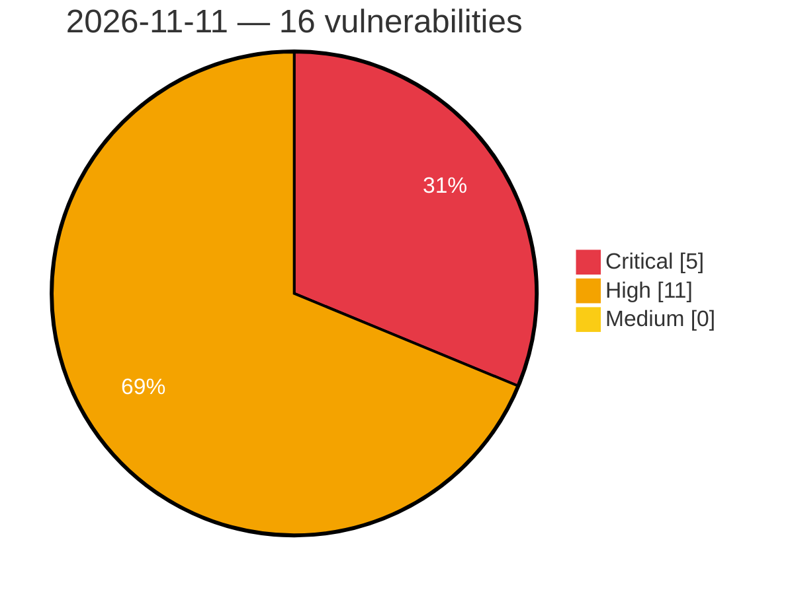

# Critical, High & Medium Severity Vulnerabilities — 2026-11-11

**Source status for this day:**

| Source | Critical | High | Medium | Total |
|--------|---------:|-----:|-------:|------:|
| cvefeed.io (High/Critical) | 5 | 11 | 0 | 16 |

**KEV (actively exploited):** 0  **Watchlist matches:** 11

## Critical (5)

| CVSS | Flags | Source | CVE / Title | Reported |
|------|-------|--------|-------------|----------|
| 9.8 | ⭐ | cvefeed.io (High/Critical) | [CVE-2026-64682 - AstroBlocks: Admin session tokens can be forged due to a hard-coded fallback JWT secret and a mismatched environment variable name](https://cvefeed.io/vuln/detail/CVE-2026-64682) | 3 hours, 55 minutes ago |
| 9.8 | ⭐ | cvefeed.io (High/Critical) | [CVE-2026-64678 - Nitrite: Unfiltered Java Deserialization in Legacy v1 Database Migration Path](https://cvefeed.io/vuln/detail/CVE-2026-64678) | 3 hours, 55 minutes ago |
| 9.8 | ⭐ | cvefeed.io (High/Critical) | [CVE-2026-126542 - WWBN AVideo 6.5 through 29.7.1 Authentication Bypass via Hybridauth Social Login](https://cvefeed.io/vuln/detail/CVE-2026-126542) | 7 hours, 57 minutes ago |
| 9.3 | ⭐ | cvefeed.io (High/Critical) | [CVE-2026-64670 - Stored XSS in @waline/client via the unsanitized markdown preview of a comment's raw body on edit](https://cvefeed.io/vuln/detail/CVE-2026-64670) | 3 hours, 55 minutes ago |
| 9.2 | — | cvefeed.io (High/Critical) | [CVE-2026-126539 - Directus before 12.1.0 Authorization Bypass via Public WebSocket REST Interface](https://cvefeed.io/vuln/detail/CVE-2026-126539) | 7 hours, 57 minutes ago |

## High (11)

| CVSS | Flags | Source | CVE / Title | Reported |
|------|-------|--------|-------------|----------|
| 8.8 | ⭐ | cvefeed.io (High/Critical) | [CVE-2026-126617 - Improper Neutralization of Special Elements used in an SQL Command ('SQL Injection') in hMailServer](https://cvefeed.io/vuln/detail/CVE-2026-126617) | 41 minutes ago |
| 8.8 | ⭐ | cvefeed.io (High/Critical) | [CVE-2026-76981 - Authenticated Second-Order SQL Injection](https://cvefeed.io/vuln/detail/CVE-2026-76981) | 57 minutes ago |
| 8.8 | ⭐ | cvefeed.io (High/Critical) | [CVE-2026-12062 - Authenticated SQL Injection](https://cvefeed.io/vuln/detail/CVE-2026-12062) | 57 minutes ago |
| 8.7 | ⭐ | cvefeed.io (High/Critical) | [CVE-2026-96414 - Octopus Server Authentication Cookie Integrity and Privilege Escalation Vulnerability](https://cvefeed.io/vuln/detail/CVE-2026-96414) | 1 hour, 57 minutes ago |
| 8.7 | ⭐ | cvefeed.io (High/Critical) | [CVE-2026-63194 - Bahmni-Core: Path traversal may lead to arbitrary file write in the admin CSV import](https://cvefeed.io/vuln/detail/CVE-2026-63194) | 5 hours, 58 minutes ago |
| 8.7 | — | cvefeed.io (High/Critical) | [CVE-2026-126543 - WWBN AVideo through 29.7.1 Wallet Credit Manipulation via PayPalYPT ipnV2.php](https://cvefeed.io/vuln/detail/CVE-2026-126543) | 7 hours, 57 minutes ago |
| 8.6 | — | cvefeed.io (High/Critical) | [CVE-2026-126541 - WWBN AVideo through 29.7.1 Missing Authorization via Live Restream Endpoints](https://cvefeed.io/vuln/detail/CVE-2026-126541) | 7 hours, 57 minutes ago |
| 8.5 | — | cvefeed.io (High/Critical) | [CVE-2026-126497 - LibreCAD through 2.2.1.6 Heap Out-of-Bounds Write via dwgReader18::parseDataPage](https://cvefeed.io/vuln/detail/CVE-2026-126497) | 16 minutes ago |
| 8.3 | ⭐ | cvefeed.io (High/Critical) | [CVE-2026-126499 - Jellyfin before 12.0 Path Traversal via Library VirtualFolders Endpoints](https://cvefeed.io/vuln/detail/CVE-2026-126499) | 16 minutes ago |
| 8.1 | ⭐ | cvefeed.io (High/Critical) | [CVE-2026-111190 - ARForms <= 7.2.4 - Unauthenticated Arbitrary File Upload to Remote Code Execution via X-FILENAME Header](https://cvefeed.io/vuln/detail/CVE-2026-111190) | 57 minutes ago |
| 8.1 | — | cvefeed.io (High/Critical) | [CVE-2026-63660 - node-fontnik: integer-overflow heap out-of-bounds write in RenderSDF](https://cvefeed.io/vuln/detail/CVE-2026-63660) | 5 hours, 58 minutes ago |
