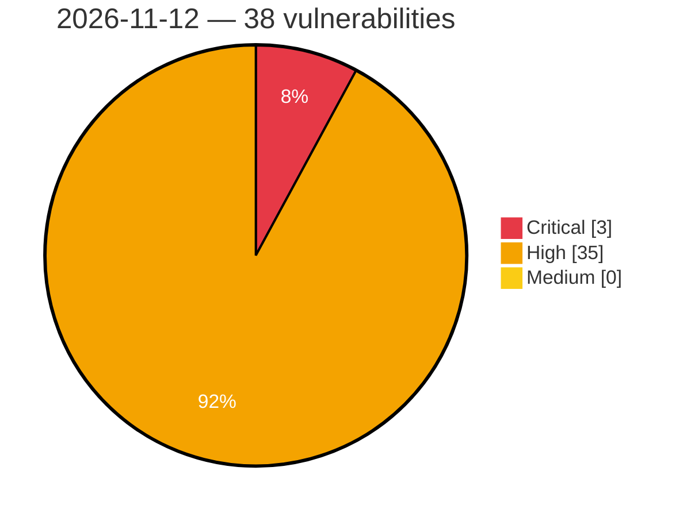

# Critical, High & Medium Severity Vulnerabilities — 2026-11-12

**Source status for this day:**

| Source | Critical | High | Medium | Total |
|--------|---------:|-----:|-------:|------:|
| cvefeed.io (High/Critical) | 3 | 35 | 0 | 38 |

**KEV (actively exploited):** 0  **Watchlist matches:** 13

## Critical (3)

| CVSS | Flags | Source | CVE / Title | Reported |
|------|-------|--------|-------------|----------|
| 9.8 | ⭐ | cvefeed.io (High/Critical) | [CVE-2026-76954 - Synology DiskStation Manager Auth API SQL Injection](https://cvefeed.io/vuln/detail/CVE-2026-76954) | 2 hours, 6 minutes ago |
| 9.3 | — | cvefeed.io (High/Critical) | [CVE-2026-126785 - rmalright TR-VISION HOME IOCTL WFanManager.sys sub_11504 default permission](https://cvefeed.io/vuln/detail/CVE-2026-126785) | 5 hours, 6 minutes ago |
| 9.1 | ⭐ | cvefeed.io (High/Critical) | [CVE-2026-127111 - SOGo before 5.12.13 Unauthenticated Password Recovery Brute Force](https://cvefeed.io/vuln/detail/CVE-2026-127111) | 7 minutes ago |

## High (35)

| CVSS | Flags | Source | CVE / Title | Reported |
|------|-------|--------|-------------|----------|
| 8.8 | ⭐ | cvefeed.io (High/Critical) | [CVE-2026-74857 - Synology DiskStation Manager Auth API Authentication Bypass Vulnerability](https://cvefeed.io/vuln/detail/CVE-2026-74857) | 2 hours, 6 minutes ago |
| 8.8 | ⭐ | cvefeed.io (High/Critical) | [CVE-2026-18792 - Synology DiskStation Manager Sharing API Path Traversal](https://cvefeed.io/vuln/detail/CVE-2026-18792) | 2 hours, 6 minutes ago |
| 8.8 | ⭐ | cvefeed.io (High/Critical) | [CVE-2026-13672 - Synology DiskStation Manager SSOAuth Authorization Bypass](https://cvefeed.io/vuln/detail/CVE-2026-13672) | 2 hours, 6 minutes ago |
| 8.8 | ⭐ | cvefeed.io (High/Critical) | [CVE-2026-122044 - Philips Hue Bridge Pro Protection Mechanism Failure Authentication Bypass Vulnerability](https://cvefeed.io/vuln/detail/CVE-2026-122044) | 3 hours, 6 minutes ago |
| 8.8 | — | cvefeed.io (High/Critical) | [CVE-2026-6460 - PostgreSQL type confusion after ALTER ... SET DATA TYPE executes arbitrary code](https://cvefeed.io/vuln/detail/CVE-2026-6460) | 43 minutes ago |
| 8.8 | — | cvefeed.io (High/Critical) | [CVE-2026-18447 - PostgreSQL output parameter type confusion executes arbitrary code](https://cvefeed.io/vuln/detail/CVE-2026-18447) | 43 minutes ago |
| 8.8 | — | cvefeed.io (High/Critical) | [CVE-2026-120151 - PostgreSQL plpgsql record-field type confusion executes arbitrary code](https://cvefeed.io/vuln/detail/CVE-2026-120151) | 43 minutes ago |
| 8.8 | — | cvefeed.io (High/Critical) | [CVE-2026-120150 - PostgreSQL expanded-record domain-check use-after-free executes arbitrary code](https://cvefeed.io/vuln/detail/CVE-2026-120150) | 43 minutes ago |
| 8.8 | — | cvefeed.io (High/Critical) | [CVE-2026-120149 - PostgreSQL FDW batch-insert mismatch executes arbitrary code](https://cvefeed.io/vuln/detail/CVE-2026-120149) | 43 minutes ago |
| 8.8 | — | cvefeed.io (High/Critical) | [CVE-2026-120147 - PostgreSQL dblink reentrant disconnect use-after-free executes arbitrary code](https://cvefeed.io/vuln/detail/CVE-2026-120147) | 43 minutes ago |
| 8.8 | — | cvefeed.io (High/Critical) | [CVE-2026-120145 - PostgreSQL logical replication can write to subscriber system catalogs, executing arbitrary code](https://cvefeed.io/vuln/detail/CVE-2026-120145) | 43 minutes ago |
| 8.8 | — | cvefeed.io (High/Critical) | [CVE-2026-120144 - PostgreSQL type-cache invalidation gap executes arbitrary code](https://cvefeed.io/vuln/detail/CVE-2026-120144) | 43 minutes ago |
| 8.8 | — | cvefeed.io (High/Critical) | [CVE-2026-120143 - PostgreSQL transition-table cursor use-after-free executes arbitrary code](https://cvefeed.io/vuln/detail/CVE-2026-120143) | 43 minutes ago |
| 8.8 | — | cvefeed.io (High/Critical) | [CVE-2026-120142 - PostgreSQL dropped-column type confusion executes arbitrary code](https://cvefeed.io/vuln/detail/CVE-2026-120142) | 43 minutes ago |
| 8.8 | — | cvefeed.io (High/Critical) | [CVE-2026-120141 - PostgreSQL materialized set-returning function type confusion executes arbitrary code](https://cvefeed.io/vuln/detail/CVE-2026-120141) | 43 minutes ago |
| 8.8 | — | cvefeed.io (High/Critical) | [CVE-2026-120139 - PostgreSQL tuple-size integer wraparound executes arbitrary code](https://cvefeed.io/vuln/detail/CVE-2026-120139) | 43 minutes ago |
| 8.8 | — | cvefeed.io (High/Critical) | [CVE-2026-116336 - PostgreSQL REINDEX CONCURRENTLY does not block DROP INDEX during index functions](https://cvefeed.io/vuln/detail/CVE-2026-116336) | 43 minutes ago |
| 8.8 | — | cvefeed.io (High/Critical) | [CVE-2026-116335 - PostgreSQL commutator or negator result-type confusion executes arbitrary code](https://cvefeed.io/vuln/detail/CVE-2026-116335) | 43 minutes ago |
| 8.8 | — | cvefeed.io (High/Critical) | [CVE-2026-116332 - PostgreSQL portal setup use-after-free executes arbitrary code](https://cvefeed.io/vuln/detail/CVE-2026-116332) | 43 minutes ago |
| 8.8 | — | cvefeed.io (High/Critical) | [CVE-2026-116331 - PostgreSQL min/max aggregate type confusion executes arbitrary code](https://cvefeed.io/vuln/detail/CVE-2026-116331) | 43 minutes ago |
| 8.8 | ⭐ | cvefeed.io (High/Critical) | [CVE-2026-116330 - PostgreSQL pg_dump tar restore.sql fails to block psql command injection](https://cvefeed.io/vuln/detail/CVE-2026-116330) | 43 minutes ago |
| 8.8 | — | cvefeed.io (High/Critical) | [CVE-2026-116329 - PostgreSQL statistics import type confusion executes arbitrary code](https://cvefeed.io/vuln/detail/CVE-2026-116329) | 43 minutes ago |
| 8.8 | — | cvefeed.io (High/Critical) | [CVE-2026-116328 - PostgreSQL generation memory context integer wraparound executes arbitrary code](https://cvefeed.io/vuln/detail/CVE-2026-116328) | 43 minutes ago |
| 8.8 | — | cvefeed.io (High/Critical) | [CVE-2026-116326 - PostgreSQL plperl tied-object exceptions follow stale sigjmp_buf](https://cvefeed.io/vuln/detail/CVE-2026-116326) | 43 minutes ago |
| 8.8 | — | cvefeed.io (High/Critical) | [CVE-2026-116323 - PostgreSQL pltcl reentrant result conversion use-after-free executes arbitrary code](https://cvefeed.io/vuln/detail/CVE-2026-116323) | 43 minutes ago |
| 8.6 | ⭐ | cvefeed.io (High/Critical) | [CVE-2026-85101 - Synology DiskStation Manager rsync Authentication Bypass Vulnerability](https://cvefeed.io/vuln/detail/CVE-2026-85101) | 2 hours, 6 minutes ago |
| 8.6 | — | cvefeed.io (High/Critical) | [CVE-2026-111433 - iSulad Symbolic Link Following Vulnerability](https://cvefeed.io/vuln/detail/CVE-2026-111433) | 2 hours, 6 minutes ago |
| 8.1 | ⭐ | cvefeed.io (High/Critical) | [CVE-2026-81584 - Synology DiskStation Manager SQL Injection Vulnerability](https://cvefeed.io/vuln/detail/CVE-2026-81584) | 2 hours, 6 minutes ago |
| 8.1 | — | cvefeed.io (High/Critical) | [CVE-2026-19048 - Synology DiskStation Manager Improper Link Resolution Vulnerability](https://cvefeed.io/vuln/detail/CVE-2026-19048) | 2 hours, 6 minutes ago |
| 8.1 | ⭐ | cvefeed.io (High/Critical) | [CVE-2026-18596 - Synology DiskStation Manager Authentication Bypass via Alternate Path or Channel](https://cvefeed.io/vuln/detail/CVE-2026-18596) | 2 hours, 6 minutes ago |
| 8.1 | — | cvefeed.io (High/Critical) | [CVE-2026-14661 - PostgreSQL dblink and subscriptions can append to arbitrary files](https://cvefeed.io/vuln/detail/CVE-2026-14661) | 43 minutes ago |
| 8.1 | — | cvefeed.io (High/Critical) | [CVE-2026-120148 - PostgreSQL extended-statistics pseudo-type confusion executes arbitrary code](https://cvefeed.io/vuln/detail/CVE-2026-120148) | 43 minutes ago |
| 8.0 | ⭐ | cvefeed.io (High/Critical) | [CVE-2026-101107 - SoftBank Air Terminal OS Command Injection](https://cvefeed.io/vuln/detail/CVE-2026-101107) | 1 hour, 12 minutes ago |
| 8.0 | ⭐ | cvefeed.io (High/Critical) | [CVE-2026-118632 - Philips Hue Bridge Pro SQL Injection Remote Code Execution Vulnerability](https://cvefeed.io/vuln/detail/CVE-2026-118632) | 3 hours, 6 minutes ago |
| 8.0 | ⭐ | cvefeed.io (High/Critical) | [CVE-2026-116325 - PostgreSQL reindexdb index name quoting allows SQL injection](https://cvefeed.io/vuln/detail/CVE-2026-116325) | 43 minutes ago |
