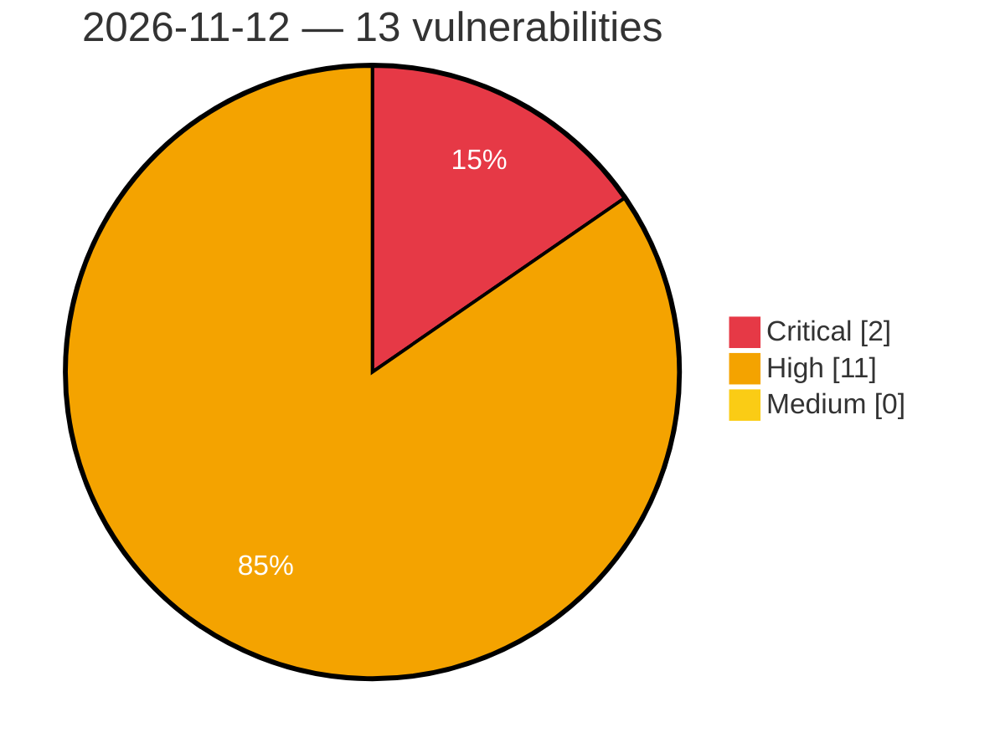

# Critical, High & Medium Severity Vulnerabilities — 2026-11-12

**Source status for this day:**

| Source | Critical | High | Medium | Total |
|--------|---------:|-----:|-------:|------:|
| cvefeed.io (High/Critical) | 2 | 11 | 0 | 13 |

**KEV (actively exploited):** 0  **Watchlist matches:** 10

## Critical (2)

| CVSS | Flags | Source | CVE / Title | Reported |
|------|-------|--------|-------------|----------|
| 9.8 | ⭐ | cvefeed.io (High/Critical) | [CVE-2026-76954 - Synology DiskStation Manager Auth API SQL Injection](https://cvefeed.io/vuln/detail/CVE-2026-76954) | 2 hours, 6 minutes ago |
| 9.3 | — | cvefeed.io (High/Critical) | [CVE-2026-126785 - rmalright TR-VISION HOME IOCTL WFanManager.sys sub_11504 default permission](https://cvefeed.io/vuln/detail/CVE-2026-126785) | 5 hours, 6 minutes ago |

## High (11)

| CVSS | Flags | Source | CVE / Title | Reported |
|------|-------|--------|-------------|----------|
| 8.8 | ⭐ | cvefeed.io (High/Critical) | [CVE-2026-74857 - Synology DiskStation Manager Auth API Authentication Bypass Vulnerability](https://cvefeed.io/vuln/detail/CVE-2026-74857) | 2 hours, 6 minutes ago |
| 8.8 | ⭐ | cvefeed.io (High/Critical) | [CVE-2026-18792 - Synology DiskStation Manager Sharing API Path Traversal](https://cvefeed.io/vuln/detail/CVE-2026-18792) | 2 hours, 6 minutes ago |
| 8.8 | ⭐ | cvefeed.io (High/Critical) | [CVE-2026-13672 - Synology DiskStation Manager SSOAuth Authorization Bypass](https://cvefeed.io/vuln/detail/CVE-2026-13672) | 2 hours, 6 minutes ago |
| 8.8 | ⭐ | cvefeed.io (High/Critical) | [CVE-2026-122044 - Philips Hue Bridge Pro Protection Mechanism Failure Authentication Bypass Vulnerability](https://cvefeed.io/vuln/detail/CVE-2026-122044) | 3 hours, 6 minutes ago |
| 8.6 | ⭐ | cvefeed.io (High/Critical) | [CVE-2026-85101 - Synology DiskStation Manager rsync Authentication Bypass Vulnerability](https://cvefeed.io/vuln/detail/CVE-2026-85101) | 2 hours, 6 minutes ago |
| 8.6 | — | cvefeed.io (High/Critical) | [CVE-2026-111433 - iSulad Symbolic Link Following Vulnerability](https://cvefeed.io/vuln/detail/CVE-2026-111433) | 2 hours, 6 minutes ago |
| 8.1 | ⭐ | cvefeed.io (High/Critical) | [CVE-2026-81584 - Synology DiskStation Manager SQL Injection Vulnerability](https://cvefeed.io/vuln/detail/CVE-2026-81584) | 2 hours, 6 minutes ago |
| 8.1 | — | cvefeed.io (High/Critical) | [CVE-2026-19048 - Synology DiskStation Manager Improper Link Resolution Vulnerability](https://cvefeed.io/vuln/detail/CVE-2026-19048) | 2 hours, 6 minutes ago |
| 8.1 | ⭐ | cvefeed.io (High/Critical) | [CVE-2026-18596 - Synology DiskStation Manager Authentication Bypass via Alternate Path or Channel](https://cvefeed.io/vuln/detail/CVE-2026-18596) | 2 hours, 6 minutes ago |
| 8.0 | ⭐ | cvefeed.io (High/Critical) | [CVE-2026-101107 - SoftBank Air Terminal OS Command Injection](https://cvefeed.io/vuln/detail/CVE-2026-101107) | 1 hour, 12 minutes ago |
| 8.0 | ⭐ | cvefeed.io (High/Critical) | [CVE-2026-118632 - Philips Hue Bridge Pro SQL Injection Remote Code Execution Vulnerability](https://cvefeed.io/vuln/detail/CVE-2026-118632) | 3 hours, 6 minutes ago |
