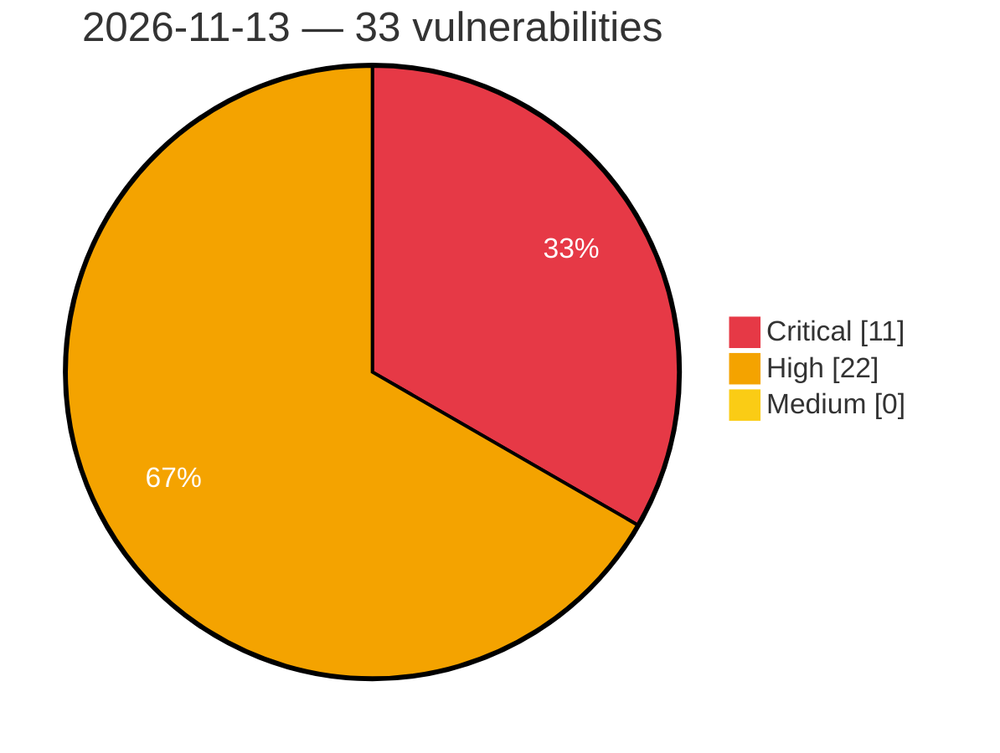

# Critical, High & Medium Severity Vulnerabilities — 2026-11-13

**Source status for this day:**

| Source | Critical | High | Medium | Total |
|--------|---------:|-----:|-------:|------:|
| cvefeed.io (High/Critical) | 11 | 22 | 0 | 33 |

**KEV (actively exploited):** 0  **Watchlist matches:** 14

## Critical (11)

| CVSS | Flags | Source | CVE / Title | Reported |
|------|-------|--------|-------------|----------|
| 10.0 | ⭐ | cvefeed.io (High/Critical) | [CVE-2026-127275 - Linksys EA8100 JNAP API ui_server.lua SetUnsecuredWiFiWarning missing authentication](https://cvefeed.io/vuln/detail/CVE-2026-127275) | 2 hours, 1 minute ago |
| 9.4 | ⭐ | cvefeed.io (High/Critical) | [CVE-2026-128049 - OpenMage Magento LTS before 20.18.2 CSRF via OAuth Authorization Confirm](https://cvefeed.io/vuln/detail/CVE-2026-128049) | 12 minutes ago |
| 9.3 | — | cvefeed.io (High/Critical) | [CVE-2026-107410 - Memory overflow in NetScaler Push can lead to unpredictable or erroneous behavior or Denial of Service in NetScaler ADC and NetScaler Gateway](https://cvefeed.io/vuln/detail/CVE-2026-107410) | 11 minutes ago |
| 9.3 | — | cvefeed.io (High/Critical) | [CVE-2026-107409 - Memory corruption in DNS-over-HTTPS (DoH) can lead to unpredictable or erroneous behavior or a Denial of Service in NetScaler ADC and NetScaler Gateway](https://cvefeed.io/vuln/detail/CVE-2026-107409) | 16 minutes ago |
| 9.3 | — | cvefeed.io (High/Critical) | [CVE-2026-107408 - Memory corruption in DNS / DNS-over-HTTPS (DoH) can lead to unpredictable or erroneous behavior or Denial of Service in NetScaler ADC and NetScaler Gateway](https://cvefeed.io/vuln/detail/CVE-2026-107408) | 18 minutes ago |
| 9.3 | — | cvefeed.io (High/Critical) | [CVE-2026-107407 - Memory overflow in SMPP traffic can lead to unpredictable or erroneous behavior or Denial of Service in NetScaler ADC and NetScaler Gateway](https://cvefeed.io/vuln/detail/CVE-2026-107407) | 20 minutes ago |
| 9.3 | — | cvefeed.io (High/Critical) | [CVE-2026-120868 - Memory overflow in Packet Processing can lead to unpredictable or erroneous behavior or Denial of Service in NetScaler ADC and NetScaler Gateway](https://cvefeed.io/vuln/detail/CVE-2026-120868) | 2 hours, 1 minute ago |
| 9.2 | ⭐ | cvefeed.io (High/Critical) | [CVE-2026-75495 - Cudy TR3000 before 2.5.42 OS Command Injection via TR-098 User Password Parameter](https://cvefeed.io/vuln/detail/CVE-2026-75495) | 12 minutes ago |
| 9.2 | ⭐ | cvefeed.io (High/Critical) | [CVE-2026-75491 - Cudy TR3000 before 2.5.42 MQTT JWT Authentication Bypass via alg none Tokens](https://cvefeed.io/vuln/detail/CVE-2026-75491) | 12 minutes ago |
| 9.1 | ⭐ | cvefeed.io (High/Critical) | [CVE-2026-128333 - listmonk 6.0.0 before 7.0.0-beta.2 2FA Bypass via Password Reset Flow](https://cvefeed.io/vuln/detail/CVE-2026-128333) | 12 minutes ago |
| 9.1 | ⭐ | cvefeed.io (High/Critical) | [CVE-2026-128332 - listmonk 6.0.0 before 7.0.0-beta.2 TOTP Brute-Force via /admin/login/twofa](https://cvefeed.io/vuln/detail/CVE-2026-128332) | 12 minutes ago |

## High (22)

| CVSS | Flags | Source | CVE / Title | Reported |
|------|-------|--------|-------------|----------|
| 8.7 | — | cvefeed.io (High/Critical) | [CVE-2026-128066 - Pillow: Memory DoS in TIFF and EXIF IFD parsing via overlapping tag data](https://cvefeed.io/vuln/detail/CVE-2026-128066) | 2 hours, 1 minute ago |
| 8.7 | — | cvefeed.io (High/Critical) | [CVE-2026-75492 - Cudy TR3000 before 2.5.42 Stack Buffer Overflow via stun_client UDP Parser](https://cvefeed.io/vuln/detail/CVE-2026-75492) | 12 minutes ago |
| 8.7 | — | cvefeed.io (High/Critical) | [CVE-2026-128347 - ExcelJS through 4.4.0 Arbitrary File Read via WorkbookWriter addImage Filename](https://cvefeed.io/vuln/detail/CVE-2026-128347) | 12 minutes ago |
| 8.7 | ⭐ | cvefeed.io (High/Critical) | [CVE-2026-128346 - ExcelJS through 4.4.0 Resource Exhaustion via Streaming WorkbookReader Temporary Files](https://cvefeed.io/vuln/detail/CVE-2026-128346) | 12 minutes ago |
| 8.7 | — | cvefeed.io (High/Critical) | [CVE-2026-128344 - ExcelJS through 4.4.0 Memory Exhaustion via Oversized Image Anchor Column](https://cvefeed.io/vuln/detail/CVE-2026-128344) | 12 minutes ago |
| 8.7 | — | cvefeed.io (High/Critical) | [CVE-2026-128343 - ExcelJS through 4.4.0 Denial of Service via Oversized Row Number](https://cvefeed.io/vuln/detail/CVE-2026-128343) | 12 minutes ago |
| 8.7 | — | cvefeed.io (High/Critical) | [CVE-2026-128342 - ExcelJS through 4.4.0 Denial of Service via Oversized Worksheet sheetId](https://cvefeed.io/vuln/detail/CVE-2026-128342) | 12 minutes ago |
| 8.7 | ⭐ | cvefeed.io (High/Critical) | [CVE-2026-128341 - ExcelJS through 4.4.0 Denial of Service via Oversized Data Validation sqref](https://cvefeed.io/vuln/detail/CVE-2026-128341) | 12 minutes ago |
| 8.7 | — | cvefeed.io (High/Critical) | [CVE-2026-128340 - ExcelJS through 4.4.0 Memory Exhaustion via Oversized Defined Name Range](https://cvefeed.io/vuln/detail/CVE-2026-128340) | 12 minutes ago |
| 8.7 | — | cvefeed.io (High/Critical) | [CVE-2026-128339 - ExcelJS through 4.4.0 Memory Exhaustion via Oversized Merged Cell Range](https://cvefeed.io/vuln/detail/CVE-2026-128339) | 12 minutes ago |
| 8.7 | — | cvefeed.io (High/Critical) | [CVE-2026-128338 - ExcelJS through 4.4.0 Memory Exhaustion via Unbounded Worksheet Column Range](https://cvefeed.io/vuln/detail/CVE-2026-128338) | 12 minutes ago |
| 8.7 | — | cvefeed.io (High/Critical) | [CVE-2026-128242 - actix-http before 3.20.1 and actix-web before 4.18.2 Decompression Bomb DoS via encoding::Decoder](https://cvefeed.io/vuln/detail/CVE-2026-128242) | 12 minutes ago |
| 8.6 | ⭐ | cvefeed.io (High/Critical) | [CVE-2026-75578 - Cudy TR3000 before 2.5.42 Command Injection via OpenVPN Client Configuration Upload](https://cvefeed.io/vuln/detail/CVE-2026-75578) | 12 minutes ago |
| 8.6 | ⭐ | cvefeed.io (High/Critical) | [CVE-2026-75577 - Cudy TR3000 before 2.5.42 Command Injection via vpn.export_conf WireGuard Private Key](https://cvefeed.io/vuln/detail/CVE-2026-75577) | 12 minutes ago |
| 8.6 | ⭐ | cvefeed.io (High/Critical) | [CVE-2026-75576 - Cudy TR3000 before 2.5.42 Command Injection via VPN Configuration Upload Filename](https://cvefeed.io/vuln/detail/CVE-2026-75576) | 12 minutes ago |
| 8.6 | ⭐ | cvefeed.io (High/Critical) | [CVE-2026-75487 - Cudy TR3000 before 2.5.42 Command Injection via WireGuard private_key Export](https://cvefeed.io/vuln/detail/CVE-2026-75487) | 12 minutes ago |
| 8.4 | ⭐ | cvefeed.io (High/Critical) | [CVE-2026-128067 - Pillow: Heap buffer overflow saving TIFF with libtiff when tags override image size](https://cvefeed.io/vuln/detail/CVE-2026-128067) | 2 hours, 1 minute ago |
| 8.3 | — | cvefeed.io (High/Critical) | [CVE-2026-75494 - Cudy TR3000 before 2.5.42 Curl Argument Injection via TR-069 Upload](https://cvefeed.io/vuln/detail/CVE-2026-75494) | 12 minutes ago |
| 8.3 | — | cvefeed.io (High/Critical) | [CVE-2026-128337 - ExcelJS through 4.4.0 Prototype Pollution via x14 Conditional Formatting Rule ID](https://cvefeed.io/vuln/detail/CVE-2026-128337) | 12 minutes ago |
| 8.3 | ⭐ | cvefeed.io (High/Critical) | [CVE-2026-128329 - Dokploy 0.28.0 before 0.31.1 Path Traversal via patch.readRepoFile](https://cvefeed.io/vuln/detail/CVE-2026-128329) | 12 minutes ago |
| 8.2 | — | cvefeed.io (High/Critical) | [CVE-2026-75493 - Cudy TR3000 before 2.5.42 Stack Buffer Overflow via obuspa KeyPassphrase Getter](https://cvefeed.io/vuln/detail/CVE-2026-75493) | 12 minutes ago |
| 8.2 | — | cvefeed.io (High/Critical) | [CVE-2026-75488 - Cudy TR3000 before 2.5.42 Stack Buffer Overflow via CWMP Basic Authorization Builder](https://cvefeed.io/vuln/detail/CVE-2026-75488) | 12 minutes ago |
