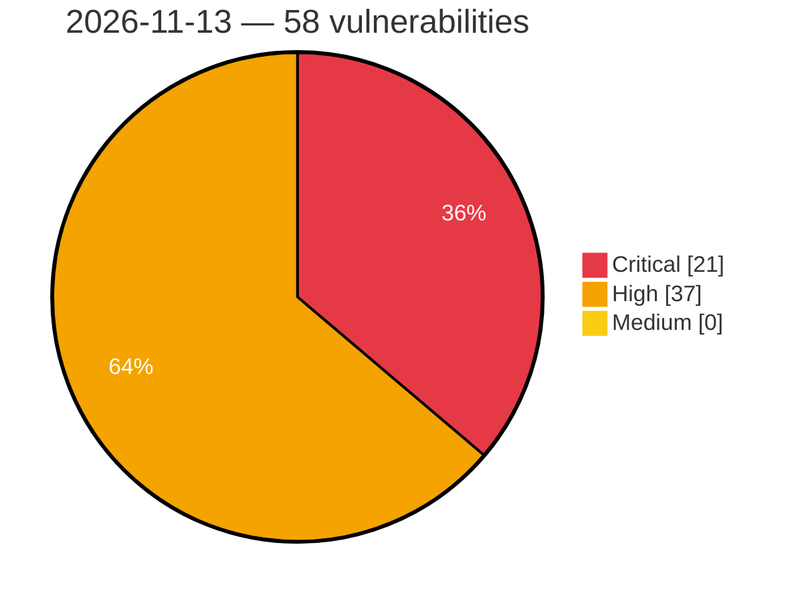

# Critical, High & Medium Severity Vulnerabilities — 2026-11-13

**Source status for this day:**

| Source | Critical | High | Medium | Total |
|--------|---------:|-----:|-------:|------:|
| cvefeed.io (High/Critical) | 21 | 37 | 0 | 58 |

**KEV (actively exploited):** 0  **Watchlist matches:** 32

## Critical (21)

| CVSS | Flags | Source | CVE / Title | Reported |
|------|-------|--------|-------------|----------|
| 10.0 | ⭐ | cvefeed.io (High/Critical) | [CVE-2026-127275 - Linksys EA8100 JNAP API ui_server.lua SetUnsecuredWiFiWarning missing authentication](https://cvefeed.io/vuln/detail/CVE-2026-127275) | 2 hours, 1 minute ago |
| 9.9 | ⭐ | cvefeed.io (High/Critical) | [CVE-2026-125851 - WordPress Hotel Booking Lite theme <= 2.5.1 - Arbitrary File Upload vulnerability](https://cvefeed.io/vuln/detail/CVE-2026-125851) | 1 hour, 2 minutes ago |
| 9.8 | ⭐ | cvefeed.io (High/Critical) | [CVE-2026-129110 - sysPass 3.0.1 through 3.2.11 Unauthenticated Reinstallation RCE via install/install](https://cvefeed.io/vuln/detail/CVE-2026-129110) | 33 minutes ago |
| 9.8 | ⭐ | cvefeed.io (High/Critical) | [CVE-2026-63079 - RBH Integra32 5.1.11 .NET Remoting Deserialization RCE](https://cvefeed.io/vuln/detail/CVE-2026-63079) | 1 hour ago |
| 9.8 | ⭐ | cvefeed.io (High/Critical) | [CVE-2026-125855 - WordPress ELEX WordPress HelpDesk & Customer Ticketing System plugin <= 3.3.9 - PHP Object Injection vulnerability](https://cvefeed.io/vuln/detail/CVE-2026-125855) | 1 hour, 2 minutes ago |
| 9.8 | — | cvefeed.io (High/Critical) | [CVE-2026-109445 - PLANET GS-5220-8P2T2S Stack Buffer Overflow via webstax_auth Cookie](https://cvefeed.io/vuln/detail/CVE-2026-109445) | 1 hour, 2 minutes ago |
| 9.4 | ⭐ | cvefeed.io (High/Critical) | [CVE-2026-128049 - OpenMage Magento LTS before 20.18.2 CSRF via OAuth Authorization Confirm](https://cvefeed.io/vuln/detail/CVE-2026-128049) | 12 minutes ago |
| 9.4 | ⭐ | cvefeed.io (High/Critical) | [CVE-2026-95377 - OS command injection via DHCP option 66 in Zenitel EdgeAudioClient TFTP provisioning](https://cvefeed.io/vuln/detail/CVE-2026-95377) | 33 minutes ago |
| 9.3 | — | cvefeed.io (High/Critical) | [CVE-2026-107410 - Memory overflow in NetScaler Push can lead to unpredictable or erroneous behavior or Denial of Service in NetScaler ADC and NetScaler Gateway](https://cvefeed.io/vuln/detail/CVE-2026-107410) | 11 minutes ago |
| 9.3 | — | cvefeed.io (High/Critical) | [CVE-2026-107409 - Memory corruption in DNS-over-HTTPS (DoH) can lead to unpredictable or erroneous behavior or a Denial of Service in NetScaler ADC and NetScaler Gateway](https://cvefeed.io/vuln/detail/CVE-2026-107409) | 16 minutes ago |
| 9.3 | — | cvefeed.io (High/Critical) | [CVE-2026-107408 - Memory corruption in DNS / DNS-over-HTTPS (DoH) can lead to unpredictable or erroneous behavior or Denial of Service in NetScaler ADC and NetScaler Gateway](https://cvefeed.io/vuln/detail/CVE-2026-107408) | 18 minutes ago |
| 9.3 | — | cvefeed.io (High/Critical) | [CVE-2026-107407 - Memory overflow in SMPP traffic can lead to unpredictable or erroneous behavior or Denial of Service in NetScaler ADC and NetScaler Gateway](https://cvefeed.io/vuln/detail/CVE-2026-107407) | 20 minutes ago |
| 9.3 | — | cvefeed.io (High/Critical) | [CVE-2026-120868 - Memory overflow in Packet Processing can lead to unpredictable or erroneous behavior or Denial of Service in NetScaler ADC and NetScaler Gateway](https://cvefeed.io/vuln/detail/CVE-2026-120868) | 2 hours, 1 minute ago |
| 9.3 | — | cvefeed.io (High/Critical) | [CVE-2026-95614 - Zenitel Connect host applies rsyslog configuration written to a volume shared with the hiatus container](https://cvefeed.io/vuln/detail/CVE-2026-95614) | 33 minutes ago |
| 9.3 | ⭐ | cvefeed.io (High/Critical) | [CVE-2026-124970 - WordPress WP BASE Booking plugin <= 6.5.2 - SQL Injection vulnerability](https://cvefeed.io/vuln/detail/CVE-2026-124970) | 1 hour, 2 minutes ago |
| 9.3 | ⭐ | cvefeed.io (High/Critical) | [CVE-2026-124415 - WordPress Alex Reservations plugin <= 2.4.8 - SQL Injection vulnerability](https://cvefeed.io/vuln/detail/CVE-2026-124415) | 1 hour, 2 minutes ago |
| 9.2 | ⭐ | cvefeed.io (High/Critical) | [CVE-2026-75495 - Cudy TR3000 before 2.5.42 OS Command Injection via TR-098 User Password Parameter](https://cvefeed.io/vuln/detail/CVE-2026-75495) | 12 minutes ago |
| 9.2 | ⭐ | cvefeed.io (High/Critical) | [CVE-2026-75491 - Cudy TR3000 before 2.5.42 MQTT JWT Authentication Bypass via alg none Tokens](https://cvefeed.io/vuln/detail/CVE-2026-75491) | 12 minutes ago |
| 9.1 | ⭐ | cvefeed.io (High/Critical) | [CVE-2026-128333 - listmonk 6.0.0 before 7.0.0-beta.2 2FA Bypass via Password Reset Flow](https://cvefeed.io/vuln/detail/CVE-2026-128333) | 12 minutes ago |
| 9.1 | ⭐ | cvefeed.io (High/Critical) | [CVE-2026-128332 - listmonk 6.0.0 before 7.0.0-beta.2 TOTP Brute-Force via /admin/login/twofa](https://cvefeed.io/vuln/detail/CVE-2026-128332) | 12 minutes ago |
| 9.1 | ⭐ | cvefeed.io (High/Critical) | [CVE-2026-103813 - Dell PowerStore OS Command Injection Vulnerability](https://cvefeed.io/vuln/detail/CVE-2026-103813) | 50 minutes ago |

## High (37)

| CVSS | Flags | Source | CVE / Title | Reported |
|------|-------|--------|-------------|----------|
| 8.8 | — | cvefeed.io (High/Critical) | [CVE-2026-128909 - DJI AeroScope Mobile: Firmware updates are not signature-verified](https://cvefeed.io/vuln/detail/CVE-2026-128909) | 1 hour, 2 minutes ago |
| 8.8 | ⭐ | cvefeed.io (High/Critical) | [CVE-2026-128908 - DJI AeroScope Mobile: OS command injection leads to root code execution](https://cvefeed.io/vuln/detail/CVE-2026-128908) | 1 hour, 2 minutes ago |
| 8.8 | ⭐ | cvefeed.io (High/Critical) | [CVE-2026-120835 - WordPress AFFI – Affiliate Marketing for WooCommerce plugin <= 1.0.11 - PHP Object Injection vulnerability](https://cvefeed.io/vuln/detail/CVE-2026-120835) | 1 hour, 2 minutes ago |
| 8.8 | ⭐ | cvefeed.io (High/Critical) | [CVE-2026-119512 - WordPress Newsletters plugin <= 4.18.2 - PHP Object Injection vulnerability](https://cvefeed.io/vuln/detail/CVE-2026-119512) | 1 hour, 2 minutes ago |
| 8.7 | — | cvefeed.io (High/Critical) | [CVE-2026-128066 - Pillow: Memory DoS in TIFF and EXIF IFD parsing via overlapping tag data](https://cvefeed.io/vuln/detail/CVE-2026-128066) | 2 hours, 1 minute ago |
| 8.7 | — | cvefeed.io (High/Critical) | [CVE-2026-75492 - Cudy TR3000 before 2.5.42 Stack Buffer Overflow via stun_client UDP Parser](https://cvefeed.io/vuln/detail/CVE-2026-75492) | 12 minutes ago |
| 8.7 | — | cvefeed.io (High/Critical) | [CVE-2026-128347 - ExcelJS through 4.4.0 Arbitrary File Read via WorkbookWriter addImage Filename](https://cvefeed.io/vuln/detail/CVE-2026-128347) | 12 minutes ago |
| 8.7 | ⭐ | cvefeed.io (High/Critical) | [CVE-2026-128346 - ExcelJS through 4.4.0 Resource Exhaustion via Streaming WorkbookReader Temporary Files](https://cvefeed.io/vuln/detail/CVE-2026-128346) | 12 minutes ago |
| 8.7 | — | cvefeed.io (High/Critical) | [CVE-2026-128344 - ExcelJS through 4.4.0 Memory Exhaustion via Oversized Image Anchor Column](https://cvefeed.io/vuln/detail/CVE-2026-128344) | 12 minutes ago |
| 8.7 | — | cvefeed.io (High/Critical) | [CVE-2026-128343 - ExcelJS through 4.4.0 Denial of Service via Oversized Row Number](https://cvefeed.io/vuln/detail/CVE-2026-128343) | 12 minutes ago |
| 8.7 | — | cvefeed.io (High/Critical) | [CVE-2026-128342 - ExcelJS through 4.4.0 Denial of Service via Oversized Worksheet sheetId](https://cvefeed.io/vuln/detail/CVE-2026-128342) | 12 minutes ago |
| 8.7 | ⭐ | cvefeed.io (High/Critical) | [CVE-2026-128341 - ExcelJS through 4.4.0 Denial of Service via Oversized Data Validation sqref](https://cvefeed.io/vuln/detail/CVE-2026-128341) | 12 minutes ago |
| 8.7 | — | cvefeed.io (High/Critical) | [CVE-2026-128340 - ExcelJS through 4.4.0 Memory Exhaustion via Oversized Defined Name Range](https://cvefeed.io/vuln/detail/CVE-2026-128340) | 12 minutes ago |
| 8.7 | — | cvefeed.io (High/Critical) | [CVE-2026-128339 - ExcelJS through 4.4.0 Memory Exhaustion via Oversized Merged Cell Range](https://cvefeed.io/vuln/detail/CVE-2026-128339) | 12 minutes ago |
| 8.7 | — | cvefeed.io (High/Critical) | [CVE-2026-128338 - ExcelJS through 4.4.0 Memory Exhaustion via Unbounded Worksheet Column Range](https://cvefeed.io/vuln/detail/CVE-2026-128338) | 12 minutes ago |
| 8.7 | — | cvefeed.io (High/Critical) | [CVE-2026-128242 - actix-http before 3.20.1 and actix-web before 4.18.2 Decompression Bomb DoS via encoding::Decoder](https://cvefeed.io/vuln/detail/CVE-2026-128242) | 12 minutes ago |
| 8.7 | ⭐ | cvefeed.io (High/Critical) | [CVE-2024-58406 - Huatian OA8000 Path Traversal via ntkodownload.jsp](https://cvefeed.io/vuln/detail/CVE-2024-58406) | 23 minutes ago |
| 8.7 | ⭐ | cvefeed.io (High/Critical) | [CVE-2026-95615 - Zenitel Connect OS command injection in hiatus container via unsanitized filename in audio messages API](https://cvefeed.io/vuln/detail/CVE-2026-95615) | 34 minutes ago |
| 8.7 | — | cvefeed.io (High/Critical) | [CVE-2026-123975 - Grid Community Toolkit globus-gss-assist before 12.9 Pre-Authentication Heap Out-of-Bounds Write](https://cvefeed.io/vuln/detail/CVE-2026-123975) | 1 hour, 2 minutes ago |
| 8.6 | ⭐ | cvefeed.io (High/Critical) | [CVE-2026-75578 - Cudy TR3000 before 2.5.42 Command Injection via OpenVPN Client Configuration Upload](https://cvefeed.io/vuln/detail/CVE-2026-75578) | 12 minutes ago |
| 8.6 | ⭐ | cvefeed.io (High/Critical) | [CVE-2026-75577 - Cudy TR3000 before 2.5.42 Command Injection via vpn.export_conf WireGuard Private Key](https://cvefeed.io/vuln/detail/CVE-2026-75577) | 12 minutes ago |
| 8.6 | ⭐ | cvefeed.io (High/Critical) | [CVE-2026-75576 - Cudy TR3000 before 2.5.42 Command Injection via VPN Configuration Upload Filename](https://cvefeed.io/vuln/detail/CVE-2026-75576) | 12 minutes ago |
| 8.6 | ⭐ | cvefeed.io (High/Critical) | [CVE-2026-75487 - Cudy TR3000 before 2.5.42 Command Injection via WireGuard private_key Export](https://cvefeed.io/vuln/detail/CVE-2026-75487) | 12 minutes ago |
| 8.6 | ⭐ | cvefeed.io (High/Critical) | [CVE-2026-49990 - BACnet Stack: AtomicReadFile/AtomicWriteFile stream fileStartPosition validation flaw causes out-of-bounds read/write in RAM file backends](https://cvefeed.io/vuln/detail/CVE-2026-49990) | 25 minutes ago |
| 8.6 | ⭐ | cvefeed.io (High/Critical) | [CVE-2026-95378 - Path traversal in Zenitel turbineweb certificate upload allows arbitrary file write as root](https://cvefeed.io/vuln/detail/CVE-2026-95378) | 35 minutes ago |
| 8.6 | ⭐ | cvefeed.io (High/Critical) | [CVE-2026-95613 - Zenitel Connect pREST API adopts arbitrary PostgreSQL role from unvalidated JWT sub claim](https://cvefeed.io/vuln/detail/CVE-2026-95613) | 35 minutes ago |
| 8.5 | — | cvefeed.io (High/Critical) | [CVE-2026-128990 - xschem 2.9.9 through 3.4.7 Heap Out-of-Bounds Write via rawtovcd read_dataset()](https://cvefeed.io/vuln/detail/CVE-2026-128990) | 1 hour, 2 minutes ago |
| 8.5 | ⭐ | cvefeed.io (High/Critical) | [CVE-2026-125811 - WordPress myCred plugin <= 4.0.2 - SQL Injection vulnerability](https://cvefeed.io/vuln/detail/CVE-2026-125811) | 1 hour, 2 minutes ago |
| 8.5 | ⭐ | cvefeed.io (High/Critical) | [CVE-2026-124265 - WordPress Newsletters plugin <= 4.18.1 - SQL Injection vulnerability](https://cvefeed.io/vuln/detail/CVE-2026-124265) | 1 hour, 2 minutes ago |
| 8.4 | ⭐ | cvefeed.io (High/Critical) | [CVE-2026-128067 - Pillow: Heap buffer overflow saving TIFF with libtiff when tags override image size](https://cvefeed.io/vuln/detail/CVE-2026-128067) | 2 hours, 1 minute ago |
| 8.3 | — | cvefeed.io (High/Critical) | [CVE-2026-75494 - Cudy TR3000 before 2.5.42 Curl Argument Injection via TR-069 Upload](https://cvefeed.io/vuln/detail/CVE-2026-75494) | 12 minutes ago |
| 8.3 | — | cvefeed.io (High/Critical) | [CVE-2026-128337 - ExcelJS through 4.4.0 Prototype Pollution via x14 Conditional Formatting Rule ID](https://cvefeed.io/vuln/detail/CVE-2026-128337) | 12 minutes ago |
| 8.3 | ⭐ | cvefeed.io (High/Critical) | [CVE-2026-128329 - Dokploy 0.28.0 before 0.31.1 Path Traversal via patch.readRepoFile](https://cvefeed.io/vuln/detail/CVE-2026-128329) | 12 minutes ago |
| 8.2 | — | cvefeed.io (High/Critical) | [CVE-2026-75493 - Cudy TR3000 before 2.5.42 Stack Buffer Overflow via obuspa KeyPassphrase Getter](https://cvefeed.io/vuln/detail/CVE-2026-75493) | 12 minutes ago |
| 8.2 | — | cvefeed.io (High/Critical) | [CVE-2026-75488 - Cudy TR3000 before 2.5.42 Stack Buffer Overflow via CWMP Basic Authorization Builder](https://cvefeed.io/vuln/detail/CVE-2026-75488) | 12 minutes ago |
| 8.2 | — | cvefeed.io (High/Critical) | [CVE-2026-121808 - Memory exhaustion via compressed Erlang terms in the elixir-grpc Erlpack codec](https://cvefeed.io/vuln/detail/CVE-2026-121808) | 31 minutes ago |
| 8.1 | — | cvefeed.io (High/Critical) | [CVE-2026-111547 - Dell PowerStore Out-of-Bounds Read Vulnerability](https://cvefeed.io/vuln/detail/CVE-2026-111547) | 1 hour, 2 minutes ago |
