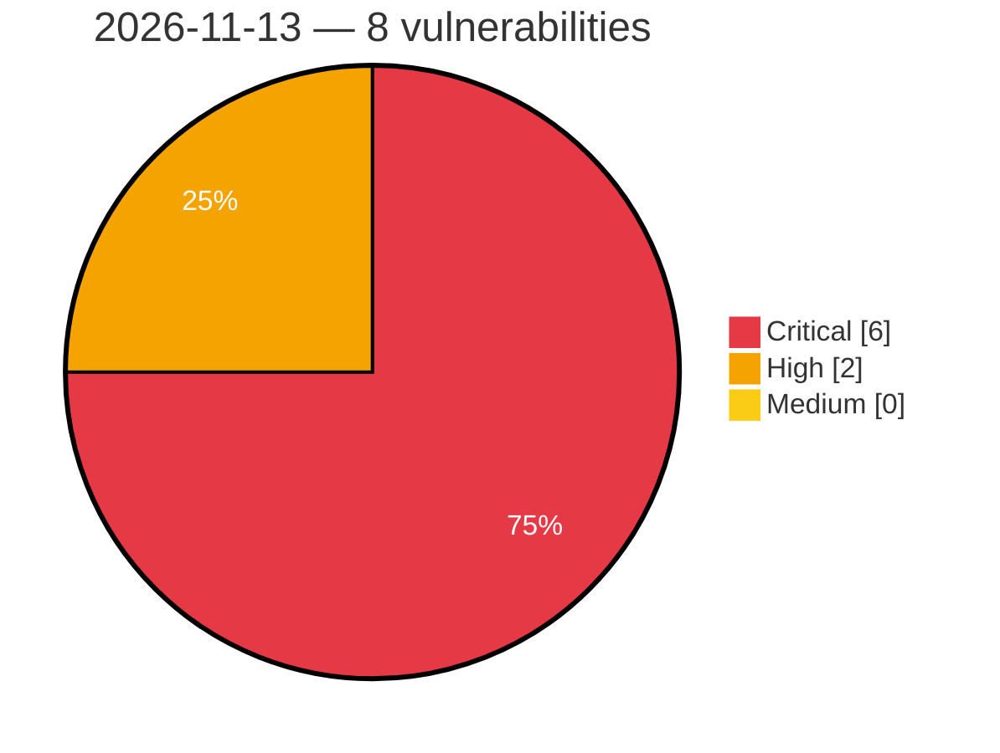

# Critical, High & Medium Severity Vulnerabilities — 2026-11-13

**Source status for this day:**

| Source | Critical | High | Medium | Total |
|--------|---------:|-----:|-------:|------:|
| cvefeed.io (High/Critical) | 6 | 2 | 0 | 8 |

**KEV (actively exploited):** 0  **Watchlist matches:** 2

## Critical (6)

| CVSS | Flags | Source | CVE / Title | Reported |
|------|-------|--------|-------------|----------|
| 10.0 | ⭐ | cvefeed.io (High/Critical) | [CVE-2026-127275 - Linksys EA8100 JNAP API ui_server.lua SetUnsecuredWiFiWarning missing authentication](https://cvefeed.io/vuln/detail/CVE-2026-127275) | 2 hours, 1 minute ago |
| 9.3 | — | cvefeed.io (High/Critical) | [CVE-2026-107410 - Memory overflow in NetScaler Push can lead to unpredictable or erroneous behavior or Denial of Service in NetScaler ADC and NetScaler Gateway](https://cvefeed.io/vuln/detail/CVE-2026-107410) | 11 minutes ago |
| 9.3 | — | cvefeed.io (High/Critical) | [CVE-2026-107409 - Memory corruption in DNS-over-HTTPS (DoH) can lead to unpredictable or erroneous behavior or a Denial of Service in NetScaler ADC and NetScaler Gateway](https://cvefeed.io/vuln/detail/CVE-2026-107409) | 16 minutes ago |
| 9.3 | — | cvefeed.io (High/Critical) | [CVE-2026-107408 - Memory corruption in DNS / DNS-over-HTTPS (DoH) can lead to unpredictable or erroneous behavior or Denial of Service in NetScaler ADC and NetScaler Gateway](https://cvefeed.io/vuln/detail/CVE-2026-107408) | 18 minutes ago |
| 9.3 | — | cvefeed.io (High/Critical) | [CVE-2026-107407 - Memory overflow in SMPP traffic can lead to unpredictable or erroneous behavior or Denial of Service in NetScaler ADC and NetScaler Gateway](https://cvefeed.io/vuln/detail/CVE-2026-107407) | 20 minutes ago |
| 9.3 | — | cvefeed.io (High/Critical) | [CVE-2026-120868 - Memory overflow in Packet Processing can lead to unpredictable or erroneous behavior or Denial of Service in NetScaler ADC and NetScaler Gateway](https://cvefeed.io/vuln/detail/CVE-2026-120868) | 2 hours, 1 minute ago |

## High (2)

| CVSS | Flags | Source | CVE / Title | Reported |
|------|-------|--------|-------------|----------|
| 8.7 | — | cvefeed.io (High/Critical) | [CVE-2026-128066 - Pillow: Memory DoS in TIFF and EXIF IFD parsing via overlapping tag data](https://cvefeed.io/vuln/detail/CVE-2026-128066) | 2 hours, 1 minute ago |
| 8.4 | ⭐ | cvefeed.io (High/Critical) | [CVE-2026-128067 - Pillow: Heap buffer overflow saving TIFF with libtiff when tags override image size](https://cvefeed.io/vuln/detail/CVE-2026-128067) | 2 hours, 1 minute ago |
