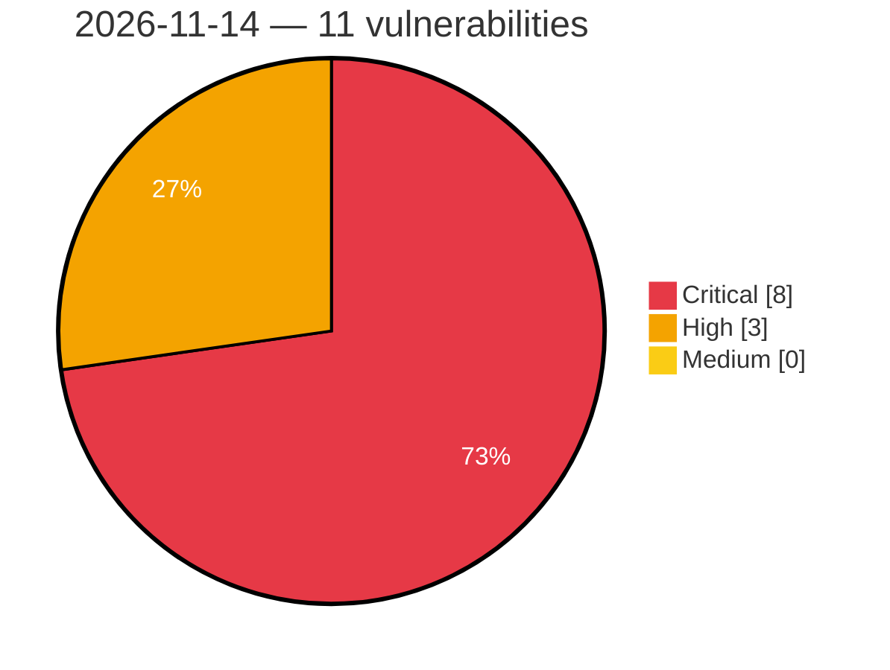

# Critical, High & Medium Severity Vulnerabilities — 2026-11-14

**Source status for this day:**

| Source | Critical | High | Medium | Total |
|--------|---------:|-----:|-------:|------:|
| cvefeed.io (High/Critical) | 8 | 3 | 0 | 11 |

**KEV (actively exploited):** 0  **Watchlist matches:** 7

## Critical (8)

| CVSS | Flags | Source | CVE / Title | Reported |
|------|-------|--------|-------------|----------|
| 9.9 | ⭐ | cvefeed.io (High/Critical) | [CVE-2026-129433 - Dokploy before 0.31.1 OS Command Injection via Compose Backup serviceName](https://cvefeed.io/vuln/detail/CVE-2026-129433) | 2 hours, 59 minutes ago |
| 9.9 | — | cvefeed.io (High/Critical) | [CVE-2026-129250 - Edimax BR6478ACV2 webs formPPTPSetup buffer overflow](https://cvefeed.io/vuln/detail/CVE-2026-129250) | 3 hours, 58 minutes ago |
| 9.8 | — | cvefeed.io (High/Critical) | [CVE-2026-126173 - AutomatorWP Pro Webhooks addon <= 1.4.4 - Missing Authorization to Unauthenticated Arbitrary User Password Reset / Account Takeover via Webhook with 'Is the user ID' Field](https://cvefeed.io/vuln/detail/CVE-2026-126173) | 5 hours, 26 minutes ago |
| 9.8 | ⭐ | cvefeed.io (High/Critical) | [CVE-2026-19907 - Shipo 1.6 - 1.8.0 - Authentication Bypass to Administrator](https://cvefeed.io/vuln/detail/CVE-2026-19907) | 2 hours, 59 minutes ago |
| 9.8 | ⭐ | cvefeed.io (High/Critical) | [CVE-2026-120522 - Cloud Storage Manager for Fluent Forms <= 1.2.0 - Unauthenticated Arbitrary File Write via Google Drive Filename Path Traversal](https://cvefeed.io/vuln/detail/CVE-2026-120522) | 2 hours, 59 minutes ago |
| 9.3 | — | cvefeed.io (High/Critical) | [CVE-2026-129255 - CoolerMaster MASTERPLUS+ Device Driver WinRing0x64.sys sub_11504 default permission](https://cvefeed.io/vuln/detail/CVE-2026-129255) | 2 hours, 59 minutes ago |
| 9.3 | ⭐ | cvefeed.io (High/Critical) | [CVE-2026-129261 - Kingston FURY CTRL RGB Control Software IOCTL NTIOLib_X64.sys exposed ioctl with insufficient access control](https://cvefeed.io/vuln/detail/CVE-2026-129261) | 4 hours, 28 minutes ago |
| 9.1 | — | cvefeed.io (High/Critical) | [CVE-2026-129258 - Tenda AC18 Firmware Upgrade upgrade data authenticity](https://cvefeed.io/vuln/detail/CVE-2026-129258) | 59 minutes ago |

## High (3)

| CVSS | Flags | Source | CVE / Title | Reported |
|------|-------|--------|-------------|----------|
| 8.8 | ⭐ | cvefeed.io (High/Critical) | [CVE-2026-18053 - MemberDash <= 1.8.7 - Authenticated (Subscriber+) Privilege Escalation to Administrator via Edit Profile 'id' Parameter](https://cvefeed.io/vuln/detail/CVE-2026-18053) | 2 hours, 59 minutes ago |
| 8.7 | ⭐ | cvefeed.io (High/Critical) | [CVE-2026-129427 - Stored XSS via avatar upload chained with an authentication bypass in /Attachments leads to ATO](https://cvefeed.io/vuln/detail/CVE-2026-129427) | 3 hours, 58 minutes ago |
| 8.2 | ⭐ | cvefeed.io (High/Critical) | [CVE-2026-129319 - create-ecdh: computeSecret does not validate that the peer public key is on the curve (invalid-curve attack)](https://cvefeed.io/vuln/detail/CVE-2026-129319) | 3 hours, 28 minutes ago |
