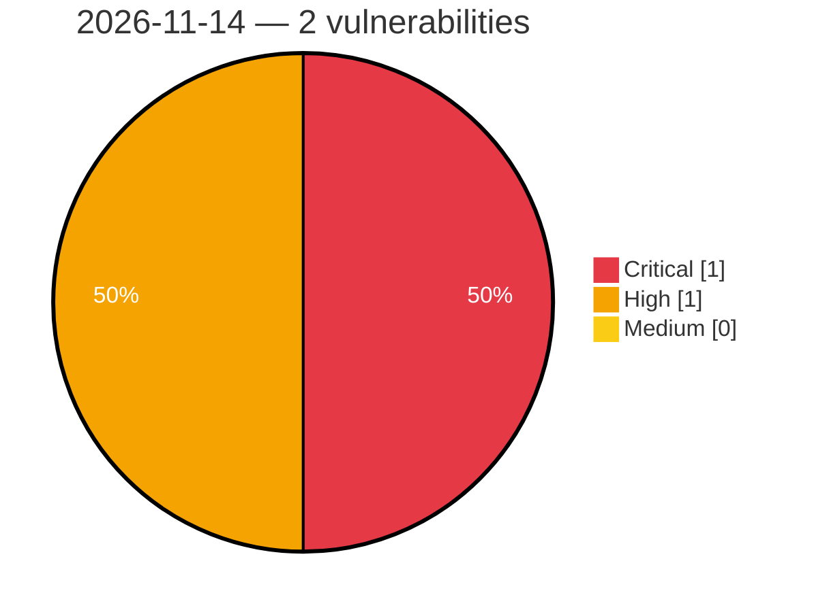

# Critical, High & Medium Severity Vulnerabilities — 2026-11-14

**Source status for this day:**

| Source | Critical | High | Medium | Total |
|--------|---------:|-----:|-------:|------:|
| cvefeed.io (High/Critical) | 1 | 1 | 0 | 2 |

**KEV (actively exploited):** 0  **Watchlist matches:** 1

## Critical (1)

| CVSS | Flags | Source | CVE / Title | Reported |
|------|-------|--------|-------------|----------|
| 9.8 | — | cvefeed.io (High/Critical) | [CVE-2026-126173 - AutomatorWP Pro Webhooks addon <= 1.4.4 - Missing Authorization to Unauthenticated Arbitrary User Password Reset / Account Takeover via Webhook with 'Is the user ID' Field](https://cvefeed.io/vuln/detail/CVE-2026-126173) | 5 hours, 26 minutes ago |

## High (1)

| CVSS | Flags | Source | CVE / Title | Reported |
|------|-------|--------|-------------|----------|
| 8.2 | ⭐ | cvefeed.io (High/Critical) | [CVE-2026-129319 - create-ecdh: computeSecret does not validate that the peer public key is on the curve (invalid-curve attack)](https://cvefeed.io/vuln/detail/CVE-2026-129319) | 3 hours, 28 minutes ago |
