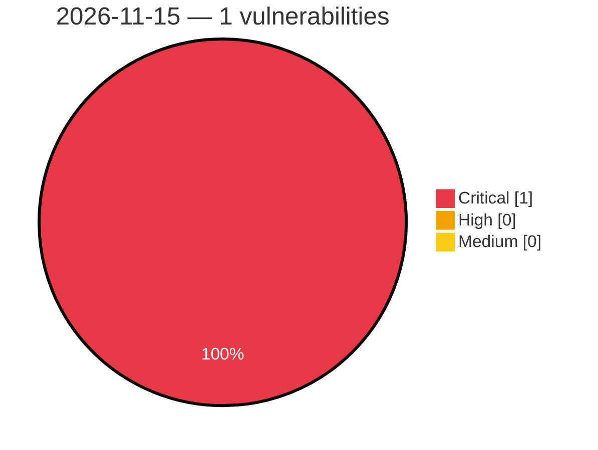

# Critical, High & Medium Severity Vulnerabilities — 2026-11-15

**Source status for this day:**

| Source | Critical | High | Medium | Total |
|--------|---------:|-----:|-------:|------:|
| cvefeed.io (High/Critical) | 1 | 0 | 0 | 1 |

**KEV (actively exploited):** 0  **Watchlist matches:** 0

## Critical (1)

| CVSS | Flags | Source | CVE / Title | Reported |
|------|-------|--------|-------------|----------|
| 10.0 | — | cvefeed.io (High/Critical) | [CVE-2026-129353 - D-Link DIR-600L authentication.cgi authenticationcgi_main stack-based overflow](https://cvefeed.io/vuln/detail/CVE-2026-129353) | 29 minutes ago |
