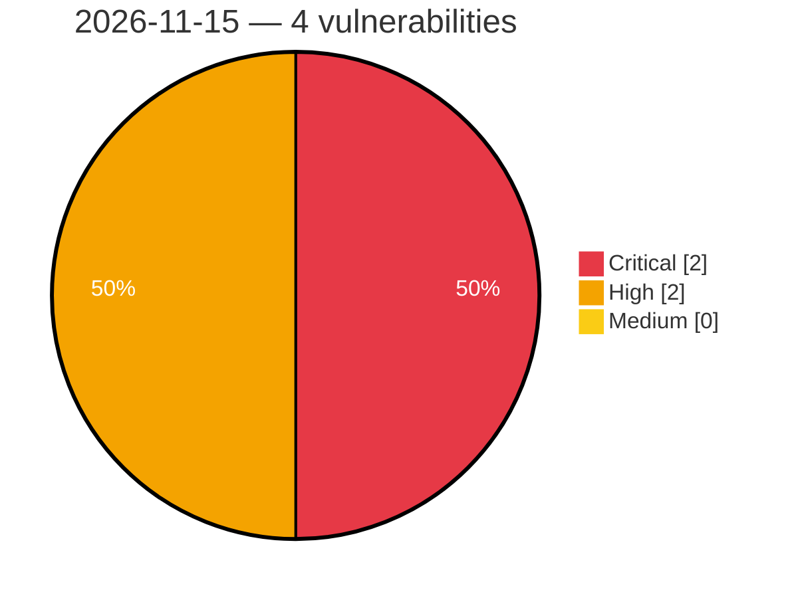

# Critical, High & Medium Severity Vulnerabilities — 2026-11-15

**Source status for this day:**

| Source | Critical | High | Medium | Total |
|--------|---------:|-----:|-------:|------:|
| cvefeed.io (High/Critical) | 2 | 2 | 0 | 4 |

**KEV (actively exploited):** 0  **Watchlist matches:** 2

## Critical (2)

| CVSS | Flags | Source | CVE / Title | Reported |
|------|-------|--------|-------------|----------|
| 10.0 | — | cvefeed.io (High/Critical) | [CVE-2026-129353 - D-Link DIR-600L authentication.cgi authenticationcgi_main stack-based overflow](https://cvefeed.io/vuln/detail/CVE-2026-129353) | 29 minutes ago |
| 10.0 | — | cvefeed.io (High/Critical) | [CVE-2026-129354 - D-Link DIR-600L HNAP cgibin hnap_main stack-based overflow](https://cvefeed.io/vuln/detail/CVE-2026-129354) | 5 hours, 28 minutes ago |

## High (2)

| CVSS | Flags | Source | CVE / Title | Reported |
|------|-------|--------|-------------|----------|
| 8.8 | ⭐ | cvefeed.io (High/Critical) | [CVE-2026-129465 - Zr.Admin.NET commit af07ffc through eb9228a IDOR via /system/user/profile](https://cvefeed.io/vuln/detail/CVE-2026-129465) | 4 hours, 28 minutes ago |
| 8.8 | ⭐ | cvefeed.io (High/Critical) | [CVE-2026-129464 - Zr.Admin.NET commit 0ee1ab8 through eb9228a Path Traversal via DownloadFile](https://cvefeed.io/vuln/detail/CVE-2026-129464) | 4 hours, 28 minutes ago |
