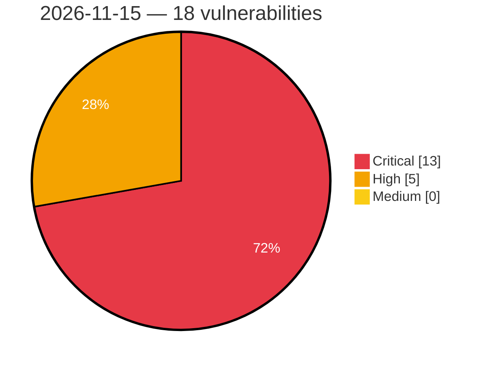

# Critical, High & Medium Severity Vulnerabilities — 2026-11-15

**Source status for this day:**

| Source | Critical | High | Medium | Total |
|--------|---------:|-----:|-------:|------:|
| cvefeed.io (High/Critical) | 13 | 5 | 0 | 18 |

**KEV (actively exploited):** 0  **Watchlist matches:** 11

## Critical (13)

| CVSS | Flags | Source | CVE / Title | Reported |
|------|-------|--------|-------------|----------|
| 10.0 | — | cvefeed.io (High/Critical) | [CVE-2026-129353 - D-Link DIR-600L authentication.cgi authenticationcgi_main stack-based overflow](https://cvefeed.io/vuln/detail/CVE-2026-129353) | 29 minutes ago |
| 10.0 | — | cvefeed.io (High/Critical) | [CVE-2026-129354 - D-Link DIR-600L HNAP cgibin hnap_main stack-based overflow](https://cvefeed.io/vuln/detail/CVE-2026-129354) | 5 hours, 28 minutes ago |
| 10.0 | — | cvefeed.io (High/Critical) | [CVE-2026-129444 - D-Link DSL-6740C FTP Daemon ftpd_conf.php hard-coded credentials](https://cvefeed.io/vuln/detail/CVE-2026-129444) | 4 hours, 58 minutes ago |
| 9.9 | ⭐ | cvefeed.io (High/Critical) | [CVE-2026-129451 - DrayTek Vigor2960 mainfunction.cgi app_guest_export path traversal](https://cvefeed.io/vuln/detail/CVE-2026-129451) | 58 minutes ago |
| 9.9 | ⭐ | cvefeed.io (High/Critical) | [CVE-2026-129450 - DrayTek Vigor2960 mainfunction.cgi sub_1E084 path traversal](https://cvefeed.io/vuln/detail/CVE-2026-129450) | 1 hour, 57 minutes ago |
| 9.9 | ⭐ | cvefeed.io (High/Critical) | [CVE-2026-129449 - DrayTek Vigor2960 mainfunction.cgi sub_14914 command injection](https://cvefeed.io/vuln/detail/CVE-2026-129449) | 2 hours, 58 minutes ago |
| 9.9 | — | cvefeed.io (High/Critical) | [CVE-2026-129453 - DrayTek Vigor2960 File Existence Check mainfunction.cgi check_file_exist heap-based overflow](https://cvefeed.io/vuln/detail/CVE-2026-129453) | 4 hours, 29 minutes ago |
| 9.8 | ⭐ | cvefeed.io (High/Critical) | [CVE-2026-125769 - WordPress Advanced Form Integration plugin <= 2.11.3 - Privilege Escalation vulnerability](https://cvefeed.io/vuln/detail/CVE-2026-125769) | 14 minutes ago |
| 9.8 | ⭐ | cvefeed.io (High/Critical) | [CVE-2026-122662 - WordPress Document Library Pro plugin < 4.2.2 - PHP Object Injection vulnerability](https://cvefeed.io/vuln/detail/CVE-2026-122662) | 14 minutes ago |
| 9.8 | — | cvefeed.io (High/Critical) | [CVE-2026-125795 - WordPress Estatik plugin <= 4.3.6 - Local File Inclusion vulnerability](https://cvefeed.io/vuln/detail/CVE-2026-125795) | 3 hours, 30 minutes ago |
| 9.3 | ⭐ | cvefeed.io (High/Critical) | [CVE-2026-129483 - Cyrus SASL through 2.1.28 SRP Authentication Bypass via plugins/srp.c](https://cvefeed.io/vuln/detail/CVE-2026-129483) | 27 minutes ago |
| 9.1 | ⭐ | cvefeed.io (High/Critical) | [CVE-2026-129452 - DrayTek Vigor2960 mainfunction.cgi set_table command injection](https://cvefeed.io/vuln/detail/CVE-2026-129452) | 58 minutes ago |
| 9.1 | — | cvefeed.io (High/Critical) | [CVE-2026-129349 - Apache Shiro: DefaultLdapRealm accepts any password when authentication caching is enabled](https://cvefeed.io/vuln/detail/CVE-2026-129349) | 3 hours, 58 minutes ago |

## High (5)

| CVSS | Flags | Source | CVE / Title | Reported |
|------|-------|--------|-------------|----------|
| 8.8 | ⭐ | cvefeed.io (High/Critical) | [CVE-2026-129465 - Zr.Admin.NET commit af07ffc through eb9228a IDOR via /system/user/profile](https://cvefeed.io/vuln/detail/CVE-2026-129465) | 4 hours, 28 minutes ago |
| 8.8 | ⭐ | cvefeed.io (High/Critical) | [CVE-2026-129464 - Zr.Admin.NET commit 0ee1ab8 through eb9228a Path Traversal via DownloadFile](https://cvefeed.io/vuln/detail/CVE-2026-129464) | 4 hours, 28 minutes ago |
| 8.8 | ⭐ | cvefeed.io (High/Critical) | [CVE-2026-125449 - WordPress Testimonial Slider plugin <= 3.0.2 - PHP Object Injection vulnerability](https://cvefeed.io/vuln/detail/CVE-2026-125449) | 14 minutes ago |
| 8.5 | ⭐ | cvefeed.io (High/Critical) | [CVE-2026-125832 - WordPress WP Data Access plugin <= 5.5.92 - SQL Injection vulnerability](https://cvefeed.io/vuln/detail/CVE-2026-125832) | 4 hours, 29 minutes ago |
| 8.4 | — | cvefeed.io (High/Critical) | [CVE-2026-129445 - D-Link DIR-850L Console Login consolepwd hard-coded credentials](https://cvefeed.io/vuln/detail/CVE-2026-129445) | 3 hours, 58 minutes ago |
