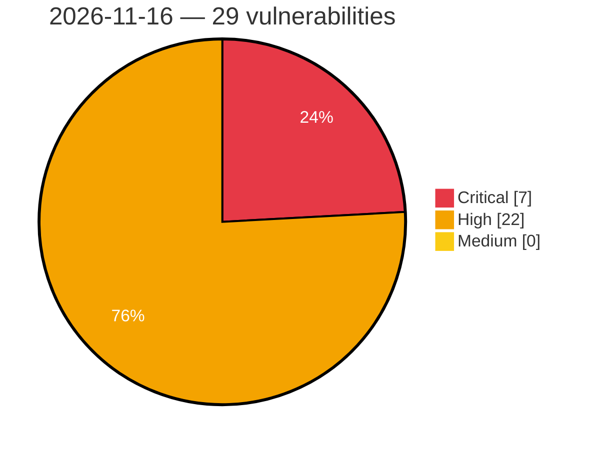

# Critical, High & Medium Severity Vulnerabilities — 2026-11-16

**Source status for this day:**

| Source | Critical | High | Medium | Total |
|--------|---------:|-----:|-------:|------:|
| cvefeed.io (High/Critical) | 7 | 22 | 0 | 29 |

**KEV (actively exploited):** 0  **Watchlist matches:** 22

## Critical (7)

| CVSS | Flags | Source | CVE / Title | Reported |
|------|-------|--------|-------------|----------|
| 10.0 | ⭐ | cvefeed.io (High/Critical) | [CVE-2026-93664 - Deserialization of Untrusted Data vulnerability affecting Station Launcher App in 3DEXPERIENCE platform from Release 3DEXPERIENCE R2023x through Release 3DEXPERIENCE R2026x](https://cvefeed.io/vuln/detail/CVE-2026-93664) | 2 hours, 58 minutes ago |
| 9.9 | ⭐ | cvefeed.io (High/Critical) | [CVE-2026-77033 - OS Command Injection vulnerability affecting Station Launcher App in 3DEXPERIENCE platform from Release 3DEXPERIENCE R2023x through Release 3DEXPERIENCE R2026x](https://cvefeed.io/vuln/detail/CVE-2026-77033) | 2 hours, 58 minutes ago |
| 9.9 | ⭐ | cvefeed.io (High/Critical) | [CVE-2026-19732 - OS Command Injection vulnerability affecting Station Launcher App in 3DEXPERIENCE platform from Release 3DEXPERIENCE R2023x through Release 3DEXPERIENCE R2026x](https://cvefeed.io/vuln/detail/CVE-2026-19732) | 2 hours, 58 minutes ago |
| 9.8 | ⭐ | cvefeed.io (High/Critical) | [CVE-2026-129955 - NodePress through 8.5.1 Authentication Bypass via Default Administrator Password](https://cvefeed.io/vuln/detail/CVE-2026-129955) | 58 minutes ago |
| 9.8 | ⭐ | cvefeed.io (High/Critical) | [CVE-2026-129952 - NodePress through 8.5.1 Authentication Bypass via Default JWT Signing Secret](https://cvefeed.io/vuln/detail/CVE-2026-129952) | 58 minutes ago |
| 9.8 | ⭐ | cvefeed.io (High/Critical) | [CVE-2026-129941 - Prime CMS through 0.4.0-beta.0 Authentication Bypass via createUser GraphQL Mutation](https://cvefeed.io/vuln/detail/CVE-2026-129941) | 58 minutes ago |
| 9.3 | ⭐ | cvefeed.io (High/Critical) | [CVE-2026-111559 - Remote Code Execution in Batflat CMS](https://cvefeed.io/vuln/detail/CVE-2026-111559) | 2 hours, 58 minutes ago |

## High (22)

| CVSS | Flags | Source | CVE / Title | Reported |
|------|-------|--------|-------------|----------|
| 8.8 | — | cvefeed.io (High/Critical) | [CVE-2026-82156 - Dell PowerStore Authorization Bypass Vulnerability](https://cvefeed.io/vuln/detail/CVE-2026-82156) | 1 hour, 31 minutes ago |
| 8.8 | ⭐ | cvefeed.io (High/Critical) | [CVE-2026-129540 - VoAPI 1.0.0 through 1.2.0 SQL Injection via search Filter Key](https://cvefeed.io/vuln/detail/CVE-2026-129540) | 3 hours, 31 minutes ago |
| 8.8 | ⭐ | cvefeed.io (High/Critical) | [CVE-2026-129948 - Contentlayer @contentlayer/source-files through 0.3.4 Code Injection via JavaScript Frontmatter](https://cvefeed.io/vuln/detail/CVE-2026-129948) | 58 minutes ago |
| 8.8 | ⭐ | cvefeed.io (High/Critical) | [CVE-2026-129879 - DeepAudit 2.0.0-beta.1 through 3.8.0 Path Traversal via upload-zip Project ID](https://cvefeed.io/vuln/detail/CVE-2026-129879) | 58 minutes ago |
| 8.8 | — | cvefeed.io (High/Critical) | [CVE-2026-129875 - REBUILD 4.5.0 through 4.5.4 Password Hash Disclosure via MCP QueryRecords](https://cvefeed.io/vuln/detail/CVE-2026-129875) | 58 minutes ago |
| 8.8 | ⭐ | cvefeed.io (High/Critical) | [CVE-2026-129874 - REBUILD 3.5.0 through 4.5.4 Privilege Escalation via roleId Mass Assignment](https://cvefeed.io/vuln/detail/CVE-2026-129874) | 58 minutes ago |
| 8.8 | ⭐ | cvefeed.io (High/Critical) | [CVE-2026-129873 - REBUILD 4.3.0 through 4.5.4 Privilege Escalation via /commons/file-preview CSRF Token Leak](https://cvefeed.io/vuln/detail/CVE-2026-129873) | 58 minutes ago |
| 8.8 | — | cvefeed.io (High/Critical) | [CVE-2026-129855 - RedAmon before 7.8.0 Unauthenticated Root Shell via Terminal PTY WebSocket](https://cvefeed.io/vuln/detail/CVE-2026-129855) | 58 minutes ago |
| 8.8 | ⭐ | cvefeed.io (High/Critical) | [CVE-2026-129854 - RedAmon 4.0.0 before 7.8.0 Missing Authorization via Agent Session Routes](https://cvefeed.io/vuln/detail/CVE-2026-129854) | 58 minutes ago |
| 8.7 | ⭐ | cvefeed.io (High/Critical) | [CVE-2026-129494 - CloudPaste 1.1.0 through 1.9.1 WebDAV Credential Disclosure via /api/proxy/link](https://cvefeed.io/vuln/detail/CVE-2026-129494) | 4 hours, 31 minutes ago |
| 8.7 | — | cvefeed.io (High/Critical) | [CVE-2026-129493 - Bolo (bolo-solo) 1.7 through 2.6.4 Article Password Disclosure via /articles](https://cvefeed.io/vuln/detail/CVE-2026-129493) | 4 hours, 31 minutes ago |
| 8.7 | ⭐ | cvefeed.io (High/Critical) | [CVE-2026-129877 - DeepAudit 2.0.0-beta.1 through 3.8.0 Information Disclosure via /api/v1/config/defaults](https://cvefeed.io/vuln/detail/CVE-2026-129877) | 58 minutes ago |
| 8.6 | ⭐ | cvefeed.io (High/Critical) | [CVE-2026-129957 - PrestaShop before 8.2.9 and 9.2.1 Path Traversal RCE via Theme/Module Import](https://cvefeed.io/vuln/detail/CVE-2026-129957) | 58 minutes ago |
| 8.6 | — | cvefeed.io (High/Critical) | [CVE-2026-129947 - Contentlayer @contentlayer/core through 0.3.4 Code Injection via Generated _index.mjs](https://cvefeed.io/vuln/detail/CVE-2026-129947) | 58 minutes ago |
| 8.6 | ⭐ | cvefeed.io (High/Critical) | [CVE-2026-129943 - Prime CMS through 0.4.0-beta.0 OS Command Injection via updateSystem Mutation](https://cvefeed.io/vuln/detail/CVE-2026-129943) | 58 minutes ago |
| 8.6 | — | cvefeed.io (High/Critical) | [CVE-2026-21176 - Samsung Device Care Unquoted Search Path Vulnerability](https://cvefeed.io/vuln/detail/CVE-2026-21176) | 3 hours, 57 minutes ago |
| 8.5 | ⭐ | cvefeed.io (High/Critical) | [CVE-2026-129956 - Sandboxie-Plus before 1.18.6 Privilege Escalation via SbieSvc MSGID_PROCESS_RUN_UPDATER](https://cvefeed.io/vuln/detail/CVE-2026-129956) | 58 minutes ago |
| 8.5 | — | cvefeed.io (High/Critical) | [CVE-2026-129857 - Microsoft jxrlib through 1.1 Heap Buffer Overflow via ReadBinaryData Integer Overflow](https://cvefeed.io/vuln/detail/CVE-2026-129857) | 58 minutes ago |
| 8.3 | ⭐ | cvefeed.io (High/Critical) | [CVE-2026-129880 - DeepAudit 2.0.0-beta.5 through 3.8.0 SSRF via Project Branch Listing Leaks Git Tokens](https://cvefeed.io/vuln/detail/CVE-2026-129880) | 58 minutes ago |
| 8.2 | ⭐ | cvefeed.io (High/Critical) | [CVE-2026-129853 - LimeSurvey before 6.17.16+260814 and 7.x before 7.0.10+260813 Unauthenticated SQL Injection via Public Statistics](https://cvefeed.io/vuln/detail/CVE-2026-129853) | 58 minutes ago |
| 8.2 | ⭐ | cvefeed.io (High/Critical) | [CVE-2026-129690 - Sensitive information disclosure via API](https://cvefeed.io/vuln/detail/CVE-2026-129690) | 1 hour, 58 minutes ago |
| 8.1 | ⭐ | cvefeed.io (High/Critical) | [CVE-2026-129870 - Rocboss paopao-ce 0.2.0 through 0.6.0-alpha.3 Path Traversal in LocalOSS File Deletion](https://cvefeed.io/vuln/detail/CVE-2026-129870) | 58 minutes ago |
