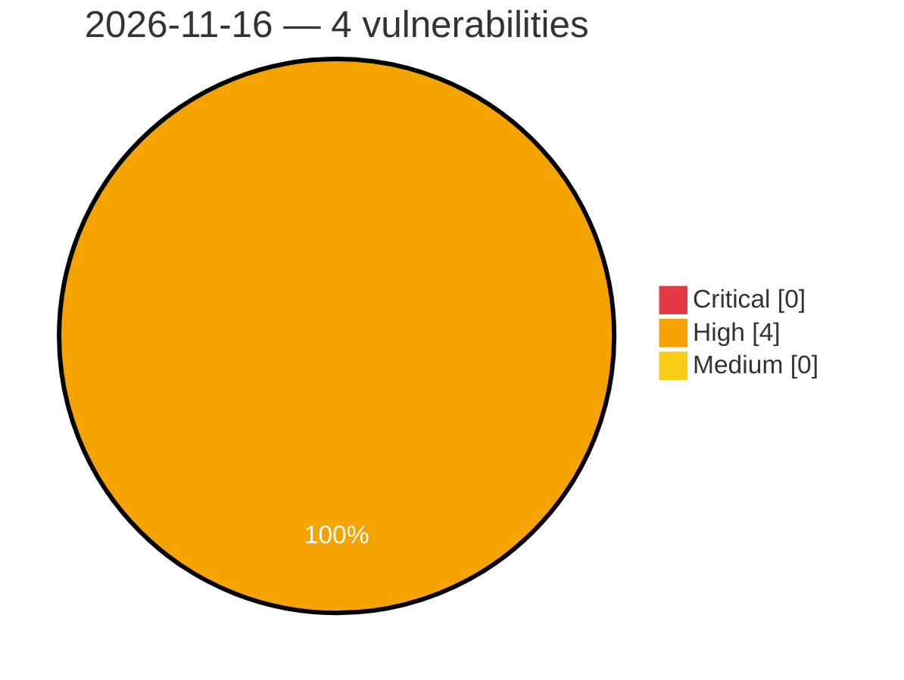

# Critical, High & Medium Severity Vulnerabilities — 2026-11-16

**Source status for this day:**

| Source | Critical | High | Medium | Total |
|--------|---------:|-----:|-------:|------:|
| cvefeed.io (High/Critical) | 0 | 4 | 0 | 4 |

**KEV (actively exploited):** 0  **Watchlist matches:** 2

## High (4)

| CVSS | Flags | Source | CVE / Title | Reported |
|------|-------|--------|-------------|----------|
| 8.8 | — | cvefeed.io (High/Critical) | [CVE-2026-82156 - Dell PowerStore Authorization Bypass Vulnerability](https://cvefeed.io/vuln/detail/CVE-2026-82156) | 1 hour, 31 minutes ago |
| 8.8 | ⭐ | cvefeed.io (High/Critical) | [CVE-2026-129540 - VoAPI 1.0.0 through 1.2.0 SQL Injection via search Filter Key](https://cvefeed.io/vuln/detail/CVE-2026-129540) | 3 hours, 31 minutes ago |
| 8.7 | ⭐ | cvefeed.io (High/Critical) | [CVE-2026-129494 - CloudPaste 1.1.0 through 1.9.1 WebDAV Credential Disclosure via /api/proxy/link](https://cvefeed.io/vuln/detail/CVE-2026-129494) | 4 hours, 31 minutes ago |
| 8.7 | — | cvefeed.io (High/Critical) | [CVE-2026-129493 - Bolo (bolo-solo) 1.7 through 2.6.4 Article Password Disclosure via /articles](https://cvefeed.io/vuln/detail/CVE-2026-129493) | 4 hours, 31 minutes ago |
