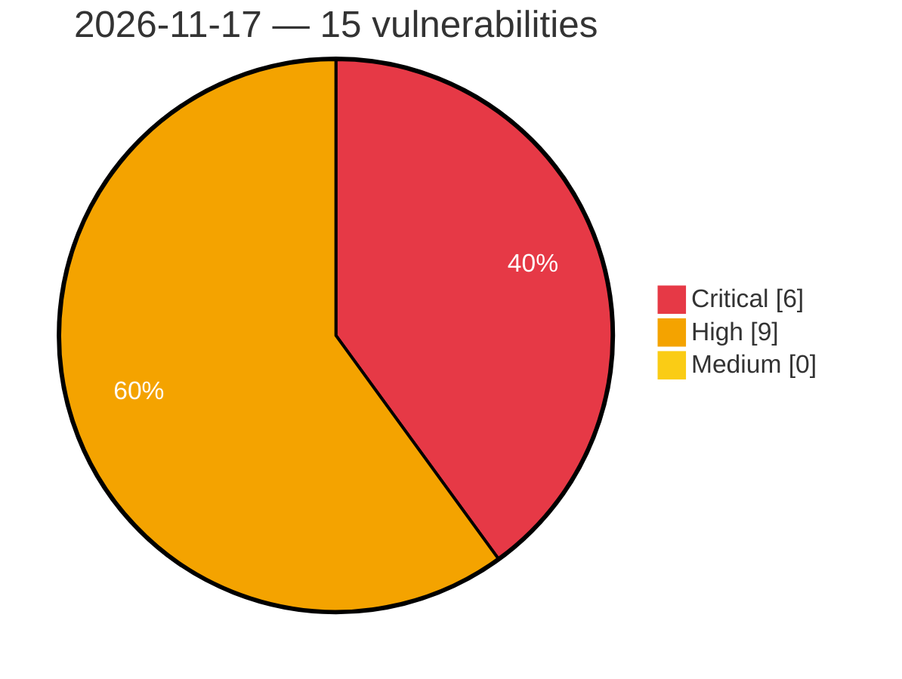

# Critical, High & Medium Severity Vulnerabilities — 2026-11-17

**Source status for this day:**

| Source | Critical | High | Medium | Total |
|--------|---------:|-----:|-------:|------:|
| cvefeed.io (High/Critical) | 6 | 9 | 0 | 15 |

**KEV (actively exploited):** 0  **Watchlist matches:** 13

## Critical (6)

| CVSS | Flags | Source | CVE / Title | Reported |
|------|-------|--------|-------------|----------|
| 10.0 | ⭐ | cvefeed.io (High/Critical) | [CVE-2026-120387 - CIRCUTOR PowerStudio SCADA WAVE JWT Signature Validation Authentication Bypass](https://cvefeed.io/vuln/detail/CVE-2026-120387) | 2 hours, 18 minutes ago |
| 9.8 | ⭐ | cvefeed.io (High/Critical) | [CVE-2026-79614 - Zyxel DX3301-T0 libclinkc Out-of-Bounds Write Privilege Escalation](https://cvefeed.io/vuln/detail/CVE-2026-79614) | 5 hours, 19 minutes ago |
| 9.2 | ⭐ | cvefeed.io (High/Critical) | [CVE-2026-130380 - AdminNeo before 5.9.1 Authentication Bypass via MS SQL Empty Username](https://cvefeed.io/vuln/detail/CVE-2026-130380) | 5 hours, 19 minutes ago |
| 9.2 | ⭐ | cvefeed.io (High/Critical) | [CVE-2026-130371 - phpMyFAQ before 4.1.12 and 4.2.0-alpha before 4.2.0-RC.2 Unauthenticated Reinstall via Web Installer](https://cvefeed.io/vuln/detail/CVE-2026-130371) | 5 hours, 19 minutes ago |
| 9.2 | ⭐ | cvefeed.io (High/Critical) | [CVE-2026-130369 - phpMyFAQ 4.1.9 before 4.1.12 and 4.2.0-alpha before 4.2.0-RC.2 Cross-Tenant WebAuthn Account Takeover](https://cvefeed.io/vuln/detail/CVE-2026-130369) | 5 hours, 19 minutes ago |
| 9.2 | ⭐ | cvefeed.io (High/Critical) | [CVE-2026-130366 - AdminNeo before 5.9.1 Authentication Bypass via ClickHouse Driver defaultPasswordHash](https://cvefeed.io/vuln/detail/CVE-2026-130366) | 5 hours, 19 minutes ago |

## High (9)

| CVSS | Flags | Source | CVE / Title | Reported |
|------|-------|--------|-------------|----------|
| 8.8 | ⭐ | cvefeed.io (High/Critical) | [CVE-2026-130382 - AdminNeo before 5.9.1 TOTP Authentication Bypass via neo_permanent Cookie](https://cvefeed.io/vuln/detail/CVE-2026-130382) | 5 hours, 19 minutes ago |
| 8.8 | ⭐ | cvefeed.io (High/Critical) | [CVE-2026-130361 - AdminNeo before 5.9.1 ClickHouse HTTP Parameter Injection via db Parameter](https://cvefeed.io/vuln/detail/CVE-2026-130361) | 5 hours, 19 minutes ago |
| 8.7 | ⭐ | cvefeed.io (High/Critical) | [CVE-2026-108153 - Improper Neutralization of Input During Web Page Generation ('Cross-site Scripting') in GitLab](https://cvefeed.io/vuln/detail/CVE-2026-108153) | 2 hours, 18 minutes ago |
| 8.7 | ⭐ | cvefeed.io (High/Critical) | [CVE-2026-105739 - Improper Neutralization of Input During Web Page Generation ('Cross-site Scripting') in GitLab](https://cvefeed.io/vuln/detail/CVE-2026-105739) | 2 hours, 18 minutes ago |
| 8.6 | ⭐ | cvefeed.io (High/Critical) | [CVE-2026-130375 - AdminNeo before 5.9.1 RCE via SQLite file: URI database name](https://cvefeed.io/vuln/detail/CVE-2026-130375) | 5 hours, 19 minutes ago |
| 8.4 | — | cvefeed.io (High/Critical) | [CVE-2026-107902 - FUJI ELECTRIC TELLUS Use-After-Free Vulnerability](https://cvefeed.io/vuln/detail/CVE-2026-107902) | 3 hours, 19 minutes ago |
| 8.2 | ⭐ | cvefeed.io (High/Critical) | [CVE-2026-18241 - Incorrect Authorization in GitLab](https://cvefeed.io/vuln/detail/CVE-2026-18241) | 2 hours, 18 minutes ago |
| 8.2 | — | cvefeed.io (High/Critical) | [CVE-2026-125275 - A device certificate whose CA isn't registered can keep a TLS handshake running forever](https://cvefeed.io/vuln/detail/CVE-2026-125275) | 4 hours, 19 minutes ago |
| 8.1 | ⭐ | cvefeed.io (High/Critical) | [CVE-2026-121684 - Soledad - Multi-Concept Blog/Magazine WordPress Theme <= 8.7.7 - Unauthenticated Remote Code Execution via penci_more_post_ajax Shortcode-Allowlist Bypass and Featured-Sliders Local File Inclusion](https://cvefeed.io/vuln/detail/CVE-2026-121684) | 2 hours, 18 minutes ago |
