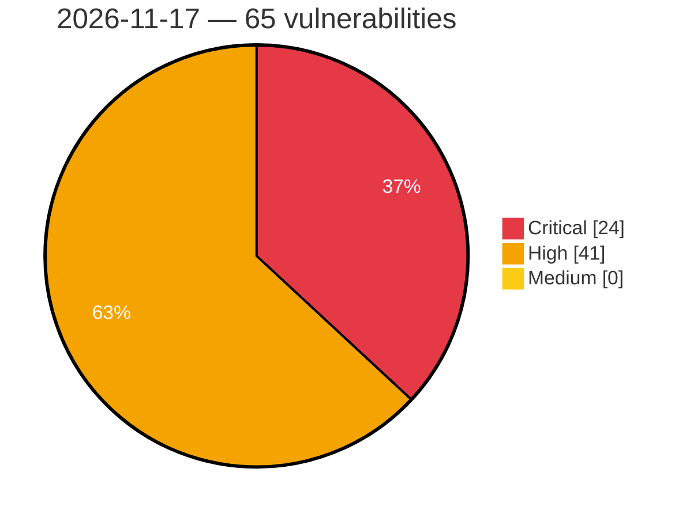

# Critical, High & Medium Severity Vulnerabilities — 2026-11-17

**Source status for this day:**

| Source | Critical | High | Medium | Total |
|--------|---------:|-----:|-------:|------:|
| cvefeed.io (High/Critical) | 24 | 41 | 0 | 65 |

**KEV (actively exploited):** 0  **Watchlist matches:** 34

## Critical (24)

| CVSS | Flags | Source | CVE / Title | Reported |
|------|-------|--------|-------------|----------|
| 10.0 | ⭐ | cvefeed.io (High/Critical) | [CVE-2026-120387 - CIRCUTOR PowerStudio SCADA WAVE JWT Signature Validation Authentication Bypass](https://cvefeed.io/vuln/detail/CVE-2026-120387) | 2 hours, 18 minutes ago |
| 10.0 | — | cvefeed.io (High/Critical) | [CVE-2026-91569 - Vulnerability in the Oracle WebLogic Server produc](https://cvefeed.io/vuln/detail/CVE-2026-91569) | 1 hour, 1 minute ago |
| 10.0 | — | cvefeed.io (High/Critical) | [CVE-2026-91510 - Vulnerability in the Oracle Access Manager product](https://cvefeed.io/vuln/detail/CVE-2026-91510) | 1 hour, 1 minute ago |
| 10.0 | — | cvefeed.io (High/Critical) | [CVE-2026-91500 - Vulnerability in the Oracle Access Manager product](https://cvefeed.io/vuln/detail/CVE-2026-91500) | 1 hour, 1 minute ago |
| 9.9 | ⭐ | cvefeed.io (High/Critical) | [CVE-2026-130587 - OpenFunction through 1.2.0 Privilege Escalation via Unrestricted PodSpec Templates](https://cvefeed.io/vuln/detail/CVE-2026-130587) | 2 hours, 35 minutes ago |
| 9.8 | ⭐ | cvefeed.io (High/Critical) | [CVE-2026-79614 - Zyxel DX3301-T0 libclinkc Out-of-Bounds Write Privilege Escalation](https://cvefeed.io/vuln/detail/CVE-2026-79614) | 5 hours, 19 minutes ago |
| 9.8 | — | cvefeed.io (High/Critical) | [CVE-2026-91585 - Vulnerability in the Oracle WebLogic Server produc](https://cvefeed.io/vuln/detail/CVE-2026-91585) | 1 hour, 1 minute ago |
| 9.8 | — | cvefeed.io (High/Critical) | [CVE-2026-91583 - Vulnerability in the Oracle WebLogic Server produc](https://cvefeed.io/vuln/detail/CVE-2026-91583) | 1 hour, 1 minute ago |
| 9.8 | — | cvefeed.io (High/Critical) | [CVE-2026-91570 - Vulnerability in the Oracle WebLogic Server produc](https://cvefeed.io/vuln/detail/CVE-2026-91570) | 1 hour, 1 minute ago |
| 9.8 | — | cvefeed.io (High/Critical) | [CVE-2026-91470 - Vulnerability in the Oracle WebLogic Server produc](https://cvefeed.io/vuln/detail/CVE-2026-91470) | 1 hour, 1 minute ago |
| 9.8 | — | cvefeed.io (High/Critical) | [CVE-2026-91456 - Vulnerability in the Oracle WebLogic Server produc](https://cvefeed.io/vuln/detail/CVE-2026-91456) | 1 hour, 1 minute ago |
| 9.6 | — | cvefeed.io (High/Critical) | [CVE-2026-91561 - Vulnerability in the Oracle Service Bus product of](https://cvefeed.io/vuln/detail/CVE-2026-91561) | 1 hour, 1 minute ago |
| 9.4 | — | cvefeed.io (High/Critical) | [CVE-2026-91469 - Vulnerability in the Oracle WebLogic Server produc](https://cvefeed.io/vuln/detail/CVE-2026-91469) | 1 hour, 1 minute ago |
| 9.3 | ⭐ | cvefeed.io (High/Critical) | [CVE-2026-126553 - AutoSys WCC unauthenticated deserialization](https://cvefeed.io/vuln/detail/CVE-2026-126553) | 8 minutes ago |
| 9.3 | ⭐ | cvefeed.io (High/Critical) | [CVE-2026-126552 - AutoSys WCC unauthenticated command execution](https://cvefeed.io/vuln/detail/CVE-2026-126552) | 11 minutes ago |
| 9.3 | — | cvefeed.io (High/Critical) | [CVE-2026-126551 - AutoSys hard-coded key to agent code execution](https://cvefeed.io/vuln/detail/CVE-2026-126551) | 20 minutes ago |
| 9.3 | ⭐ | cvefeed.io (High/Critical) | [CVE-2026-130603 - Eclipse Zenoh-pico Buffer Overflow Vulnerability](https://cvefeed.io/vuln/detail/CVE-2026-130603) | 2 hours, 35 minutes ago |
| 9.3 | ⭐ | cvefeed.io (High/Critical) | [CVE-2026-130583 - Rootways Authorize.net CIM Pro for Magento 2 before 4.1.5 SSRF via Apple Pay Validation](https://cvefeed.io/vuln/detail/CVE-2026-130583) | 2 hours, 35 minutes ago |
| 9.3 | — | cvefeed.io (High/Critical) | [CVE-2026-91507 - Vulnerability in the Oracle Access Manager product](https://cvefeed.io/vuln/detail/CVE-2026-91507) | 1 hour, 1 minute ago |
| 9.2 | ⭐ | cvefeed.io (High/Critical) | [CVE-2026-130380 - AdminNeo before 5.9.1 Authentication Bypass via MS SQL Empty Username](https://cvefeed.io/vuln/detail/CVE-2026-130380) | 5 hours, 19 minutes ago |
| 9.2 | ⭐ | cvefeed.io (High/Critical) | [CVE-2026-130371 - phpMyFAQ before 4.1.12 and 4.2.0-alpha before 4.2.0-RC.2 Unauthenticated Reinstall via Web Installer](https://cvefeed.io/vuln/detail/CVE-2026-130371) | 5 hours, 19 minutes ago |
| 9.2 | ⭐ | cvefeed.io (High/Critical) | [CVE-2026-130369 - phpMyFAQ 4.1.9 before 4.1.12 and 4.2.0-alpha before 4.2.0-RC.2 Cross-Tenant WebAuthn Account Takeover](https://cvefeed.io/vuln/detail/CVE-2026-130369) | 5 hours, 19 minutes ago |
| 9.2 | ⭐ | cvefeed.io (High/Critical) | [CVE-2026-130366 - AdminNeo before 5.9.1 Authentication Bypass via ClickHouse Driver defaultPasswordHash](https://cvefeed.io/vuln/detail/CVE-2026-130366) | 5 hours, 19 minutes ago |
| 9.1 | — | cvefeed.io (High/Critical) | [CVE-2026-91618 - Vulnerability in the Oracle Application Developmen](https://cvefeed.io/vuln/detail/CVE-2026-91618) | 1 hour, 1 minute ago |

## High (41)

| CVSS | Flags | Source | CVE / Title | Reported |
|------|-------|--------|-------------|----------|
| 8.8 | ⭐ | cvefeed.io (High/Critical) | [CVE-2026-130382 - AdminNeo before 5.9.1 TOTP Authentication Bypass via neo_permanent Cookie](https://cvefeed.io/vuln/detail/CVE-2026-130382) | 5 hours, 19 minutes ago |
| 8.8 | ⭐ | cvefeed.io (High/Critical) | [CVE-2026-130361 - AdminNeo before 5.9.1 ClickHouse HTTP Parameter Injection via db Parameter](https://cvefeed.io/vuln/detail/CVE-2026-130361) | 5 hours, 19 minutes ago |
| 8.8 | ⭐ | cvefeed.io (High/Critical) | [CVE-2026-67455 - NVIDIA Model Optimizer Insecure Deserialization Vulnerability](https://cvefeed.io/vuln/detail/CVE-2026-67455) | 40 minutes ago |
| 8.8 | ⭐ | cvefeed.io (High/Critical) | [CVE-2026-12239 - WP Abstracts <= 2.7.6 - Authenticated (Subscriber+) Privilege Escalation via wpabs_save_regform AJAX Action](https://cvefeed.io/vuln/detail/CVE-2026-12239) | 3 hours, 35 minutes ago |
| 8.8 | ⭐ | cvefeed.io (High/Critical) | [CVE-2026-129025 - WordPress ZIP AI plugin <= 0.0.19 - Cross Site Request Forgery (CSRF) vulnerability](https://cvefeed.io/vuln/detail/CVE-2026-129025) | 31 minutes ago |
| 8.8 | — | cvefeed.io (High/Critical) | [CVE-2026-91566 - Vulnerability in the Oracle Service Bus product of](https://cvefeed.io/vuln/detail/CVE-2026-91566) | 1 hour, 1 minute ago |
| 8.8 | — | cvefeed.io (High/Critical) | [CVE-2026-91556 - Vulnerability in the Service Delivery Platform pro](https://cvefeed.io/vuln/detail/CVE-2026-91556) | 1 hour, 1 minute ago |
| 8.8 | — | cvefeed.io (High/Critical) | [CVE-2026-83362 - Vulnerability in the Oracle Purchasing product of](https://cvefeed.io/vuln/detail/CVE-2026-83362) | 1 hour, 1 minute ago |
| 8.8 | ⭐ | cvefeed.io (High/Critical) | [CVE-2026-69187 - WeGIA: Authenticated Privilege Escalation due to Missing Action-level Authorisation](https://cvefeed.io/vuln/detail/CVE-2026-69187) | 1 hour, 1 minute ago |
| 8.7 | ⭐ | cvefeed.io (High/Critical) | [CVE-2026-108153 - Improper Neutralization of Input During Web Page Generation ('Cross-site Scripting') in GitLab](https://cvefeed.io/vuln/detail/CVE-2026-108153) | 2 hours, 18 minutes ago |
| 8.7 | ⭐ | cvefeed.io (High/Critical) | [CVE-2026-105739 - Improper Neutralization of Input During Web Page Generation ('Cross-site Scripting') in GitLab](https://cvefeed.io/vuln/detail/CVE-2026-105739) | 2 hours, 18 minutes ago |
| 8.7 | ⭐ | cvefeed.io (High/Critical) | [CVE-2026-77224 - Camunda XXE Injection via DomXmlDataFormat](https://cvefeed.io/vuln/detail/CVE-2026-77224) | 1 hour, 35 minutes ago |
| 8.7 | ⭐ | cvefeed.io (High/Critical) | [CVE-2026-130591 - 53AIHub before 0.5.5 Missing Authentication via File Preview Endpoints](https://cvefeed.io/vuln/detail/CVE-2026-130591) | 2 hours, 35 minutes ago |
| 8.7 | ⭐ | cvefeed.io (High/Critical) | [CVE-2026-130584 - Xibo CMS before 4.5.3 IDOR via /dataset/{id}/rss/{rssId}](https://cvefeed.io/vuln/detail/CVE-2026-130584) | 2 hours, 35 minutes ago |
| 8.7 | ⭐ | cvefeed.io (High/Critical) | [CVE-2026-124646 - Insecure Direct Object Reference (IDOR) Vulnerability in e-Sushrut HMIS](https://cvefeed.io/vuln/detail/CVE-2026-124646) | 3 hours, 35 minutes ago |
| 8.7 | — | cvefeed.io (High/Critical) | [CVE-2026-124645 - Hardcoded Cryptographic Key Vulnerability in e-Sushrut HMIS](https://cvefeed.io/vuln/detail/CVE-2026-124645) | 3 hours, 35 minutes ago |
| 8.7 | — | cvefeed.io (High/Critical) | [CVE-2026-124643 - Improper Authentication Vulnerability in e-Sushrut HMIS](https://cvefeed.io/vuln/detail/CVE-2026-124643) | 4 hours, 35 minutes ago |
| 8.7 | ⭐ | cvefeed.io (High/Critical) | [CVE-2026-91509 - Vulnerability in the Oracle Access Manager product](https://cvefeed.io/vuln/detail/CVE-2026-91509) | 1 hour, 1 minute ago |
| 8.6 | ⭐ | cvefeed.io (High/Critical) | [CVE-2026-130375 - AdminNeo before 5.9.1 RCE via SQLite file: URI database name](https://cvefeed.io/vuln/detail/CVE-2026-130375) | 5 hours, 19 minutes ago |
| 8.6 | — | cvefeed.io (High/Critical) | [CVE-2026-126550 - AutoSys WCC session identifiers written to log](https://cvefeed.io/vuln/detail/CVE-2026-126550) | 23 minutes ago |
| 8.6 | ⭐ | cvefeed.io (High/Critical) | [CVE-2026-82025 - WP File Manager < 8.0.7 Arbitrary File Upload RCE via elFinder](https://cvefeed.io/vuln/detail/CVE-2026-82025) | 2 hours, 35 minutes ago |
| 8.6 | ⭐ | cvefeed.io (High/Critical) | [CVE-2026-130589 - Emitter through 3.1 Master Key Forgery via Unauthenticated Channel Key Encryption](https://cvefeed.io/vuln/detail/CVE-2026-130589) | 2 hours, 35 minutes ago |
| 8.6 | — | cvefeed.io (High/Critical) | [CVE-2026-91587 - Vulnerability in the Oracle WebCenter Portal produ](https://cvefeed.io/vuln/detail/CVE-2026-91587) | 1 hour, 1 minute ago |
| 8.6 | — | cvefeed.io (High/Critical) | [CVE-2026-91548 - Vulnerability in the Oracle Platform Security for](https://cvefeed.io/vuln/detail/CVE-2026-91548) | 1 hour, 1 minute ago |
| 8.5 | — | cvefeed.io (High/Critical) | [CVE-2026-91671 - Vulnerability in the Oracle Access Manager product](https://cvefeed.io/vuln/detail/CVE-2026-91671) | 1 hour, 1 minute ago |
| 8.4 | — | cvefeed.io (High/Critical) | [CVE-2026-107902 - FUJI ELECTRIC TELLUS Use-After-Free Vulnerability](https://cvefeed.io/vuln/detail/CVE-2026-107902) | 3 hours, 19 minutes ago |
| 8.4 | ⭐ | cvefeed.io (High/Critical) | [CVE-2026-100971 - NVIDIA OpenShell Path Traversal Vulnerability](https://cvefeed.io/vuln/detail/CVE-2026-100971) | 35 minutes ago |
| 8.3 | ⭐ | cvefeed.io (High/Critical) | [CVE-2026-119726 - PocketBook Reader Android App - Remote Path Traversal Allows Arbitrary File Read and Credential Theft](https://cvefeed.io/vuln/detail/CVE-2026-119726) | 29 minutes ago |
| 8.3 | — | cvefeed.io (High/Critical) | [CVE-2026-130386 - Contiki-NG through 5.2 Out-of-Bounds Access in MPL Multicast Seed-Set Iteration](https://cvefeed.io/vuln/detail/CVE-2026-130386) | 2 hours, 35 minutes ago |
| 8.3 | — | cvefeed.io (High/Critical) | [CVE-2026-91558 - Vulnerability in the Service Delivery Platform pro](https://cvefeed.io/vuln/detail/CVE-2026-91558) | 1 hour, 1 minute ago |
| 8.2 | ⭐ | cvefeed.io (High/Critical) | [CVE-2026-18241 - Incorrect Authorization in GitLab](https://cvefeed.io/vuln/detail/CVE-2026-18241) | 2 hours, 18 minutes ago |
| 8.2 | — | cvefeed.io (High/Critical) | [CVE-2026-125275 - A device certificate whose CA isn't registered can keep a TLS handshake running forever](https://cvefeed.io/vuln/detail/CVE-2026-125275) | 4 hours, 19 minutes ago |
| 8.2 | ⭐ | cvefeed.io (High/Critical) | [CVE-2026-119725 - PocketBook Reader Android App - Path Traversal to Arbitrary File Read and Credential Theft](https://cvefeed.io/vuln/detail/CVE-2026-119725) | 36 minutes ago |
| 8.2 | — | cvefeed.io (High/Critical) | [CVE-2026-91543 - Vulnerability in the Oracle Access Manager product](https://cvefeed.io/vuln/detail/CVE-2026-91543) | 1 hour, 1 minute ago |
| 8.2 | — | cvefeed.io (High/Critical) | [CVE-2026-91533 - Vulnerability in the Oracle Access Manager product](https://cvefeed.io/vuln/detail/CVE-2026-91533) | 1 hour, 1 minute ago |
| 8.1 | ⭐ | cvefeed.io (High/Critical) | [CVE-2026-121684 - Soledad - Multi-Concept Blog/Magazine WordPress Theme <= 8.7.7 - Unauthenticated Remote Code Execution via penci_more_post_ajax Shortcode-Allowlist Bypass and Featured-Sliders Local File Inclusion](https://cvefeed.io/vuln/detail/CVE-2026-121684) | 2 hours, 18 minutes ago |
| 8.1 | ⭐ | cvefeed.io (High/Critical) | [CVE-2026-100972 - NVIDIA OpenShell Unauthorized Resource Access Vulnerability](https://cvefeed.io/vuln/detail/CVE-2026-100972) | 35 minutes ago |
| 8.1 | — | cvefeed.io (High/Critical) | [CVE-2026-100963 - NVIDIA TensorRT Integer Overflow Vulnerability](https://cvefeed.io/vuln/detail/CVE-2026-100963) | 35 minutes ago |
| 8.1 | — | cvefeed.io (High/Critical) | [CVE-2026-118789 - Untrusted SQL Execution via HTTP-Delivered CIP News in Farmasimplex](https://cvefeed.io/vuln/detail/CVE-2026-118789) | 1 hour, 35 minutes ago |
| 8.1 | — | cvefeed.io (High/Critical) | [CVE-2026-130608 - Application Profile Management Plaintext Password Overwrite Vulnerability](https://cvefeed.io/vuln/detail/CVE-2026-130608) | 2 hours, 35 minutes ago |
| 8.1 | ⭐ | cvefeed.io (High/Critical) | [CVE-2026-91522 - Vulnerability in the Oracle Access Manager product](https://cvefeed.io/vuln/detail/CVE-2026-91522) | 1 hour, 1 minute ago |
