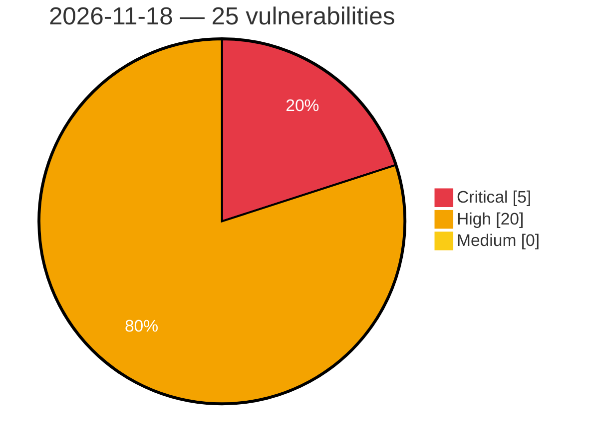

# Critical, High & Medium Severity Vulnerabilities — 2026-11-18

**Source status for this day:**

| Source | Critical | High | Medium | Total |
|--------|---------:|-----:|-------:|------:|
| cvefeed.io (High/Critical) | 5 | 20 | 0 | 25 |

**KEV (actively exploited):** 0  **Watchlist matches:** 17

## Critical (5)

| CVSS | Flags | Source | CVE / Title | Reported |
|------|-------|--------|-------------|----------|
| 10.0 | — | cvefeed.io (High/Critical) | [CVE-2026-114202 - ASUS Control Center Express Hard-coded Cryptographic Key Vulnerability](https://cvefeed.io/vuln/detail/CVE-2026-114202) | 4 hours, 10 minutes ago |
| 9.8 | ⭐ | cvefeed.io (High/Critical) | [CVE-2026-131852 - OwnTracks Recorder before 1.0.5 Format String via Stored tid Value](https://cvefeed.io/vuln/detail/CVE-2026-131852) | 6 hours, 9 minutes ago |
| 9.4 | — | cvefeed.io (High/Critical) | [CVE-2026-126574 - ASUS Control Center Authorization Bypass Vulnerability](https://cvefeed.io/vuln/detail/CVE-2026-126574) | 4 hours, 10 minutes ago |
| 9.4 | ⭐ | cvefeed.io (High/Critical) | [CVE-2026-114205 - ASUS Control Center Express Privilege Escalation Vulnerability](https://cvefeed.io/vuln/detail/CVE-2026-114205) | 4 hours, 10 minutes ago |
| 9.0 | ⭐ | cvefeed.io (High/Critical) | [CVE-2026-114204 - ASUS Control Center Express Hard-coded Cryptographic Key Authentication Bypass](https://cvefeed.io/vuln/detail/CVE-2026-114204) | 4 hours, 10 minutes ago |

## High (20)

| CVSS | Flags | Source | CVE / Title | Reported |
|------|-------|--------|-------------|----------|
| 8.8 | ⭐ | cvefeed.io (High/Critical) | [CVE-2026-5765 - Essential Real Estate <= 5.3.3 - Authenticated (Subscriber+) PHP Object Injection via 'ere_query' Parameter](https://cvefeed.io/vuln/detail/CVE-2026-5765) | 52 minutes ago |
| 8.8 | ⭐ | cvefeed.io (High/Critical) | [CVE-2026-131875 - fqterm before 0.9.11 Heap Out-of-Bounds Write via FQTermDecode CSI Parameters](https://cvefeed.io/vuln/detail/CVE-2026-131875) | 3 hours, 10 minutes ago |
| 8.8 | ⭐ | cvefeed.io (High/Critical) | [CVE-2026-92182 - Netgate pfSense CE XMLRPC Incorrect Authorization Remote Code Execution Vulnerability](https://cvefeed.io/vuln/detail/CVE-2026-92182) | 6 hours, 9 minutes ago |
| 8.8 | ⭐ | cvefeed.io (High/Critical) | [CVE-2026-131851 - ILIAS before 9.25, 10.13, and 11.6 SQL Injection via StudyProgramme Members Filter](https://cvefeed.io/vuln/detail/CVE-2026-131851) | 6 hours, 9 minutes ago |
| 8.7 | ⭐ | cvefeed.io (High/Critical) | [CVE-2026-88711 - ASUS Router OS Command Injection Vulnerability](https://cvefeed.io/vuln/detail/CVE-2026-88711) | 4 hours, 10 minutes ago |
| 8.7 | — | cvefeed.io (High/Critical) | [CVE-2026-131857 - Supergateway 4.2.0 through 4.2.2 DoS via Prototype-Inherited sessionId](https://cvefeed.io/vuln/detail/CVE-2026-131857) | 6 hours, 9 minutes ago |
| 8.6 | ⭐ | cvefeed.io (High/Critical) | [CVE-2026-101113 - ELECOM Wireless LAN Router OS Command Injection Vulnerability](https://cvefeed.io/vuln/detail/CVE-2026-101113) | 2 hours, 10 minutes ago |
| 8.6 | ⭐ | cvefeed.io (High/Critical) | [CVE-2026-116643 - SSH certificate authentication bypass in GitHub Enterprise Server](https://cvefeed.io/vuln/detail/CVE-2026-116643) | 4 hours, 10 minutes ago |
| 8.6 | — | cvefeed.io (High/Critical) | [CVE-2026-116637 - Improper link resolution in GitHub Enterprise Server allowed root-level file modification via pre-receive hook environments](https://cvefeed.io/vuln/detail/CVE-2026-116637) | 4 hours, 10 minutes ago |
| 8.6 | ⭐ | cvefeed.io (High/Critical) | [CVE-2026-131850 - ILIAS 11.0 before 11.6 SQL Injection via Registration Codes Table Sorting](https://cvefeed.io/vuln/detail/CVE-2026-131850) | 6 hours, 9 minutes ago |
| 8.5 | — | cvefeed.io (High/Critical) | [CVE-2026-131871 - WLA DX 9.7 through 10.7 Stack Buffer Overflow via wlalink parse_data_blocks()](https://cvefeed.io/vuln/detail/CVE-2026-131871) | 3 hours, 10 minutes ago |
| 8.5 | — | cvefeed.io (High/Critical) | [CVE-2026-93459 - ASUS Router Firmware Format String Vulnerability](https://cvefeed.io/vuln/detail/CVE-2026-93459) | 4 hours, 10 minutes ago |
| 8.5 | ⭐ | cvefeed.io (High/Critical) | [CVE-2026-112115 - ASUS Armoury Crate Untrusted Search Path Privilege Escalation](https://cvefeed.io/vuln/detail/CVE-2026-112115) | 4 hours, 10 minutes ago |
| 8.4 | ⭐ | cvefeed.io (High/Critical) | [CVE-2026-118900 - Imperial Household Agency Imperial Palaces Guide OS Command Injection](https://cvefeed.io/vuln/detail/CVE-2026-118900) | 1 hour, 9 minutes ago |
| 8.3 | ⭐ | cvefeed.io (High/Critical) | [CVE-2026-131800 - Stored cross-site scripting vulnerability in GitHub Enterprise Server allowed unauthorized SSH key addition to another user account](https://cvefeed.io/vuln/detail/CVE-2026-131800) | 3 hours, 10 minutes ago |
| 8.3 | — | cvefeed.io (High/Critical) | [CVE-2026-131849 - Snap7 through 1.4.3 Heap-Based Buffer Overflow via TSnap7MicroClient::opReadSZL](https://cvefeed.io/vuln/detail/CVE-2026-131849) | 6 hours, 9 minutes ago |
| 8.3 | — | cvefeed.io (High/Critical) | [CVE-2026-131848 - Snap7 through 1.4.3 Out-of-Bounds Write via TSnap7MicroClient::opReadMultiVars](https://cvefeed.io/vuln/detail/CVE-2026-131848) | 6 hours, 9 minutes ago |
| 8.2 | ⭐ | cvefeed.io (High/Critical) | [CVE-2026-107950 - XML External Entity (XXE) vulnerability affects HCL Commerce](https://cvefeed.io/vuln/detail/CVE-2026-107950) | 3 hours, 10 minutes ago |
| 8.1 | ⭐ | cvefeed.io (High/Critical) | [CVE-2026-130644 - Ansible-core: ansible-core: ansible-galaxy collection install path traversal via unvalidated artifact-derived collection name allows file writes and directory deletion outside the collections path](https://cvefeed.io/vuln/detail/CVE-2026-130644) | 2 hours, 10 minutes ago |
| 8.1 | ⭐ | cvefeed.io (High/Critical) | [CVE-2026-105929 - Ansible-core: ansible-galaxy role install path traversal via unvalidated role name allows file writes and directory deletion outside the roles directory](https://cvefeed.io/vuln/detail/CVE-2026-105929) | 4 hours, 10 minutes ago |
