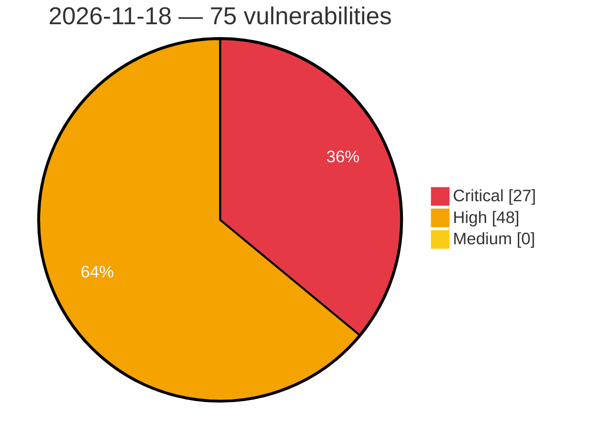

# Critical, High & Medium Severity Vulnerabilities — 2026-11-18

**Source status for this day:**

| Source | Critical | High | Medium | Total |
|--------|---------:|-----:|-------:|------:|
| cvefeed.io (High/Critical) | 27 | 48 | 0 | 75 |

**KEV (actively exploited):** 0  **Watchlist matches:** 56

## Critical (27)

| CVSS | Flags | Source | CVE / Title | Reported |
|------|-------|--------|-------------|----------|
| 10.0 | — | cvefeed.io (High/Critical) | [CVE-2026-114202 - ASUS Control Center Express Hard-coded Cryptographic Key Vulnerability](https://cvefeed.io/vuln/detail/CVE-2026-114202) | 4 hours, 10 minutes ago |
| 10.0 | ⭐ | cvefeed.io (High/Critical) | [CVE-2026-75521 - Miren Runtime: Authentication bypass in RPC layer: unverified TLS client certificates grant cluster superuser access](https://cvefeed.io/vuln/detail/CVE-2026-75521) | 2 hours, 11 minutes ago |
| 10.0 | ⭐ | cvefeed.io (High/Critical) | [CVE-2026-71499 - cf-manager: SSRF via URL-based Worker deployment allows arbitrary code execution in victim Cloudflare accounts](https://cvefeed.io/vuln/detail/CVE-2026-71499) | 2 hours, 11 minutes ago |
| 9.9 | — | cvefeed.io (High/Critical) | [CVE-2026-130786 - Incus before 7.6.0 LXC Configuration Injection via OCI Image Config](https://cvefeed.io/vuln/detail/CVE-2026-130786) | 2 hours, 11 minutes ago |
| 9.9 | ⭐ | cvefeed.io (High/Critical) | [CVE-2026-130784 - Incus before 7.6.0 Authorization Bypass via Default Project Resource Inheritance](https://cvefeed.io/vuln/detail/CVE-2026-130784) | 2 hours, 11 minutes ago |
| 9.9 | ⭐ | cvefeed.io (High/Critical) | [CVE-2026-130780 - Incus before 7.6.0 Path Traversal via Dependent Volumes in Migration](https://cvefeed.io/vuln/detail/CVE-2026-130780) | 2 hours, 11 minutes ago |
| 9.8 | ⭐ | cvefeed.io (High/Critical) | [CVE-2026-131852 - OwnTracks Recorder before 1.0.5 Format String via Stored tid Value](https://cvefeed.io/vuln/detail/CVE-2026-131852) | 6 hours, 9 minutes ago |
| 9.8 | ⭐ | cvefeed.io (High/Critical) | [CVE-2026-63189 - Dialoqbase: Unauthenticated path traversal in GET /api/v1/view/* leads to arbitrary file read and full application takeover](https://cvefeed.io/vuln/detail/CVE-2026-63189) | 29 minutes ago |
| 9.8 | ⭐ | cvefeed.io (High/Critical) | [CVE-2026-116449 - Dell PowerStore OS Command Injection Vulnerability](https://cvefeed.io/vuln/detail/CVE-2026-116449) | 39 minutes ago |
| 9.8 | — | cvefeed.io (High/Critical) | [CVE-2026-116443 - Dell PowerStore SDNAS Stack-Based Buffer Overflow](https://cvefeed.io/vuln/detail/CVE-2026-116443) | 47 minutes ago |
| 9.8 | ⭐ | cvefeed.io (High/Critical) | [CVE-2012-20007 - ThinkPHP 2.x / 3.0 Lite Unauthenticated RCE via Dispatcher PATH_INFO](https://cvefeed.io/vuln/detail/CVE-2012-20007) | 48 minutes ago |
| 9.8 | ⭐ | cvefeed.io (High/Critical) | [CVE-2018-25443 - Baidu UEditor 1.4.0-1.4.3.3 Unrestricted File Upload via controller.ashx](https://cvefeed.io/vuln/detail/CVE-2018-25443) | 48 minutes ago |
| 9.8 | ⭐ | cvefeed.io (High/Critical) | [CVE-2019-25782 - ThinkPHP 5.0.0 < 5.0.24 RCE via _method construct in Request.php](https://cvefeed.io/vuln/detail/CVE-2019-25782) | 48 minutes ago |
| 9.8 | ⭐ | cvefeed.io (High/Critical) | [CVE-2021-48023 - Weaver E-cology 9.0 Unrestricted File Upload via uploadOperation.jsp](https://cvefeed.io/vuln/detail/CVE-2021-48023) | 48 minutes ago |
| 9.8 | ⭐ | cvefeed.io (High/Critical) | [CVE-2021-48025 - OpenSNS 3.2.1 Unauthenticated RCE via weibo/Share/shareBox](https://cvefeed.io/vuln/detail/CVE-2021-48025) | 48 minutes ago |
| 9.8 | ⭐ | cvefeed.io (High/Critical) | [CVE-2022-51027 - MeterSphere < 1.14.7 / 1.16.4 Pre-Auth RCE via /plugin/customMethod](https://cvefeed.io/vuln/detail/CVE-2022-51027) | 48 minutes ago |
| 9.8 | ⭐ | cvefeed.io (High/Critical) | [CVE-2023-54419 - nginxWebUI 3.0.0 < 3.5.8 Authentication Bypass RCE via runCmd](https://cvefeed.io/vuln/detail/CVE-2023-54419) | 48 minutes ago |
| 9.8 | ⭐ | cvefeed.io (High/Critical) | [CVE-2026-73969 - AnsibleForms: Authentication bypass via hard-coded default JWT signing secret](https://cvefeed.io/vuln/detail/CVE-2026-73969) | 1 hour, 14 minutes ago |
| 9.6 | ⭐ | cvefeed.io (High/Critical) | [CVE-2026-55506 - Wavelog: Authenticated Arbitrary File Deletion via QSL Image Filename Path Traversal](https://cvefeed.io/vuln/detail/CVE-2026-55506) | 50 minutes ago |
| 9.6 | — | cvefeed.io (High/Critical) | [CVE-2026-130783 - Incus before 7.6.0 Token Exposure and Missing Authorization via Operation Events](https://cvefeed.io/vuln/detail/CVE-2026-130783) | 2 hours, 11 minutes ago |
| 9.4 | — | cvefeed.io (High/Critical) | [CVE-2026-126574 - ASUS Control Center Authorization Bypass Vulnerability](https://cvefeed.io/vuln/detail/CVE-2026-126574) | 4 hours, 10 minutes ago |
| 9.4 | ⭐ | cvefeed.io (High/Critical) | [CVE-2026-114205 - ASUS Control Center Express Privilege Escalation Vulnerability](https://cvefeed.io/vuln/detail/CVE-2026-114205) | 4 hours, 10 minutes ago |
| 9.4 | ⭐ | cvefeed.io (High/Critical) | [CVE-2026-55508 - Wavelog has unauthenticated SQL injection in the OQRS callsign log search](https://cvefeed.io/vuln/detail/CVE-2026-55508) | 44 minutes ago |
| 9.3 | ⭐ | cvefeed.io (High/Critical) | [CVE-2026-76807 - Todoist MCP Server: Browser DNS rebinding lets websites write and delete Todoist data through local MCP server](https://cvefeed.io/vuln/detail/CVE-2026-76807) | 1 hour, 10 minutes ago |
| 9.2 | — | cvefeed.io (High/Critical) | [CVE-2016-20105 - Lucee Server 5.0.0.0 < 5.3.4.46 Unauthenticated Admin Password Setup](https://cvefeed.io/vuln/detail/CVE-2016-20105) | 48 minutes ago |
| 9.0 | ⭐ | cvefeed.io (High/Critical) | [CVE-2026-114204 - ASUS Control Center Express Hard-coded Cryptographic Key Authentication Bypass](https://cvefeed.io/vuln/detail/CVE-2026-114204) | 4 hours, 10 minutes ago |
| 9.0 | ⭐ | cvefeed.io (High/Critical) | [CVE-2026-61532 - Chamilo LMS: ZIP Slip / Path Traversal in CourseRestorer leads to arbitrary file write and RCE by any course teacher](https://cvefeed.io/vuln/detail/CVE-2026-61532) | 2 hours, 11 minutes ago |

## High (48)

| CVSS | Flags | Source | CVE / Title | Reported |
|------|-------|--------|-------------|----------|
| 8.8 | ⭐ | cvefeed.io (High/Critical) | [CVE-2026-5765 - Essential Real Estate <= 5.3.3 - Authenticated (Subscriber+) PHP Object Injection via 'ere_query' Parameter](https://cvefeed.io/vuln/detail/CVE-2026-5765) | 52 minutes ago |
| 8.8 | ⭐ | cvefeed.io (High/Critical) | [CVE-2026-131875 - fqterm before 0.9.11 Heap Out-of-Bounds Write via FQTermDecode CSI Parameters](https://cvefeed.io/vuln/detail/CVE-2026-131875) | 3 hours, 10 minutes ago |
| 8.8 | ⭐ | cvefeed.io (High/Critical) | [CVE-2026-92182 - Netgate pfSense CE XMLRPC Incorrect Authorization Remote Code Execution Vulnerability](https://cvefeed.io/vuln/detail/CVE-2026-92182) | 6 hours, 9 minutes ago |
| 8.8 | ⭐ | cvefeed.io (High/Critical) | [CVE-2026-131851 - ILIAS before 9.25, 10.13, and 11.6 SQL Injection via StudyProgramme Members Filter](https://cvefeed.io/vuln/detail/CVE-2026-131851) | 6 hours, 9 minutes ago |
| 8.8 | — | cvefeed.io (High/Critical) | [CVE-2012-20008 - openSIS 5.1 < 9.0 Authenticated Local File Inclusion via ajax.php modname](https://cvefeed.io/vuln/detail/CVE-2012-20008) | 48 minutes ago |
| 8.8 | ⭐ | cvefeed.io (High/Critical) | [CVE-2019-25784 - FineCMS 5.0.4 < 5.0.11 SQL Injection via api data2 param](https://cvefeed.io/vuln/detail/CVE-2019-25784) | 48 minutes ago |
| 8.8 | ⭐ | cvefeed.io (High/Critical) | [CVE-2021-48021 - Chamilo LMS 1.11.10 < 1.11.16 SQL Injection via extra_field.ajax.php](https://cvefeed.io/vuln/detail/CVE-2021-48021) | 48 minutes ago |
| 8.8 | ⭐ | cvefeed.io (High/Critical) | [CVE-2022-51028 - CmsEasy 7.7.5_20210919 Unauthenticated SQL Injection via crossall execsql](https://cvefeed.io/vuln/detail/CVE-2022-51028) | 48 minutes ago |
| 8.8 | ⭐ | cvefeed.io (High/Critical) | [CVE-2022-51034 - Reservoir Safety Supervision Platform SQL Injection via SIMMaintainService.asmx](https://cvefeed.io/vuln/detail/CVE-2022-51034) | 48 minutes ago |
| 8.8 | ⭐ | cvefeed.io (High/Critical) | [CVE-2026-63129 - mssql-mcp-core: SQL injection in mssql-mcp write tools via unparameterized table names and WHERE clauses](https://cvefeed.io/vuln/detail/CVE-2026-63129) | 1 hour, 10 minutes ago |
| 8.7 | ⭐ | cvefeed.io (High/Critical) | [CVE-2026-88711 - ASUS Router OS Command Injection Vulnerability](https://cvefeed.io/vuln/detail/CVE-2026-88711) | 4 hours, 10 minutes ago |
| 8.7 | — | cvefeed.io (High/Critical) | [CVE-2026-131857 - Supergateway 4.2.0 through 4.2.2 DoS via Prototype-Inherited sessionId](https://cvefeed.io/vuln/detail/CVE-2026-131857) | 6 hours, 9 minutes ago |
| 8.7 | ⭐ | cvefeed.io (High/Critical) | [CVE-2016-20106 - NUUO NVRmini 3.0.8 File Disclosure via css_parser.php](https://cvefeed.io/vuln/detail/CVE-2016-20106) | 48 minutes ago |
| 8.7 | ⭐ | cvefeed.io (High/Critical) | [CVE-2019-25785 - FineReport 8.0 Unauthenticated File Read via ReportServer resourcepath](https://cvefeed.io/vuln/detail/CVE-2019-25785) | 48 minutes ago |
| 8.7 | ⭐ | cvefeed.io (High/Critical) | [CVE-2021-48022 - Rocket.Chat < 3.13.2 Unauthenticated IDOR via livechat:loadHistory](https://cvefeed.io/vuln/detail/CVE-2021-48022) | 48 minutes ago |
| 8.7 | ⭐ | cvefeed.io (High/Critical) | [CVE-2022-51029 - Synway SMG Gateway Management Software Unauthenticated File Read via down.php](https://cvefeed.io/vuln/detail/CVE-2022-51029) | 48 minutes ago |
| 8.7 | — | cvefeed.io (High/Critical) | [CVE-2022-51030 - QiboCMS V7 Arbitrary File Download via job.php download endpoint](https://cvefeed.io/vuln/detail/CVE-2022-51030) | 48 minutes ago |
| 8.7 | — | cvefeed.io (High/Critical) | [CVE-2023-54417 - Nuxt 3.0.0 < 3.4.2 Unauthenticated File Read via vite-node Dev Server](https://cvefeed.io/vuln/detail/CVE-2023-54417) | 48 minutes ago |
| 8.7 | — | cvefeed.io (High/Critical) | [CVE-2023-54418 - Nuxt 3.0.0-rc.1 < 3.0.0-rc.13 Unauthenticated Arbitrary File Read via Vite Dev Server](https://cvefeed.io/vuln/detail/CVE-2023-54418) | 48 minutes ago |
| 8.7 | ⭐ | cvefeed.io (High/Critical) | [CVE-2023-54420 - LiveBOS Unauthenticated Path Traversal File Read via ShowImage.do](https://cvefeed.io/vuln/detail/CVE-2023-54420) | 48 minutes ago |
| 8.7 | ⭐ | cvefeed.io (High/Critical) | [CVE-2026-127222 - SGLang 0.5.23 Missing Authorization via load_lora_adapter_from_tensors](https://cvefeed.io/vuln/detail/CVE-2026-127222) | 1 hour, 1 minute ago |
| 8.7 | — | cvefeed.io (High/Critical) | [CVE-2026-130092 - Unauthenticated callers can exhaust temporal-proxy memory through unbounded request metrics](https://cvefeed.io/vuln/detail/CVE-2026-130092) | 1 hour, 10 minutes ago |
| 8.7 | ⭐ | cvefeed.io (High/Critical) | [CVE-2026-73967 - AnsibleForms: Stored cross-site scripting (job output and form fields)](https://cvefeed.io/vuln/detail/CVE-2026-73967) | 1 hour, 12 minutes ago |
| 8.7 | ⭐ | cvefeed.io (High/Critical) | [CVE-2026-61583 - Chamilo LMS: Authenticated RCE through .htaccess in dropbox](https://cvefeed.io/vuln/detail/CVE-2026-61583) | 2 hours, 11 minutes ago |
| 8.6 | ⭐ | cvefeed.io (High/Critical) | [CVE-2026-101113 - ELECOM Wireless LAN Router OS Command Injection Vulnerability](https://cvefeed.io/vuln/detail/CVE-2026-101113) | 2 hours, 10 minutes ago |
| 8.6 | ⭐ | cvefeed.io (High/Critical) | [CVE-2026-116643 - SSH certificate authentication bypass in GitHub Enterprise Server](https://cvefeed.io/vuln/detail/CVE-2026-116643) | 4 hours, 10 minutes ago |
| 8.6 | — | cvefeed.io (High/Critical) | [CVE-2026-116637 - Improper link resolution in GitHub Enterprise Server allowed root-level file modification via pre-receive hook environments](https://cvefeed.io/vuln/detail/CVE-2026-116637) | 4 hours, 10 minutes ago |
| 8.6 | ⭐ | cvefeed.io (High/Critical) | [CVE-2026-131850 - ILIAS 11.0 before 11.6 SQL Injection via Registration Codes Table Sorting](https://cvefeed.io/vuln/detail/CVE-2026-131850) | 6 hours, 9 minutes ago |
| 8.6 | ⭐ | cvefeed.io (High/Critical) | [CVE-2026-130791 - Finsys Dockhand before 1.0.55 Path Traversal via Stack Relocate oldDir Parameter](https://cvefeed.io/vuln/detail/CVE-2026-130791) | 2 hours, 11 minutes ago |
| 8.5 | — | cvefeed.io (High/Critical) | [CVE-2026-131871 - WLA DX 9.7 through 10.7 Stack Buffer Overflow via wlalink parse_data_blocks()](https://cvefeed.io/vuln/detail/CVE-2026-131871) | 3 hours, 10 minutes ago |
| 8.5 | — | cvefeed.io (High/Critical) | [CVE-2026-93459 - ASUS Router Firmware Format String Vulnerability](https://cvefeed.io/vuln/detail/CVE-2026-93459) | 4 hours, 10 minutes ago |
| 8.5 | ⭐ | cvefeed.io (High/Critical) | [CVE-2026-112115 - ASUS Armoury Crate Untrusted Search Path Privilege Escalation](https://cvefeed.io/vuln/detail/CVE-2026-112115) | 4 hours, 10 minutes ago |
| 8.5 | ⭐ | cvefeed.io (High/Critical) | [CVE-2026-130785 - Incus 7.3.0 before 7.6.0 Guest API Container Impersonation via Forged Cgroup](https://cvefeed.io/vuln/detail/CVE-2026-130785) | 2 hours, 11 minutes ago |
| 8.4 | ⭐ | cvefeed.io (High/Critical) | [CVE-2026-118900 - Imperial Household Agency Imperial Palaces Guide OS Command Injection](https://cvefeed.io/vuln/detail/CVE-2026-118900) | 1 hour, 9 minutes ago |
| 8.4 | ⭐ | cvefeed.io (High/Critical) | [CVE-2026-76090 - Tapir: Construction/decode RCE via property name -> raw case-class field (tapir-openapi-codegen)](https://cvefeed.io/vuln/detail/CVE-2026-76090) | 1 hour, 10 minutes ago |
| 8.3 | ⭐ | cvefeed.io (High/Critical) | [CVE-2026-131800 - Stored cross-site scripting vulnerability in GitHub Enterprise Server allowed unauthorized SSH key addition to another user account](https://cvefeed.io/vuln/detail/CVE-2026-131800) | 3 hours, 10 minutes ago |
| 8.3 | — | cvefeed.io (High/Critical) | [CVE-2026-131849 - Snap7 through 1.4.3 Heap-Based Buffer Overflow via TSnap7MicroClient::opReadSZL](https://cvefeed.io/vuln/detail/CVE-2026-131849) | 6 hours, 9 minutes ago |
| 8.3 | — | cvefeed.io (High/Critical) | [CVE-2026-131848 - Snap7 through 1.4.3 Out-of-Bounds Write via TSnap7MicroClient::opReadMultiVars](https://cvefeed.io/vuln/detail/CVE-2026-131848) | 6 hours, 9 minutes ago |
| 8.3 | ⭐ | cvefeed.io (High/Critical) | [CVE-2018-25442 - Baidu UEditor 1.4.0 < 1.4.3.1 SSRF via controller.jsp catchimage](https://cvefeed.io/vuln/detail/CVE-2018-25442) | 48 minutes ago |
| 8.3 | ⭐ | cvefeed.io (High/Critical) | [CVE-2026-132144 - MISP: Non-admin users can change login email under external authentication to capture a directory identity](https://cvefeed.io/vuln/detail/CVE-2026-132144) | 48 minutes ago |
| 8.3 | — | cvefeed.io (High/Critical) | [CVE-2026-130787 - Frappe ERPNext before 16.35.0 Missing Authorization in Financial Reporting Endpoints](https://cvefeed.io/vuln/detail/CVE-2026-130787) | 2 hours, 11 minutes ago |
| 8.3 | ⭐ | cvefeed.io (High/Critical) | [CVE-2026-130782 - Incus before 7.6.0 Improper Authorization Exposes Default Project Resources](https://cvefeed.io/vuln/detail/CVE-2026-130782) | 2 hours, 11 minutes ago |
| 8.2 | ⭐ | cvefeed.io (High/Critical) | [CVE-2026-107950 - XML External Entity (XXE) vulnerability affects HCL Commerce](https://cvefeed.io/vuln/detail/CVE-2026-107950) | 3 hours, 10 minutes ago |
| 8.2 | ⭐ | cvefeed.io (High/Critical) | [CVE-2026-61528 - Chamilo LMS: XXE Injection Vulnerability in BigBlueButton Plugin](https://cvefeed.io/vuln/detail/CVE-2026-61528) | 2 hours, 11 minutes ago |
| 8.1 | ⭐ | cvefeed.io (High/Critical) | [CVE-2026-130644 - Ansible-core: ansible-core: ansible-galaxy collection install path traversal via unvalidated artifact-derived collection name allows file writes and directory deletion outside the collections path](https://cvefeed.io/vuln/detail/CVE-2026-130644) | 2 hours, 10 minutes ago |
| 8.1 | ⭐ | cvefeed.io (High/Critical) | [CVE-2026-105929 - Ansible-core: ansible-galaxy role install path traversal via unvalidated role name allows file writes and directory deletion outside the roles directory](https://cvefeed.io/vuln/detail/CVE-2026-105929) | 4 hours, 10 minutes ago |
| 8.1 | — | cvefeed.io (High/Critical) | [CVE-2026-76007 - IBM Engineering AI hub Open Redirect](https://cvefeed.io/vuln/detail/CVE-2026-76007) | 36 minutes ago |
| 8.0 | ⭐ | cvefeed.io (High/Critical) | [CVE-2026-62340 - X-Road: Cross-instance global configuration poisoning via federated download](https://cvefeed.io/vuln/detail/CVE-2026-62340) | 1 hour, 10 minutes ago |
