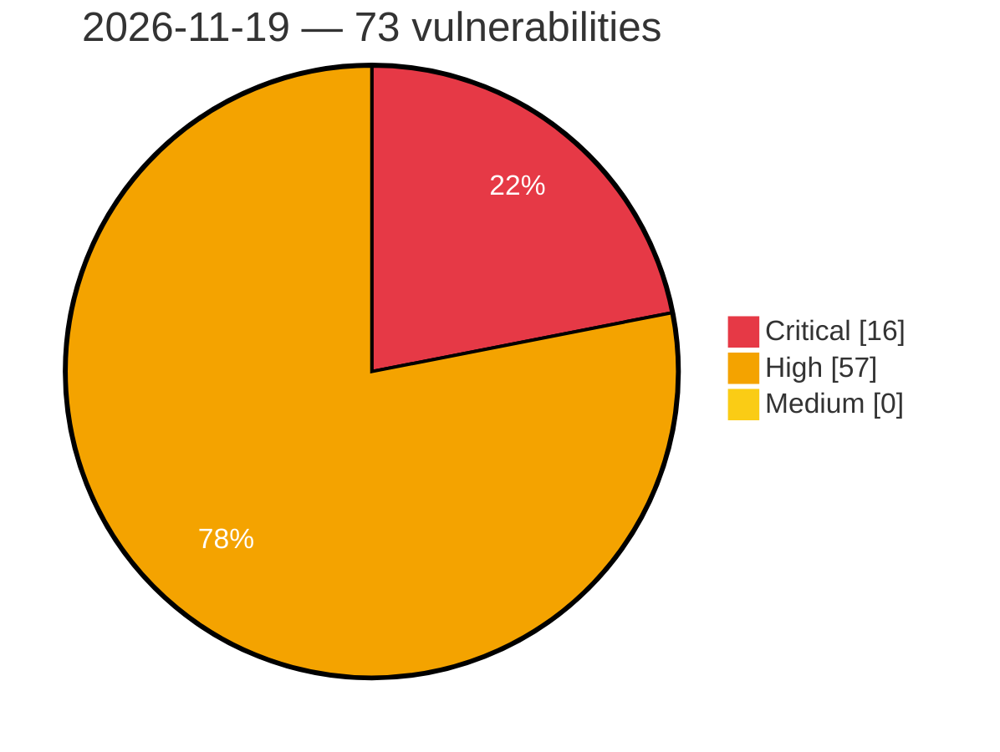

# Critical, High & Medium Severity Vulnerabilities — 2026-11-19

**Source status for this day:**

| Source | Critical | High | Medium | Total |
|--------|---------:|-----:|-------:|------:|
| cvefeed.io (High/Critical) | 16 | 57 | 0 | 73 |

**KEV (actively exploited):** 0  **Watchlist matches:** 53

## Critical (16)

| CVSS | Flags | Source | CVE / Title | Reported |
|------|-------|--------|-------------|----------|
| 10.0 | — | cvefeed.io (High/Critical) | [CVE-2026-77312 - Flyto2 Core: Arbitrary file write via unguarded data.*/file.* modules (incomplete fix of CVE-2026-67429)](https://cvefeed.io/vuln/detail/CVE-2026-77312) | 3 hours, 3 minutes ago |
| 9.9 | ⭐ | cvefeed.io (High/Critical) | [CVE-2026-129048 - WordPress WP Photo Album Plus plugin <= 9.3.06.003 - Remote Code Execution (RCE) vulnerability](https://cvefeed.io/vuln/detail/CVE-2026-129048) | 3 hours, 45 minutes ago |
| 9.9 | ⭐ | cvefeed.io (High/Critical) | [CVE-2026-131253 - Remote Code Execution (RCE) through the App Wizard in Splunk SOAR](https://cvefeed.io/vuln/detail/CVE-2026-131253) | 42 minutes ago |
| 9.8 | ⭐ | cvefeed.io (High/Critical) | [CVE-2026-132891 - JetBrains TeamCity Remote Code Execution Vulnerability](https://cvefeed.io/vuln/detail/CVE-2026-132891) | 45 minutes ago |
| 9.8 | ⭐ | cvefeed.io (High/Critical) | [CVE-2026-14492 - WP Duplicate <= 1.1.11 - Unauthenticated Arbitrary File Upload to Remote Code Execution via 'files_data' Parameter in handle_batch_upload_files](https://cvefeed.io/vuln/detail/CVE-2026-14492) | 1 hour, 45 minutes ago |
| 9.8 | — | cvefeed.io (High/Critical) | [CVE-2026-114516 - Etherpad: Pre-auth arbitrary file read](https://cvefeed.io/vuln/detail/CVE-2026-114516) | 3 hours, 4 minutes ago |
| 9.8 | ⭐ | cvefeed.io (High/Critical) | [CVE-2026-87977 - IBM Guardium Data Protection SQL Injection](https://cvefeed.io/vuln/detail/CVE-2026-87977) | 4 hours, 4 minutes ago |
| 9.8 | ⭐ | cvefeed.io (High/Critical) | [CVE-2026-84236 - IBM Guardium Data Protection Deserialization of Untrusted Data](https://cvefeed.io/vuln/detail/CVE-2026-84236) | 4 hours, 4 minutes ago |
| 9.6 | ⭐ | cvefeed.io (High/Critical) | [CVE-2026-131287 - Remote Code Execution (RCE) through the REST API in Splunk SOAR](https://cvefeed.io/vuln/detail/CVE-2026-131287) | 42 minutes ago |
| 9.4 | ⭐ | cvefeed.io (High/Critical) | [CVE-2026-76536 - Authentication Bypass through the Cluster Configuration REST API in Splunk Enterprise](https://cvefeed.io/vuln/detail/CVE-2026-76536) | 42 minutes ago |
| 9.3 | ⭐ | cvefeed.io (High/Critical) | [CVE-2026-131914 - Deserialization of untrusted data in CodePlex AntiCSRF](https://cvefeed.io/vuln/detail/CVE-2026-131914) | 1 hour, 12 minutes ago |
| 9.3 | — | cvefeed.io (High/Critical) | [CVE-2026-110461 - Comelit 1456B Multi-User Gateway ships with default administrative credentials](https://cvefeed.io/vuln/detail/CVE-2026-110461) | 4 hours, 45 minutes ago |
| 9.2 | — | cvefeed.io (High/Critical) | [CVE-2026-123058 - Missing authentication for critical function in JTL-Shop](https://cvefeed.io/vuln/detail/CVE-2026-123058) | 14 minutes ago |
| 9.1 | — | cvefeed.io (High/Critical) | [CVE-2026-129932 - Attacker able to redirect a Java driver client to a host they own, surviving TLS certificate verification, via an SRV parent-domain bypass](https://cvefeed.io/vuln/detail/CVE-2026-129932) | 9 minutes ago |
| 9.1 | ⭐ | cvefeed.io (High/Critical) | [CVE-2026-76535 - Authentication Bypass through the RapidDiag REST API in Splunk Enterprise](https://cvefeed.io/vuln/detail/CVE-2026-76535) | 42 minutes ago |
| 9.1 | — | cvefeed.io (High/Critical) | [CVE-2026-82339 - IBM Guardium Data Protection Missing Authentication](https://cvefeed.io/vuln/detail/CVE-2026-82339) | 4 hours, 4 minutes ago |

## High (57)

| CVSS | Flags | Source | CVE / Title | Reported |
|------|-------|--------|-------------|----------|
| 8.8 | — | cvefeed.io (High/Critical) | [CVE-2026-125060 - Authorization bypass through user-controlled key in JTL-Shop](https://cvefeed.io/vuln/detail/CVE-2026-125060) | 25 minutes ago |
| 8.8 | ⭐ | cvefeed.io (High/Critical) | [CVE-2026-133027 - JetBrains TeamCity Privilege Escalation via Token Authentication](https://cvefeed.io/vuln/detail/CVE-2026-133027) | 26 minutes ago |
| 8.8 | ⭐ | cvefeed.io (High/Critical) | [CVE-2026-133019 - JetBrains TeamCity Kotlin DSL Sandbox Remote Code Execution](https://cvefeed.io/vuln/detail/CVE-2026-133019) | 26 minutes ago |
| 8.8 | ⭐ | cvefeed.io (High/Critical) | [CVE-2026-133018 - JetBrains TeamCity Remote Code Execution Vulnerability](https://cvefeed.io/vuln/detail/CVE-2026-133018) | 26 minutes ago |
| 8.8 | ⭐ | cvefeed.io (High/Critical) | [CVE-2026-133016 - JetBrains TeamCity Remote Code Execution Vulnerability](https://cvefeed.io/vuln/detail/CVE-2026-133016) | 26 minutes ago |
| 8.8 | ⭐ | cvefeed.io (High/Critical) | [CVE-2026-133015 - JetBrains TeamCity Kotlin DSL Sandbox Remote Code Execution](https://cvefeed.io/vuln/detail/CVE-2026-133015) | 26 minutes ago |
| 8.8 | ⭐ | cvefeed.io (High/Critical) | [CVE-2026-132917 - JetBrains TeamCity Kotlin DSL Sandbox File Write Remote Code Execution](https://cvefeed.io/vuln/detail/CVE-2026-132917) | 45 minutes ago |
| 8.8 | ⭐ | cvefeed.io (High/Critical) | [CVE-2026-132909 - JetBrains TeamCity Mercurial Repository Remote Code Execution Vulnerability](https://cvefeed.io/vuln/detail/CVE-2026-132909) | 45 minutes ago |
| 8.8 | ⭐ | cvefeed.io (High/Critical) | [CVE-2026-132906 - JetBrains TeamCity Kotlin DSL Sandbox Remote Code Execution](https://cvefeed.io/vuln/detail/CVE-2026-132906) | 45 minutes ago |
| 8.8 | ⭐ | cvefeed.io (High/Critical) | [CVE-2026-76540 - Improper Authorization through the REST API in Splunk Enterprise](https://cvefeed.io/vuln/detail/CVE-2026-76540) | 42 minutes ago |
| 8.8 | ⭐ | cvefeed.io (High/Critical) | [CVE-2026-76538 - SPL Injection through the REST API in Splunk Enterprise](https://cvefeed.io/vuln/detail/CVE-2026-76538) | 42 minutes ago |
| 8.8 | — | cvefeed.io (High/Critical) | [CVE-2026-131295 - Improper Authorization in Playbook Execution in Splunk SOAR](https://cvefeed.io/vuln/detail/CVE-2026-131295) | 42 minutes ago |
| 8.8 | ⭐ | cvefeed.io (High/Critical) | [CVE-2026-131271 - Improper Access Control through the REST API in Splunk SOAR](https://cvefeed.io/vuln/detail/CVE-2026-131271) | 42 minutes ago |
| 8.8 | ⭐ | cvefeed.io (High/Critical) | [CVE-2026-131270 - Path Traversal through the REST API in Splunk SOAR](https://cvefeed.io/vuln/detail/CVE-2026-131270) | 42 minutes ago |
| 8.8 | ⭐ | cvefeed.io (High/Critical) | [CVE-2026-131269 - Remote Code Execution (RCE) through Python Dependencies in Splunk SOAR](https://cvefeed.io/vuln/detail/CVE-2026-131269) | 42 minutes ago |
| 8.8 | — | cvefeed.io (High/Critical) | [CVE-2026-131263 - Argument Injection during App Installation in Splunk SOAR](https://cvefeed.io/vuln/detail/CVE-2026-131263) | 42 minutes ago |
| 8.8 | ⭐ | cvefeed.io (High/Critical) | [CVE-2026-131261 - Remote Code Execution (RCE) through the REST API in Splunk SOAR](https://cvefeed.io/vuln/detail/CVE-2026-131261) | 42 minutes ago |
| 8.8 | ⭐ | cvefeed.io (High/Critical) | [CVE-2026-131252 - Missing Authorization in Cross-Tenant Asset Management through the REST API in Splunk SOAR](https://cvefeed.io/vuln/detail/CVE-2026-131252) | 42 minutes ago |
| 8.8 | ⭐ | cvefeed.io (High/Critical) | [CVE-2026-131246 - Information Disclosure through REST API External Prompts in Splunk SOAR](https://cvefeed.io/vuln/detail/CVE-2026-131246) | 42 minutes ago |
| 8.8 | — | cvefeed.io (High/Critical) | [CVE-2026-131236 - SPL Injection through Splunk Web Workflow Actions in Splunk Enterprise Security](https://cvefeed.io/vuln/detail/CVE-2026-131236) | 42 minutes ago |
| 8.8 | ⭐ | cvefeed.io (High/Critical) | [CVE-2026-133476 - Dolibarr SQL Injection Vulnerability](https://cvefeed.io/vuln/detail/CVE-2026-133476) | 3 hours, 4 minutes ago |
| 8.7 | ⭐ | cvefeed.io (High/Critical) | [CVE-2026-22311 - Use of a less trusted source leading to denial of service by lockout in JTL-Shop](https://cvefeed.io/vuln/detail/CVE-2026-22311) | 7 minutes ago |
| 8.7 | ⭐ | cvefeed.io (High/Critical) | [CVE-2026-125061 - Stored cross-site scripting in the JTL PayPal Checkout plugin](https://cvefeed.io/vuln/detail/CVE-2026-125061) | 38 minutes ago |
| 8.7 | ⭐ | cvefeed.io (High/Critical) | [CVE-2026-131260 - Cross-Site Scripting (XSS) through the REST API in Splunk SOAR](https://cvefeed.io/vuln/detail/CVE-2026-131260) | 42 minutes ago |
| 8.7 | ⭐ | cvefeed.io (High/Critical) | [CVE-2026-131258 - Stored Cross-Site Scripting (XSS) through the REST API in Splunk SOAR](https://cvefeed.io/vuln/detail/CVE-2026-131258) | 42 minutes ago |
| 8.7 | ⭐ | cvefeed.io (High/Critical) | [CVE-2026-61827 - netty-incubator-codec-ohttp: BinaryHttpParser should enforce limits for variable lengths fields](https://cvefeed.io/vuln/detail/CVE-2026-61827) | 3 hours, 4 minutes ago |
| 8.7 | — | cvefeed.io (High/Critical) | [CVE-2026-133201 - smartalock wireguard-lwip X25519 Ladder x25519.c mul out-of-bounds write](https://cvefeed.io/vuln/detail/CVE-2026-133201) | 4 hours, 4 minutes ago |
| 8.7 | ⭐ | cvefeed.io (High/Critical) | [CVE-2026-130235 - Improper Request URL Validation in the Okta .NET SDK Abstractions Library](https://cvefeed.io/vuln/detail/CVE-2026-130235) | 4 hours, 4 minutes ago |
| 8.6 | — | cvefeed.io (High/Critical) | [CVE-2026-132748 - Vtiger CRM through 8.4.0 PHP Code Injection via Configuration Editor](https://cvefeed.io/vuln/detail/CVE-2026-132748) | 3 hours, 12 minutes ago |
| 8.6 | ⭐ | cvefeed.io (High/Critical) | [CVE-2026-19609 - Unblu Spark Cross-Site Scripting through Synchronized Page Attributes in Embedded Co-Browsing](https://cvefeed.io/vuln/detail/CVE-2026-19609) | 4 hours, 45 minutes ago |
| 8.6 | — | cvefeed.io (High/Critical) | [CVE-2026-110462 - Comelit 1456B Multi-User Gateway exposes all role passwords in cleartext via Installer-accessible backup](https://cvefeed.io/vuln/detail/CVE-2026-110462) | 4 hours, 45 minutes ago |
| 8.5 | ⭐ | cvefeed.io (High/Critical) | [CVE-2026-132756 - Geany through 2.1.0 OS Command Injection via Filename in Build Commands](https://cvefeed.io/vuln/detail/CVE-2026-132756) | 3 hours, 12 minutes ago |
| 8.5 | — | cvefeed.io (High/Critical) | [CVE-2026-132751 - yt through 4.4.4 Code Injection via con_args eval() in ytdata HDF5](https://cvefeed.io/vuln/detail/CVE-2026-132751) | 3 hours, 12 minutes ago |
| 8.5 | ⭐ | cvefeed.io (High/Critical) | [CVE-2026-122676 - WordPress PublishPress Authors plugin <= 4.18.0 - SQL Injection vulnerability](https://cvefeed.io/vuln/detail/CVE-2026-122676) | 2 hours, 2 minutes ago |
| 8.5 | ⭐ | cvefeed.io (High/Critical) | [CVE-2026-77315 - Flyto2 Core: http.paginate follows server-supplied next-page URLs (Link header / cursor) without SSRF revalidation](https://cvefeed.io/vuln/detail/CVE-2026-77315) | 3 hours, 3 minutes ago |
| 8.5 | ⭐ | cvefeed.io (High/Critical) | [CVE-2026-130236 - API Authentication and Rule Generation in the Auth0 Authorization Extension](https://cvefeed.io/vuln/detail/CVE-2026-130236) | 4 hours, 4 minutes ago |
| 8.5 | ⭐ | cvefeed.io (High/Critical) | [CVE-2026-130179 - Credential Overwriting in Okta .NET SDK Abstractions Library](https://cvefeed.io/vuln/detail/CVE-2026-130179) | 4 hours, 4 minutes ago |
| 8.5 | — | cvefeed.io (High/Critical) | [CVE-2026-130151 - FreeRDP Smartcard Redirection Memory Handling in Okta Privileged Access Gateway](https://cvefeed.io/vuln/detail/CVE-2026-130151) | 4 hours, 4 minutes ago |
| 8.4 | ⭐ | cvefeed.io (High/Critical) | [CVE-2026-132913 - JetBrains TeamCity Stored Cross-Site Scripting](https://cvefeed.io/vuln/detail/CVE-2026-132913) | 45 minutes ago |
| 8.3 | ⭐ | cvefeed.io (High/Critical) | [CVE-2026-131293 - Improper Access Control in the Data Management Automation API in Splunk SOAR](https://cvefeed.io/vuln/detail/CVE-2026-131293) | 42 minutes ago |
| 8.3 | ⭐ | cvefeed.io (High/Critical) | [CVE-2026-131218 - SPL Injection through the Mission Control REST API in Splunk Enterprise Security](https://cvefeed.io/vuln/detail/CVE-2026-131218) | 43 minutes ago |
| 8.1 | — | cvefeed.io (High/Critical) | [CVE-2026-132907 - JetBrains TeamCity GitHub App Credential Improper Authorization](https://cvefeed.io/vuln/detail/CVE-2026-132907) | 45 minutes ago |
| 8.1 | — | cvefeed.io (High/Critical) | [CVE-2026-132904 - JetBrains TeamCity Missing Authorization Vulnerability](https://cvefeed.io/vuln/detail/CVE-2026-132904) | 45 minutes ago |
| 8.1 | ⭐ | cvefeed.io (High/Critical) | [CVE-2026-132903 - JetBrains TeamCity Missing Authorization Vulnerability](https://cvefeed.io/vuln/detail/CVE-2026-132903) | 45 minutes ago |
| 8.1 | ⭐ | cvefeed.io (High/Critical) | [CVE-2026-132892 - JetBrains TeamCity Privilege Escalation](https://cvefeed.io/vuln/detail/CVE-2026-132892) | 45 minutes ago |
| 8.1 | — | cvefeed.io (High/Critical) | [CVE-2026-76544 - SPL Injection through Metric Alert Filters in Splunk Enterprise](https://cvefeed.io/vuln/detail/CVE-2026-76544) | 42 minutes ago |
| 8.1 | ⭐ | cvefeed.io (High/Critical) | [CVE-2026-131305 - Improper Input Validation through the REST API in Splunk AI Assistant](https://cvefeed.io/vuln/detail/CVE-2026-131305) | 42 minutes ago |
| 8.1 | ⭐ | cvefeed.io (High/Critical) | [CVE-2026-131304 - Authorization Bypass through the REST API in Splunk AI Assistant](https://cvefeed.io/vuln/detail/CVE-2026-131304) | 42 minutes ago |
| 8.1 | ⭐ | cvefeed.io (High/Critical) | [CVE-2026-131297 - Single Sign-On Authentication Bypass in Splunk SOAR](https://cvefeed.io/vuln/detail/CVE-2026-131297) | 42 minutes ago |
| 8.1 | ⭐ | cvefeed.io (High/Critical) | [CVE-2026-131282 - Information Exposure through the REST API in Splunk SOAR](https://cvefeed.io/vuln/detail/CVE-2026-131282) | 42 minutes ago |
| 8.1 | — | cvefeed.io (High/Critical) | [CVE-2026-61798 - netty-incubator-codec-ohttp: BoringSSL HPKE private key bytes exposed through toString() and exception messages](https://cvefeed.io/vuln/detail/CVE-2026-61798) | 3 hours, 4 minutes ago |
| 8.1 | ⭐ | cvefeed.io (High/Critical) | [CVE-2026-85018 - IBM Guardium Data Protection Improper Certificate Validation](https://cvefeed.io/vuln/detail/CVE-2026-85018) | 4 hours, 4 minutes ago |
| 8.1 | ⭐ | cvefeed.io (High/Critical) | [CVE-2026-84273 - IBM Guardium Data Protection Path Traversal](https://cvefeed.io/vuln/detail/CVE-2026-84273) | 4 hours, 4 minutes ago |
| 8.1 | — | cvefeed.io (High/Critical) | [CVE-2026-82342 - IBM Guardium Data Protection Buffer Overflow](https://cvefeed.io/vuln/detail/CVE-2026-82342) | 4 hours, 4 minutes ago |
| 8.0 | ⭐ | cvefeed.io (High/Critical) | [CVE-2026-133017 - JetBrains TeamCity Remote Code Execution Vulnerability](https://cvefeed.io/vuln/detail/CVE-2026-133017) | 26 minutes ago |
| 8.0 | ⭐ | cvefeed.io (High/Critical) | [CVE-2026-132914 - JetBrains TeamCity Stored Cross-Site Scripting](https://cvefeed.io/vuln/detail/CVE-2026-132914) | 45 minutes ago |
| 8.0 | ⭐ | cvefeed.io (High/Critical) | [CVE-2026-130234 - Path Parameter Encoding in Okta Swift Management SDK](https://cvefeed.io/vuln/detail/CVE-2026-130234) | 4 hours, 4 minutes ago |
