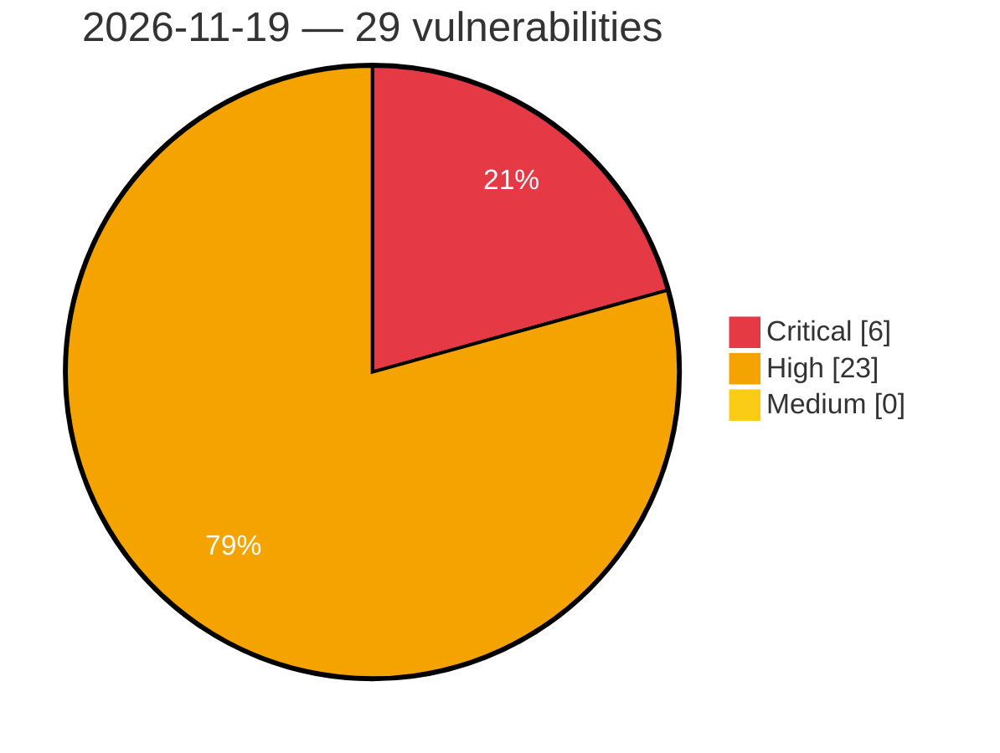

# Critical, High & Medium Severity Vulnerabilities — 2026-11-19

**Source status for this day:**

| Source | Critical | High | Medium | Total |
|--------|---------:|-----:|-------:|------:|
| cvefeed.io (High/Critical) | 6 | 23 | 0 | 29 |

**KEV (actively exploited):** 0  **Watchlist matches:** 21

## Critical (6)

| CVSS | Flags | Source | CVE / Title | Reported |
|------|-------|--------|-------------|----------|
| 9.9 | ⭐ | cvefeed.io (High/Critical) | [CVE-2026-129048 - WordPress WP Photo Album Plus plugin <= 9.3.06.003 - Remote Code Execution (RCE) vulnerability](https://cvefeed.io/vuln/detail/CVE-2026-129048) | 3 hours, 45 minutes ago |
| 9.8 | ⭐ | cvefeed.io (High/Critical) | [CVE-2026-132891 - JetBrains TeamCity Remote Code Execution Vulnerability](https://cvefeed.io/vuln/detail/CVE-2026-132891) | 45 minutes ago |
| 9.8 | ⭐ | cvefeed.io (High/Critical) | [CVE-2026-14492 - WP Duplicate <= 1.1.11 - Unauthenticated Arbitrary File Upload to Remote Code Execution via 'files_data' Parameter in handle_batch_upload_files](https://cvefeed.io/vuln/detail/CVE-2026-14492) | 1 hour, 45 minutes ago |
| 9.3 | ⭐ | cvefeed.io (High/Critical) | [CVE-2026-131914 - Deserialization of untrusted data in CodePlex AntiCSRF](https://cvefeed.io/vuln/detail/CVE-2026-131914) | 1 hour, 12 minutes ago |
| 9.3 | — | cvefeed.io (High/Critical) | [CVE-2026-110461 - Comelit 1456B Multi-User Gateway ships with default administrative credentials](https://cvefeed.io/vuln/detail/CVE-2026-110461) | 4 hours, 45 minutes ago |
| 9.2 | — | cvefeed.io (High/Critical) | [CVE-2026-123058 - Missing authentication for critical function in JTL-Shop](https://cvefeed.io/vuln/detail/CVE-2026-123058) | 14 minutes ago |

## High (23)

| CVSS | Flags | Source | CVE / Title | Reported |
|------|-------|--------|-------------|----------|
| 8.8 | — | cvefeed.io (High/Critical) | [CVE-2026-125060 - Authorization bypass through user-controlled key in JTL-Shop](https://cvefeed.io/vuln/detail/CVE-2026-125060) | 25 minutes ago |
| 8.8 | ⭐ | cvefeed.io (High/Critical) | [CVE-2026-133027 - JetBrains TeamCity Privilege Escalation via Token Authentication](https://cvefeed.io/vuln/detail/CVE-2026-133027) | 26 minutes ago |
| 8.8 | ⭐ | cvefeed.io (High/Critical) | [CVE-2026-133019 - JetBrains TeamCity Kotlin DSL Sandbox Remote Code Execution](https://cvefeed.io/vuln/detail/CVE-2026-133019) | 26 minutes ago |
| 8.8 | ⭐ | cvefeed.io (High/Critical) | [CVE-2026-133018 - JetBrains TeamCity Remote Code Execution Vulnerability](https://cvefeed.io/vuln/detail/CVE-2026-133018) | 26 minutes ago |
| 8.8 | ⭐ | cvefeed.io (High/Critical) | [CVE-2026-133016 - JetBrains TeamCity Remote Code Execution Vulnerability](https://cvefeed.io/vuln/detail/CVE-2026-133016) | 26 minutes ago |
| 8.8 | ⭐ | cvefeed.io (High/Critical) | [CVE-2026-133015 - JetBrains TeamCity Kotlin DSL Sandbox Remote Code Execution](https://cvefeed.io/vuln/detail/CVE-2026-133015) | 26 minutes ago |
| 8.8 | ⭐ | cvefeed.io (High/Critical) | [CVE-2026-132917 - JetBrains TeamCity Kotlin DSL Sandbox File Write Remote Code Execution](https://cvefeed.io/vuln/detail/CVE-2026-132917) | 45 minutes ago |
| 8.8 | ⭐ | cvefeed.io (High/Critical) | [CVE-2026-132909 - JetBrains TeamCity Mercurial Repository Remote Code Execution Vulnerability](https://cvefeed.io/vuln/detail/CVE-2026-132909) | 45 minutes ago |
| 8.8 | ⭐ | cvefeed.io (High/Critical) | [CVE-2026-132906 - JetBrains TeamCity Kotlin DSL Sandbox Remote Code Execution](https://cvefeed.io/vuln/detail/CVE-2026-132906) | 45 minutes ago |
| 8.7 | ⭐ | cvefeed.io (High/Critical) | [CVE-2026-22311 - Use of a less trusted source leading to denial of service by lockout in JTL-Shop](https://cvefeed.io/vuln/detail/CVE-2026-22311) | 7 minutes ago |
| 8.7 | ⭐ | cvefeed.io (High/Critical) | [CVE-2026-125061 - Stored cross-site scripting in the JTL PayPal Checkout plugin](https://cvefeed.io/vuln/detail/CVE-2026-125061) | 38 minutes ago |
| 8.6 | — | cvefeed.io (High/Critical) | [CVE-2026-132748 - Vtiger CRM through 8.4.0 PHP Code Injection via Configuration Editor](https://cvefeed.io/vuln/detail/CVE-2026-132748) | 3 hours, 12 minutes ago |
| 8.6 | ⭐ | cvefeed.io (High/Critical) | [CVE-2026-19609 - Unblu Spark Cross-Site Scripting through Synchronized Page Attributes in Embedded Co-Browsing](https://cvefeed.io/vuln/detail/CVE-2026-19609) | 4 hours, 45 minutes ago |
| 8.6 | — | cvefeed.io (High/Critical) | [CVE-2026-110462 - Comelit 1456B Multi-User Gateway exposes all role passwords in cleartext via Installer-accessible backup](https://cvefeed.io/vuln/detail/CVE-2026-110462) | 4 hours, 45 minutes ago |
| 8.5 | ⭐ | cvefeed.io (High/Critical) | [CVE-2026-132756 - Geany through 2.1.0 OS Command Injection via Filename in Build Commands](https://cvefeed.io/vuln/detail/CVE-2026-132756) | 3 hours, 12 minutes ago |
| 8.5 | — | cvefeed.io (High/Critical) | [CVE-2026-132751 - yt through 4.4.4 Code Injection via con_args eval() in ytdata HDF5](https://cvefeed.io/vuln/detail/CVE-2026-132751) | 3 hours, 12 minutes ago |
| 8.4 | ⭐ | cvefeed.io (High/Critical) | [CVE-2026-132913 - JetBrains TeamCity Stored Cross-Site Scripting](https://cvefeed.io/vuln/detail/CVE-2026-132913) | 45 minutes ago |
| 8.1 | — | cvefeed.io (High/Critical) | [CVE-2026-132907 - JetBrains TeamCity GitHub App Credential Improper Authorization](https://cvefeed.io/vuln/detail/CVE-2026-132907) | 45 minutes ago |
| 8.1 | — | cvefeed.io (High/Critical) | [CVE-2026-132904 - JetBrains TeamCity Missing Authorization Vulnerability](https://cvefeed.io/vuln/detail/CVE-2026-132904) | 45 minutes ago |
| 8.1 | ⭐ | cvefeed.io (High/Critical) | [CVE-2026-132903 - JetBrains TeamCity Missing Authorization Vulnerability](https://cvefeed.io/vuln/detail/CVE-2026-132903) | 45 minutes ago |
| 8.1 | ⭐ | cvefeed.io (High/Critical) | [CVE-2026-132892 - JetBrains TeamCity Privilege Escalation](https://cvefeed.io/vuln/detail/CVE-2026-132892) | 45 minutes ago |
| 8.0 | ⭐ | cvefeed.io (High/Critical) | [CVE-2026-133017 - JetBrains TeamCity Remote Code Execution Vulnerability](https://cvefeed.io/vuln/detail/CVE-2026-133017) | 26 minutes ago |
| 8.0 | ⭐ | cvefeed.io (High/Critical) | [CVE-2026-132914 - JetBrains TeamCity Stored Cross-Site Scripting](https://cvefeed.io/vuln/detail/CVE-2026-132914) | 45 minutes ago |
