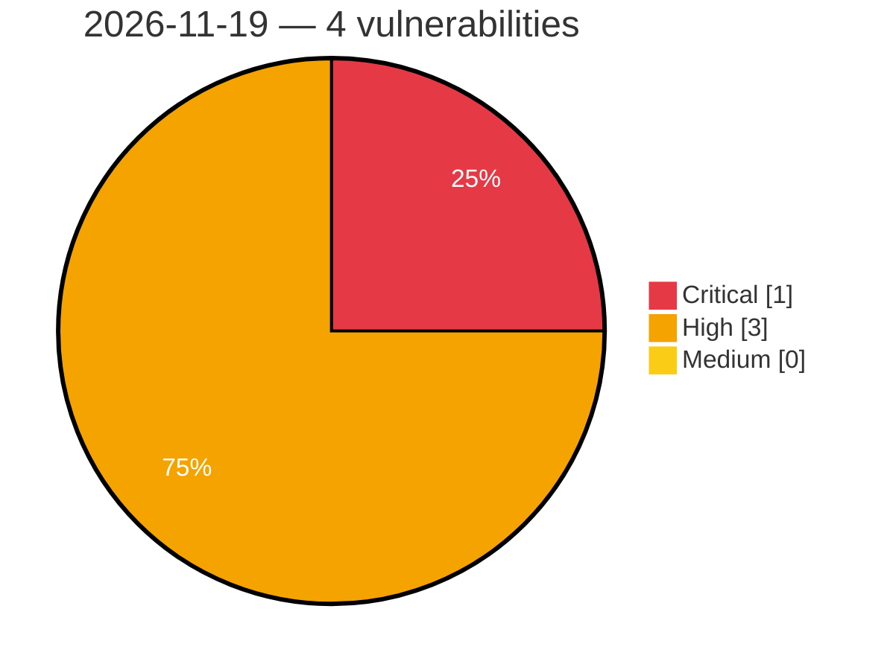

# Critical, High & Medium Severity Vulnerabilities — 2026-11-19

**Source status for this day:**

| Source | Critical | High | Medium | Total |
|--------|---------:|-----:|-------:|------:|
| cvefeed.io (High/Critical) | 1 | 3 | 0 | 4 |

**KEV (actively exploited):** 0  **Watchlist matches:** 2

## Critical (1)

| CVSS | Flags | Source | CVE / Title | Reported |
|------|-------|--------|-------------|----------|
| 9.3 | ⭐ | cvefeed.io (High/Critical) | [CVE-2026-131914 - Deserialization of untrusted data in CodePlex AntiCSRF](https://cvefeed.io/vuln/detail/CVE-2026-131914) | 1 hour, 12 minutes ago |

## High (3)

| CVSS | Flags | Source | CVE / Title | Reported |
|------|-------|--------|-------------|----------|
| 8.6 | — | cvefeed.io (High/Critical) | [CVE-2026-132748 - Vtiger CRM through 8.4.0 PHP Code Injection via Configuration Editor](https://cvefeed.io/vuln/detail/CVE-2026-132748) | 3 hours, 12 minutes ago |
| 8.5 | ⭐ | cvefeed.io (High/Critical) | [CVE-2026-132756 - Geany through 2.1.0 OS Command Injection via Filename in Build Commands](https://cvefeed.io/vuln/detail/CVE-2026-132756) | 3 hours, 12 minutes ago |
| 8.5 | — | cvefeed.io (High/Critical) | [CVE-2026-132751 - yt through 4.4.4 Code Injection via con_args eval() in ytdata HDF5](https://cvefeed.io/vuln/detail/CVE-2026-132751) | 3 hours, 12 minutes ago |
