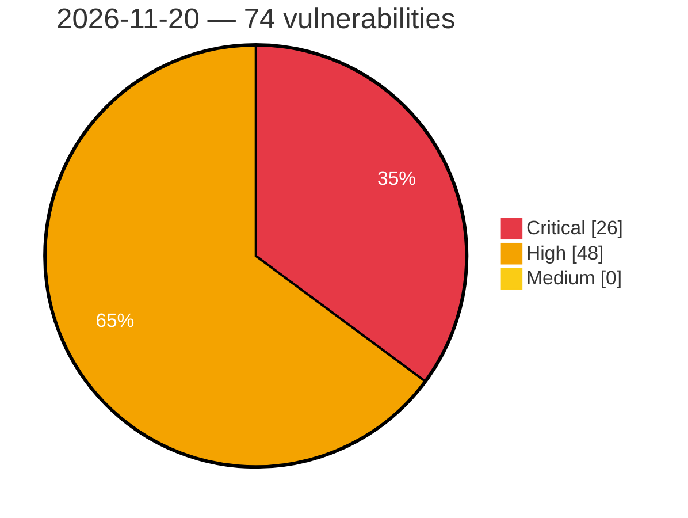

# Critical, High & Medium Severity Vulnerabilities — 2026-11-20

**Source status for this day:**

| Source | Critical | High | Medium | Total |
|--------|---------:|-----:|-------:|------:|
| cvefeed.io (High/Critical) | 26 | 48 | 0 | 74 |

**KEV (actively exploited):** 0  **Watchlist matches:** 49

## Critical (26)

| CVSS | Flags | Source | CVE / Title | Reported |
|------|-------|--------|-------------|----------|
| 10.0 | ⭐ | cvefeed.io (High/Critical) | [CVE-2026-133493 - D-Link DIR-600L GENA gena.cgi genacgi_main os command injection](https://cvefeed.io/vuln/detail/CVE-2026-133493) | 3 hours, 13 minutes ago |
| 10.0 | ⭐ | cvefeed.io (High/Critical) | [CVE-2026-14914 - RCE in TEGSOFT Management's Tegsoft Contact Center](https://cvefeed.io/vuln/detail/CVE-2026-14914) | 2 hours, 40 minutes ago |
| 9.9 | ⭐ | cvefeed.io (High/Critical) | [CVE-2026-133648 - Flowintel Disables TLS Certificate Verification for MISP and Mail Connections](https://cvefeed.io/vuln/detail/CVE-2026-133648) | 6 minutes ago |
| 9.9 | ⭐ | cvefeed.io (High/Critical) | [CVE-2026-133680 - D-Link DCS-935L Local Recording CGI setconf.cgi loginRouter os command injection](https://cvefeed.io/vuln/detail/CVE-2026-133680) | 2 hours, 42 minutes ago |
| 9.8 | ⭐ | cvefeed.io (High/Critical) | [CVE-2026-129056 - WordPress Authorizer plugin < 3.17.2 - Privilege Escalation vulnerability](https://cvefeed.io/vuln/detail/CVE-2026-129056) | 2 hours, 12 minutes ago |
| 9.8 | ⭐ | cvefeed.io (High/Critical) | [CVE-2026-80188 - BuddyBoss Addons <= 1.2.1 - Unauthenticated Account Takeover via Unverified Social Login Identity Tokens](https://cvefeed.io/vuln/detail/CVE-2026-80188) | 2 hours, 40 minutes ago |
| 9.8 | ⭐ | cvefeed.io (High/Critical) | [CVE-2026-129039 - WordPress Newsletters plugin <= 4.18.2 - PHP Object Injection vulnerability](https://cvefeed.io/vuln/detail/CVE-2026-129039) | 2 hours, 40 minutes ago |
| 9.8 | ⭐ | cvefeed.io (High/Critical) | [CVE-2026-129073 - WordPress miniorange otp verification plugin <= 5.6.1 - Broken Authentication vulnerability](https://cvefeed.io/vuln/detail/CVE-2026-129073) | 3 hours, 39 minutes ago |
| 9.8 | ⭐ | cvefeed.io (High/Critical) | [CVE-2026-129175 - U.S Department of the Interior Unstable Slope Management Program unauthenticated SQL Injection](https://cvefeed.io/vuln/detail/CVE-2026-129175) | 2 hours, 42 minutes ago |
| 9.6 | ⭐ | cvefeed.io (High/Critical) | [CVE-2026-96805 - Elecbrakes Missing Authentication for Critical Function](https://cvefeed.io/vuln/detail/CVE-2026-96805) | 3 hours, 40 minutes ago |
| 9.4 | ⭐ | cvefeed.io (High/Critical) | [CVE-2026-132660 - Postgres Enterprise Manager Privilege Escalation via Unsafe Search Path](https://cvefeed.io/vuln/detail/CVE-2026-132660) | 1 hour, 40 minutes ago |
| 9.4 | — | cvefeed.io (High/Critical) | [CVE-2026-132659 - Postgres Enterprise Manager Improper Authorization Vulnerability](https://cvefeed.io/vuln/detail/CVE-2026-132659) | 1 hour, 40 minutes ago |
| 9.4 | — | cvefeed.io (High/Critical) | [CVE-2026-132658 - Postgres Enterprise Manager Arbitrary File Read and Write Vulnerability](https://cvefeed.io/vuln/detail/CVE-2026-132658) | 1 hour, 40 minutes ago |
| 9.3 | — | cvefeed.io (High/Critical) | [CVE-2026-133528 - BeamNG.drive before 0.40.6 LuaJIT FFI Sandbox Escape via JIT Bounds-Check Bypass](https://cvefeed.io/vuln/detail/CVE-2026-133528) | 40 minutes ago |
| 9.3 | ⭐ | cvefeed.io (High/Critical) | [CVE-2026-126054 - Path Traversal in Dataform, BigQuery Studio and Colab Enterprise allows Cross-Tenant File Read and Write](https://cvefeed.io/vuln/detail/CVE-2026-126054) | 1 hour, 40 minutes ago |
| 9.3 | ⭐ | cvefeed.io (High/Critical) | [CVE-2026-129043 - WordPress Newsletters plugin <= 4.18.2 - SQL Injection vulnerability](https://cvefeed.io/vuln/detail/CVE-2026-129043) | 2 hours, 40 minutes ago |
| 9.3 | ⭐ | cvefeed.io (High/Critical) | [CVE-2026-94567 - NukeViet CMS: Stored XSS via SVG upload: the sanitizer is blind to markup hidden inside an internal DTD entity](https://cvefeed.io/vuln/detail/CVE-2026-94567) | 3 hours, 40 minutes ago |
| 9.3 | ⭐ | cvefeed.io (High/Critical) | [CVE-2026-94565 - NukeViet CMS: Unauthenticated Stored XSS in the Contact module](https://cvefeed.io/vuln/detail/CVE-2026-94565) | 3 hours, 40 minutes ago |
| 9.2 | ⭐ | cvefeed.io (High/Critical) | [CVE-2026-127027 - Remote Code Execution in Poste.io](https://cvefeed.io/vuln/detail/CVE-2026-127027) | 1 hour, 40 minutes ago |
| 9.1 | — | cvefeed.io (High/Critical) | [CVE-2026-120681 - Mang Board <= 2.4.7 - Missing Authorization to Unauthenticated Arbitrary Content Deletion via 'mode' / 'comment_pid' / 'board_pid' Parameter Confusion](https://cvefeed.io/vuln/detail/CVE-2026-120681) | 13 minutes ago |
| 9.1 | ⭐ | cvefeed.io (High/Critical) | [CVE-2026-133500 - Gladys Assistant Backup Restore Endpoint gateway.downloadBackup.js os command injection](https://cvefeed.io/vuln/detail/CVE-2026-133500) | 1 hour, 10 minutes ago |
| 9.1 | ⭐ | cvefeed.io (High/Critical) | [CVE-2026-133872 - LessPass Backend before Commit 9469b0c Missing Rate Limiting on JWT Login](https://cvefeed.io/vuln/detail/CVE-2026-133872) | 41 minutes ago |
| 9.1 | — | cvefeed.io (High/Critical) | [CVE-2026-115407 - Crypto11 Cryptographic Nonce Reuse Vulnerability](https://cvefeed.io/vuln/detail/CVE-2026-115407) | 47 minutes ago |
| 9.1 | — | cvefeed.io (High/Critical) | [CVE-2026-101340 - Query ID predictable from a short sequence of observations](https://cvefeed.io/vuln/detail/CVE-2026-101340) | 3 hours, 39 minutes ago |
| 9.0 | ⭐ | cvefeed.io (High/Critical) | [CVE-2026-133501 - Gladys Assistant Backup Restore gateway.downloadBackup.js path traversal](https://cvefeed.io/vuln/detail/CVE-2026-133501) | 1 hour, 10 minutes ago |
| 9.0 | — | cvefeed.io (High/Critical) | [CVE-2026-65094 - NVIDIA BlueField Virtio-Net Memory Corruption Vulnerability](https://cvefeed.io/vuln/detail/CVE-2026-65094) | 7 hours, 13 minutes ago |

## High (48)

| CVSS | Flags | Source | CVE / Title | Reported |
|------|-------|--------|-------------|----------|
| 8.9 | — | cvefeed.io (High/Critical) | [CVE-2026-131167 - Unsafe usage of return values](https://cvefeed.io/vuln/detail/CVE-2026-131167) | 4 hours, 40 minutes ago |
| 8.8 | ⭐ | cvefeed.io (High/Critical) | [CVE-2026-125085 - Nexter Extension <= 4.9.0 - Authenticated (Subscriber+) Privilege Escalation to 'reset-view' Parameter](https://cvefeed.io/vuln/detail/CVE-2026-125085) | 13 minutes ago |
| 8.8 | ⭐ | cvefeed.io (High/Critical) | [CVE-2026-134052 - Open Robotics RViz fillIndexBuffer Heap-based Buffer Overflow Remote Code Execution Vulnerability](https://cvefeed.io/vuln/detail/CVE-2026-134052) | 2 hours, 42 minutes ago |
| 8.8 | — | cvefeed.io (High/Critical) | [CVE-2026-129176 - U.S Department of the Interior Unstable Slope Management Program unauthenticated user deletion](https://cvefeed.io/vuln/detail/CVE-2026-129176) | 2 hours, 42 minutes ago |
| 8.8 | — | cvefeed.io (High/Critical) | [CVE-2026-77355 - isomorphic-git: NTFS .git::$INDEX_ALLOCATION alias bypass writes into the active gitdir](https://cvefeed.io/vuln/detail/CVE-2026-77355) | 3 hours, 40 minutes ago |
| 8.8 | — | cvefeed.io (High/Critical) | [CVE-2026-77347 - Pozeiden: Out-of-bounds read/write (crash / memory corruption) on valid diagrams in grid-layout renderers](https://cvefeed.io/vuln/detail/CVE-2026-77347) | 3 hours, 40 minutes ago |
| 8.7 | ⭐ | cvefeed.io (High/Critical) | [CVE-2026-124767 - Multiple Vulnerabilities in XOne's XOneManager](https://cvefeed.io/vuln/detail/CVE-2026-124767) | 13 minutes ago |
| 8.7 | ⭐ | cvefeed.io (High/Critical) | [CVE-2026-124768 - Multiple Vulnerabilities in XOne's XOneManager](https://cvefeed.io/vuln/detail/CVE-2026-124768) | 15 minutes ago |
| 8.7 | — | cvefeed.io (High/Critical) | [CVE-2026-129972 - Ethernet Remote I/O Web Management Service Buffer Overflow](https://cvefeed.io/vuln/detail/CVE-2026-129972) | 3 hours, 13 minutes ago |
| 8.7 | — | cvefeed.io (High/Critical) | [CVE-2026-129971 - Ethernet Remote I/Os SNMP Buffer Overflow](https://cvefeed.io/vuln/detail/CVE-2026-129971) | 3 hours, 13 minutes ago |
| 8.7 | ⭐ | cvefeed.io (High/Critical) | [CVE-2026-133534 - Neotroni Lighting｜PowerLink - SQL Injection](https://cvefeed.io/vuln/detail/CVE-2026-133534) | 7 hours, 13 minutes ago |
| 8.7 | ⭐ | cvefeed.io (High/Critical) | [CVE-2026-129424 - Joomla Extension - solidres.com - Unauthenticated stored XSS through guest reservation details in Solidres extension 1.0.0-3.4.1, 4.0.0-4.6.0](https://cvefeed.io/vuln/detail/CVE-2026-129424) | 3 hours, 39 minutes ago |
| 8.7 | — | cvefeed.io (High/Critical) | [CVE-2026-134164 - probe-image-size before 7.5.0 Denial of Service via EXIF Sub-IFD Traversal](https://cvefeed.io/vuln/detail/CVE-2026-134164) | 28 minutes ago |
| 8.7 | ⭐ | cvefeed.io (High/Critical) | [CVE-2026-134167 - devpi-web before 5.2.0 Unauthenticated Path Traversal via +doc Route](https://cvefeed.io/vuln/detail/CVE-2026-134167) | 29 minutes ago |
| 8.7 | — | cvefeed.io (High/Critical) | [CVE-2026-134169 - Qwik City before 1.20.3 and Router before 2.0.0-rc.4 DoS via formToObj](https://cvefeed.io/vuln/detail/CVE-2026-134169) | 29 minutes ago |
| 8.7 | — | cvefeed.io (High/Critical) | [CVE-2026-129177 - U.S Department of the Interior Unstable Slope Management Program unauthenticated user creation](https://cvefeed.io/vuln/detail/CVE-2026-129177) | 2 hours, 42 minutes ago |
| 8.7 | ⭐ | cvefeed.io (High/Critical) | [CVE-2026-77383 - mcp-ssh-manager: Command injection in mcp-ssh-manager database helpers (ssh_db_list / ssh_db_dump / ssh_db_import)](https://cvefeed.io/vuln/detail/CVE-2026-77383) | 3 hours, 40 minutes ago |
| 8.7 | ⭐ | cvefeed.io (High/Critical) | [CVE-2026-54065 - NukeViet CMS: Path Traversal to Arbitrary File Deletion in Edit Comment Function](https://cvefeed.io/vuln/detail/CVE-2026-54065) | 3 hours, 40 minutes ago |
| 8.7 | ⭐ | cvefeed.io (High/Critical) | [CVE-2026-54064 - NukeViet CMS: Multiple Anti-XSS Filter Bypasses Leading to Stored XSS in News Module](https://cvefeed.io/vuln/detail/CVE-2026-54064) | 3 hours, 40 minutes ago |
| 8.7 | ⭐ | cvefeed.io (High/Critical) | [CVE-2026-49259 - NukeViet: stored XSS through comment reply display names](https://cvefeed.io/vuln/detail/CVE-2026-49259) | 3 hours, 40 minutes ago |
| 8.6 | — | cvefeed.io (High/Critical) | [CVE-2026-130494 - Ethernet Switches Improper Firmware Authenticity Verification Vulnerability](https://cvefeed.io/vuln/detail/CVE-2026-130494) | 4 hours, 13 minutes ago |
| 8.6 | ⭐ | cvefeed.io (High/Critical) | [CVE-2026-113347 - Ruijie Networks OS Command Injection Vulnerability](https://cvefeed.io/vuln/detail/CVE-2026-113347) | 6 hours, 13 minutes ago |
| 8.6 | ⭐ | cvefeed.io (High/Critical) | [CVE-2026-133874 - Iceburg CRM through 5.0.0 Authorization Bypass via Record Save](https://cvefeed.io/vuln/detail/CVE-2026-133874) | 41 minutes ago |
| 8.6 | ⭐ | cvefeed.io (High/Critical) | [CVE-2026-131163 - Stored XSS in pretix-adyen](https://cvefeed.io/vuln/detail/CVE-2026-131163) | 4 hours, 40 minutes ago |
| 8.6 | ⭐ | cvefeed.io (High/Critical) | [CVE-2026-133663 - flowintel Insecure Direct Object Reference Allows Cross-Case Data Access and Modification](https://cvefeed.io/vuln/detail/CVE-2026-133663) | 5 hours, 39 minutes ago |
| 8.6 | — | cvefeed.io (High/Critical) | [CVE-2026-77326 - MapServer: Heap buffer overflow in WMS GetLegendGraphic via repeated LAYER parameters](https://cvefeed.io/vuln/detail/CVE-2026-77326) | 3 hours, 40 minutes ago |
| 8.5 | ⭐ | cvefeed.io (High/Critical) | [CVE-2026-128915 - WordPress InstaWP Connect plugin <= 0.1.4.4 - SQL Injection vulnerability](https://cvefeed.io/vuln/detail/CVE-2026-128915) | 1 hour, 10 minutes ago |
| 8.5 | ⭐ | cvefeed.io (High/Critical) | [CVE-2026-133199 - Incorrect privilege assignment on reused e-mail addresses or group names in AWS ssosync](https://cvefeed.io/vuln/detail/CVE-2026-133199) | 25 minutes ago |
| 8.5 | — | cvefeed.io (High/Critical) | [CVE-2026-133710 - llama.cpp b11003 before b12556 Heap Out-of-Bounds Write via hrm_text Model Loader](https://cvefeed.io/vuln/detail/CVE-2026-133710) | 3 hours, 39 minutes ago |
| 8.5 | — | cvefeed.io (High/Critical) | [CVE-2026-133708 - diffpy.structure before 3.5.1 Code Execution via eval in get_symop CIF Parsing](https://cvefeed.io/vuln/detail/CVE-2026-133708) | 3 hours, 39 minutes ago |
| 8.5 | — | cvefeed.io (High/Critical) | [CVE-2026-133707 - targets R package before 1.12.1 Code Execution via Custom Storage Metadata](https://cvefeed.io/vuln/detail/CVE-2026-133707) | 3 hours, 39 minutes ago |
| 8.5 | ⭐ | cvefeed.io (High/Critical) | [CVE-2026-134172 - audio-separator before 0.47.2 RCE via Unsafe Pickle Deserialization of Demucs Models](https://cvefeed.io/vuln/detail/CVE-2026-134172) | 29 minutes ago |
| 8.4 | ⭐ | cvefeed.io (High/Critical) | [CVE-2026-133847 - flowintel: Missing Authorization Check Allows Organization Admin to Edit Platform Admin Accounts via Browser Interface](https://cvefeed.io/vuln/detail/CVE-2026-133847) | 1 hour, 40 minutes ago |
| 8.4 | ⭐ | cvefeed.io (High/Critical) | [CVE-2026-133662 - flowintel Analyzer: Missing Authorization on Result Reads and Case/Task Writes (IDOR)](https://cvefeed.io/vuln/detail/CVE-2026-133662) | 5 hours, 39 minutes ago |
| 8.3 | ⭐ | cvefeed.io (High/Critical) | [CVE-2026-133848 - flowintel: Organization Admin Can Delete Platform Admin Accounts Due to Missing Privilege Hierarchy Check](https://cvefeed.io/vuln/detail/CVE-2026-133848) | 1 hour, 40 minutes ago |
| 8.2 | — | cvefeed.io (High/Critical) | [CVE-2026-125080 - Cypher injection via orderBy placeholder in Spring Data Neo4j custom queries](https://cvefeed.io/vuln/detail/CVE-2026-125080) | 1 hour, 10 minutes ago |
| 8.2 | — | cvefeed.io (High/Critical) | [CVE-2026-134170 - Cesanta Mongoose 7.22 before 7.24 Out-of-Bounds Read via mg_timegm](https://cvefeed.io/vuln/detail/CVE-2026-134170) | 29 minutes ago |
| 8.2 | ⭐ | cvefeed.io (High/Critical) | [CVE-2026-94598 - NukeViet CMS: Stored XSS via internal marker injection in iframe srcdoc sanitization](https://cvefeed.io/vuln/detail/CVE-2026-94598) | 3 hours, 40 minutes ago |
| 8.2 | ⭐ | cvefeed.io (High/Critical) | [CVE-2026-94564 - NukeViet CMS: Unauthenticated Stored XSS in the Contact module via HTML sanitizer bypass](https://cvefeed.io/vuln/detail/CVE-2026-94564) | 3 hours, 40 minutes ago |
| 8.1 | ⭐ | cvefeed.io (High/Critical) | [CVE-2026-126716 - Mega Forms <= 1.7.9 - Unauthenticated Arbitrary File Deletion via Submitted Field Value](https://cvefeed.io/vuln/detail/CVE-2026-126716) | 13 minutes ago |
| 8.1 | ⭐ | cvefeed.io (High/Critical) | [CVE-2026-130010 - Chatterbug Forms <= 1.1 - Unauthenticated Arbitrary File Deletion via Content-Disposition 'filename='](https://cvefeed.io/vuln/detail/CVE-2026-130010) | 1 hour, 10 minutes ago |
| 8.1 | ⭐ | cvefeed.io (High/Critical) | [CVE-2026-118522 - Video & Photo Gallery for Ultimate Member <= 1.1.4 - Authenticated (Subscriber+) Arbitrary File Deletion via 'videos[]' Parameter](https://cvefeed.io/vuln/detail/CVE-2026-118522) | 1 hour, 10 minutes ago |
| 8.1 | ⭐ | cvefeed.io (High/Critical) | [CVE-2026-89095 - Shortcodes and extra features for Phlox theme <= 2.17.22 - Unauthenticated Local File Inclusion via 'extra_template_path' Parameter](https://cvefeed.io/vuln/detail/CVE-2026-89095) | 2 hours, 12 minutes ago |
| 8.1 | — | cvefeed.io (High/Critical) | [CVE-2026-131795 - WordPress Aora theme <= 1.3.5 - Local File Inclusion vulnerability](https://cvefeed.io/vuln/detail/CVE-2026-131795) | 2 hours, 12 minutes ago |
| 8.1 | ⭐ | cvefeed.io (High/Critical) | [CVE-2026-120556 - Toocheke Companion <= 2.38 - Missing Authorization to Authenticated (Contributor+) Arbitrary Post Deletion via 'series_post_id' Parameter](https://cvefeed.io/vuln/detail/CVE-2026-120556) | 2 hours, 12 minutes ago |
| 8.1 | ⭐ | cvefeed.io (High/Critical) | [CVE-2026-54039 - LibreChat: Pre-registration account takeover via attacker-controlled `provider` field and social-login email fallback](https://cvefeed.io/vuln/detail/CVE-2026-54039) | 2 hours, 41 minutes ago |
| 8.1 | — | cvefeed.io (High/Critical) | [CVE-2026-129179 - U.S Department of the Interior Unstable Slope Management Program authentication mechanism bypass through client-controlled flow
selection](https://cvefeed.io/vuln/detail/CVE-2026-129179) | 2 hours, 42 minutes ago |
| 8.0 | ⭐ | cvefeed.io (High/Critical) | [CVE-2026-86017 - isomorphic-git: Arbitrary File Write via Symlink](https://cvefeed.io/vuln/detail/CVE-2026-86017) | 3 hours, 40 minutes ago |
