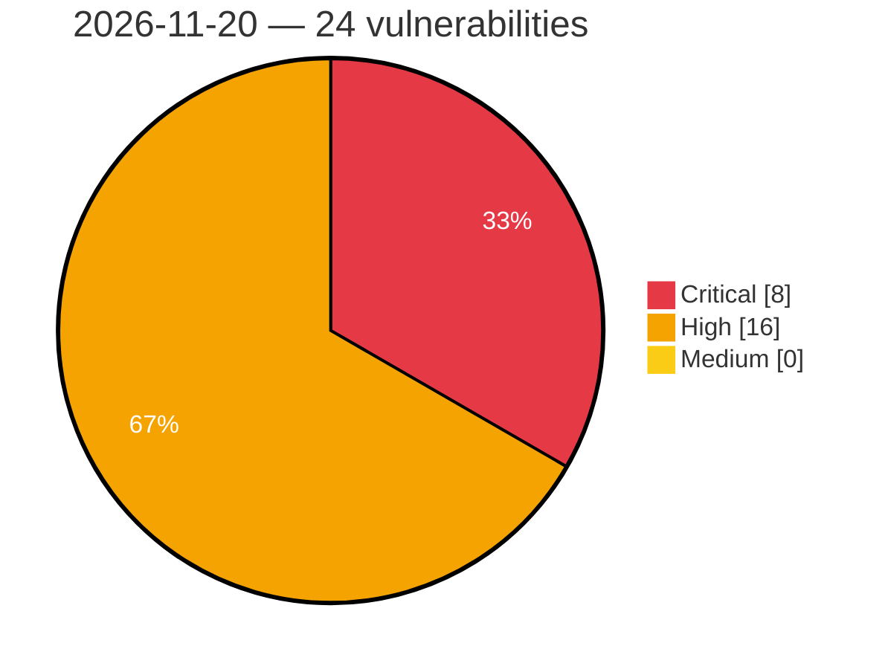

# Critical, High & Medium Severity Vulnerabilities — 2026-11-20

**Source status for this day:**

| Source | Critical | High | Medium | Total |
|--------|---------:|-----:|-------:|------:|
| cvefeed.io (High/Critical) | 8 | 16 | 0 | 24 |

**KEV (actively exploited):** 0  **Watchlist matches:** 16

## Critical (8)

| CVSS | Flags | Source | CVE / Title | Reported |
|------|-------|--------|-------------|----------|
| 10.0 | ⭐ | cvefeed.io (High/Critical) | [CVE-2026-133493 - D-Link DIR-600L GENA gena.cgi genacgi_main os command injection](https://cvefeed.io/vuln/detail/CVE-2026-133493) | 3 hours, 13 minutes ago |
| 9.9 | ⭐ | cvefeed.io (High/Critical) | [CVE-2026-133648 - Flowintel Disables TLS Certificate Verification for MISP and Mail Connections](https://cvefeed.io/vuln/detail/CVE-2026-133648) | 6 minutes ago |
| 9.8 | ⭐ | cvefeed.io (High/Critical) | [CVE-2026-129056 - WordPress Authorizer plugin < 3.17.2 - Privilege Escalation vulnerability](https://cvefeed.io/vuln/detail/CVE-2026-129056) | 2 hours, 12 minutes ago |
| 9.3 | — | cvefeed.io (High/Critical) | [CVE-2026-133528 - BeamNG.drive before 0.40.6 LuaJIT FFI Sandbox Escape via JIT Bounds-Check Bypass](https://cvefeed.io/vuln/detail/CVE-2026-133528) | 40 minutes ago |
| 9.1 | — | cvefeed.io (High/Critical) | [CVE-2026-120681 - Mang Board <= 2.4.7 - Missing Authorization to Unauthenticated Arbitrary Content Deletion via 'mode' / 'comment_pid' / 'board_pid' Parameter Confusion](https://cvefeed.io/vuln/detail/CVE-2026-120681) | 13 minutes ago |
| 9.1 | ⭐ | cvefeed.io (High/Critical) | [CVE-2026-133500 - Gladys Assistant Backup Restore Endpoint gateway.downloadBackup.js os command injection](https://cvefeed.io/vuln/detail/CVE-2026-133500) | 1 hour, 10 minutes ago |
| 9.0 | ⭐ | cvefeed.io (High/Critical) | [CVE-2026-133501 - Gladys Assistant Backup Restore gateway.downloadBackup.js path traversal](https://cvefeed.io/vuln/detail/CVE-2026-133501) | 1 hour, 10 minutes ago |
| 9.0 | — | cvefeed.io (High/Critical) | [CVE-2026-65094 - NVIDIA BlueField Virtio-Net Memory Corruption Vulnerability](https://cvefeed.io/vuln/detail/CVE-2026-65094) | 7 hours, 13 minutes ago |

## High (16)

| CVSS | Flags | Source | CVE / Title | Reported |
|------|-------|--------|-------------|----------|
| 8.8 | ⭐ | cvefeed.io (High/Critical) | [CVE-2026-125085 - Nexter Extension <= 4.9.0 - Authenticated (Subscriber+) Privilege Escalation to 'reset-view' Parameter](https://cvefeed.io/vuln/detail/CVE-2026-125085) | 13 minutes ago |
| 8.7 | ⭐ | cvefeed.io (High/Critical) | [CVE-2026-124767 - Multiple Vulnerabilities in XOne's XOneManager](https://cvefeed.io/vuln/detail/CVE-2026-124767) | 13 minutes ago |
| 8.7 | ⭐ | cvefeed.io (High/Critical) | [CVE-2026-124768 - Multiple Vulnerabilities in XOne's XOneManager](https://cvefeed.io/vuln/detail/CVE-2026-124768) | 15 minutes ago |
| 8.7 | — | cvefeed.io (High/Critical) | [CVE-2026-129972 - Ethernet Remote I/O Web Management Service Buffer Overflow](https://cvefeed.io/vuln/detail/CVE-2026-129972) | 3 hours, 13 minutes ago |
| 8.7 | — | cvefeed.io (High/Critical) | [CVE-2026-129971 - Ethernet Remote I/Os SNMP Buffer Overflow](https://cvefeed.io/vuln/detail/CVE-2026-129971) | 3 hours, 13 minutes ago |
| 8.7 | ⭐ | cvefeed.io (High/Critical) | [CVE-2026-133534 - Neotroni Lighting｜PowerLink - SQL Injection](https://cvefeed.io/vuln/detail/CVE-2026-133534) | 7 hours, 13 minutes ago |
| 8.6 | — | cvefeed.io (High/Critical) | [CVE-2026-130494 - Ethernet Switches Improper Firmware Authenticity Verification Vulnerability](https://cvefeed.io/vuln/detail/CVE-2026-130494) | 4 hours, 13 minutes ago |
| 8.6 | ⭐ | cvefeed.io (High/Critical) | [CVE-2026-113347 - Ruijie Networks OS Command Injection Vulnerability](https://cvefeed.io/vuln/detail/CVE-2026-113347) | 6 hours, 13 minutes ago |
| 8.5 | ⭐ | cvefeed.io (High/Critical) | [CVE-2026-128915 - WordPress InstaWP Connect plugin <= 0.1.4.4 - SQL Injection vulnerability](https://cvefeed.io/vuln/detail/CVE-2026-128915) | 1 hour, 10 minutes ago |
| 8.2 | — | cvefeed.io (High/Critical) | [CVE-2026-125080 - Cypher injection via orderBy placeholder in Spring Data Neo4j custom queries](https://cvefeed.io/vuln/detail/CVE-2026-125080) | 1 hour, 10 minutes ago |
| 8.1 | ⭐ | cvefeed.io (High/Critical) | [CVE-2026-126716 - Mega Forms <= 1.7.9 - Unauthenticated Arbitrary File Deletion via Submitted Field Value](https://cvefeed.io/vuln/detail/CVE-2026-126716) | 13 minutes ago |
| 8.1 | ⭐ | cvefeed.io (High/Critical) | [CVE-2026-130010 - Chatterbug Forms <= 1.1 - Unauthenticated Arbitrary File Deletion via Content-Disposition 'filename='](https://cvefeed.io/vuln/detail/CVE-2026-130010) | 1 hour, 10 minutes ago |
| 8.1 | ⭐ | cvefeed.io (High/Critical) | [CVE-2026-118522 - Video & Photo Gallery for Ultimate Member <= 1.1.4 - Authenticated (Subscriber+) Arbitrary File Deletion via 'videos[]' Parameter](https://cvefeed.io/vuln/detail/CVE-2026-118522) | 1 hour, 10 minutes ago |
| 8.1 | ⭐ | cvefeed.io (High/Critical) | [CVE-2026-89095 - Shortcodes and extra features for Phlox theme <= 2.17.22 - Unauthenticated Local File Inclusion via 'extra_template_path' Parameter](https://cvefeed.io/vuln/detail/CVE-2026-89095) | 2 hours, 12 minutes ago |
| 8.1 | — | cvefeed.io (High/Critical) | [CVE-2026-131795 - WordPress Aora theme <= 1.3.5 - Local File Inclusion vulnerability](https://cvefeed.io/vuln/detail/CVE-2026-131795) | 2 hours, 12 minutes ago |
| 8.1 | ⭐ | cvefeed.io (High/Critical) | [CVE-2026-120556 - Toocheke Companion <= 2.38 - Missing Authorization to Authenticated (Contributor+) Arbitrary Post Deletion via 'series_post_id' Parameter](https://cvefeed.io/vuln/detail/CVE-2026-120556) | 2 hours, 12 minutes ago |
