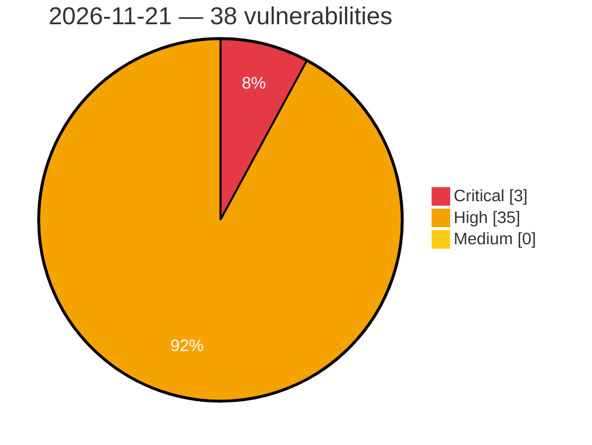

# Critical, High & Medium Severity Vulnerabilities — 2026-11-21

**Source status for this day:**

| Source | Critical | High | Medium | Total |
|--------|---------:|-----:|-------:|------:|
| cvefeed.io (High/Critical) | 3 | 35 | 0 | 38 |

**KEV (actively exploited):** 0  **Watchlist matches:** 14

## Critical (3)

| CVSS | Flags | Source | CVE / Title | Reported |
|------|-------|--------|-------------|----------|
| 10.0 | — | cvefeed.io (High/Critical) | [CVE-2026-133993 - D-Link DIR-600L GENA Subscription gena.cgi FUN_0040efb0 stack-based overflow](https://cvefeed.io/vuln/detail/CVE-2026-133993) | 1 hour ago |
| 9.8 | ⭐ | cvefeed.io (High/Critical) | [CVE-2026-120539 - Restrictions for BuddyPress <= 1.5.4 - Unauthenticated Remote Code Execution via Request URI String Interpolation in eval()](https://cvefeed.io/vuln/detail/CVE-2026-120539) | 1 hour, 16 minutes ago |
| 9.8 | ⭐ | cvefeed.io (High/Critical) | [CVE-2026-125294 - Nexter Blocks Pro <= 5.0.10 - Unauthenticated Privilege Escalation to Unicode Collation Confusion in 'tpgb_acf_key' Parameter](https://cvefeed.io/vuln/detail/CVE-2026-125294) | 45 minutes ago |

## High (35)

| CVSS | Flags | Source | CVE / Title | Reported |
|------|-------|--------|-------------|----------|
| 8.8 | — | cvefeed.io (High/Critical) | [CVE-2026-129220 - Everest Forms <= 3.6.4 - Authenticated (Custom+) Missing Authorization to Arbitrary Plugin Activation via 'moduleData' Parameter](https://cvefeed.io/vuln/detail/CVE-2026-129220) | 16 minutes ago |
| 8.8 | — | cvefeed.io (High/Critical) | [CVE-2026-19793 - WP Import Export Lite <= 3.9.32 - Unauthenticated Stored Code Execution via Placeholder Substitution in Imported Comment Content](https://cvefeed.io/vuln/detail/CVE-2026-19793) | 3 hours, 15 minutes ago |
| 8.8 | — | cvefeed.io (High/Critical) | [CVE-2026-129811 - CoE PDO Mapping Size Exceeds Process Data Buffer Out-of-Bounds Write](https://cvefeed.io/vuln/detail/CVE-2026-129811) | 1 hour, 55 minutes ago |
| 8.8 | — | cvefeed.io (High/Critical) | [CVE-2026-129798 - CoE SDO Segmented Download Cumulative Out-of-Bounds Write](https://cvefeed.io/vuln/detail/CVE-2026-129798) | 1 hour, 55 minutes ago |
| 8.8 | — | cvefeed.io (High/Critical) | [CVE-2026-129797 - CoE SDO Segmented Download Missing State Guard](https://cvefeed.io/vuln/detail/CVE-2026-129797) | 1 hour, 55 minutes ago |
| 8.8 | — | cvefeed.io (High/Critical) | [CVE-2026-129796 - CoE SDO Download Bounds Check Failures on Flexible-Length Objects](https://cvefeed.io/vuln/detail/CVE-2026-129796) | 1 hour, 55 minutes ago |
| 8.8 | — | cvefeed.io (High/Critical) | [CVE-2026-129794 - EoE Fragment Reassembly Heap Out-of-Bounds Write](https://cvefeed.io/vuln/detail/CVE-2026-129794) | 1 hour, 55 minutes ago |
| 8.8 | ⭐ | cvefeed.io (High/Critical) | [CVE-2026-134452 - Dockhand before 1.0.57 RCE via PATH Poisoning in Stack Deploy](https://cvefeed.io/vuln/detail/CVE-2026-134452) | 2 hours ago |
| 8.7 | ⭐ | cvefeed.io (High/Critical) | [CVE-2026-134461 - Web-Token jwt-framework before 3.4.10 DoS via Unbounded PBES2 p2c Iteration Count](https://cvefeed.io/vuln/detail/CVE-2026-134461) | 2 hours ago |
| 8.7 | — | cvefeed.io (High/Critical) | [CVE-2026-134456 - Hysteria 2.5.0 before 2.9.2 Denial of Service via HTTP Sniff Header](https://cvefeed.io/vuln/detail/CVE-2026-134456) | 2 hours ago |
| 8.7 | ⭐ | cvefeed.io (High/Critical) | [CVE-2026-134367 - pypdf 2.4.2 before 7.0.0 Excessive Memory Usage via XFA Forms](https://cvefeed.io/vuln/detail/CVE-2026-134367) | 2 hours ago |
| 8.6 | ⭐ | cvefeed.io (High/Critical) | [CVE-2026-134451 - Dockhand before 1.0.57 Privilege Escalation via OIDC Provider Update Handler](https://cvefeed.io/vuln/detail/CVE-2026-134451) | 2 hours ago |
| 8.6 | ⭐ | cvefeed.io (High/Critical) | [CVE-2026-134448 - Finsys Dockhand 1.0.7 before 1.0.57 Path Traversal via Stack env/raw Endpoint](https://cvefeed.io/vuln/detail/CVE-2026-134448) | 2 hours ago |
| 8.5 | ⭐ | cvefeed.io (High/Critical) | [CVE-2026-134433 - Frappe ERPNext before 15.124.2 Missing Authorization Across Endpoints and Reports](https://cvefeed.io/vuln/detail/CVE-2026-134433) | 2 hours ago |
| 8.5 | — | cvefeed.io (High/Critical) | [CVE-2026-134429 - Frappe ERPNext before 15.121.4 Missing Authorization in CRM and Support Communications](https://cvefeed.io/vuln/detail/CVE-2026-134429) | 2 hours ago |
| 8.5 | ⭐ | cvefeed.io (High/Critical) | [CVE-2026-134389 - Frappe ERPNext 6.18.0 before 15.124.0 Unauthorized Document Access via Payment Requests](https://cvefeed.io/vuln/detail/CVE-2026-134389) | 2 hours ago |
| 8.4 | — | cvefeed.io (High/Critical) | [CVE-2025-61963 - AmdPlatformRasSmm Arbitrary Code Execution](https://cvefeed.io/vuln/detail/CVE-2025-61963) | 28 minutes ago |
| 8.3 | — | cvefeed.io (High/Critical) | [CVE-2026-134436 - ERPNext 15.8.0 before 15.121.4 Missing Authorization Exposes Transaction Child Table Rows](https://cvefeed.io/vuln/detail/CVE-2026-134436) | 2 hours ago |
| 8.3 | — | cvefeed.io (High/Critical) | [CVE-2026-134435 - Frappe ERPNext before 15.124.2 Missing Authorization in Accounts Clearance Date Endpoint](https://cvefeed.io/vuln/detail/CVE-2026-134435) | 2 hours ago |
| 8.3 | — | cvefeed.io (High/Critical) | [CVE-2026-134434 - Frappe ERPNext 16.0.0 before 16.36.0 Missing Authorization in Manufacturing Stock Reservation Cancellation](https://cvefeed.io/vuln/detail/CVE-2026-134434) | 2 hours ago |
| 8.3 | — | cvefeed.io (High/Critical) | [CVE-2026-134428 - Frappe ERPNext 13.0.0 before 15.121.4 Missing Authorization in Stock Module Item Records](https://cvefeed.io/vuln/detail/CVE-2026-134428) | 2 hours ago |
| 8.3 | — | cvefeed.io (High/Critical) | [CVE-2026-134418 - Frappe ERPNext 4.0.0 before 15.122.0 Missing Authorization in Accounts Module Taxes Endpoint](https://cvefeed.io/vuln/detail/CVE-2026-134418) | 2 hours ago |
| 8.3 | — | cvefeed.io (High/Critical) | [CVE-2026-134417 - ERPNext 13.0.0 before 15.121.4 Missing Authorization in Bank Statement Import Endpoint](https://cvefeed.io/vuln/detail/CVE-2026-134417) | 2 hours ago |
| 8.3 | — | cvefeed.io (High/Critical) | [CVE-2026-134411 - Frappe ERPNext 11.1.7 before 15.121.4 Missing Authorization in Regional Module E-Invoice Endpoint](https://cvefeed.io/vuln/detail/CVE-2026-134411) | 2 hours ago |
| 8.3 | — | cvefeed.io (High/Critical) | [CVE-2026-134404 - Frappe ERPNext 6.3.0 before 15.124.0 Missing Authorization in Customer and Supplier Portals](https://cvefeed.io/vuln/detail/CVE-2026-134404) | 2 hours ago |
| 8.3 | — | cvefeed.io (High/Critical) | [CVE-2026-134399 - Frappe ERPNext 8.11.1 before 15.124.0 Unauthorized Document Access via Print and Portal Views](https://cvefeed.io/vuln/detail/CVE-2026-134399) | 2 hours ago |
| 8.3 | — | cvefeed.io (High/Critical) | [CVE-2026-134393 - Frappe ERPNext 10.1.41 before 15.122.0 Missing Authorization in Manufacturing BOM Replacement](https://cvefeed.io/vuln/detail/CVE-2026-134393) | 2 hours ago |
| 8.3 | ⭐ | cvefeed.io (High/Critical) | [CVE-2026-134372 - Frappe ERPNext 4.3.0 before 15.121.6 SQL Injection in Selling and Buying Modules](https://cvefeed.io/vuln/detail/CVE-2026-134372) | 2 hours ago |
| 8.3 | ⭐ | cvefeed.io (High/Critical) | [CVE-2026-134370 - Frappe Framework before 16.33.1 Authenticated Arbitrary File Read via File Attachment Handling](https://cvefeed.io/vuln/detail/CVE-2026-134370) | 2 hours ago |
| 8.2 | — | cvefeed.io (High/Critical) | [CVE-2026-129344 - Client-selected V1 serializer crashes shared broadcast dispatch on binary payloads](https://cvefeed.io/vuln/detail/CVE-2026-129344) | 3 hours, 55 minutes ago |
| 8.2 | — | cvefeed.io (High/Critical) | [CVE-2026-128361 - Unsanitized presence key crashes Presence tracker](https://cvefeed.io/vuln/detail/CVE-2026-128361) | 3 hours, 55 minutes ago |
| 8.2 | ⭐ | cvefeed.io (High/Critical) | [CVE-2026-134459 - web-token jwt-framework before 3.4.10 RSA1_5 Bleichenbacher Padding Oracle](https://cvefeed.io/vuln/detail/CVE-2026-134459) | 2 hours ago |
| 8.2 | ⭐ | cvefeed.io (High/Critical) | [CVE-2026-134458 - web-token jwt-framework before 3.4.12 ECDH-ES Weak Key Derivation via ConcatKDF](https://cvefeed.io/vuln/detail/CVE-2026-134458) | 2 hours ago |
| 8.1 | ⭐ | cvefeed.io (High/Critical) | [CVE-2026-123086 - PublishPress Revisions: Duplicate Posts, Submit, Approve and Schedule Content Changes <= 4.3.4 - Missing Authorization to Authenticated (Contributor+) Arbitrary Post Deletion via 'pp_revisions_deleted' Parameter](https://cvefeed.io/vuln/detail/CVE-2026-123086) | 16 minutes ago |
| 8.1 | — | cvefeed.io (High/Critical) | [CVE-2026-118049 - Tutor LMS <= 4.2.0 - Missing Authorization to Authenticated (Subscriber+) Arbitrary Content Deletion via 'question_id' Parameter](https://cvefeed.io/vuln/detail/CVE-2026-118049) | 4 hours, 55 minutes ago |
