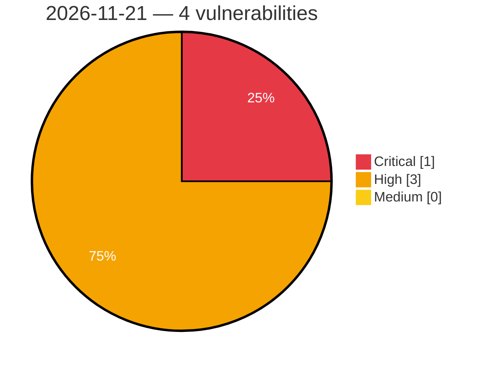

# Critical, High & Medium Severity Vulnerabilities — 2026-11-21

**Source status for this day:**

| Source | Critical | High | Medium | Total |
|--------|---------:|-----:|-------:|------:|
| cvefeed.io (High/Critical) | 1 | 3 | 0 | 4 |

**KEV (actively exploited):** 0  **Watchlist matches:** 2

## Critical (1)

| CVSS | Flags | Source | CVE / Title | Reported |
|------|-------|--------|-------------|----------|
| 9.8 | ⭐ | cvefeed.io (High/Critical) | [CVE-2026-120539 - Restrictions for BuddyPress <= 1.5.4 - Unauthenticated Remote Code Execution via Request URI String Interpolation in eval()](https://cvefeed.io/vuln/detail/CVE-2026-120539) | 1 hour, 16 minutes ago |

## High (3)

| CVSS | Flags | Source | CVE / Title | Reported |
|------|-------|--------|-------------|----------|
| 8.8 | — | cvefeed.io (High/Critical) | [CVE-2026-129220 - Everest Forms <= 3.6.4 - Authenticated (Custom+) Missing Authorization to Arbitrary Plugin Activation via 'moduleData' Parameter](https://cvefeed.io/vuln/detail/CVE-2026-129220) | 16 minutes ago |
| 8.8 | — | cvefeed.io (High/Critical) | [CVE-2026-19793 - WP Import Export Lite <= 3.9.32 - Unauthenticated Stored Code Execution via Placeholder Substitution in Imported Comment Content](https://cvefeed.io/vuln/detail/CVE-2026-19793) | 3 hours, 15 minutes ago |
| 8.1 | ⭐ | cvefeed.io (High/Critical) | [CVE-2026-123086 - PublishPress Revisions: Duplicate Posts, Submit, Approve and Schedule Content Changes <= 4.3.4 - Missing Authorization to Authenticated (Contributor+) Arbitrary Post Deletion via 'pp_revisions_deleted' Parameter](https://cvefeed.io/vuln/detail/CVE-2026-123086) | 16 minutes ago |
