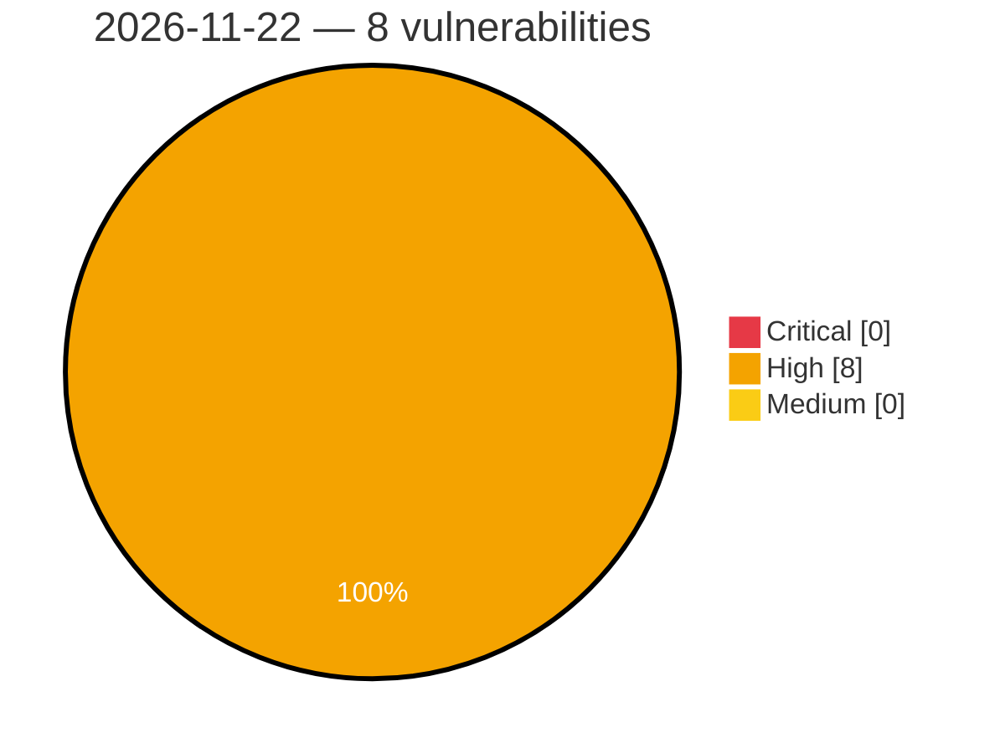

# Critical, High & Medium Severity Vulnerabilities — 2026-11-22

**Source status for this day:**

| Source | Critical | High | Medium | Total |
|--------|---------:|-----:|-------:|------:|
| cvefeed.io (High/Critical) | 0 | 8 | 0 | 8 |

**KEV (actively exploited):** 0  **Watchlist matches:** 4

## High (8)

| CVSS | Flags | Source | CVE / Title | Reported |
|------|-------|--------|-------------|----------|
| 8.8 | ⭐ | cvefeed.io (High/Critical) | [CVE-2026-131707 - WordPress ProfileGrid plugin <= 6.0.0.6 - PHP Object Injection vulnerability](https://cvefeed.io/vuln/detail/CVE-2026-131707) | 4 hours, 41 minutes ago |
| 8.7 | — | cvefeed.io (High/Critical) | [CVE-2026-134679 - WeddingShare through 1.8.2 Missing Authorization via MediaViewer GalleryItem](https://cvefeed.io/vuln/detail/CVE-2026-134679) | 5 hours, 30 minutes ago |
| 8.6 | — | cvefeed.io (High/Critical) | [CVE-2026-134654 - Mailflare before 48957fb Host Header Injection in Password Reset](https://cvefeed.io/vuln/detail/CVE-2026-134654) | 5 hours, 30 minutes ago |
| 8.5 | ⭐ | cvefeed.io (High/Critical) | [CVE-2026-134704 - OpenShot Video Editor through 4.1.1 Deserialization via Legacy Project Import](https://cvefeed.io/vuln/detail/CVE-2026-134704) | 5 hours, 30 minutes ago |
| 8.5 | — | cvefeed.io (High/Critical) | [CVE-2026-134694 - Gammapy through 2.1 Code Injection via WCSSHAPE FITS Header Card](https://cvefeed.io/vuln/detail/CVE-2026-134694) | 5 hours, 30 minutes ago |
| 8.5 | ⭐ | cvefeed.io (High/Critical) | [CVE-2026-131701 - WordPress WP Media folder plugin <= 6.2.8 - SQL Injection vulnerability](https://cvefeed.io/vuln/detail/CVE-2026-131701) | 3 hours, 41 minutes ago |
| 8.5 | ⭐ | cvefeed.io (High/Critical) | [CVE-2026-131705 - WordPress ProfileGrid plugin <= 6.0.0.6 - SQL Injection vulnerability](https://cvefeed.io/vuln/detail/CVE-2026-131705) | 4 hours, 41 minutes ago |
| 8.3 | — | cvefeed.io (High/Critical) | [CVE-2026-134753 - dsniff through 2.5a2 Integer Underflow Out-of-Bounds Write via decode_sniffer()](https://cvefeed.io/vuln/detail/CVE-2026-134753) | 41 minutes ago |
