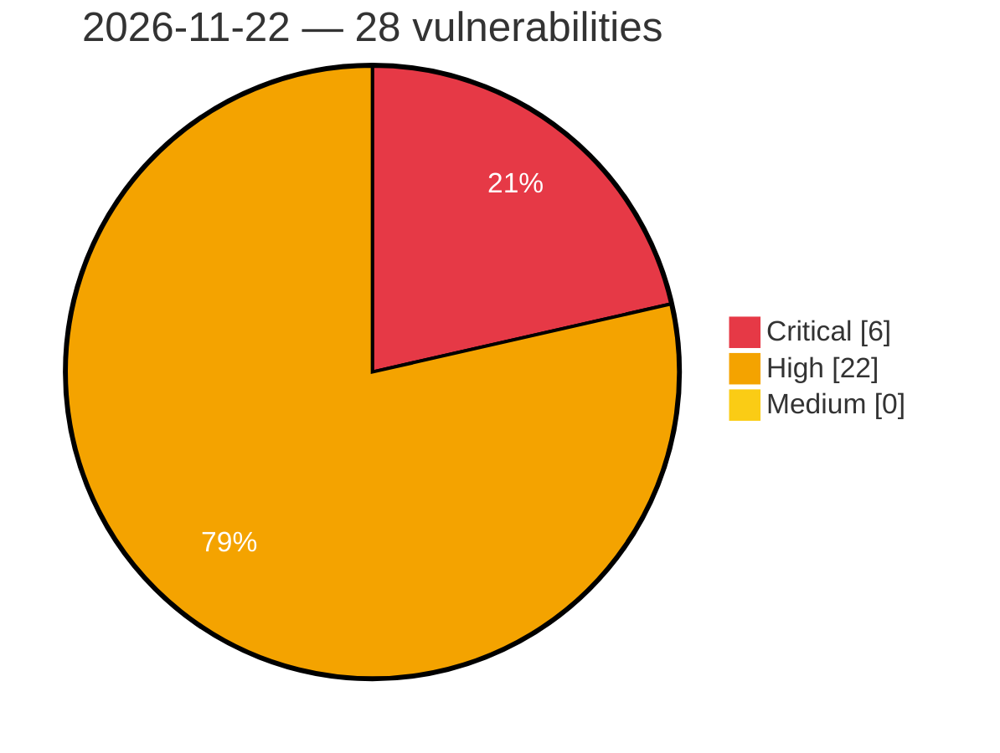

# Critical, High & Medium Severity Vulnerabilities — 2026-11-22

**Source status for this day:**

| Source | Critical | High | Medium | Total |
|--------|---------:|-----:|-------:|------:|
| cvefeed.io (High/Critical) | 6 | 22 | 0 | 28 |

**KEV (actively exploited):** 0  **Watchlist matches:** 17

## Critical (6)

| CVSS | Flags | Source | CVE / Title | Reported |
|------|-------|--------|-------------|----------|
| 9.8 | ⭐ | cvefeed.io (High/Critical) | [CVE-2026-131782 - WordPress Simple Shopping Cart plugin <= 5.3.3 - PHP Object Injection vulnerability](https://cvefeed.io/vuln/detail/CVE-2026-131782) | 6 hours, 32 minutes ago |
| 9.8 | ⭐ | cvefeed.io (High/Critical) | [CVE-2026-131754 - WordPress APCu Manager plugin <= 4.6.1 - PHP Object Injection vulnerability](https://cvefeed.io/vuln/detail/CVE-2026-131754) | 6 hours, 32 minutes ago |
| 9.3 | ⭐ | cvefeed.io (High/Critical) | [CVE-2026-134624 - MailAssure / SpamExperts: Server-Side Request Forgery in relay LDAP synchronisation connection check](https://cvefeed.io/vuln/detail/CVE-2026-134624) | 2 hours, 32 minutes ago |
| 9.2 | — | cvefeed.io (High/Critical) | [CVE-2026-134814 - binary-parser before 2.3.1 Code Injection via String-Typed Parser Options](https://cvefeed.io/vuln/detail/CVE-2026-134814) | 27 minutes ago |
| 9.2 | — | cvefeed.io (High/Critical) | [CVE-2026-134815 - simple-git before 4.1.0 Argument Injection via --exec Option in ls-remote](https://cvefeed.io/vuln/detail/CVE-2026-134815) | 27 minutes ago |
| 9.1 | — | cvefeed.io (High/Critical) | [CVE-2026-134838 - Weblate before 2026.11 Account Takeover via Unicode E-mail Matching in Password Reset](https://cvefeed.io/vuln/detail/CVE-2026-134838) | 27 minutes ago |

## High (22)

| CVSS | Flags | Source | CVE / Title | Reported |
|------|-------|--------|-------------|----------|
| 8.8 | ⭐ | cvefeed.io (High/Critical) | [CVE-2026-131707 - WordPress ProfileGrid plugin <= 6.0.0.6 - PHP Object Injection vulnerability](https://cvefeed.io/vuln/detail/CVE-2026-131707) | 4 hours, 41 minutes ago |
| 8.8 | ⭐ | cvefeed.io (High/Critical) | [CVE-2026-134804 - Portainer 2.39.0 before 2.39.9, 2.40.0 before 2.45.4, and 3.0.0 before 3.1.0 Authorization Bypass via WebSocket Attach and Exec](https://cvefeed.io/vuln/detail/CVE-2026-134804) | 26 minutes ago |
| 8.7 | — | cvefeed.io (High/Critical) | [CVE-2026-134679 - WeddingShare through 1.8.2 Missing Authorization via MediaViewer GalleryItem](https://cvefeed.io/vuln/detail/CVE-2026-134679) | 5 hours, 30 minutes ago |
| 8.7 | ⭐ | cvefeed.io (High/Critical) | [CVE-2026-134765 - Kirby 5.0.0 before 5.6.4 XSS via Chunked Upload Race Condition](https://cvefeed.io/vuln/detail/CVE-2026-134765) | 26 minutes ago |
| 8.7 | — | cvefeed.io (High/Critical) | [CVE-2026-134812 - msgpackr before 2.1.4 Inefficient Algorithmic Complexity via UnpackrStream and decodeIter](https://cvefeed.io/vuln/detail/CVE-2026-134812) | 27 minutes ago |
| 8.7 | ⭐ | cvefeed.io (High/Critical) | [CVE-2026-134813 - Faye websocket-driver 0.5.0 before 0.8.0 Decompression Bomb via permessage-deflate](https://cvefeed.io/vuln/detail/CVE-2026-134813) | 27 minutes ago |
| 8.7 | — | cvefeed.io (High/Critical) | [CVE-2026-134821 - Gunicorn 25.2.0 before 27.0.0 Memory Exhaustion via ASGI HTTP/1 Parser](https://cvefeed.io/vuln/detail/CVE-2026-134821) | 27 minutes ago |
| 8.7 | ⭐ | cvefeed.io (High/Critical) | [CVE-2026-134830 - Casdoor before 4.27.1 Denial of Service via SAML Message Decompression](https://cvefeed.io/vuln/detail/CVE-2026-134830) | 27 minutes ago |
| 8.6 | — | cvefeed.io (High/Critical) | [CVE-2026-134654 - Mailflare before 48957fb Host Header Injection in Password Reset](https://cvefeed.io/vuln/detail/CVE-2026-134654) | 5 hours, 30 minutes ago |
| 8.6 | ⭐ | cvefeed.io (High/Critical) | [CVE-2026-134836 - Dashy 4.0.0 before 4.9.12 Credential Disclosure via isLocalRequest Prefix Check](https://cvefeed.io/vuln/detail/CVE-2026-134836) | 27 minutes ago |
| 8.6 | ⭐ | cvefeed.io (High/Critical) | [CVE-2026-131750 - WordPress Everest Forms plugin <= 3.6.4 - Arbitrary File Deletion vulnerability](https://cvefeed.io/vuln/detail/CVE-2026-131750) | 5 hours, 32 minutes ago |
| 8.6 | ⭐ | cvefeed.io (High/Critical) | [CVE-2026-129024 - WordPress Everest Forms plugin <= 3.6.4 - Arbitrary File Deletion vulnerability](https://cvefeed.io/vuln/detail/CVE-2026-129024) | 5 hours, 32 minutes ago |
| 8.5 | ⭐ | cvefeed.io (High/Critical) | [CVE-2026-134704 - OpenShot Video Editor through 4.1.1 Deserialization via Legacy Project Import](https://cvefeed.io/vuln/detail/CVE-2026-134704) | 5 hours, 30 minutes ago |
| 8.5 | — | cvefeed.io (High/Critical) | [CVE-2026-134694 - Gammapy through 2.1 Code Injection via WCSSHAPE FITS Header Card](https://cvefeed.io/vuln/detail/CVE-2026-134694) | 5 hours, 30 minutes ago |
| 8.5 | ⭐ | cvefeed.io (High/Critical) | [CVE-2026-131701 - WordPress WP Media folder plugin <= 6.2.8 - SQL Injection vulnerability](https://cvefeed.io/vuln/detail/CVE-2026-131701) | 3 hours, 41 minutes ago |
| 8.5 | ⭐ | cvefeed.io (High/Critical) | [CVE-2026-131705 - WordPress ProfileGrid plugin <= 6.0.0.6 - SQL Injection vulnerability](https://cvefeed.io/vuln/detail/CVE-2026-131705) | 4 hours, 41 minutes ago |
| 8.5 | ⭐ | cvefeed.io (High/Critical) | [CVE-2026-134793 - Electerm before 5.9.0 OS Command Injection via Unicode Quotes in PowerShell](https://cvefeed.io/vuln/detail/CVE-2026-134793) | 26 minutes ago |
| 8.3 | — | cvefeed.io (High/Critical) | [CVE-2026-134753 - dsniff through 2.5a2 Integer Underflow Out-of-Bounds Write via decode_sniffer()](https://cvefeed.io/vuln/detail/CVE-2026-134753) | 41 minutes ago |
| 8.3 | ⭐ | cvefeed.io (High/Critical) | [CVE-2026-134825 - Gradio 6.27.0 before 6.32.0 Authentication Bypass via Forged Host Header](https://cvefeed.io/vuln/detail/CVE-2026-134825) | 27 minutes ago |
| 8.3 | — | cvefeed.io (High/Critical) | [CVE-2026-134827 - Lightdash before 3.212.0 Credential Exposure via AI Writeback GitLab Read Access](https://cvefeed.io/vuln/detail/CVE-2026-134827) | 27 minutes ago |
| 8.2 | ⭐ | cvefeed.io (High/Critical) | [CVE-2026-134816 - sigstore-js @sigstore/oci before 0.8.0 Credential Exposure via Cross-Origin Redirect](https://cvefeed.io/vuln/detail/CVE-2026-134816) | 27 minutes ago |
| 8.1 | — | cvefeed.io (High/Critical) | [CVE-2026-134803 - DBHub before 1.7.0 Read-Only Mode Bypass via Backslash-Escaped Quotes](https://cvefeed.io/vuln/detail/CVE-2026-134803) | 26 minutes ago |
