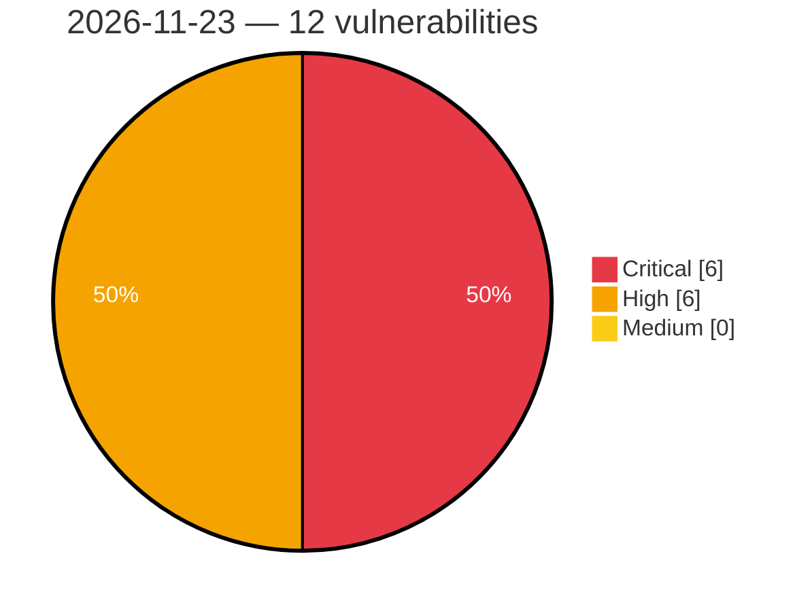

# Critical, High & Medium Severity Vulnerabilities — 2026-11-23

**Source status for this day:**

| Source | Critical | High | Medium | Total |
|--------|---------:|-----:|-------:|------:|
| cvefeed.io (High/Critical) | 6 | 6 | 0 | 12 |

**KEV (actively exploited):** 0  **Watchlist matches:** 10

## Critical (6)

| CVSS | Flags | Source | CVE / Title | Reported |
|------|-------|--------|-------------|----------|
| 10.0 | ⭐ | cvefeed.io (High/Critical) | [CVE-2026-134882 - TOTOLINK A7100RU CGI cstecgi.cgi exportOvpn os command injection](https://cvefeed.io/vuln/detail/CVE-2026-134882) | 1 hour, 41 minutes ago |
| 9.9 | ⭐ | cvefeed.io (High/Critical) | [CVE-2026-115873 - Code injection in the Cribl Stream nested expression compiler](https://cvefeed.io/vuln/detail/CVE-2026-115873) | 1 hour, 41 minutes ago |
| 9.8 | ⭐ | cvefeed.io (High/Critical) | [CVE-2026-121613 - Unauthenticated reboot and firmware replacement](https://cvefeed.io/vuln/detail/CVE-2026-121613) | 41 minutes ago |
| 9.8 | ⭐ | cvefeed.io (High/Critical) | [CVE-2026-115899 - Code injection in Cribl Stream REST Collector pagination](https://cvefeed.io/vuln/detail/CVE-2026-115899) | 1 hour, 41 minutes ago |
| 9.8 | ⭐ | cvefeed.io (High/Critical) | [CVE-2026-120382 - Synology DiskStation Manager OAuth API Command Injection Vulnerability](https://cvefeed.io/vuln/detail/CVE-2026-120382) | 2 hours, 41 minutes ago |
| 9.0 | ⭐ | cvefeed.io (High/Critical) | [CVE-2026-115901 - Cross-site scripting in the Cribl Stream OIDC callback](https://cvefeed.io/vuln/detail/CVE-2026-115901) | 1 hour, 41 minutes ago |

## High (6)

| CVSS | Flags | Source | CVE / Title | Reported |
|------|-------|--------|-------------|----------|
| 8.8 | ⭐ | cvefeed.io (High/Critical) | [CVE-2026-80466 - WAGO: OS Command Injection in WBM Routing Configuration](https://cvefeed.io/vuln/detail/CVE-2026-80466) | 41 minutes ago |
| 8.8 | — | cvefeed.io (High/Critical) | [CVE-2026-123886 - Spring Data Elasticsearch SpEL Expression Injection through String-based Query Method Arguments](https://cvefeed.io/vuln/detail/CVE-2026-123886) | 46 minutes ago |
| 8.8 | ⭐ | cvefeed.io (High/Critical) | [CVE-2026-115900 - Prototype pollution in Cribl Stream Worker heartbeats](https://cvefeed.io/vuln/detail/CVE-2026-115900) | 1 hour, 41 minutes ago |
| 8.7 | — | cvefeed.io (High/Critical) | [CVE-2026-133646 - Out-of-bounds write in Synchronet BBS from synchro.net](https://cvefeed.io/vuln/detail/CVE-2026-133646) | 45 minutes ago |
| 8.6 | ⭐ | cvefeed.io (High/Critical) | [CVE-2026-93584 - Unauthenticated SQL Injection in OTRS External Survey Endpoint](https://cvefeed.io/vuln/detail/CVE-2026-93584) | 1 hour, 41 minutes ago |
| 8.1 | ⭐ | cvefeed.io (High/Critical) | [CVE-2026-88850 - WAGO: Missing Authorization for PROFIBUS Configuration in WBM](https://cvefeed.io/vuln/detail/CVE-2026-88850) | 41 minutes ago |
