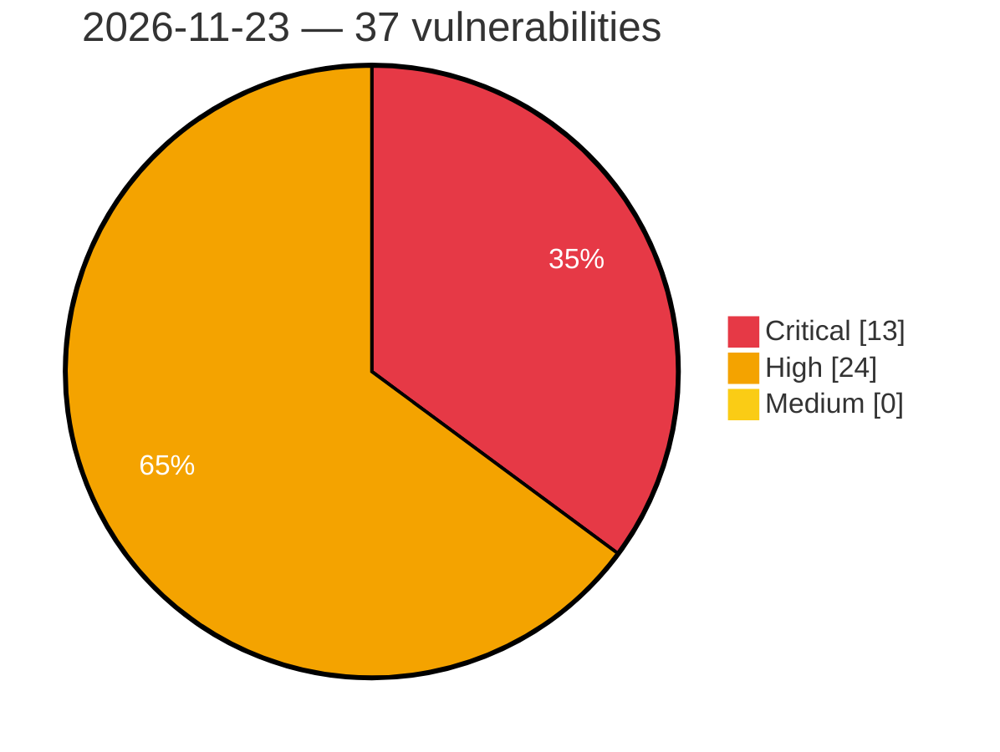

# Critical, High & Medium Severity Vulnerabilities — 2026-11-23

**Source status for this day:**

| Source | Critical | High | Medium | Total |
|--------|---------:|-----:|-------:|------:|
| cvefeed.io (High/Critical) | 13 | 24 | 0 | 37 |

**KEV (actively exploited):** 0  **Watchlist matches:** 25

## Critical (13)

| CVSS | Flags | Source | CVE / Title | Reported |
|------|-------|--------|-------------|----------|
| 10.0 | ⭐ | cvefeed.io (High/Critical) | [CVE-2026-134882 - TOTOLINK A7100RU CGI cstecgi.cgi exportOvpn os command injection](https://cvefeed.io/vuln/detail/CVE-2026-134882) | 1 hour, 41 minutes ago |
| 9.9 | ⭐ | cvefeed.io (High/Critical) | [CVE-2026-115873 - Code injection in the Cribl Stream nested expression compiler](https://cvefeed.io/vuln/detail/CVE-2026-115873) | 1 hour, 41 minutes ago |
| 9.9 | ⭐ | cvefeed.io (High/Critical) | [CVE-2026-103782 - Dell Enterprise SONiC Distribution Argument Injection Vulnerability](https://cvefeed.io/vuln/detail/CVE-2026-103782) | 4 hours, 47 minutes ago |
| 9.8 | ⭐ | cvefeed.io (High/Critical) | [CVE-2026-121613 - Unauthenticated reboot and firmware replacement](https://cvefeed.io/vuln/detail/CVE-2026-121613) | 41 minutes ago |
| 9.8 | ⭐ | cvefeed.io (High/Critical) | [CVE-2026-115899 - Code injection in Cribl Stream REST Collector pagination](https://cvefeed.io/vuln/detail/CVE-2026-115899) | 1 hour, 41 minutes ago |
| 9.8 | ⭐ | cvefeed.io (High/Critical) | [CVE-2026-120382 - Synology DiskStation Manager OAuth API Command Injection Vulnerability](https://cvefeed.io/vuln/detail/CVE-2026-120382) | 2 hours, 41 minutes ago |
| 9.8 | — | cvefeed.io (High/Critical) | [CVE-2026-133469 - Xen Orchestra: Empty-object login token](https://cvefeed.io/vuln/detail/CVE-2026-133469) | 3 hours, 47 minutes ago |
| 9.8 | ⭐ | cvefeed.io (High/Critical) | [CVE-2026-135208 - Kerberos Agent before 3.14.4 Authentication Bypass via Hard-coded JWT Signing Key](https://cvefeed.io/vuln/detail/CVE-2026-135208) | 4 hours, 47 minutes ago |
| 9.6 | ⭐ | cvefeed.io (High/Critical) | [CVE-2026-103788 - Dell Enterprise SONiC Distribution OS Command Injection Vulnerability](https://cvefeed.io/vuln/detail/CVE-2026-103788) | 3 hours, 47 minutes ago |
| 9.2 | ⭐ | cvefeed.io (High/Critical) | [CVE-2026-135211 - BISHENG before 3.0.0 Missing Authentication via /api/v2/workflow/invoke and /stop](https://cvefeed.io/vuln/detail/CVE-2026-135211) | 4 hours, 47 minutes ago |
| 9.1 | ⭐ | cvefeed.io (High/Critical) | [CVE-2026-135429 - Tabbycat 2.9.0 through 2.12.1 Unauthenticated Tournament Modification via REST API](https://cvefeed.io/vuln/detail/CVE-2026-135429) | 2 hours, 47 minutes ago |
| 9.1 | ⭐ | cvefeed.io (High/Critical) | [CVE-2026-135300 - Pomerium 0.30.0 before 0.34.0 Missing Client Secret Verification via MCP Token Endpoint](https://cvefeed.io/vuln/detail/CVE-2026-135300) | 3 hours, 47 minutes ago |
| 9.0 | ⭐ | cvefeed.io (High/Critical) | [CVE-2026-115901 - Cross-site scripting in the Cribl Stream OIDC callback](https://cvefeed.io/vuln/detail/CVE-2026-115901) | 1 hour, 41 minutes ago |

## High (24)

| CVSS | Flags | Source | CVE / Title | Reported |
|------|-------|--------|-------------|----------|
| 8.8 | ⭐ | cvefeed.io (High/Critical) | [CVE-2026-80466 - WAGO: OS Command Injection in WBM Routing Configuration](https://cvefeed.io/vuln/detail/CVE-2026-80466) | 41 minutes ago |
| 8.8 | — | cvefeed.io (High/Critical) | [CVE-2026-123886 - Spring Data Elasticsearch SpEL Expression Injection through String-based Query Method Arguments](https://cvefeed.io/vuln/detail/CVE-2026-123886) | 46 minutes ago |
| 8.8 | ⭐ | cvefeed.io (High/Critical) | [CVE-2026-115900 - Prototype pollution in Cribl Stream Worker heartbeats](https://cvefeed.io/vuln/detail/CVE-2026-115900) | 1 hour, 41 minutes ago |
| 8.8 | ⭐ | cvefeed.io (High/Critical) | [CVE-2026-95793 - HPE Morpheus Manager Remote Code Execution Vulnerability](https://cvefeed.io/vuln/detail/CVE-2026-95793) | 46 minutes ago |
| 8.8 | ⭐ | cvefeed.io (High/Critical) | [CVE-2026-135436 - KindleEar 3.0.0 through 3.5.3 Authenticated RCE via Recipe Upload](https://cvefeed.io/vuln/detail/CVE-2026-135436) | 2 hours, 47 minutes ago |
| 8.7 | — | cvefeed.io (High/Critical) | [CVE-2026-133646 - Out-of-bounds write in Synchronet BBS from synchro.net](https://cvefeed.io/vuln/detail/CVE-2026-133646) | 45 minutes ago |
| 8.7 | ⭐ | cvefeed.io (High/Critical) | [CVE-2026-135470 - WPC Product Options for WooCommerce before 4.0.9 Price Manipulation](https://cvefeed.io/vuln/detail/CVE-2026-135470) | 46 minutes ago |
| 8.7 | ⭐ | cvefeed.io (High/Critical) | [CVE-2026-135446 - Bold pagos en linea before 3.5.1 Payment Bypass via Webhook Signature](https://cvefeed.io/vuln/detail/CVE-2026-135446) | 2 hours, 47 minutes ago |
| 8.7 | — | cvefeed.io (High/Critical) | [CVE-2026-135249 - MISP Unauthenticated Decompression Bomb via Compressed Request Bodies](https://cvefeed.io/vuln/detail/CVE-2026-135249) | 4 hours, 47 minutes ago |
| 8.6 | ⭐ | cvefeed.io (High/Critical) | [CVE-2026-93584 - Unauthenticated SQL Injection in OTRS External Survey Endpoint](https://cvefeed.io/vuln/detail/CVE-2026-93584) | 1 hour, 41 minutes ago |
| 8.6 | ⭐ | cvefeed.io (High/Critical) | [CVE-2026-127224 - GFI HelpDesk before 4.99.13 SQL Injection via Archiver ExportAll](https://cvefeed.io/vuln/detail/CVE-2026-127224) | 2 hours, 47 minutes ago |
| 8.6 | ⭐ | cvefeed.io (High/Critical) | [CVE-2026-127223 - GFI HelpDesk before 4.99.13 SQL Injection via StaffGroup InsertSubmit](https://cvefeed.io/vuln/detail/CVE-2026-127223) | 2 hours, 47 minutes ago |
| 8.5 | — | cvefeed.io (High/Critical) | [CVE-2026-135433 - FLTK through 1.4.5 Heap Buffer Overflow via Fl_BMP_Image Row Pointer](https://cvefeed.io/vuln/detail/CVE-2026-135433) | 2 hours, 47 minutes ago |
| 8.5 | — | cvefeed.io (High/Critical) | [CVE-2026-135295 - FontForge through 20251009 Heap Out-of-Bounds Write via PCF Encodings Table](https://cvefeed.io/vuln/detail/CVE-2026-135295) | 3 hours, 47 minutes ago |
| 8.4 | — | cvefeed.io (High/Critical) | [CVE-2026-135452 - HP Hotkey UWP Service – Escalation of Privilege](https://cvefeed.io/vuln/detail/CVE-2026-135452) | 1 hour, 47 minutes ago |
| 8.3 | ⭐ | cvefeed.io (High/Critical) | [CVE-2026-134056 - Out-of-bounds write in padded block cipher decryption in AWS-LC](https://cvefeed.io/vuln/detail/CVE-2026-134056) | 47 minutes ago |
| 8.3 | — | cvefeed.io (High/Critical) | [CVE-2026-135292 - Contiki-NG through 5.2 Out-of-Bounds Write via MPL Seed ID Length](https://cvefeed.io/vuln/detail/CVE-2026-135292) | 3 hours, 47 minutes ago |
| 8.3 | — | cvefeed.io (High/Critical) | [CVE-2026-135239 - MISP Authorization Bypass Allows Non-Privileged Users to Attribute Data to Arbitrary Organisations](https://cvefeed.io/vuln/detail/CVE-2026-135239) | 4 hours, 47 minutes ago |
| 8.2 | ⭐ | cvefeed.io (High/Critical) | [CVE-2026-103783 - Dell Enterprise Sonic Distribution OS Command Injection Vulnerability](https://cvefeed.io/vuln/detail/CVE-2026-103783) | 3 hours, 47 minutes ago |
| 8.2 | ⭐ | cvefeed.io (High/Critical) | [CVE-2026-101218 - Dell Enterprise Sonic Distribution OS Command Injection Vulnerability](https://cvefeed.io/vuln/detail/CVE-2026-101218) | 3 hours, 47 minutes ago |
| 8.1 | ⭐ | cvefeed.io (High/Critical) | [CVE-2026-88850 - WAGO: Missing Authorization for PROFIBUS Configuration in WBM](https://cvefeed.io/vuln/detail/CVE-2026-88850) | 41 minutes ago |
| 8.1 | — | cvefeed.io (High/Critical) | [CVE-2026-134842 - pgjdbc simple query mode quotes parameters for the wrong standard_conforming_strings value](https://cvefeed.io/vuln/detail/CVE-2026-134842) | 3 hours, 47 minutes ago |
| 8.1 | — | cvefeed.io (High/Critical) | [CVE-2026-134841 - pgjdbc parses quoted text as SQL in JDBC escapes, dollar quotes and E strings](https://cvefeed.io/vuln/detail/CVE-2026-134841) | 3 hours, 47 minutes ago |
| 8.1 | — | cvefeed.io (High/Critical) | [CVE-2026-129975 - Gpgme: gpgme: double free in read_status() via crafted signature](https://cvefeed.io/vuln/detail/CVE-2026-129975) | 4 hours, 47 minutes ago |
